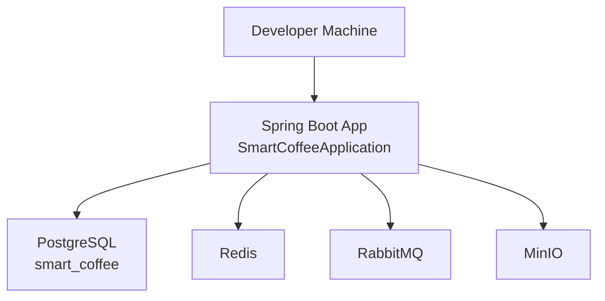
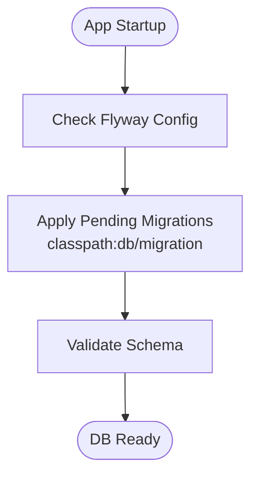

# Getting Started

<cite>
**Referenced Files in This Document**
- [pom.xml](file://pom.xml)
- [compose.yaml](file://compose.yaml)
- [Dockerfile](file://Dockerfile)
- [application.yml](file://src/main/resources/application.yml)
- [SmartCoffeeApplication.java](file://src/main/java/com/smartcoffee/SmartCoffeeApplication.java)
- [V001__identity_auth_rbac.sql](file://src/main/resources/db/migration/V001__identity_auth_rbac.sql)
</cite>

## Table of Contents
1. [Introduction](#introduction)
2. [Prerequisites](#prerequisites)
3. [Project Structure](#project-structure)
4. [Local Development Environment](#local-development-environment)
5. [Database Initialization with Flyway](#database-initialization-with-flyway)
6. [Running the Application Locally](#running-the-application-locally)
7. [Environment Variables Reference](#environment-variables-reference)
8. [Verifying the Installation](#verifying-the-installation)
9. [Basic API Testing Examples](#basic-api-testing-examples)
10. [Troubleshooting Guide](#troubleshooting-guide)
11. [Conclusion](#conclusion)

## Introduction
This guide helps you set up and run the Smart Coffee Backend locally. You will install prerequisites, start required infrastructure using Docker Compose, initialize the database schema via Flyway migrations, configure environment variables, and verify that the application is healthy. It also includes basic API testing examples and troubleshooting tips for common setup issues.

## Prerequisites
- Java 26 (required by the project build)
- Maven 3.x
- Docker and Docker Compose
- A terminal or command-line interface

The project declares Java 26 as the target version and uses Spring Boot 4.1.1. The Dockerfile builds with JDK 17, but the runtime JRE image is JDK 17; ensure your local development toolchain matches the project’s declared Java version.

**Section sources**
- [pom.xml:14-19](file://pom.xml#L14-L19)
- [pom.xml:36-56](file://pom.xml#L36-L56)
- [Dockerfile:1-11](file://Dockerfile#L1-L11)

## Project Structure
At a high level:
- src/main/java contains the Spring Boot application and modules
- src/main/resources holds configuration and Flyway migration scripts
- compose.yaml defines local infrastructure services (PostgreSQL, Redis, RabbitMQ, MinIO)
- Dockerfile builds a containerized application artifact
- pom.xml defines dependencies, plugins, and build settings

**Diagram sources**
- [SmartCoffeeApplication.java:5-8](file://src/main/java/com/smartcoffee/SmartCoffeeApplication.java#L5-L8)
- [compose.yaml:1-71](file://compose.yaml#L1-L71)

**Section sources**
- [SmartCoffeeApplication.java:1-11](file://src/main/java/com/smartcoffee/SmartCoffeeApplication.java#L1-L11)
- [compose.yaml:1-71](file://compose.yaml#L1-L71)

## Local Development Environment
Follow these steps to prepare your environment:

1. Install Java 26 and Maven 3.x on your machine.
2. Install Docker and Docker Compose.
3. Clone the repository into your workspace.
4. Verify Maven can resolve dependencies:
   - Run a clean compile to validate the build toolchain.

If you prefer running the app directly from source, ensure your IDE is configured to use Java 26.

**Section sources**
- [pom.xml:36-56](file://pom.xml#L36-L56)

## Database Initialization with Flyway
Flyway manages database schema changes. Migrations are located under src/main/resources/db/migration. On startup, the application applies pending migrations against PostgreSQL.

Key points:
- The default profile is local.
- Flyway is enabled and scans classpath:db/migration.
- Validation is enforced on migrate, and cleaning is disabled.
- The first migration creates the identity schema and core tables for users, credentials, roles, permissions, role-permission mappings, user-role assignments, and auth sessions.

**Diagram sources**
- [application.yml:33-37](file://src/main/resources/application.yml#L33-L37)
- [V001__identity_auth_rbac.sql:1-135](file://src/main/resources/db/migration/V001__identity_auth_rbac.sql#L1-L135)

**Section sources**
- [application.yml:33-37](file://src/main/resources/application.yml#L33-L37)
- [V001__identity_auth_rbac.sql:1-135](file://src/main/resources/db/migration/V001__identity_auth_rbac.sql#L1-L135)

## Running the Application Locally
You can run the backend using Docker Compose. This starts the application together with its dependencies.

Steps:
1. Ensure Docker is running.
2. From the repository root, start all services:
   - docker compose up
3. Wait until PostgreSQL, Redis, RabbitMQ, and MinIO are healthy.
4. The Spring Boot application will auto-connect to the services and apply Flyway migrations.

Notes:
- PostgreSQL is exposed on port 5433.
- Redis is exposed on port 6379.
- RabbitMQ management UI is available at http://localhost:15672 with guest/guest.
- MinIO console is available at http://localhost:9001 with minioadmin/minioadmin.

To stop services:
- docker compose down

To rebuild and restart:
- docker compose up --build

**Section sources**
- [compose.yaml:1-71](file://compose.yaml#L1-L71)

## Environment Variables Reference
The application reads configuration from application.yml and supports overriding values via environment variables.

Core variables:
- DATABASE_URL: JDBC URL for PostgreSQL (default uses localhost:5433)
- DATABASE_USERNAME: Database username (default smart_coffee)
- DATABASE_PASSWORD: Database password (default smart_coffee)
- MINIO_ENDPOINT: MinIO endpoint (default http://localhost:9000)
- MINIO_ACCESS_KEY: MinIO access key (default minioadmin)
- MINIO_SECRET_KEY: MinIO secret key (default minioadmin)
- JWT_HMAC_SECRET_BASE64: HMAC secret for JWT tokens (development-only default provided)
- CATALOG_PUBLIC_IMAGE_BASE_URL: Base URL for catalog images
- WEBSOCKET_ALLOWED_ORIGINS: Allowed WebSocket origins (default http://localhost:3000)
- RECEIPT_BUCKET: MinIO bucket name for receipts (default receipts)

Additional defaults:
- RabbitMQ publisher confirm type and returns are enabled.
- Actuator endpoints health, info, metrics, and prometheus are exposed.

**Section sources**
- [application.yml:17-21](file://src/main/resources/application.yml#L17-L21)
- [application.yml:43-80](file://src/main/resources/application.yml#L43-L80)
- [application.yml:81-93](file://src/main/resources/application.yml#L81-L93)

## Verifying the Installation
After starting the application:

1. Health check:
   - curl http://localhost:8080/actuator/health
   - Expect a JSON response indicating UP status.

2. OpenAPI documentation:
   - Visit http://localhost:8080/swagger-ui.html to explore available APIs.

3. Infrastructure checks:
   - PostgreSQL: psql -h 127.0.0.1 -p 5433 -U smart_coffee -d smart_coffee
   - Redis: redis-cli -h 127.0.0.1 -p 6379 ping
   - RabbitMQ: http://localhost:15672 (guest/guest)
   - MinIO Console: http://localhost:9001 (minioadmin/minioadmin)

**Section sources**
- [application.yml:81-93](file://src/main/resources/application.yml#L81-L93)
- [compose.yaml:1-71](file://compose.yaml#L1-L71)

## Basic API Testing Examples
Use curl or Postman to test the following endpoints after the application is running.

- Health check
  - GET http://localhost:8080/actuator/health

- OpenAPI UI
  - GET http://localhost:8080/swagger-ui.html

- Authentication endpoints
  - POST http://localhost:8080/api/auth/register
    - Body: JSON with registration fields
  - POST http://localhost:8080/api/auth/login
    - Body: JSON with login credentials
  - Use the returned token in subsequent requests via Authorization header.

- Catalog endpoints
  - GET http://localhost:8080/api/categories
  - GET http://localhost:8080/api/products

- Cart endpoints
  - GET http://localhost:8080/api/cart
  - POST http://localhost:8080/api/cart/items
  - PUT http://localhost:8080/api/cart/items/{id}

- Order endpoints
  - POST http://localhost:8080/api/orders

- Payment endpoints
  - GET http://localhost:8080/api/payment-methods
  - POST http://localhost:8080/api/payments

- Production endpoints
  - GET http://localhost:8080/api/production/tickets
  - POST http://localhost:8080/api/production/tickets/{id}/actions

- Inventory endpoints
  - GET http://localhost:8080/api/inventory/balance
  - GET http://localhost:8080/api/inventory/uom

- Notification endpoints
  - GET http://localhost:8080/api/notifications
  - GET http://localhost:8080/api/notifications/unread-count

- Identity endpoints
  - GET http://localhost:8080/api/users/me

- Audit endpoints
  - GET http://localhost:8080/api/audit/logs

For authenticated endpoints, include the Authorization header with the bearer token obtained from login.

Note: If you encounter 401 Unauthorized responses, ensure you have successfully logged in and included the correct token.

**Section sources**
- [application.yml:81-93](file://src/main/resources/application.yml#L81-L93)

## Troubleshooting Guide
Common issues and resolutions:

- Port conflicts
  - Symptom: Docker fails to bind ports.
  - Resolution: Stop other processes using ports 5433, 6379, 5672, 15672, 9000, 9001, or change compose.yaml ports accordingly.

- Database connection failures
  - Symptom: Application cannot connect to PostgreSQL.
  - Resolution:
    - Verify PostgreSQL is running and accessible at 127.0.0.1:5433.
    - Confirm DATABASE_URL, DATABASE_USERNAME, and DATABASE_PASSWORD match compose.yaml settings.
    - Ensure Flyway migrations ran successfully.

- Redis connectivity issues
  - Symptom: Cache operations fail.
  - Resolution:
    - Verify Redis is running on 127.0.0.1:6379.
    - Check spring.data.redis properties if overridden.

- RabbitMQ not reachable
  - Symptom: Messaging errors or consumers not starting.
  - Resolution:
    - Verify RabbitMQ is running and accessible at 127.0.0.1:5672.
    - Confirm RabbitMQ credentials if customized.

- MinIO storage errors
  - Symptom: Upload/download or signed URL generation fails.
  - Resolution:
    - Verify MinIO is running and accessible at 127.0.0.1:9000.
    - Confirm MINIO_ENDPOINT, MINIO_ACCESS_KEY, and MINIO_SECRET_KEY.
    - Ensure the configured bucket exists (e.g., receipts).

- JWT authentication failures
  - Symptom: 401 Unauthorized or invalid token errors.
  - Resolution:
    - Ensure JWT_HMAC_SECRET_BASE64 is set correctly.
    - Re-login to obtain a fresh token.

- Build or runtime Java version mismatch
  - Symptom: Compilation or runtime errors related to Java version.
  - Resolution:
    - Use Java 26 for development as declared in the project.
    - Align IDE and CLI toolchains with Java 26.

- Docker build issues
  - Symptom: Dockerfile fails during build.
  - Resolution:
    - Ensure Docker is running and has sufficient resources.
    - Rebuild with docker compose up --build.

**Section sources**
- [compose.yaml:1-71](file://compose.yaml#L1-L71)
- [application.yml:17-21](file://src/main/resources/application.yml#L17-L21)
- [application.yml:43-80](file://src/main/resources/application.yml#L43-L80)

## Conclusion
You now have the Smart Coffee Backend running locally with PostgreSQL, Redis, RabbitMQ, and MinIO. Use the provided API examples to explore functionality, and refer to the troubleshooting section if you encounter setup issues. For further details on architecture and module design, consult the architecture documents in the repository.