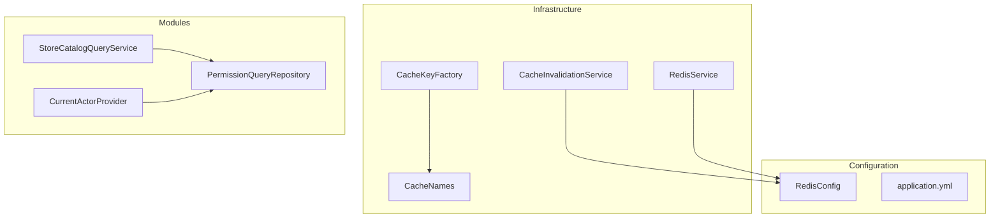
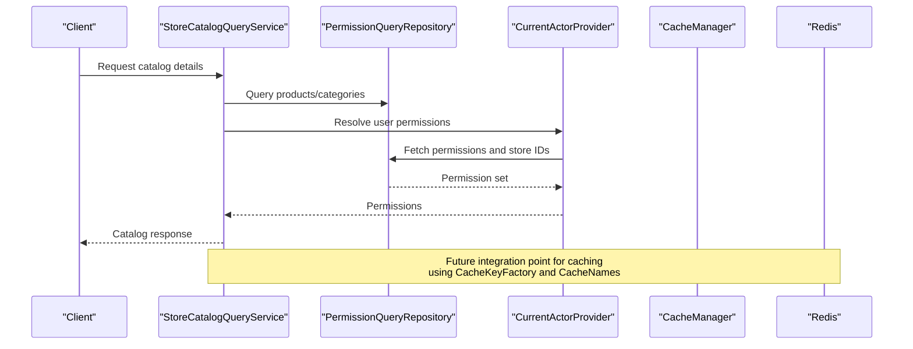
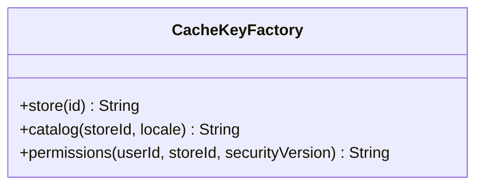
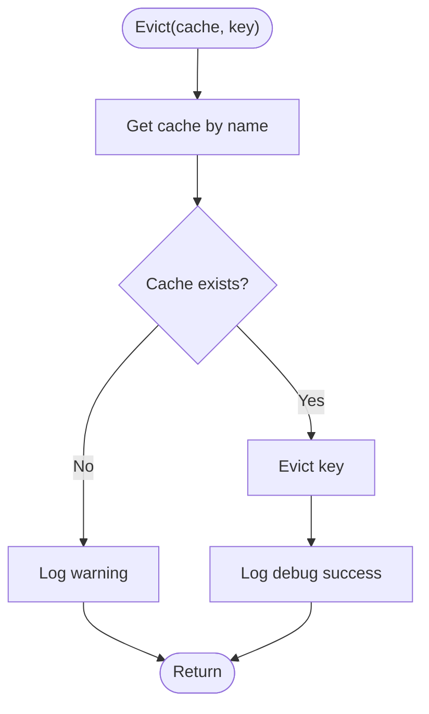
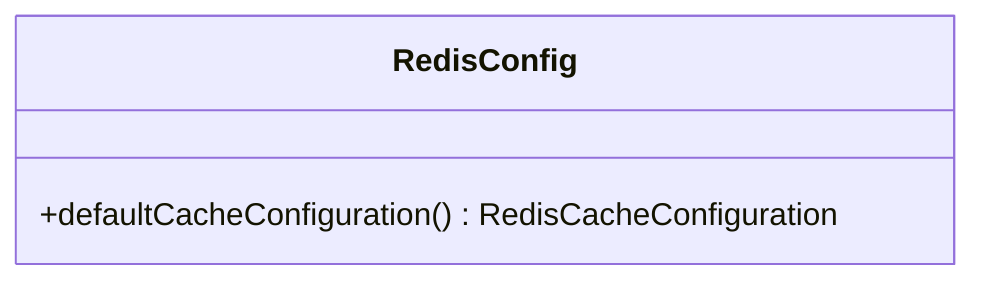
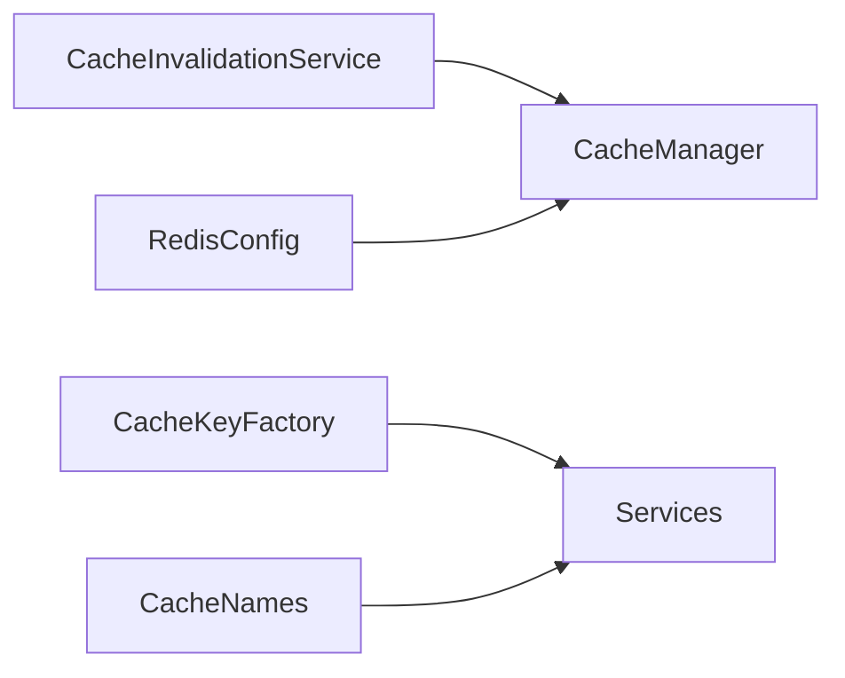

# Caching Layer

<cite>
**Referenced Files in This Document**
- [CacheKeyFactory.java](file://src/main/java/com/smartcoffee/infrastructure/cache/CacheKeyFactory.java)
- [CacheNames.java](file://src/main/java/com/smartcoffee/infrastructure/cache/CacheNames.java)
- [RedisService.java](file://src/main/java/com/smartcoffee/infrastructure/cache/RedisService.java)
- [CacheInvalidationService.java](file://src/main/java/com/smartcoffee/infrastructure/cache/CacheInvalidationService.java)
- [RedisConfig.java](file://src/main/java/com/smartcoffee/config/RedisConfig.java)
- [application.yml](file://src/main/resources/application.yml)
- [StoreCatalogQueryService.java](file://src/main/java/com/smartcoffee/modules/catalog/application/StoreCatalogQueryService.java)
- [PermissionQueryRepository.java](file://src/main/java/com/smartcoffee/modules/rbac/persistence/PermissionQueryRepository.java)
- [CurrentActorProvider.java](file://src/main/java/com/smartcoffee/common/security/CurrentActorProvider.java)
- [RedisDegradationIT.java](file://src/test/java/com/smartcoffee/infrastructure/RedisDegradationIT.java)
</cite>

## Table of Contents
1. Introduction
2. Project Structure
3. Core Components
4. Architecture Overview
5. Detailed Component Analysis
6. Dependency Analysis
7. Performance Considerations
8. Troubleshooting Guide
9. Conclusion

## Introduction
This document describes the Redis-based caching layer in Smart Coffee Backend. It focuses on cache key generation, cache organization, core operations, and invalidation strategies. It also outlines recommended cache strategies, TTL policies, cache warming techniques, configuration options for Redis connection pooling and memory management, and guidance for troubleshooting common issues such as cache stampedes and memory leaks.

The current codebase provides:
- A cache key factory for consistent key construction
- Centralized cache names for logical grouping
- A placeholder service for Redis operations
- A cache invalidation service backed by Spring Cache
- A default Redis cache configuration with a global TTL

## Project Structure
The caching-related components are located under infrastructure.cache and config:
- infrastructure.cache: CacheKeyFactory, CacheNames, RedisService, CacheInvalidationService
- config: RedisConfig (Spring Cache + Redis defaults)
- application.yml: Application-level properties (no explicit Redis connection settings present)

**Diagram sources**
- [CacheKeyFactory.java:1-5](file://src/main/java/com/smartcoffee/infrastructure/cache/CacheKeyFactory.java#L1-L5)
- [CacheNames.java:1-4](file://src/main/java/com/smartcoffee/infrastructure/cache/CacheNames.java#L1-L4)
- [RedisService.java:1-9](file://src/main/java/com/smartcoffee/infrastructure/cache/RedisService.java#L1-L9)
- [CacheInvalidationService.java:1-28](file://src/main/java/com/smartcoffee/infrastructure/cache/CacheInvalidationService.java#L1-L28)
- [RedisConfig.java:1-5](file://src/main/java/com/smartcoffee/config/RedisConfig.java#L1-L5)
- [application.yml:1-93](file://src/main/resources/application.yml#L1-L93)
- [StoreCatalogQueryService.java:1-67](file://src/main/java/com/smartcoffee/modules/catalog/application/StoreCatalogQueryService.java#L1-L67)
- [PermissionQueryRepository.java:1-21](file://src/main/java/com/smartcoffee/modules/rbac/persistence/PermissionQueryRepository.java#L1-L21)
- [CurrentActorProvider.java:1-40](file://src/main/java/com/smartcoffee/common/security/CurrentActorProvider.java#L1-L40)

**Section sources**
- [CacheKeyFactory.java:1-5](file://src/main/java/com/smartcoffee/infrastructure/cache/CacheKeyFactory.java#L1-L5)
- [CacheNames.java:1-4](file://src/main/java/com/smartcoffee/infrastructure/cache/CacheNames.java#L1-L4)
- [RedisService.java:1-9](file://src/main/java/com/smartcoffee/infrastructure/cache/RedisService.java#L1-L9)
- [CacheInvalidationService.java:1-28](file://src/main/java/com/smartcoffee/infrastructure/cache/CacheInvalidationService.java#L1-L28)
- [RedisConfig.java:1-5](file://src/main/java/com/smartcoffee/config/RedisConfig.java#L1-L5)
- [application.yml:1-93](file://src/main/resources/application.yml#L1-L93)

## Core Components
- CacheKeyFactory: Generates consistent, domain-scoped cache keys for stores, catalogs, and permissions.
- CacheNames: Centralizes logical cache group names (e.g., store, store-catalog, product, permissions).
- RedisService: Placeholder for future Redis-specific operations; currently empty.
- CacheInvalidationService: Evicts entries from named caches via Spring’s CacheManager.
- RedisConfig: Enables caching and sets a default TTL of 10 minutes; disables caching null values.

Usage patterns:
- Use CacheKeyFactory to build keys that include entity identifiers and contextual attributes (e.g., locale, security version).
- Use CacheNames to reference logical caches consistently across modules.
- Use CacheInvalidationService to evict stale entries after writes or permission changes.

**Section sources**
- [CacheKeyFactory.java:1-5](file://src/main/java/com/smartcoffee/infrastructure/cache/CacheKeyFactory.java#L1-L5)
- [CacheNames.java:1-4](file://src/main/java/com/smartcoffee/infrastructure/cache/CacheNames.java#L1-L4)
- [RedisService.java:1-9](file://src/main/java/com/smartcoffee/infrastructure/cache/RedisService.java#L1-L9)
- [CacheInvalidationService.java:1-28](file://src/main/java/com/smartcoffee/infrastructure/cache/CacheInvalidationService.java#L1-L28)
- [RedisConfig.java:1-5](file://src/main/java/com/smartcoffee/config/RedisConfig.java#L1-L5)

## Architecture Overview
The caching architecture centers around Spring Cache with Redis as the backing store. The default configuration applies a global TTL and prevents caching nulls. Cache keys are generated centrally to ensure consistency. Invalidation is performed explicitly through CacheInvalidationService.

**Diagram sources**
- [StoreCatalogQueryService.java:1-67](file://src/main/java/com/smartcoffee/modules/catalog/application/StoreCatalogQueryService.java#L1-L67)
- [PermissionQueryRepository.java:1-21](file://src/main/java/com/smartcoffee/modules/rbac/persistence/PermissionQueryRepository.java#L1-L21)
- [CurrentActorProvider.java:1-40](file://src/main/java/com/smartcoffee/common/security/CurrentActorProvider.java#L1-L40)

## Detailed Component Analysis

### CacheKeyFactory
Purpose:
- Provide deterministic, namespaced cache keys for entities and contexts.
- Include relevant dimensions (store ID, locale, security version) to avoid cross-context collisions.

Key methods:
- store(UUID): Key for store-level data.
- catalog(UUID, String): Key for store catalog scoped by locale.
- permissions(UUID, UUID, long): Key for permissions scoped by user, store, and security version.

Design notes:
- Keys are simple string concatenations with clear prefixes and separators.
- Security versioning ensures permission caches invalidate when authorization state changes.

**Diagram sources**
- [CacheKeyFactory.java:1-5](file://src/main/java/com/smartcoffee/infrastructure/cache/CacheKeyFactory.java#L1-L5)

**Section sources**
- [CacheKeyFactory.java:1-5](file://src/main/java/com/smartcoffee/infrastructure/cache/CacheKeyFactory.java#L1-L5)

### CacheNames
Purpose:
- Centralize cache group names to avoid typos and improve maintainability.

Defined groups:
- STORE
- STORE_CATALOG
- PRODUCT
- PERMISSIONS

Usage:
- Reference these constants wherever cache operations occur to ensure consistency.

**Section sources**
- [CacheNames.java:1-4](file://src/main/java/com/smartcoffee/infrastructure/cache/CacheNames.java#L1-L4)

### RedisService
Status:
- Currently an empty service placeholder.

Recommendations:
- Implement Redis-specific operations (e.g., get/set/delete, pipeline, Lua scripts) if direct Redis access is required beyond Spring Cache.
- Integrate with RedisConfig for connection and serialization settings.

**Section sources**
- [RedisService.java:1-9](file://src/main/java/com/smartcoffee/infrastructure/cache/RedisService.java#L1-L9)

### CacheInvalidationService
Responsibilities:
- Evict entries from named caches using CacheManager.
- Log warnings when attempting to evict from non-existent caches.

Behavior:
- Safe eviction: checks cache existence before evicting.
- Debug logging for successful evictions.

**Diagram sources**
- [CacheInvalidationService.java:1-28](file://src/main/java/com/smartcoffee/infrastructure/cache/CacheInvalidationService.java#L1-L28)

**Section sources**
- [CacheInvalidationService.java:1-28](file://src/main/java/com/smartcoffee/infrastructure/cache/CacheInvalidationService.java#L1-L28)

### RedisConfig
Configuration highlights:
- Enables Spring caching.
- Sets default TTL to 10 minutes.
- Disables caching null values.

Implications:
- All caches without explicit overrides inherit the 10-minute TTL.
- Null results are not cached, preventing accidental null poisoning.

**Diagram sources**
- [RedisConfig.java:1-5](file://src/main/java/com/smartcoffee/config/RedisConfig.java#L1-L5)

**Section sources**
- [RedisConfig.java:1-5](file://src/main/java/com/smartcoffee/config/RedisConfig.java#L1-L5)

### Integration Points and Usage Patterns
- StoreCatalogQueryService: Reads catalog data from repositories; suitable candidate for read-through caching keyed by store and locale.
- PermissionQueryRepository and CurrentActorProvider: Frequently accessed authorization data; ideal for permission caching keyed by user/store/security version.

Recommended patterns:
- Read-through caching for catalog queries with keys built via CacheKeyFactory.catalog and grouped under CacheNames.STORE_CATALOG.
- Permission caching with keys built via CacheKeyFactory.permissions and grouped under CacheNames.PERMISSIONS.
- Explicit invalidation via CacheInvalidationService.evict after permission updates or catalog mutations.

**Section sources**
- [StoreCatalogQueryService.java:1-67](file://src/main/java/com/smartcoffee/modules/catalog/application/StoreCatalogQueryService.java#L1-L67)
- [PermissionQueryRepository.java:1-21](file://src/main/java/com/smartcoffee/modules/rbac/persistence/PermissionQueryRepository.java#L1-L21)
- [CurrentActorProvider.java:1-40](file://src/main/java/com/smartcoffee/common/security/CurrentActorProvider.java#L1-L40)

## Dependency Analysis
Caching dependencies and relationships:
- CacheInvalidationService depends on CacheManager (provided by Spring Cache).
- RedisConfig provides default cache configuration used by all caches.
- CacheKeyFactory and CacheNames are utilities consumed by services integrating caching.

**Diagram sources**
- [CacheInvalidationService.java:1-28](file://src/main/java/com/smartcoffee/infrastructure/cache/CacheInvalidationService.java#L1-L28)
- [RedisConfig.java:1-5](file://src/main/java/com/smartcoffee/config/RedisConfig.java#L1-L5)
- [CacheKeyFactory.java:1-5](file://src/main/java/com/smartcoffee/infrastructure/cache/CacheKeyFactory.java#L1-L5)
- [CacheNames.java:1-4](file://src/main/java/com/smartcoffee/infrastructure/cache/CacheNames.java#L1-L4)

**Section sources**
- [CacheInvalidationService.java:1-28](file://src/main/java/com/smartcoffee/infrastructure/cache/CacheInvalidationService.java#L1-L28)
- [RedisConfig.java:1-5](file://src/main/java/com/smartcoffee/config/RedisConfig.java#L1-L5)

## Performance Considerations
TTL policy:
- Default TTL is 10 minutes across caches unless overridden. Adjust per cache based on data volatility and consistency requirements.

Serialization and memory:
- Ensure serializers are efficient and avoid large payloads in frequently accessed caches.
- Monitor Redis memory usage and consider eviction policies appropriate for your workload.

Connection pooling:
- Configure Redis connection pooling parameters (e.g., pool size, timeouts) at the Spring Data Redis level to match expected concurrency and latency targets.

Read amplification:
- Prefer read-through caching for hot reads (e.g., catalog listings, permissions).
- Use cache warming during deployment or low-traffic windows to pre-populate critical caches.

Consistency:
- Invalidate caches explicitly after writes or permission changes.
- For permission caches, include a security version in the key to force re-computation when authorization state changes.

[No sources needed since this section provides general guidance]

## Troubleshooting Guide
Common issues and resolutions:
- Cache miss storms (stampede):
  - Mitigation: Use distributed locks or single-flight requests around cache population for high-traffic keys.
  - Validate TTL and consider shorter initial TTLs with background refresh.
- Stale data:
  - Ensure CacheInvalidationService.evict is called after mutations.
  - Verify cache keys include all necessary dimensions (e.g., locale, security version).
- Memory growth:
  - Review TTLs and payload sizes.
  - Tune Redis memory limits and eviction policies.
  - Avoid caching large objects unnecessarily.
- Redis connectivity:
  - Confirm Redis connection settings in application configuration.
  - Inspect logs for connection errors and adjust timeouts/pool sizes.

Operational checks:
- Health and metrics endpoints are exposed; monitor cache hit rates and Redis latency.
- Integration test scenario indicates database correctness should survive cache failure; ensure fallback paths exist.

**Section sources**
- [application.yml:81-93](file://src/main/resources/application.yml#L81-L93)
- [RedisDegradationIT.java:1-12](file://src/test/java/com/smartcoffee/infrastructure/RedisDegradationIT.java#L1-L12)

## Conclusion
Smart Coffee Backend’s caching layer provides foundational building blocks for scalable, consistent caching:
- Consistent key generation via CacheKeyFactory
- Logical cache organization via CacheNames
- Centralized invalidation via CacheInvalidationService
- Default TTL and null-caching behavior via RedisConfig

To fully realize performance benefits:
- Integrate caching into read-heavy services (e.g., catalog and permissions).
- Apply targeted TTLs and invalidation strategies.
- Configure Redis connection pooling and memory management according to production workloads.
- Monitor and tune based on observed traffic patterns and cache metrics.

[No sources needed since this section summarizes without analyzing specific files]