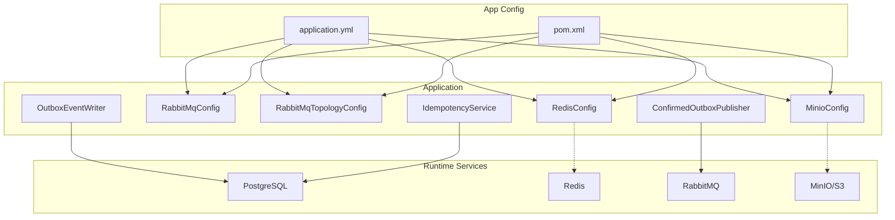
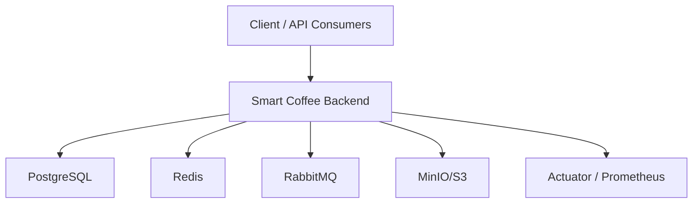
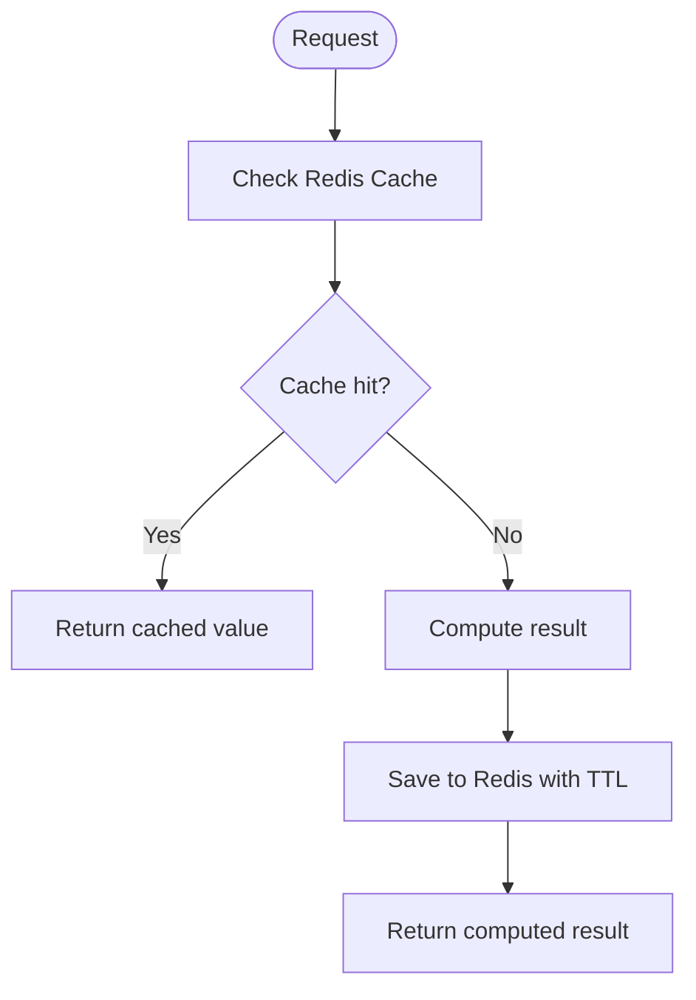
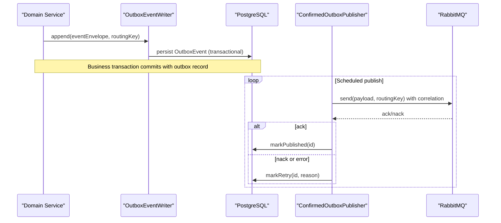
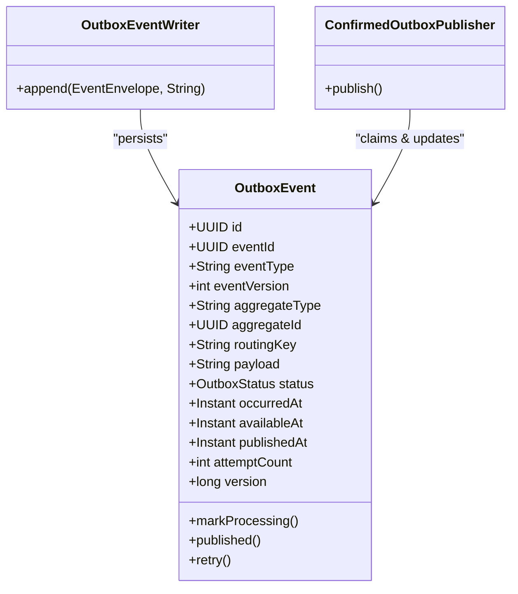
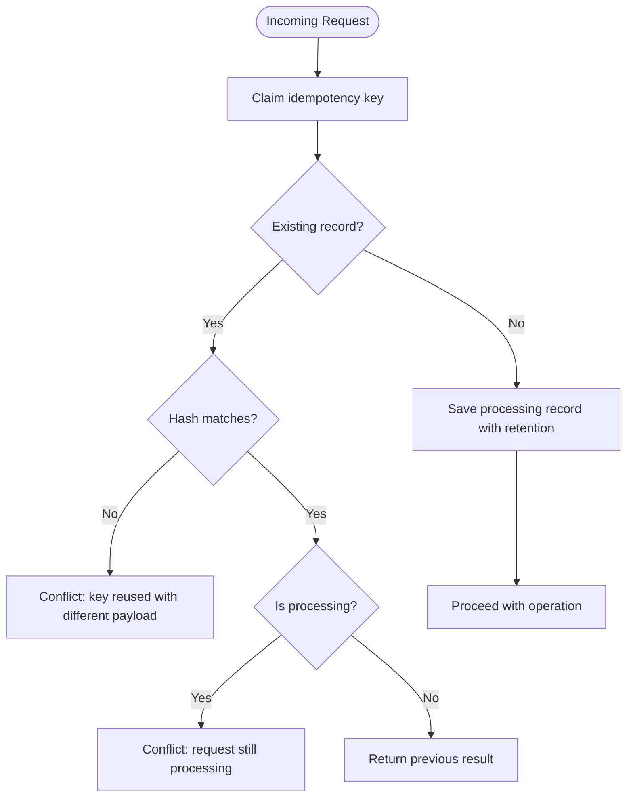
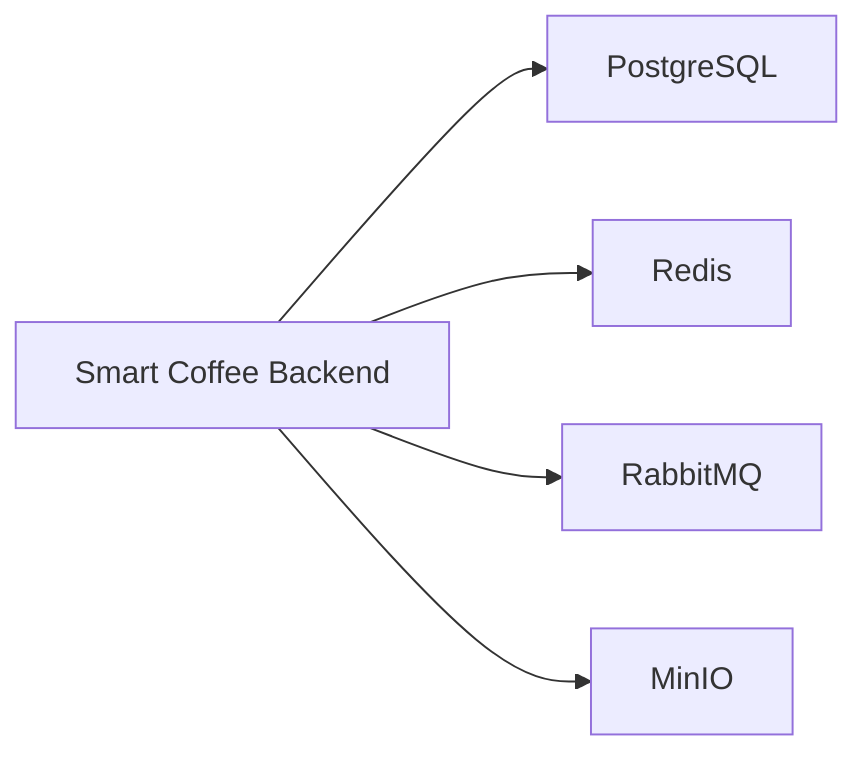

# Infrastructure Components

<cite>
**Referenced Files in This Document**
- [application.yml](file://src/main/resources/application.yml)
- [compose.yaml](file://compose.yaml)
- [pom.xml](file://pom.xml)
- [RedisConfig.java](file://src/main/java/com/smartcoffee/config/RedisConfig.java)
- [RabbitMqConfig.java](file://src/main/java/com/smartcoffee/config/RabbitMqConfig.java)
- [RabbitMqTopologyConfig.java](file://src/main/java/com/smartcoffee/config/RabbitMqTopologyConfig.java)
- [MinioConfig.java](file://src/main/java/com/smartcoffee/config/MinioConfig.java)
- [RedisService.java](file://src/main/java/com/smartcoffee/infrastructure/cache/RedisService.java)
- [OutboxEvent.java](file://src/main/java/com/smartcoffee/infrastructure/messaging/outbox/OutboxEvent.java)
- [OutboxEventWriter.java](file://src/main/java/com/smartcoffee/infrastructure/messaging/outbox/OutboxEventWriter.java)
- [ConfirmedOutboxPublisher.java](file://src/main/java/com/smartcoffee/infrastructure/messaging/outbox/ConfirmedOutboxPublisher.java)
- [OutboxRecoveryJob.java](file://src/main/java/com/smartcoffee/infrastructure/messaging/outbox/OutboxRecoveryJob.java)
- [IdempotencyService.java](file://src/main/java/com/smartcoffee/infrastructure/idempotency/IdempotencyService.java)
</cite>

## Table of Contents
1. [Introduction](#introduction)
2. [Project Structure](#project-structure)
3. [Core Components](#core-components)
4. [Architecture Overview](#architecture-overview)
5. [Detailed Component Analysis](#detailed-component-analysis)
6. [Dependency Analysis](#dependency-analysis)
7. [Performance Considerations](#performance-considerations)
8. [Troubleshooting Guide](#troubleshooting-guide)
9. [Conclusion](#conclusion)
10. [Appendices](#appendices)

## Introduction
This document describes the infrastructure components and cross-cutting concerns for Smart Coffee Backend, focusing on:
- Caching with Redis
- Messaging with RabbitMQ
- Object storage with MinIO/S3
- Monitoring, observability, health checks, metrics, and logging
- Transactional outbox pattern for reliable event publishing
- Idempotency mechanisms
- Security configurations
- Operational procedures and performance tuning guidelines

The goal is to provide a comprehensive, code-grounded guide for developers and operators to understand, configure, operate, and troubleshoot these systems.

## Project Structure
Infrastructure-related configuration and implementation are primarily located under:
- Configuration classes under src/main/java/com/smartcoffee/config
- Infrastructure services under src/main/java/com/smartcoffee/infrastructure
- Runtime dependencies and versions in pom.xml
- Environment and feature flags in application.yml
- Local development environment in compose.yaml

**Diagram sources**
- [application.yml:1-93](file://src/main/resources/application.yml#L1-L93)
- [pom.xml:1-402](file://pom.xml#L1-L402)
- [RedisConfig.java:1-5](file://src/main/java/com/smartcoffee/config/RedisConfig.java#L1-L5)
- [RabbitMqConfig.java:1-12](file://src/main/java/com/smartcoffee/config/RabbitMqConfig.java#L1-L12)
- [RabbitMqTopologyConfig.java:1-87](file://src/main/java/com/smartcoffee/config/RabbitMqTopologyConfig.java#L1-L87)
- [MinioConfig.java:1-5](file://src/main/java/com/smartcoffee/config/MinioConfig.java#L1-L5)
- [OutboxEventWriter.java:1-24](file://src/main/java/com/smartcoffee/infrastructure/messaging/outbox/OutboxEventWriter.java#L1-L24)
- [ConfirmedOutboxPublisher.java:1-60](file://src/main/java/com/smartcoffee/infrastructure/messaging/outbox/ConfirmedOutboxPublisher.java#L1-L60)
- [IdempotencyService.java:1-7](file://src/main/java/com/smartcoffee/infrastructure/idempotency/IdempotencyService.java#L1-L7)

**Section sources**
- [application.yml:1-93](file://src/main/resources/application.yml#L1-L93)
- [compose.yaml:1-71](file://compose.yaml#L1-L71)
- [pom.xml:1-402](file://pom.xml#L1-L402)

## Core Components
- Redis caching: Spring Cache configured with TTL and null-value handling; Redis service placeholder for future cache operations.
- RabbitMQ messaging: Exchange and queue topology defined; publisher confirms enabled; dead-lettering for failed messages.
- MinIO/S3 object storage: MinIO client configured via properties.
- Outbox pattern: Event persistence within business transactions; scheduled publisher with broker confirmations and retry/backoff.
- Idempotency: Request-level idempotency records with conflict detection and processing guards.
- Observability: Actuator endpoints exposed (health, info, metrics, prometheus); request logging filter present.

**Section sources**
- [RedisConfig.java:1-5](file://src/main/java/com/smartcoffee/config/RedisConfig.java#L1-L5)
- [RedisService.java:1-9](file://src/main/java/com/smartcoffee/infrastructure/cache/RedisService.java#L1-L9)
- [RabbitMqConfig.java:1-12](file://src/main/java/com/smartcoffee/config/RabbitMqConfig.java#L1-L12)
- [RabbitMqTopologyConfig.java:1-87](file://src/main/java/com/smartcoffee/config/RabbitMqTopologyConfig.java#L1-L87)
- [MinioConfig.java:1-5](file://src/main/java/com/smartcoffee/config/MinioConfig.java#L1-L5)
- [OutboxEvent.java:1-217](file://src/main/java/com/smartcoffee/infrastructure/messaging/outbox/OutboxEvent.java#L1-L217)
- [OutboxEventWriter.java:1-24](file://src/main/java/com/smartcoffee/infrastructure/messaging/outbox/OutboxEventWriter.java#L1-L24)
- [ConfirmedOutboxPublisher.java:1-60](file://src/main/java/com/smartcoffee/infrastructure/messaging/outbox/ConfirmedOutboxPublisher.java#L1-L60)
- [IdempotencyService.java:1-7](file://src/main/java/com/smartcoffee/infrastructure/idempotency/IdempotencyService.java#L1-L7)
- [application.yml:81-93](file://src/main/resources/application.yml#L81-L93)

## Architecture Overview
The system integrates four primary infrastructure backends: PostgreSQL (primary data store), Redis (cache), RabbitMQ (messaging), and MinIO/S3 (object storage). The application uses Spring Boot Actuator for health and metrics, and exposes Prometheus metrics.

**Diagram sources**
- [application.yml:17-37](file://src/main/resources/application.yml#L17-L37)
- [application.yml:39-42](file://src/main/resources/application.yml#L39-L42)
- [application.yml:44-48](file://src/main/resources/application.yml#L44-L48)
- [application.yml:81-93](file://src/main/resources/application.yml#L81-L93)
- [compose.yaml:1-71](file://compose.yaml#L1-L71)

## Detailed Component Analysis

### Redis Caching Strategy
- Configuration enables Spring Cache and sets default TTL to 10 minutes while disabling caching of null values.
- Redis service class exists as a placeholder for custom cache operations.
- Compose provides a local Redis instance with append-only file enabled for durability.

Operational notes:
- Use @Cacheable/@CacheEvict annotations in domain services to leverage the default cache configuration.
- Tune TTL per cache region if needed by providing custom RedisCacheConfiguration beans.

**Diagram sources**
- [RedisConfig.java:1-5](file://src/main/java/com/smartcoffee/config/RedisConfig.java#L1-L5)
- [RedisService.java:1-9](file://src/main/java/com/smartcoffee/infrastructure/cache/RedisService.java#L1-L9)
- [compose.yaml:19-37](file://compose.yaml#L19-L37)

**Section sources**
- [RedisConfig.java:1-5](file://src/main/java/com/smartcoffee/config/RedisConfig.java#L1-L5)
- [RedisService.java:1-9](file://src/main/java/com/smartcoffee/infrastructure/cache/RedisService.java#L1-L9)
- [compose.yaml:19-37](file://compose.yaml#L19-L37)

### RabbitMQ Messaging and Topology
- Publisher confirms and returns are enabled for reliable delivery.
- Topic exchange smartcoffee.business.events routes events to queues based on routing keys.
- Dead-letter exchange smartcoffee.deadletter captures failed notifications; dedicated dead queue for inspection.
- Notification queue binds to order.ready.v1, payment.*.v1, and loyalty.# patterns.

**Diagram sources**
- [application.yml:39-42](file://src/main/resources/application.yml#L39-L42)
- [RabbitMqTopologyConfig.java:15-85](file://src/main/java/com/smartcoffee/config/RabbitMqTopologyConfig.java#L15-L85)
- [OutboxEventWriter.java:18-21](file://src/main/java/com/smartcoffee/infrastructure/messaging/outbox/OutboxEventWriter.java#L18-L21)
- [ConfirmedOutboxPublisher.java:28-56](file://src/main/java/com/smartcoffee/infrastructure/messaging/outbox/ConfirmedOutboxPublisher.java#L28-L56)

**Section sources**
- [application.yml:39-42](file://src/main/resources/application.yml#L39-L42)
- [RabbitMqConfig.java:5-10](file://src/main/java/com/smartcoffee/config/RabbitMqConfig.java#L5-L10)
- [RabbitMqTopologyConfig.java:15-85](file://src/main/java/com/smartcoffee/config/RabbitMqTopologyConfig.java#L15-L85)
- [compose.yaml:39-56](file://compose.yaml#L39-L56)

### MinIO/S3 Object Storage Integration
- MinIO client is configured using endpoint, access key, and secret key from application properties.
- Bucket name for receipts is configurable via app.receipt.bucket.

Operational notes:
- Ensure bucket exists or create it programmatically during bootstrap.
- For S3 compatibility, adjust endpoint and credentials accordingly.

**Section sources**
- [MinioConfig.java:1-5](file://src/main/java/com/smartcoffee/config/MinioConfig.java#L1-L5)
- [application.yml:44-48](file://src/main/resources/application.yml#L44-L48)
- [application.yml:78-80](file://src/main/resources/application.yml#L78-L80)
- [compose.yaml:58-71](file://compose.yaml#L58-L71)

### Transactional Outbox Pattern
- OutboxEvent stores event metadata and payload in JSONB, with status transitions and versioning.
- OutboxEventWriter persists events within an existing transaction (MANDATORY propagation).
- ConfirmedOutboxPublisher claims pending events, publishes to RabbitMQ with correlation-based confirmation, and updates status accordingly.
- Retry logic applies exponential backoff capped at 300 seconds.
- Recovery job placeholder for stale PROCESSING events.

**Diagram sources**
- [OutboxEvent.java:15-216](file://src/main/java/com/smartcoffee/infrastructure/messaging/outbox/OutboxEvent.java#L15-L216)
- [OutboxEventWriter.java:8-21](file://src/main/java/com/smartcoffee/infrastructure/messaging/outbox/OutboxEventWriter.java#L8-L21)
- [ConfirmedOutboxPublisher.java:13-56](file://src/main/java/com/smartcoffee/infrastructure/messaging/outbox/ConfirmedOutboxPublisher.java#L13-L56)

**Section sources**
- [OutboxEvent.java:15-216](file://src/main/java/com/smartcoffee/infrastructure/messaging/outbox/OutboxEvent.java#L15-L216)
- [OutboxEventWriter.java:8-21](file://src/main/java/com/smartcoffee/infrastructure/messaging/outbox/OutboxEventWriter.java#L8-L21)
- [ConfirmedOutboxPublisher.java:13-56](file://src/main/java/com/smartcoffee/infrastructure/messaging/outbox/ConfirmedOutboxPublisher.java#L13-L56)
- [OutboxRecoveryJob.java:6-13](file://src/main/java/com/smartcoffee/infrastructure/messaging/outbox/OutboxRecoveryJob.java#L6-L13)

### Idempotency Mechanism
- IdempotencyService claims a unique idempotency key per scope, actor type, actor id, and request key.
- Prevents reuse of keys with different payloads and blocks concurrent processing of the same key.
- Records include retention policy and transition to processing state.

**Diagram sources**
- [IdempotencyService.java:3-5](file://src/main/java/com/smartcoffee/infrastructure/idempotency/IdempotencyService.java#L3-L5)

**Section sources**
- [IdempotencyService.java:1-7](file://src/main/java/com/smartcoffee/infrastructure/idempotency/IdempotencyService.java#L1-L7)

### Security Implementations
- JWT security configuration is present; secrets are externalized via environment variables.
- WebSocket allowed origins are configurable.
- Security-related dependencies are included in the project.

Operational notes:
- Rotate JWT secrets regularly and never commit them.
- Restrict WebSocket origins to trusted domains.

**Section sources**
- [application.yml:49-56](file://src/main/resources/application.yml#L49-L56)
- [application.yml:75-77](file://src/main/resources/application.yml#L75-L77)
- [pom.xml:122-132](file://pom.xml#L122-L132)

### Monitoring, Health Checks, Metrics, and Logging
- Actuator endpoints health, info, metrics, and prometheus are exposed.
- Health probes enabled for Kubernetes-style readiness/liveness.
- Micrometer Prometheus registry dependency included.
- Logging level configuration provided.

Operational notes:
- Integrate with Prometheus/Grafana for dashboards.
- Use structured logging and correlate requests via context.

**Section sources**
- [application.yml:81-93](file://src/main/resources/application.yml#L81-L93)
- [pom.xml:166-177](file://pom.xml#L166-L177)

## Dependency Analysis
External runtime services are orchestrated via Docker Compose and wired into the application through Spring Boot auto-configuration and explicit config classes.

**Diagram sources**
- [compose.yaml:1-71](file://compose.yaml#L1-L71)
- [application.yml:17-48](file://src/main/resources/application.yml#L17-L48)

**Section sources**
- [compose.yaml:1-71](file://compose.yaml#L1-L71)
- [application.yml:17-48](file://src/main/resources/application.yml#L17-L48)

## Performance Considerations
- Redis
  - Default TTL is 10 minutes; tune per cache region to balance freshness and memory usage.
  - Enable connection pooling and consider Redis cluster for scale-out.
- RabbitMQ
  - Publisher confirms are enabled; ensure adequate broker resources and monitor queue depths.
  - Batch size and poll delay for outbox publisher are configurable; tune based on throughput needs.
- PostgreSQL
  - Flyway migrations validated on migrate; keep schema changes incremental.
  - Monitor slow queries and add indexes for hot paths.
- MinIO/S3
  - Use appropriate bucket policies and lifecycle rules.
  - Consider CDN for public assets.

[No sources needed since this section provides general guidance]

## Troubleshooting Guide
- Redis connectivity issues
  - Verify Redis container is running and healthcheck passes.
  - Confirm application.yml datasource.redis settings and network reachability.
- RabbitMQ connectivity or message loss
  - Check publisher confirmations and dead-letter queues.
  - Inspect notification.dead queue for failed messages.
- Outbox not publishing
  - Validate batch-size and poll-delay-ms settings.
  - Review logs for negative acknowledgements and retry reasons.
- Idempotency conflicts
  - Ensure clients generate stable idempotency keys per request.
  - Investigate hash mismatches indicating payload changes.
- MinIO/S3 errors
  - Validate endpoint, access key, secret key, and bucket existence.
  - Check CORS and bucket policies if accessing from browsers.

**Section sources**
- [compose.yaml:19-71](file://compose.yaml#L19-L71)
- [application.yml:39-48](file://src/main/resources/application.yml#L39-L48)
- [application.yml:71-74](file://src/main/resources/application.yml#L71-L74)
- [RabbitMqTopologyConfig.java:41-85](file://src/main/java/com/smartcoffee/config/RabbitMqTopologyConfig.java#L41-L85)
- [ConfirmedOutboxPublisher.java:28-56](file://src/main/java/com/smartcoffee/infrastructure/messaging/outbox/ConfirmedOutboxPublisher.java#L28-L56)
- [IdempotencyService.java:3-5](file://src/main/java/com/smartcoffee/infrastructure/idempotency/IdempotencyService.java#L3-L5)
- [MinioConfig.java:1-5](file://src/main/java/com/smartcoffee/config/MinioConfig.java#L1-L5)

## Conclusion
Smart Coffee Backend integrates Redis, RabbitMQ, and MinIO/S3 with robust operational practices:
- Reliable event publishing via the transactional outbox pattern with broker confirmations and retries
- Request-level idempotency to prevent duplicate processing
- Exposed health and metrics for monitoring
- Secure configuration via environment variables
Operators should tune performance parameters, monitor infrastructure health, and use dead-letter queues and Prometheus metrics to maintain reliability and visibility.

[No sources needed since this section summarizes without analyzing specific files]

## Appendices

### Configuration Options Reference
- Database
  - URL, username, password via environment variables
  - Flyway enabled with validation
- Redis
  - Spring Data Redis repositories disabled; default cache TTL 10 minutes
- RabbitMQ
  - Publisher confirmations and returns enabled
- MinIO
  - Endpoint, access key, secret key
- Application features
  - Receipt bucket, outbox batch size and poll delay, notification queue and poll interval, WebSocket allowed origins, catalog image base URL
- Management
  - Health probes enabled; endpoints health, info, metrics, prometheus exposed

**Section sources**
- [application.yml:17-48](file://src/main/resources/application.yml#L17-L48)
- [application.yml:55-80](file://src/main/resources/application.yml#L55-L80)
- [application.yml:81-93](file://src/main/resources/application.yml#L81-L93)