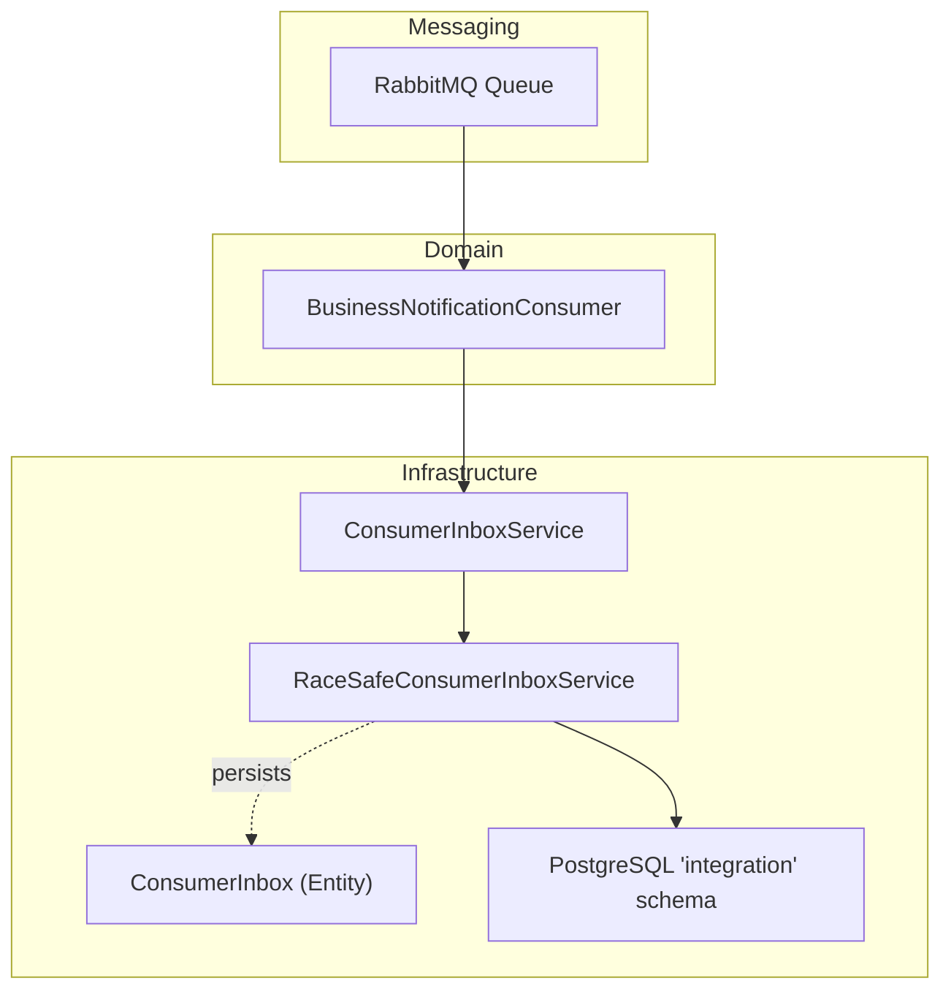
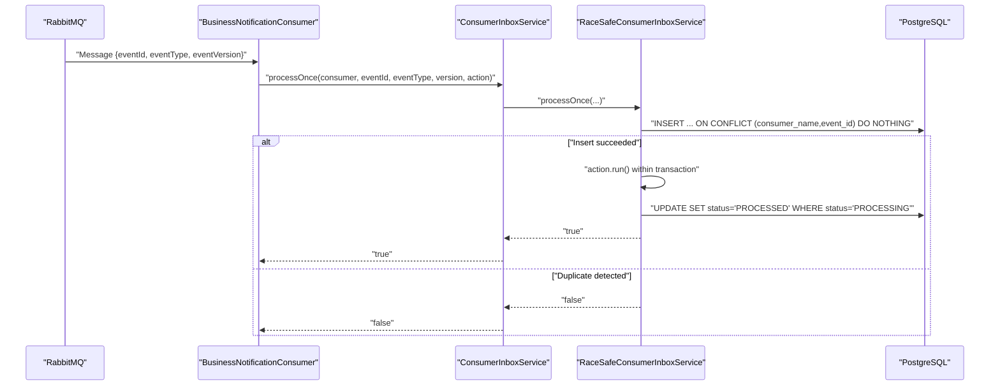
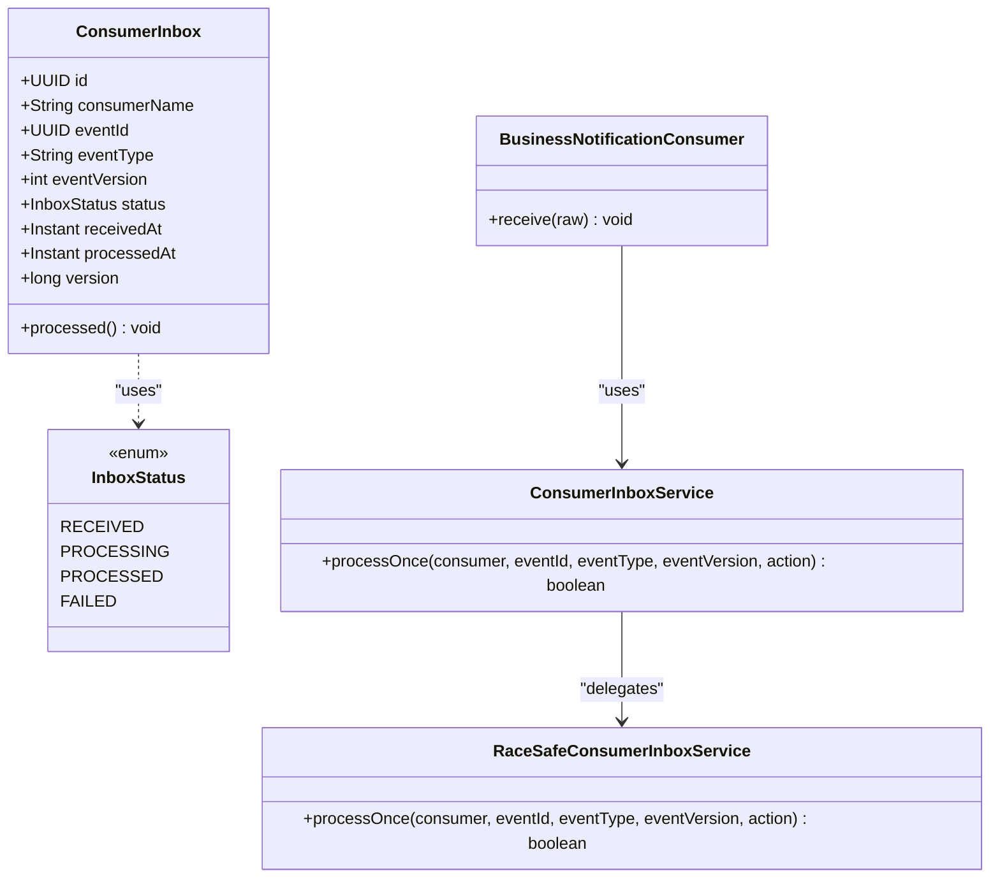
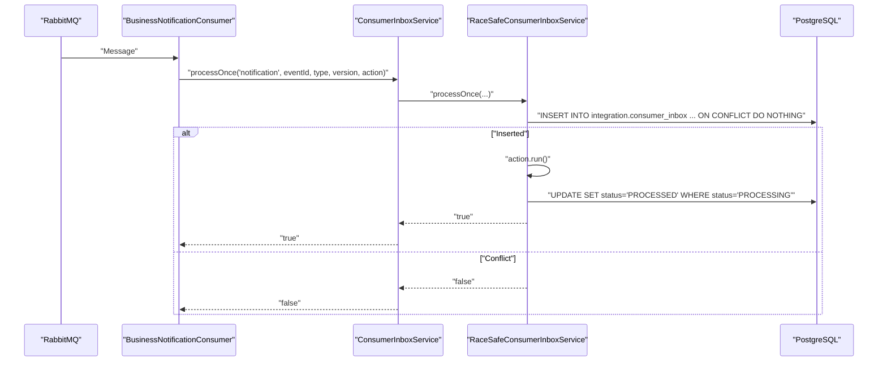
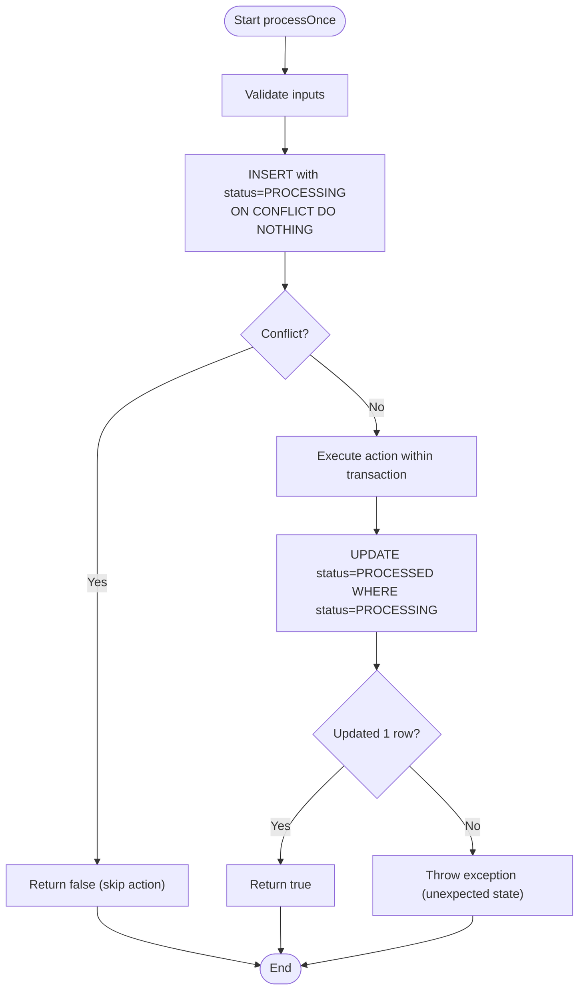
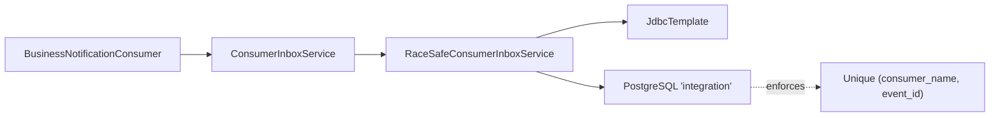

# Consumer Inbox Processing

<cite>
**Referenced Files in This Document**
- [ConsumerInbox.java](file://src/main/java/com/smartcoffee/infrastructure/messaging/inbox/ConsumerInbox.java)
- [ConsumerInboxService.java](file://src/main/java/com/smartcoffee/infrastructure/messaging/inbox/ConsumerInboxService.java)
- [RaceSafeConsumerInboxService.java](file://src/main/java/com/smartcoffee/infrastructure/messaging/inbox/RaceSafeConsumerInboxService.java)
- [InboxStatus.java](file://src/main/java/com/smartcoffee/infrastructure/messaging/inbox/InboxStatus.java)
- [ConsumerInboxRepository.java](file://src/main/java/com/smartcoffee/infrastructure/messaging/inbox/ConsumerInboxRepository.java)
- [BusinessNotificationConsumer.java](file://src/main/java/com/smartcoffee/modules/notification/consumer/BusinessNotificationConsumer.java)
</cite>

## Table of Contents
1. [Introduction](#introduction)
2. [Project Structure](#project-structure)
3. [Core Components](#core-components)
4. [Architecture Overview](#architecture-overview)
5. [Detailed Component Analysis](#detailed-component-analysis)
6. [Dependency Analysis](#dependency-analysis)
7. [Performance Considerations](#performance-considerations)
8. [Troubleshooting Guide](#troubleshooting-guide)
9. [Conclusion](#conclusion)

## Introduction
This document explains the consumer inbox processing system that ensures idempotent message consumption. It details how the system tracks processed messages to prevent duplicate processing, describes the ConsumerInboxService interface and RaceSafeConsumerInboxService implementation for safe concurrent access, documents the InboxStatus enum and status transitions during message processing, and provides examples of registering handlers, processing incoming messages, and handling race conditions. It also explains database-level locking mechanisms used to prevent duplicate processing across multiple service instances.

## Project Structure
The consumer inbox subsystem lives under infrastructure messaging and is consumed by domain modules such as notifications. The key parts are:
- Data model and repository for tracking inbox entries
- A thin service facade (ConsumerInboxService) delegating to a race-safe implementation
- A race-safe implementation using direct SQL with unique constraints and transactions
- A RabbitMQ consumer that registers a handler wrapped by the inbox service

**Diagram sources**
- [BusinessNotificationConsumer.java:33-63](file://src/main/java/com/smartcoffee/modules/notification/consumer/BusinessNotificationConsumer.java#L33-L63)
- [ConsumerInboxService.java:18-31](file://src/main/java/com/smartcoffee/infrastructure/messaging/inbox/ConsumerInboxService.java#L18-L31)
- [RaceSafeConsumerInboxService.java:18-121](file://src/main/java/com/smartcoffee/infrastructure/messaging/inbox/RaceSafeConsumerInboxService.java#L18-L121)
- [ConsumerInbox.java:7-30](file://src/main/java/com/smartcoffee/infrastructure/messaging/inbox/ConsumerInbox.java#L7-L30)

**Section sources**
- [BusinessNotificationConsumer.java:33-63](file://src/main/java/com/smartcoffee/modules/notification/consumer/BusinessNotificationConsumer.java#L33-L63)
- [ConsumerInboxService.java:18-31](file://src/main/java/com/smartcoffee/infrastructure/messaging/inbox/ConsumerInboxService.java#L18-L31)
- [RaceSafeConsumerInboxService.java:18-121](file://src/main/java/com/smartcoffee/infrastructure/messaging/inbox/RaceSafeConsumerInboxService.java#L18-L121)
- [ConsumerInbox.java:7-30](file://src/main/java/com/smartcoffee/infrastructure/messaging/inbox/ConsumerInbox.java#L7-L30)

## Core Components
- ConsumerInbox: JPA entity representing an inbox record with a unique constraint on consumer_name and event_id. It includes fields for event identity, version, status, timestamps, and optimistic versioning.
- InboxStatus: Enum defining lifecycle states RECEIVED, PROCESSING, PROCESSED, FAILED.
- ConsumerInboxService: Thin Spring service exposing processOnce(...) to callers; delegates to the race-safe implementation.
- RaceSafeConsumerInboxService: Transactional service that performs an upsert-style insert with ON CONFLICT DO NOTHING to guarantee exactly-once semantics per consumer+event, runs user action within the same transaction, then updates status to PROCESSED only if still PROCESSING.
- BusinessNotificationConsumer: Example consumer that extracts eventId, eventType, eventVersion from a message and wraps business logic inside processOnce(...).

Key behaviors:
- Idempotency: Unique constraint on (consumer_name, event_id) prevents duplicate inserts.
- Concurrency safety: Transaction boundaries and conditional update ensure only one instance processes a given event.
- Observability: Timestamps and status transitions provide auditability.

**Section sources**
- [ConsumerInbox.java:7-45](file://src/main/java/com/smartcoffee/infrastructure/messaging/inbox/ConsumerInbox.java#L7-L45)
- [InboxStatus.java:3-5](file://src/main/java/com/smartcoffee/infrastructure/messaging/inbox/InboxStatus.java#L3-L5)
- [ConsumerInboxService.java:18-31](file://src/main/java/com/smartcoffee/infrastructure/messaging/inbox/ConsumerInboxService.java#L18-L31)
- [RaceSafeConsumerInboxService.java:18-121](file://src/main/java/com/smartcoffee/infrastructure/messaging/inbox/RaceSafeConsumerInboxService.java#L18-L121)
- [BusinessNotificationConsumer.java:33-63](file://src/main/java/com/smartcoffee/modules/notification/consumer/BusinessNotificationConsumer.java#L33-L63)

## Architecture Overview
The system uses a database-backed inbox pattern to achieve idempotent consumption:
- Producers publish events with stable, globally unique event IDs.
- Consumers call processOnce(consumer, eventId, eventType, eventVersion, action).
- The race-safe service attempts to insert a row with status PROCESSING using a unique constraint. If already present, it returns false without executing the action.
- On success, the action executes within the same transaction. If successful, the row is updated to PROCESSED; otherwise, the transaction rolls back, leaving the row available for retry.

**Diagram sources**
- [BusinessNotificationConsumer.java:33-63](file://src/main/java/com/smartcoffee/modules/notification/consumer/BusinessNotificationConsumer.java#L33-L63)
- [ConsumerInboxService.java:18-31](file://src/main/java/com/smartcoffee/infrastructure/messaging/inbox/ConsumerInboxService.java#L18-L31)
- [RaceSafeConsumerInboxService.java:18-121](file://src/main/java/com/smartcoffee/infrastructure/messaging/inbox/RaceSafeConsumerInboxService.java#L18-L121)

## Detailed Component Analysis

### ConsumerInbox Entity
- Purpose: Represents a single inbox entry for a consumer and event.
- Key fields:
  - inbox_id: primary key
  - consumer_name, event_id: composite uniqueness enforced at the database level
  - event_type, event_version: identify the event contract and version
  - status: lifecycle state machine via InboxStatus
  - received_at, processed_at: timestamps for auditing
  - version: optimistic lock field
- Behavior:
  - Default status is RECEIVED when created via JPA path.
  - processed() method sets status to PROCESSED and records processed_at.

Complexity:
- O(1) for entity operations; uniqueness check is enforced by the database index.

Error handling:
- Integrity exceptions on duplicate keys are prevented by the application flow but can be handled upstream if needed.

**Section sources**
- [ConsumerInbox.java:7-45](file://src/main/java/com/smartcoffee/infrastructure/messaging/inbox/ConsumerInbox.java#L7-L45)

### InboxStatus Enum
- States:
  - RECEIVED: initial state when persisted via JPA
  - PROCESSING: set by the race-safe service before executing business logic
  - PROCESSED: set after successful completion
  - FAILED: reserved for error scenarios (not used by current race-safe flow)

Transitions:
- RECEIVED -> PROCESSING (via direct SQL in race-safe service)
- PROCESSING -> PROCESSED (conditional update after action succeeds)
- PROCESSING -> FAILED (reserved for future error handling)

**Section sources**
- [InboxStatus.java:3-5](file://src/main/java/com/smartcoffee/infrastructure/messaging/inbox/InboxStatus.java#L3-L5)

### ConsumerInboxService
- Exposes a simple API: processOnce(consumer, eventId, eventType, eventVersion, action).
- Delegates to RaceSafeConsumerInboxService to enforce concurrency and idempotency guarantees.
- Returns boolean indicating whether the action was executed (true) or skipped due to duplication (false).

Usage example (conceptual):
- Register a handler by calling processOnce with a Runnable that contains your business logic.
- If the same event is delivered again, the handler will not run.

**Section sources**
- [ConsumerInboxService.java:18-31](file://src/main/java/com/smartcoffee/infrastructure/messaging/inbox/ConsumerInboxService.java#L18-L31)

### RaceSafeConsumerInboxService
- Guarantees exactly-once execution per (consumer, event_id) using:
  - Database unique constraint on (consumer_name, event_id)
  - INSERT ... ON CONFLICT (consumer_name, event_id) DO NOTHING
  - @Transactional boundary around insertion, action execution, and finalization
- Flow:
  1. Validate inputs (non-null consumer, event_id, non-blank event_type, positive event_version, non-null action).
  2. Attempt to insert a row with status PROCESSING.
  3. If insert fails due to conflict, return false (duplicate detected).
  4. Execute the provided action within the transaction.
  5. Update the row to PROCESSED only if status is still PROCESSING.
  6. If update affects zero rows, throw an exception to signal unexpected state.
  7. Return true on success.

Concurrency and race conditions:
- Multiple consumers receiving the same message concurrently will contend on the unique constraint; only one insert succeeds.
- Conditional update ensures that even if two threads somehow proceed, only one can mark the event as PROCESSED.

Database-level locking:
- PostgreSQL enforces the unique constraint at the storage engine level, serializing conflicting inserts.
- The transaction ensures atomicity of insertion, business changes, and finalization.

Failure and retries:
- If the action throws, the transaction rolls back, removing both business changes and the PROCESSING marker, allowing safe retries.

**Section sources**
- [RaceSafeConsumerInboxService.java:18-121](file://src/main/java/com/smartcoffee/infrastructure/messaging/inbox/RaceSafeConsumerInboxService.java#L18-L121)

### BusinessNotificationConsumer (Example Handler)
- Listens to a RabbitMQ queue and parses the envelope to extract eventId, eventType, and eventVersion.
- Wraps notification creation logic inside processOnce("notification", eventId, eventType, eventVersion, action).
- Ensures that even if RabbitMQ redelivers the message, the notification is created exactly once.

Handler registration example (conceptual):
- Annotate a method with @RabbitListener for the target queue.
- Inside the listener, call inbox.processOnce with a Runnable containing your domain logic.

Processing incoming messages:
- Extract identifiers from the message payload.
- Pass them into processOnce along with a Runnable that performs side effects (e.g., creating notifications).

Handling race conditions:
- The inbox service handles duplicates transparently; your handler should be idempotent by design and rely on the inbox to guard against reprocessing.

**Section sources**
- [BusinessNotificationConsumer.java:33-63](file://src/main/java/com/smartcoffee/modules/notification/consumer/BusinessNotificationConsumer.java#L33-L63)

### Class Diagram

**Diagram sources**
- [ConsumerInbox.java:7-45](file://src/main/java/com/smartcoffee/infrastructure/messaging/inbox/ConsumerInbox.java#L7-L45)
- [InboxStatus.java:3-5](file://src/main/java/com/smartcoffee/infrastructure/messaging/inbox/InboxStatus.java#L3-L5)
- [ConsumerInboxService.java:18-31](file://src/main/java/com/smartcoffee/infrastructure/messaging/inbox/ConsumerInboxService.java#L18-L31)
- [RaceSafeConsumerInboxService.java:18-121](file://src/main/java/com/smartcoffee/infrastructure/messaging/inbox/RaceSafeConsumerInboxService.java#L18-L121)
- [BusinessNotificationConsumer.java:33-63](file://src/main/java/com/smartcoffee/modules/notification/consumer/BusinessNotificationConsumer.java#L33-L63)

### Sequence Diagram: Message Processing Flow

**Diagram sources**
- [BusinessNotificationConsumer.java:33-63](file://src/main/java/com/smartcoffee/modules/notification/consumer/BusinessNotificationConsumer.java#L33-L63)
- [ConsumerInboxService.java:18-31](file://src/main/java/com/smartcoffee/infrastructure/messaging/inbox/ConsumerInboxService.java#L18-L31)
- [RaceSafeConsumerInboxService.java:18-121](file://src/main/java/com/smartcoffee/infrastructure/messaging/inbox/RaceSafeConsumerInboxService.java#L18-L121)

### Flowchart: Status Transitions and Duplicate Handling

**Diagram sources**
- [RaceSafeConsumerInboxService.java:18-121](file://src/main/java/com/smartcoffee/infrastructure/messaging/inbox/RaceSafeConsumerInboxService.java#L18-L121)

## Dependency Analysis
- BusinessNotificationConsumer depends on ConsumerInboxService to wrap its handler with idempotency.
- ConsumerInboxService depends on RaceSafeConsumerInboxService for concurrency-safe execution.
- RaceSafeConsumerInboxService depends on JdbcTemplate to perform direct SQL operations ensuring tight control over transactional behavior and locking semantics.
- ConsumerInbox entity defines the schema expectations and constraints enforced by the database.

**Diagram sources**
- [BusinessNotificationConsumer.java:33-63](file://src/main/java/com/smartcoffee/modules/notification/consumer/BusinessNotificationConsumer.java#L33-L63)
- [ConsumerInboxService.java:18-31](file://src/main/java/com/smartcoffee/infrastructure/messaging/inbox/ConsumerInboxService.java#L18-L31)
- [RaceSafeConsumerInboxService.java:18-121](file://src/main/java/com/smartcoffee/infrastructure/messaging/inbox/RaceSafeConsumerInboxService.java#L18-L121)
- [ConsumerInbox.java:7-30](file://src/main/java/com/smartcoffee/infrastructure/messaging/inbox/ConsumerInbox.java#L7-L30)

**Section sources**
- [BusinessNotificationConsumer.java:33-63](file://src/main/java/com/smartcoffee/modules/notification/consumer/BusinessNotificationConsumer.java#L33-L63)
- [ConsumerInboxService.java:18-31](file://src/main/java/com/smartcoffee/infrastructure/messaging/inbox/ConsumerInboxService.java#L18-L31)
- [RaceSafeConsumerInboxService.java:18-121](file://src/main/java/com/smartcoffee/infrastructure/messaging/inbox/RaceSafeConsumerInboxService.java#L18-L121)
- [ConsumerInbox.java:7-30](file://src/main/java/com/smartcoffee/infrastructure/messaging/inbox/ConsumerInbox.java#L7-L30)

## Performance Considerations
- Unique constraint enforcement is highly efficient and offloads contention to the database.
- Direct SQL avoids ORM overhead for critical paths and allows precise control over locking and transaction boundaries.
- Conditional update minimizes unnecessary writes and protects against double-finalization.
- Keep actions lightweight and idempotent; long-running work should be decomposed to avoid holding database locks for extended periods.

[No sources needed since this section provides general guidance]

## Troubleshooting Guide
Common issues and resolutions:
- Duplicate processing observed:
  - Verify that each producer assigns a stable, unique eventId per logical event.
  - Ensure the consumer name is consistent across instances for the same logical consumer.
- Repeated retries despite apparent success:
  - Check that the action does not throw exceptions; any exception causes rollback, making the event eligible for retry.
  - Confirm that the final UPDATE affects exactly one row; failures indicate unexpected state.
- Stuck in PROCESSING:
  - Investigate long-running actions or unhandled exceptions that cause timeouts or deadlocks.
  - Review logs for IllegalStateException indicating failed finalization.

Operational tips:
- Monitor the integration.consumer_inbox table for counts by status to detect anomalies.
- Use timestamps (received_at, processed_at) to measure latency and identify slow consumers.

**Section sources**
- [RaceSafeConsumerInboxService.java:18-121](file://src/main/java/com/smartcoffee/infrastructure/messaging/inbox/RaceSafeConsumerInboxService.java#L18-L121)

## Conclusion
The consumer inbox system provides robust, database-backed idempotency for message consumption. By combining a unique constraint, transactional boundaries, and conditional updates, it prevents duplicate processing even under high concurrency and across multiple service instances. The ConsumerInboxService offers a clean API for registering handlers, while RaceSafeConsumerInboxService encapsulates the complex concurrency logic. InboxStatus captures the lifecycle of each event, enabling observability and troubleshooting. Adopting this pattern ensures reliable, exactly-once-like processing for downstream business logic.

[No sources needed since this section summarizes without analyzing specific files]