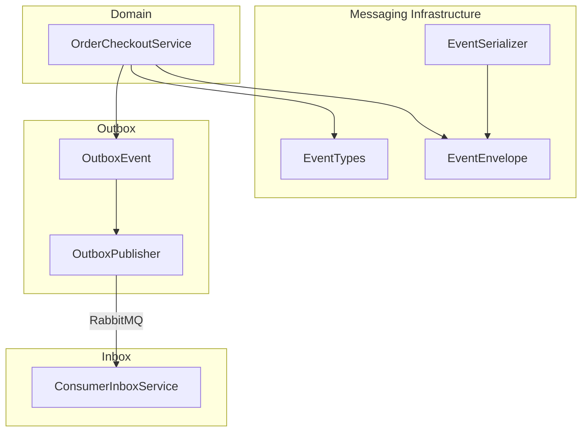
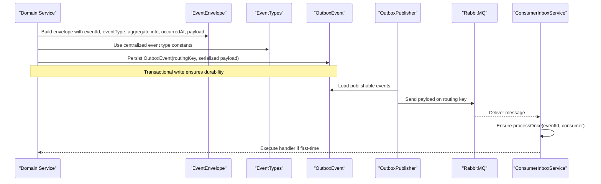
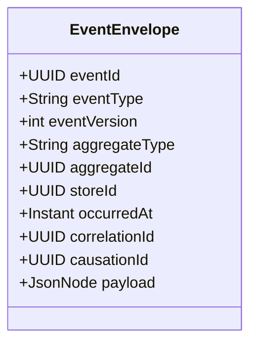
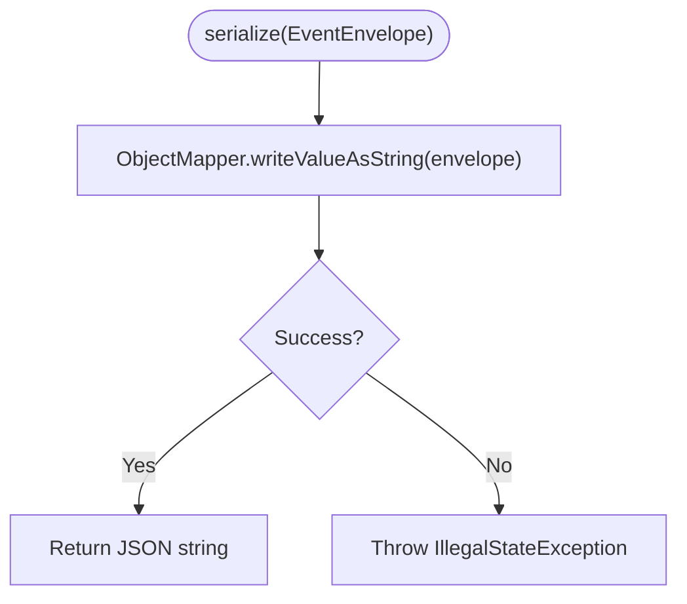
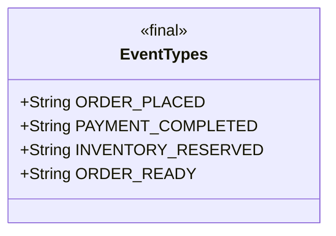
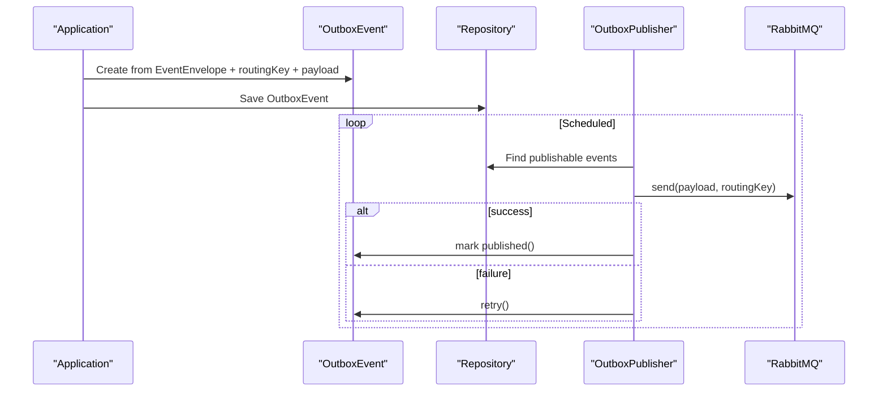
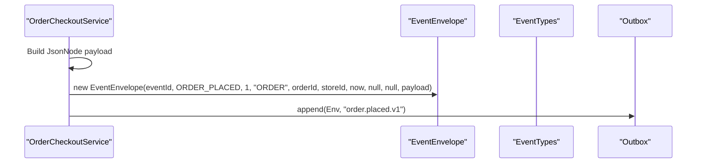
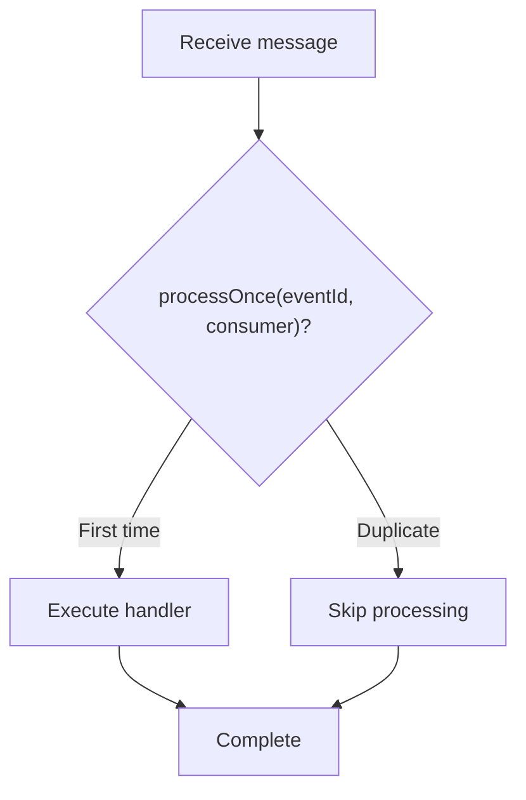
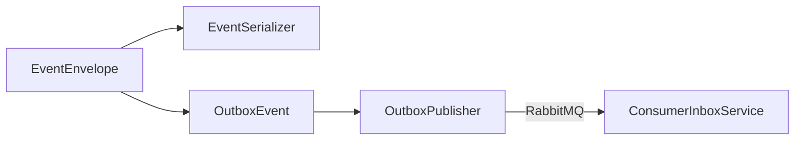

# Event Serialization & Envelope Handling

<cite>
**Referenced Files in This Document**
- [EventSerializer.java](file://src/main/java/com/smartcoffee/infrastructure/messaging/EventSerializer.java)
- [EventEnvelope.java](file://src/main/java/com/smartcoffee/infrastructure/messaging/EventEnvelope.java)
- [EventTypes.java](file://src/main/java/com/smartcoffee/infrastructure/messaging/EventTypes.java)
- [OutboxEvent.java](file://src/main/java/com/smartcoffee/infrastructure/messaging/outbox/OutboxEvent.java)
- [OutboxPublisher.java](file://src/main/java/com/smartcoffee/infrastructure/messaging/outbox/OutboxPublisher.java)
- [ConsumerInboxService.java](file://src/main/java/com/smartcoffee/infrastructure/messaging/inbox/ConsumerInboxService.java)
- [OrderCheckoutService.java](file://src/main/java/com/smartcoffee/modules/ordering/application/OrderCheckoutService.java)
</cite>

## Table of Contents
1. [Introduction](#introduction)
2. [Project Structure](#project-structure)
3. [Core Components](#core-components)
4. [Architecture Overview](#architecture-overview)
5. [Detailed Component Analysis](#detailed-component-analysis)
6. [Dependency Analysis](#dependency-analysis)
7. [Performance Considerations](#performance-considerations)
8. [Troubleshooting Guide](#troubleshooting-guide)
9. [Conclusion](#conclusion)
10. [Appendices](#appendices)

## Introduction
This document explains how the system serializes and deserializes domain events, how event envelopes carry metadata for tracing and routing, and how the outbox pattern ensures reliable delivery. It covers:
- EventSerializer for JSON serialization using a configured ObjectMapper
- EventEnvelope as the transport wrapper with correlation IDs, timestamps, and source information
- EventTypes enumeration that centralizes supported event names
- Practical examples for producing and consuming events via the outbox and inbox mechanisms
- Versioning strategies to evolve event schemas while maintaining backward compatibility

## Project Structure
The eventing infrastructure lives under the messaging package and integrates with persistence (outbox) and message broker (RabbitMQ). Consumers use an inbox mechanism to ensure idempotent processing.

**Diagram sources**
- [EventSerializer.java:1-22](file://src/main/java/com/smartcoffee/infrastructure/messaging/EventSerializer.java#L1-L22)
- [EventEnvelope.java:1-52](file://src/main/java/com/smartcoffee/infrastructure/messaging/EventEnvelope.java#L1-L52)
- [EventTypes.java:1-11](file://src/main/java/com/smartcoffee/infrastructure/messaging/EventTypes.java#L1-L11)
- [OutboxEvent.java:1-217](file://src/main/java/com/smartcoffee/infrastructure/messaging/outbox/OutboxEvent.java#L1-L217)
- [OutboxPublisher.java:1-36](file://src/main/java/com/smartcoffee/infrastructure/messaging/outbox/OutboxPublisher.java#L1-L36)
- [ConsumerInboxService.java:1-34](file://src/main/java/com/smartcoffee/infrastructure/messaging/inbox/ConsumerInboxService.java#L1-L34)
- [OrderCheckoutService.java:119-135](file://src/main/java/com/smartcoffee/modules/ordering/application/OrderCheckoutService.java#L119-L135)

**Section sources**
- [EventSerializer.java:1-22](file://src/main/java/com/smartcoffee/infrastructure/messaging/EventSerializer.java#L1-L22)
- [EventEnvelope.java:1-52](file://src/main/java/com/smartcoffee/infrastructure/messaging/EventEnvelope.java#L1-L52)
- [EventTypes.java:1-11](file://src/main/java/com/smartcoffee/infrastructure/messaging/EventTypes.java#L1-L11)
- [OutboxEvent.java:1-217](file://src/main/java/com/smartcoffee/infrastructure/messaging/outbox/OutboxEvent.java#L1-L217)
- [OutboxPublisher.java:1-36](file://src/main/java/com/smartcoffee/infrastructure/messaging/outbox/OutboxPublisher.java#L1-L36)
- [ConsumerInboxService.java:1-34](file://src/main/java/com/smartcoffee/infrastructure/messaging/inbox/ConsumerInboxService.java#L1-L34)
- [OrderCheckoutService.java:119-135](file://src/main/java/com/smartcoffee/modules/ordering/application/OrderCheckoutService.java#L119-L135)

## Core Components
- EventEnvelope: Immutable record carrying envelope metadata and a generic JSON payload. It enforces required fields and validates constraints at construction time.
- EventSerializer: Spring component wrapping Jackson’s ObjectMapper to serialize EventEnvelope instances into JSON strings.
- EventTypes: Centralized constants defining all supported event type names used across the system.
- OutboxEvent: Persistent representation of an event ready for publishing, including status, timing, and retry metadata.
- OutboxPublisher: Scheduled job that publishes pending events to RabbitMQ and updates their status.
- ConsumerInboxService: Idempotency guard ensuring each event is processed once per consumer.

**Section sources**
- [EventEnvelope.java:1-52](file://src/main/java/com/smartcoffee/infrastructure/messaging/EventEnvelope.java#L1-L52)
- [EventSerializer.java:1-22](file://src/main/java/com/smartcoffee/infrastructure/messaging/EventSerializer.java#L1-L22)
- [EventTypes.java:1-11](file://src/main/java/com/smartcoffee/infrastructure/messaging/EventTypes.java#L1-L11)
- [OutboxEvent.java:1-217](file://src/main/java/com/smartcoffee/infrastructure/messaging/outbox/OutboxEvent.java#L1-L217)
- [OutboxPublisher.java:1-36](file://src/main/java/com/smartcoffee/infrastructure/messaging/outbox/OutboxPublisher.java#L1-L36)
- [ConsumerInboxService.java:1-34](file://src/main/java/com/smartcoffee/infrastructure/messaging/inbox/ConsumerInboxService.java#L1-L34)

## Architecture Overview
Events are produced by domain services, wrapped in an EventEnvelope, persisted via the outbox, and published to RabbitMQ. Consumers receive messages and process them idempotently through the inbox service.

**Diagram sources**
- [OrderCheckoutService.java:119-135](file://src/main/java/com/smartcoffee/modules/ordering/application/OrderCheckoutService.java#L119-L135)
- [EventEnvelope.java:1-52](file://src/main/java/com/smartcoffee/infrastructure/messaging/EventEnvelope.java#L1-L52)
- [EventTypes.java:1-11](file://src/main/java/com/smartcoffee/infrastructure/messaging/EventTypes.java#L1-L11)
- [OutboxEvent.java:1-217](file://src/main/java/com/smartcoffee/infrastructure/messaging/outbox/OutboxEvent.java#L1-L217)
- [OutboxPublisher.java:1-36](file://src/main/java/com/smartcoffee/infrastructure/messaging/outbox/OutboxPublisher.java#L1-L36)
- [ConsumerInboxService.java:1-34](file://src/main/java/com/smartcoffee/infrastructure/messaging/inbox/ConsumerInboxService.java#L1-L34)

## Detailed Component Analysis

### EventEnvelope
- Purpose: Transport wrapper for domain events with rich metadata for tracing, routing, and versioning.
- Key fields:
  - Identifier and typing: eventId, eventType, eventVersion
  - Aggregate context: aggregateType, aggregateId
  - Tenant/store context: storeId
  - Temporal context: occurredAt
  - Correlation and causation: correlationId, causationId
  - Payload: JsonNode for flexible, schema-evolvable content
- Validation: Constructor enforces non-null and business rules (e.g., positive eventVersion), failing fast on invalid input.

**Diagram sources**
- [EventEnvelope.java:1-52](file://src/main/java/com/smartcoffee/infrastructure/messaging/EventEnvelope.java#L1-L52)

**Section sources**
- [EventEnvelope.java:1-52](file://src/main/java/com/smartcoffee/infrastructure/messaging/EventEnvelope.java#L1-L52)

### EventSerializer
- Purpose: Serialize EventEnvelope to JSON string using a shared ObjectMapper instance.
- Behavior: Wraps serialization exceptions in IllegalStateException to signal configuration or runtime issues early.

**Diagram sources**
- [EventSerializer.java:1-22](file://src/main/java/com/smartcoffee/infrastructure/messaging/EventSerializer.java#L1-L22)

**Section sources**
- [EventSerializer.java:1-22](file://src/main/java/com/smartcoffee/infrastructure/messaging/EventSerializer.java#L1-L22)

### EventTypes
- Purpose: Central registry of event type names to avoid magic strings and ensure consistency across producers and consumers.
- Current types: OrderPlaced, PaymentCompleted, InventoryReserved, OrderReady.

**Diagram sources**
- [EventTypes.java:1-11](file://src/main/java/com/smartcoffee/infrastructure/messaging/EventTypes.java#L1-L11)

**Section sources**
- [EventTypes.java:1-11](file://src/main/java/com/smartcoffee/infrastructure/messaging/EventTypes.java#L1-L11)

### Outbox Integration
- OutboxEvent: Persists event metadata and serialized payload along with status, timing, and retry counters. Supports rehydration from storage.
- OutboxPublisher: Periodically claims and publishes pending events to RabbitMQ; marks events as published or schedules retries with exponential backoff.

**Diagram sources**
- [OutboxEvent.java:1-217](file://src/main/java/com/smartcoffee/infrastructure/messaging/outbox/OutboxEvent.java#L1-L217)
- [OutboxPublisher.java:1-36](file://src/main/java/com/smartcoffee/infrastructure/messaging/outbox/OutboxPublisher.java#L1-L36)

**Section sources**
- [OutboxEvent.java:1-217](file://src/main/java/com/smartcoffee/infrastructure/messaging/outbox/OutboxEvent.java#L1-L217)
- [OutboxPublisher.java:1-36](file://src/main/java/com/smartcoffee/infrastructure/messaging/outbox/OutboxPublisher.java#L1-L36)

### Producer Example: Creating an Event
- The ordering flow constructs a JSON payload describing the order and emits an OrderPlaced event via the outbox.
- Steps:
  1. Build a JsonNode payload with relevant order data.
  2. Create an EventEnvelope with a unique eventId, EventTypes.ORDER_PLACED, version 1, aggregate context, and timestamp.
  3. Append to outbox with a routing key (e.g., order.placed.v1).

**Diagram sources**
- [OrderCheckoutService.java:119-135](file://src/main/java/com/smartcoffee/modules/ordering/application/OrderCheckoutService.java#L119-L135)
- [EventEnvelope.java:1-52](file://src/main/java/com/smartcoffee/infrastructure/messaging/EventEnvelope.java#L1-L52)
- [EventTypes.java:1-11](file://src/main/java/com/smartcoffee/infrastructure/messaging/EventTypes.java#L1-L11)

**Section sources**
- [OrderCheckoutService.java:119-135](file://src/main/java/com/smartcoffee/modules/ordering/application/OrderCheckoutService.java#L119-L135)

### Consumer Example: Processing Incoming Messages
- Consumers should:
  1. Deserialize the incoming message payload into the appropriate domain model or JsonNode.
  2. Use ConsumerInboxService.processOnce with a unique eventId, eventType, eventVersion, and a Runnable action to guarantee single execution per consumer.
  3. Handle errors within the action and rely on inbox deduplication to prevent duplicate side effects.

**Diagram sources**
- [ConsumerInboxService.java:1-34](file://src/main/java/com/smartcoffee/infrastructure/messaging/inbox/ConsumerInboxService.java#L1-L34)

**Section sources**
- [ConsumerInboxService.java:1-34](file://src/main/java/com/smartcoffee/infrastructure/messaging/inbox/ConsumerInboxService.java#L1-L34)

### Working with Event Envelopes
- Building envelopes:
  - Always set eventId, eventType, eventVersion, aggregateType, aggregateId, storeId, occurredAt, and a non-null payload.
  - Use correlationId/causationId when bridging request/response flows or chaining processes.
- Serializing envelopes:
  - Use EventSerializer.serialize to convert to JSON for persistence or transmission where needed.
- Deserializing payloads:
  - Read JsonNode from the envelope payload and map to typed models in consumers based on eventType and eventVersion.

**Section sources**
- [EventEnvelope.java:1-52](file://src/main/java/com/smartcoffee/infrastructure/messaging/EventEnvelope.java#L1-L52)
- [EventSerializer.java:1-22](file://src/main/java/com/smartcoffee/infrastructure/messaging/EventSerializer.java#L1-L22)

## Dependency Analysis
- EventEnvelope depends on Jackson’s JsonNode for flexible payloads and standard Java types for identifiers and timestamps.
- EventSerializer depends on a configured ObjectMapper provided by Spring.
- OutboxEvent depends on JPA and stores both envelope-derived metadata and serialized payload.
- OutboxPublisher depends on RabbitTemplate and repository to publish events reliably.
- ConsumerInboxService provides idempotency for downstream handlers.

**Diagram sources**
- [EventEnvelope.java:1-52](file://src/main/java/com/smartcoffee/infrastructure/messaging/EventEnvelope.java#L1-L52)
- [EventSerializer.java:1-22](file://src/main/java/com/smartcoffee/infrastructure/messaging/EventSerializer.java#L1-L22)
- [OutboxEvent.java:1-217](file://src/main/java/com/smartcoffee/infrastructure/messaging/outbox/OutboxEvent.java#L1-L217)
- [OutboxPublisher.java:1-36](file://src/main/java/com/smartcoffee/infrastructure/messaging/outbox/OutboxPublisher.java#L1-L36)
- [ConsumerInboxService.java:1-34](file://src/main/java/com/smartcoffee/infrastructure/messaging/inbox/ConsumerInboxService.java#L1-L34)

**Section sources**
- [EventEnvelope.java:1-52](file://src/main/java/com/smartcoffee/infrastructure/messaging/EventEnvelope.java#L1-L52)
- [EventSerializer.java:1-22](file://src/main/java/com/smartcoffee/infrastructure/messaging/EventSerializer.java#L1-L22)
- [OutboxEvent.java:1-217](file://src/main/java/com/smartcoffee/infrastructure/messaging/outbox/OutboxEvent.java#L1-L217)
- [OutboxPublisher.java:1-36](file://src/main/java/com/smartcoffee/infrastructure/messaging/outbox/OutboxPublisher.java#L1-L36)
- [ConsumerInboxService.java:1-34](file://src/main/java/com/smartcoffee/infrastructure/messaging/inbox/ConsumerInboxService.java#L1-L34)

## Performance Considerations
- Use JsonNode payloads to minimize mapping overhead during production; map to typed models only in consumers.
- Batch outbox publication via the scheduled publisher to reduce database and network round-trips.
- Leverage inbox deduplication to avoid expensive duplicate processing.
- Keep eventVersion stable and increment only when breaking changes occur to avoid costly reprocessing.

[No sources needed since this section provides general guidance]

## Troubleshooting Guide
- Serialization failures:
  - EventSerializer wraps Jackson errors in IllegalStateException; check ObjectMapper configuration and payload structure.
- Invalid envelopes:
  - EventEnvelope constructor throws IllegalArgumentException for missing or invalid fields; validate inputs before creating envelopes.
- Outbox publishing failures:
  - OutboxPublisher marks events as failed and schedules retries with exponential backoff; monitor attempt counts and availableAt times.
- Duplicate processing:
  - If handlers run multiple times, ensure you pass the correct eventId to ConsumerInboxService.processOnce so the inbox can deduplicate.

**Section sources**
- [EventSerializer.java:1-22](file://src/main/java/com/smartcoffee/infrastructure/messaging/EventSerializer.java#L1-L22)
- [EventEnvelope.java:1-52](file://src/main/java/com/smartcoffee/infrastructure/messaging/EventEnvelope.java#L1-L52)
- [OutboxPublisher.java:1-36](file://src/main/java/com/smartcoffee/infrastructure/messaging/outbox/OutboxPublisher.java#L1-L36)
- [ConsumerInboxService.java:1-34](file://src/main/java/com/smartcoffee/infrastructure/messaging/inbox/ConsumerInboxService.java#L1-L34)

## Conclusion
The system uses a robust eventing foundation:
- EventEnvelope carries consistent metadata for tracing and routing
- EventSerializer leverages Jackson for reliable JSON handling
- EventTypes centralizes event naming
- Outbox guarantees durable, eventually consistent publishing
- Inbox ensures idempotent consumption
Adopting these patterns enables scalable, resilient event-driven workflows with clear evolution paths for schemas.

[No sources needed since this section summarizes without analyzing specific files]

## Appendices

### Versioning Strategies and Backward Compatibility
- Use eventVersion in EventEnvelope to indicate schema versions. Consumers branch logic based on eventType and eventVersion.
- Prefer additive changes to payloads (new optional fields) to maintain backward compatibility.
- Avoid removing or renaming existing fields; deprecate gradually and support multiple versions concurrently until migration completes.
- Route keys can encode versions (e.g., order.placed.v1) to guide routing and consumer selection.

[No sources needed since this section provides general guidance]