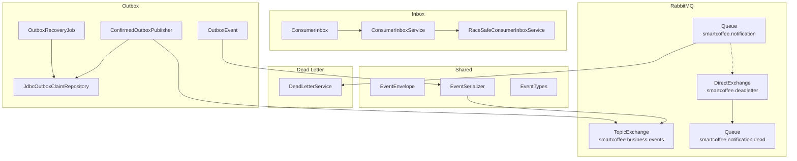
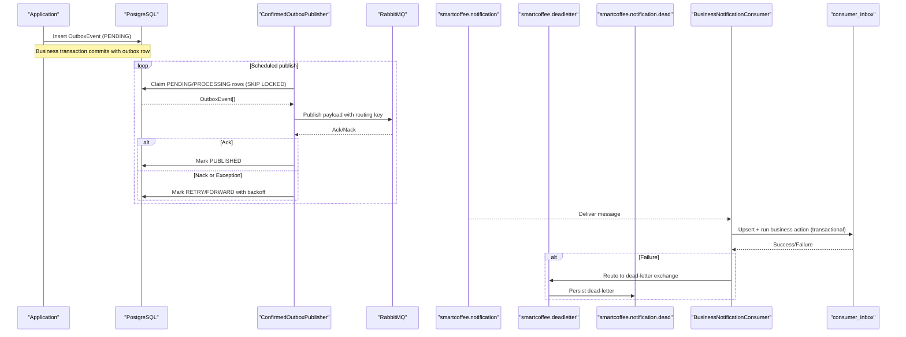
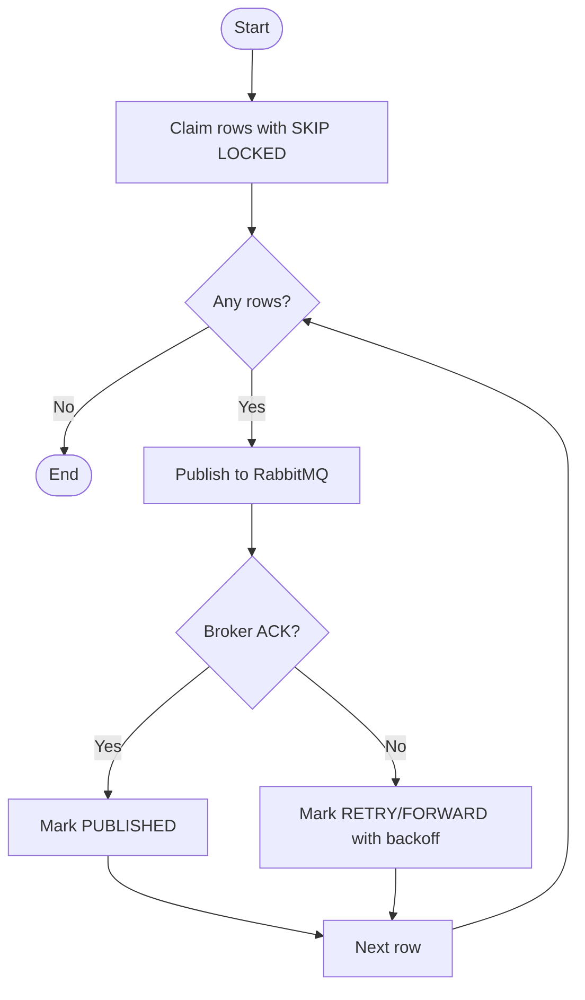
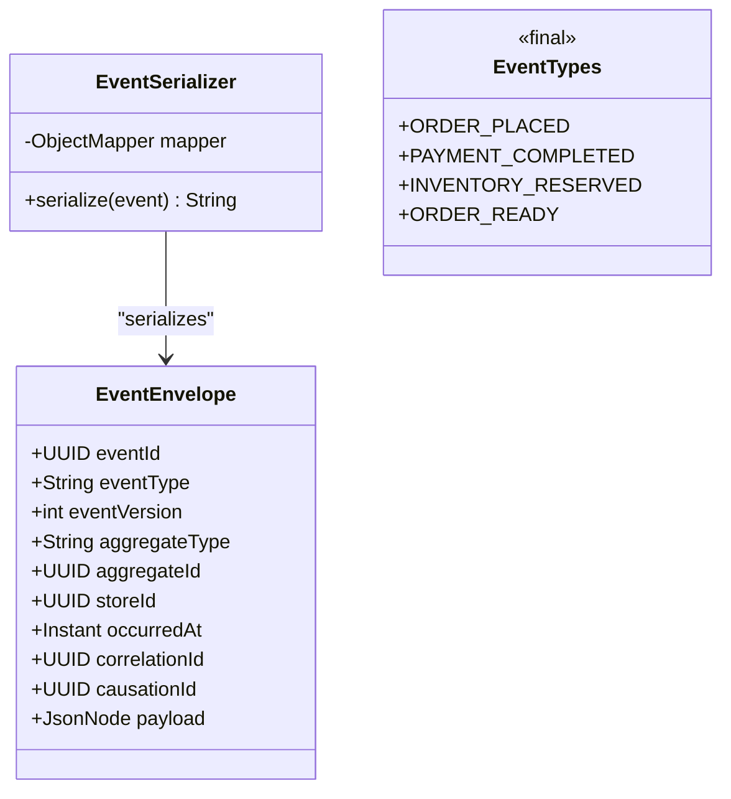
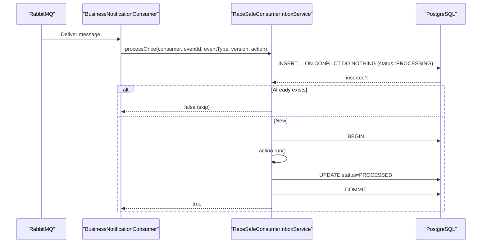
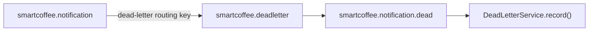
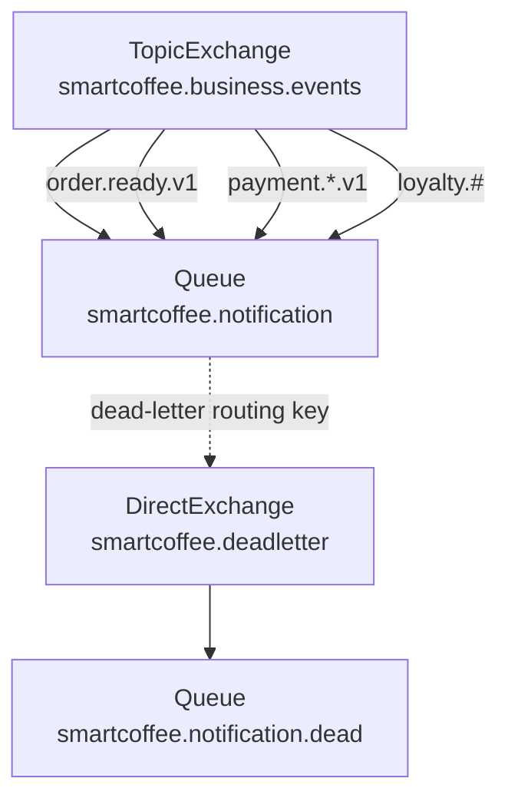
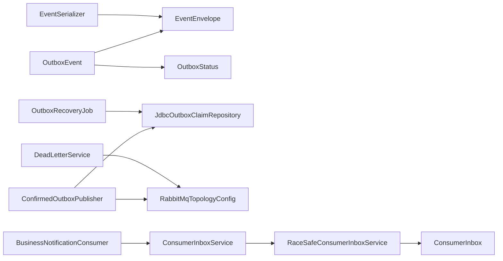

# Message Queue & Event Processing

<cite>
**Referenced Files in This Document**
- [OutboxEvent.java](file://src/main/java/com/smartcoffee/infrastructure/messaging/outbox/OutboxEvent.java)
- [ConfirmedOutboxPublisher.java](file://src/main/java/com/smartcoffee/infrastructure/messaging/outbox/ConfirmedOutboxPublisher.java)
- [OutboxRecoveryJob.java](file://src/main/java/com/smartcoffee/infrastructure/messaging/outbox/OutboxRecoveryJob.java)
- [JdbcOutboxClaimRepository.java](file://src/main/java/com/smartcoffee/infrastructure/messaging/outbox/JdbcOutboxClaimRepository.java)
- [OutboxStatus.java](file://src/main/java/com/smartcoffee/infrastructure/messaging/outbox/OutboxStatus.java)
- [EventSerializer.java](file://src/main/java/com/smartcoffee/infrastructure/messaging/EventSerializer.java)
- [EventTypes.java](file://src/main/java/com/smartcoffee/infrastructure/messaging/EventTypes.java)
- [EventEnvelope.java](file://src/main/java/com/smartcoffee/infrastructure/messaging/EventEnvelope.java)
- [ConsumerInbox.java](file://src/main/java/com/smartcoffee/infrastructure/messaging/inbox/ConsumerInbox.java)
- [ConsumerInboxService.java](file://src/main/java/com/smartcoffee/infrastructure/messaging/inbox/ConsumerInboxService.java)
- [RaceSafeConsumerInboxService.java](file://src/main/java/com/smartcoffee/infrastructure/messaging/inbox/RaceSafeConsumerInboxService.java)
- [InboxStatus.java](file://src/main/java/com/smartcoffee/infrastructure/messaging/inbox/InboxStatus.java)
- [DeadLetterService.java](file://src/main/java/com/smartcoffee/infrastructure/messaging/deadletter/DeadLetterService.java)
- [RabbitMqTopologyConfig.java](file://src/main/java/com/smartcoffee/config/RabbitMqTopologyConfig.java)
- [BusinessNotificationConsumer.java](file://src/main/java/com/smartcoffee/modules/notification/consumer/BusinessNotificationConsumer.java)
</cite>

## Table of Contents
1. [Introduction](#introduction)
2. [Project Structure](#project-structure)
3. [Core Components](#core-components)
4. [Architecture Overview](#architecture-overview)
5. [Detailed Component Analysis](#detailed-component-analysis)
6. [Dependency Analysis](#dependency-analysis)
7. [Performance Considerations](#performance-considerations)
8. [Troubleshooting Guide](#troubleshooting-guide)
9. [Conclusion](#conclusion)

## Introduction
This document explains the RabbitMQ-based event-driven architecture for reliable, idempotent messaging. It covers:
- Transactional outbox pattern using OutboxEvent, ConfirmedOutboxPublisher, and OutboxRecoveryJob
- Message serialization with EventSerializer
- Event types and envelope handling via EventTypes and EventEnvelope
- Inbox processing with ConsumerInbox and RaceSafeConsumerInboxService
- Dead letter handling with DeadLetterService
- Queue topology configuration and routing strategies
- Error handling patterns and monitoring approaches
- Practical examples for publishing events, consuming messages, and handling failures

## Project Structure
The messaging subsystem is organized under infrastructure.messaging with clear separation between outbox (publishers), inbox (consumers), shared envelopes/types, and dead-letter utilities. Topology is configured centrally.

**Diagram sources**
- [OutboxEvent.java:15-62](file://src/main/java/com/smartcoffee/infrastructure/messaging/outbox/OutboxEvent.java#L15-L62)
- [ConfirmedOutboxPublisher.java:13-57](file://src/main/java/com/smartcoffee/infrastructure/messaging/outbox/ConfirmedOutboxPublisher.java#L13-L57)
- [JdbcOutboxClaimRepository.java:16-104](file://src/main/java/com/smartcoffee/infrastructure/messaging/outbox/JdbcOutboxClaimRepository.java#L16-L104)
- [OutboxRecoveryJob.java:6-13](file://src/main/java/com/smartcoffee/infrastructure/messaging/outbox/OutboxRecoveryJob.java#L6-L13)
- [EventEnvelope.java:8-50](file://src/main/java/com/smartcoffee/infrastructure/messaging/EventEnvelope.java#L8-L50)
- [EventSerializer.java:6-20](file://src/main/java/com/smartcoffee/infrastructure/messaging/EventSerializer.java#L6-L20)
- [EventTypes.java:3-9](file://src/main/java/com/smartcoffee/infrastructure/messaging/EventTypes.java#L3-L9)
- [ConsumerInbox.java:7-45](file://src/main/java/com/smartcoffee/infrastructure/messaging/inbox/ConsumerInbox.java#L7-L45)
- [ConsumerInboxService.java:7-32](file://src/main/java/com/smartcoffee/infrastructure/messaging/inbox/ConsumerInboxService.java#L7-L32)
- [RaceSafeConsumerInboxService.java:9-122](file://src/main/java/com/smartcoffee/infrastructure/messaging/inbox/RaceSafeConsumerInboxService.java#L9-L122)
- [DeadLetterService.java:6-12](file://src/main/java/com/smartcoffee/infrastructure/messaging/deadletter/DeadLetterService.java#L6-L12)
- [RabbitMqTopologyConfig.java:13-85](file://src/main/java/com/smartcoffee/config/RabbitMqTopologyConfig.java#L13-L85)

**Section sources**
- [RabbitMqTopologyConfig.java:13-85](file://src/main/java/com/smartcoffee/config/RabbitMqTopologyConfig.java#L13-L85)

## Core Components
- OutboxEvent: Persistent representation of an event to be published, including metadata, payload, status, timing, and retry counters.
- ConfirmedOutboxPublisher: Scheduled publisher that claims pending outbox rows, publishes to RabbitMQ with confirmation, and updates status accordingly.
- OutboxRecoveryJob: Scheduled job placeholder for recovering stale PROCESSING entries once claim strategy is finalized.
- JdbcOutboxClaimRepository: Low-level repository implementing optimistic claiming with SKIP LOCKED, exponential backoff, and error tracking.
- EventEnvelope: Immutable record carrying event identity, type, version, aggregate context, correlation/causation IDs, timestamp, and JSON payload.
- EventSerializer: JSON serializer wrapping ObjectMapper for converting envelopes to strings.
- EventTypes: Centralized constants for known event names.
- ConsumerInbox: Persistence model for deduplication and lifecycle tracking of consumed events.
- ConsumerInboxService / RaceSafeConsumerInboxService: Idempotent consumer wrapper ensuring exactly-once processing semantics per consumer/event pair within a transaction.
- DeadLetterService: Logging utility for recording dead-lettered events.

**Section sources**
- [OutboxEvent.java:15-216](file://src/main/java/com/smartcoffee/infrastructure/messaging/outbox/OutboxEvent.java#L15-L216)
- [ConfirmedOutboxPublisher.java:13-57](file://src/main/java/com/smartcoffee/infrastructure/messaging/outbox/ConfirmedOutboxPublisher.java#L13-L57)
- [OutboxRecoveryJob.java:6-13](file://src/main/java/com/smartcoffee/infrastructure/messaging/outbox/OutboxRecoveryJob.java#L6-L13)
- [JdbcOutboxClaimRepository.java:16-180](file://src/main/java/com/smartcoffee/infrastructure/messaging/outbox/JdbcOutboxClaimRepository.java#L16-L180)
- [EventEnvelope.java:8-50](file://src/main/java/com/smartcoffee/infrastructure/messaging/EventEnvelope.java#L8-L50)
- [EventSerializer.java:6-20](file://src/main/java/com/smartcoffee/infrastructure/messaging/EventSerializer.java#L6-L20)
- [EventTypes.java:3-9](file://src/main/java/com/smartcoffee/infrastructure/messaging/EventTypes.java#L3-L9)
- [ConsumerInbox.java:7-45](file://src/main/java/com/smartcoffee/infrastructure/messaging/inbox/ConsumerInbox.java#L7-L45)
- [ConsumerInboxService.java:7-32](file://src/main/java/com/smartcoffee/infrastructure/messaging/inbox/ConsumerInboxService.java#L7-L32)
- [RaceSafeConsumerInboxService.java:9-122](file://src/main/java/com/smartcoffee/infrastructure/messaging/inbox/RaceSafeConsumerInboxService.java#L9-L122)
- [DeadLetterService.java:6-12](file://src/main/java/com/smartcoffee/infrastructure/messaging/deadletter/DeadLetterService.java#L6-L12)

## Architecture Overview
The system uses a transactional outbox to guarantee at-least-once delivery with eventual consistency. Consumers use an inbox table to ensure idempotency. RabbitMQ provides durable exchanges and queues with dead-letter routing for failed messages.

**Diagram sources**
- [ConfirmedOutboxPublisher.java:28-57](file://src/main/java/com/smartcoffee/infrastructure/messaging/outbox/ConfirmedOutboxPublisher.java#L28-L57)
- [JdbcOutboxClaimRepository.java:26-104](file://src/main/java/com/smartcoffee/infrastructure/messaging/outbox/JdbcOutboxClaimRepository.java#L26-L104)
- [RabbitMqTopologyConfig.java:25-85](file://src/main/java/com/smartcoffee/config/RabbitMqTopologyConfig.java#L25-L85)
- [BusinessNotificationConsumer.java:33-42](file://src/main/java/com/smartcoffee/modules/notification/consumer/BusinessNotificationConsumer.java#L33-L42)
- [RaceSafeConsumerInboxService.java:48-122](file://src/main/java/com/smartcoffee/infrastructure/messaging/inbox/RaceSafeConsumerInboxService.java#L48-L122)

## Detailed Component Analysis

### Transactional Outbox Pattern
- OutboxEvent stores all necessary metadata and payload for later publication. It enforces required fields and supports state transitions (PENDING -> PROCESSING -> PUBLISHED or FAILED).
- JdbcOutboxClaimRepository implements safe claiming across multiple publishers using SKIP LOCKED and sets claimed_by/claimed_at for ownership. It applies exponential backoff and caps attempts before marking FAILED.
- ConfirmedOutboxPublisher polls periodically, claims a batch, publishes with CorrelationData, and updates status based on broker ack/nack or exceptions.
- OutboxRecoveryJob is a scheduled hook for future stale PROCESSING recovery logic.

**Diagram sources**
- [JdbcOutboxClaimRepository.java:26-104](file://src/main/java/com/smartcoffee/infrastructure/messaging/outbox/JdbcOutboxClaimRepository.java#L26-L104)
- [ConfirmedOutboxPublisher.java:28-57](file://src/main/java/com/smartcoffee/infrastructure/messaging/outbox/ConfirmedOutboxPublisher.java#L28-L57)

**Section sources**
- [OutboxEvent.java:15-216](file://src/main/java/com/smartcoffee/infrastructure/messaging/outbox/OutboxEvent.java#L15-L216)
- [JdbcOutboxClaimRepository.java:26-180](file://src/main/java/com/smartcoffee/infrastructure/messaging/outbox/JdbcOutboxClaimRepository.java#L26-L180)
- [ConfirmedOutboxPublisher.java:13-57](file://src/main/java/com/smartcoffee/infrastructure/messaging/outbox/ConfirmedOutboxPublisher.java#L13-L57)
- [OutboxRecoveryJob.java:6-13](file://src/main/java/com/smartcoffee/infrastructure/messaging/outbox/OutboxRecoveryJob.java#L6-L13)

### Message Serialization and Envelope Handling
- EventEnvelope defines a strict contract for event identity, type, version, aggregate context, correlation/causation, timestamp, and JSON payload. Validation ensures required fields are present.
- EventSerializer wraps ObjectMapper to serialize envelopes into JSON strings for persistence and transport.
- EventTypes centralizes known event names used across modules.

**Diagram sources**
- [EventEnvelope.java:8-50](file://src/main/java/com/smartcoffee/infrastructure/messaging/EventEnvelope.java#L8-L50)
- [EventSerializer.java:6-20](file://src/main/java/com/smartcoffee/infrastructure/messaging/EventSerializer.java#L6-L20)
- [EventTypes.java:3-9](file://src/main/java/com/smartcoffee/infrastructure/messaging/EventTypes.java#L3-L9)

**Section sources**
- [EventEnvelope.java:8-50](file://src/main/java/com/smartcoffee/infrastructure/messaging/EventEnvelope.java#L8-L50)
- [EventSerializer.java:6-20](file://src/main/java/com/smartcoffee/infrastructure/messaging/EventSerializer.java#L6-L20)
- [EventTypes.java:3-9](file://src/main/java/com/smartcoffee/infrastructure/messaging/EventTypes.java#L3-L9)

### Inbox Processing and Idempotency
- ConsumerInbox persists each received event with a unique constraint on (consumer_name, event_id) to prevent duplicate processing.
- RaceSafeConsumerInboxService performs an upsert with status PROCESSING, executes the business action inside a transaction, then marks it PROCESSED. If the action fails, the entire transaction rolls back, allowing safe retries.
- ConsumerInboxService exposes a simple facade for consumers.

**Diagram sources**
- [RaceSafeConsumerInboxService.java:48-122](file://src/main/java/com/smartcoffee/infrastructure/messaging/inbox/RaceSafeConsumerInboxService.java#L48-L122)
- [ConsumerInbox.java:7-45](file://src/main/java/com/smartcoffee/infrastructure/messaging/inbox/ConsumerInbox.java#L7-L45)
- [BusinessNotificationConsumer.java:33-42](file://src/main/java/com/smartcoffee/modules/notification/consumer/BusinessNotificationConsumer.java#L33-L42)

**Section sources**
- [ConsumerInbox.java:7-45](file://src/main/java/com/smartcoffee/infrastructure/messaging/inbox/ConsumerInbox.java#L7-L45)
- [ConsumerInboxService.java:7-32](file://src/main/java/com/smartcoffee/infrastructure/messaging/inbox/ConsumerInboxService.java#L7-L32)
- [RaceSafeConsumerInboxService.java:9-122](file://src/main/java/com/smartcoffee/infrastructure/messaging/inbox/RaceSafeConsumerInboxService.java#L9-L122)

### Dead Letter Handling
- RabbitMqTopologyConfig configures a dead-letter exchange and queue, and attaches a dead-letter routing key to the notification queue so failed messages are routed automatically.
- DeadLetterService records dead-letter events with identifiers and error codes for observability.

**Diagram sources**
- [RabbitMqTopologyConfig.java:41-85](file://src/main/java/com/smartcoffee/config/RabbitMqTopologyConfig.java#L41-L85)
- [DeadLetterService.java:6-12](file://src/main/java/com/smartcoffee/infrastructure/messaging/deadletter/DeadLetterService.java#L6-L12)

**Section sources**
- [RabbitMqTopologyConfig.java:41-85](file://src/main/java/com/smartcoffee/config/RabbitMqTopologyConfig.java#L41-L85)
- [DeadLetterService.java:6-12](file://src/main/java/com/smartcoffee/infrastructure/messaging/deadletter/DeadLetterService.java#L6-L12)

### Queue Topology and Routing Strategies
- Topic exchange smartcoffee.business.events routes messages by routing keys such as order.ready.v1, payment.*.v1, loyalty.#.
- The notification queue subscribes to these patterns and forwards failures to smartcoffee.deadletter with routing key notification.dead.

**Diagram sources**
- [RabbitMqTopologyConfig.java:25-85](file://src/main/java/com/smartcoffee/config/RabbitMqTopologyConfig.java#L25-L85)

**Section sources**
- [RabbitMqTopologyConfig.java:25-85](file://src/main/java/com/smartcoffee/config/RabbitMqTopologyConfig.java#L25-L85)

## Dependency Analysis

**Diagram sources**
- [OutboxEvent.java:15-62](file://src/main/java/com/smartcoffee/infrastructure/messaging/outbox/OutboxEvent.java#L15-L62)
- [OutboxStatus.java:3-5](file://src/main/java/com/smartcoffee/infrastructure/messaging/outbox/OutboxStatus.java#L3-L5)
- [ConfirmedOutboxPublisher.java:13-57](file://src/main/java/com/smartcoffee/infrastructure/messaging/outbox/ConfirmedOutboxPublisher.java#L13-L57)
- [JdbcOutboxClaimRepository.java:16-104](file://src/main/java/com/smartcoffee/infrastructure/messaging/outbox/JdbcOutboxClaimRepository.java#L16-L104)
- [OutboxRecoveryJob.java:6-13](file://src/main/java/com/smartcoffee/infrastructure/messaging/outbox/OutboxRecoveryJob.java#L6-L13)
- [EventSerializer.java:6-20](file://src/main/java/com/smartcoffee/infrastructure/messaging/EventSerializer.java#L6-L20)
- [EventEnvelope.java:8-50](file://src/main/java/com/smartcoffee/infrastructure/messaging/EventEnvelope.java#L8-L50)
- [BusinessNotificationConsumer.java:33-42](file://src/main/java/com/smartcoffee/modules/notification/consumer/BusinessNotificationConsumer.java#L33-L42)
- [ConsumerInboxService.java:7-32](file://src/main/java/com/smartcoffee/infrastructure/messaging/inbox/ConsumerInboxService.java#L7-L32)
- [RaceSafeConsumerInboxService.java:9-122](file://src/main/java/com/smartcoffee/infrastructure/messaging/inbox/RaceSafeConsumerInboxService.java#L9-L122)
- [ConsumerInbox.java:7-45](file://src/main/java/com/smartcoffee/infrastructure/messaging/inbox/ConsumerInbox.java#L7-L45)
- [DeadLetterService.java:6-12](file://src/main/java/com/smartcoffee/infrastructure/messaging/deadletter/DeadLetterService.java#L6-L12)
- [RabbitMqTopologyConfig.java:25-85](file://src/main/java/com/smartcoffee/config/RabbitMqTopologyConfig.java#L25-L85)

**Section sources**
- [OutboxEvent.java:15-216](file://src/main/java/com/smartcoffee/infrastructure/messaging/outbox/OutboxEvent.java#L15-L216)
- [ConfirmedOutboxPublisher.java:13-57](file://src/main/java/com/smartcoffee/infrastructure/messaging/outbox/ConfirmedOutboxPublisher.java#L13-L57)
- [JdbcOutboxClaimRepository.java:16-180](file://src/main/java/com/smartcoffee/infrastructure/messaging/outbox/JdbcOutboxClaimRepository.java#L16-L180)
- [EventEnvelope.java:8-50](file://src/main/java/com/smartcoffee/infrastructure/messaging/EventEnvelope.java#L8-L50)
- [EventSerializer.java:6-20](file://src/main/java/com/smartcoffee/infrastructure/messaging/EventSerializer.java#L6-L20)
- [ConsumerInboxService.java:7-32](file://src/main/java/com/smartcoffee/infrastructure/messaging/inbox/ConsumerInboxService.java#L7-L32)
- [RaceSafeConsumerInboxService.java:9-122](file://src/main/java/com/smartcoffee/infrastructure/messaging/inbox/RaceSafeConsumerInboxService.java#L9-L122)
- [RabbitMqTopologyConfig.java:25-85](file://src/main/java/com/smartcoffee/config/RabbitMqTopologyConfig.java#L25-L85)

## Performance Considerations
- Outbox batching: ConfirmedOutboxPublisher claims batches sized by app.outbox.batch-size to reduce round-trips.
- Exponential backoff: Retry intervals grow exponentially up to a cap, reducing pressure during transient failures.
- SKIP LOCKED: Database-level locking avoids contention among multiple publisher instances.
- Durable exchanges and queues: Ensures resilience against broker restarts.
- Idempotent consumers: Inbox deduplication prevents duplicate side effects under retries.

[No sources needed since this section provides general guidance]

## Troubleshooting Guide
Common issues and resolutions:
- Events not appearing on the queue:
  - Verify outbox rows exist with status PENDING and available_at in the past.
  - Check publisher scheduling and logs for claim/publish errors.
- Duplicate processing:
  - Ensure consumers call processOnce with consistent consumer name and event ID.
  - Validate unique constraints on consumer_inbox are enforced.
- Messages sent to dead letters:
  - Inspect dead-letter queue and DeadLetterService logs for error codes.
  - Review consumer logic for unhandled exceptions.
- Stale PROCESSING outbox events:
  - Implement recovery in OutboxRecoveryJob to reset stale claims after a timeout.

**Section sources**
- [ConfirmedOutboxPublisher.java:28-57](file://src/main/java/com/smartcoffee/infrastructure/messaging/outbox/ConfirmedOutboxPublisher.java#L28-L57)
- [RaceSafeConsumerInboxService.java:48-122](file://src/main/java/com/smartcoffee/infrastructure/messaging/inbox/RaceSafeConsumerInboxService.java#L48-L122)
- [DeadLetterService.java:6-12](file://src/main/java/com/smartcoffee/infrastructure/messaging/deadletter/DeadLetterService.java#L6-L12)
- [OutboxRecoveryJob.java:6-13](file://src/main/java/com/smartcoffee/infrastructure/messaging/outbox/OutboxRecoveryJob.java#L6-L13)

## Conclusion
This architecture provides reliable, idempotent messaging through a transactional outbox and inbox pattern, backed by durable RabbitMQ topology and dead-letter handling. Publishers safely claim and publish events with broker confirmations, while consumers enforce exactly-once semantics per consumer/event pair. Monitoring and troubleshooting are supported via structured logging and dead-letter queues.

[No sources needed since this section summarizes without analyzing specific files]