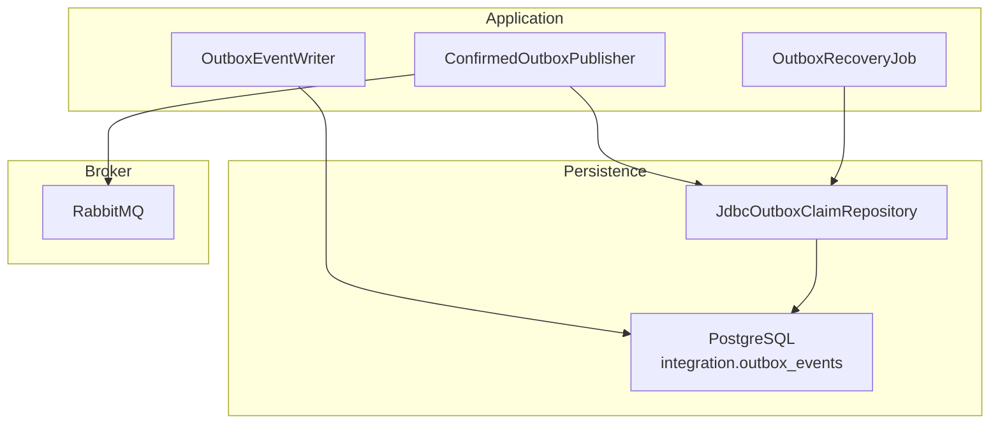
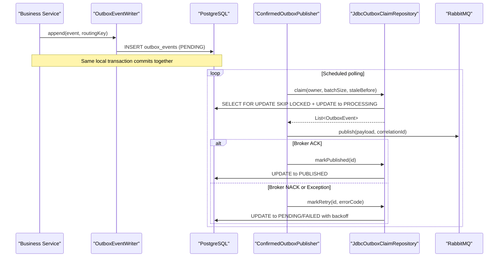
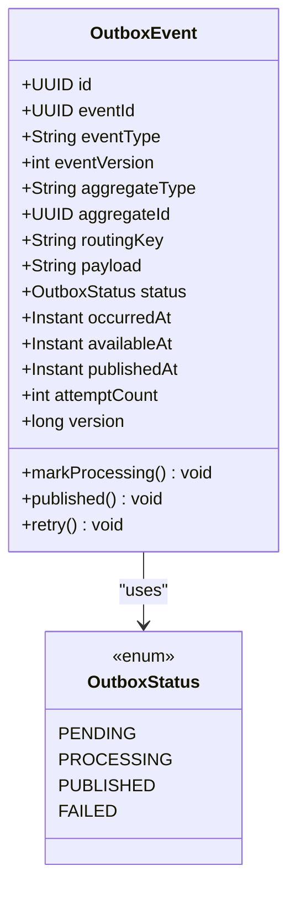
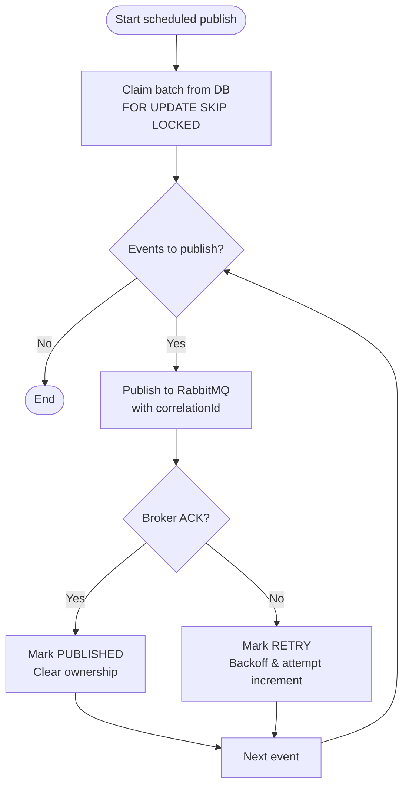
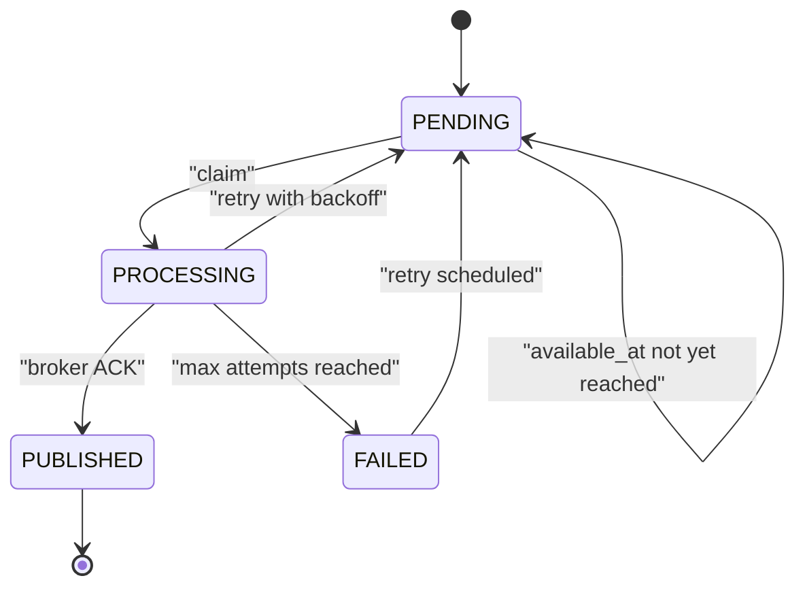
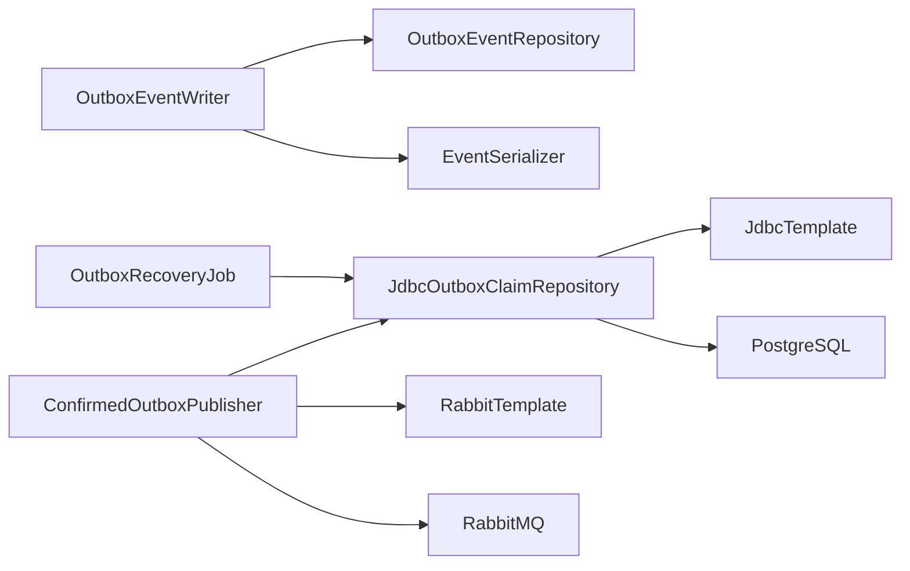

# Transactional Outbox Pattern

<cite>
**Referenced Files in This Document**
- [ADR-004-transactional-outbox.md](file://adr/ADR-004-transactional-outbox.md)
- [OutboxEvent.java](file://src/main/java/com/smartcoffee/infrastructure/messaging/outbox/OutboxEvent.java)
- [OutboxStatus.java](file://src/main/java/com/smartcoffee/infrastructure/messaging/outbox/OutboxStatus.java)
- [ConfirmedOutboxPublisher.java](file://src/main/java/com/smartcoffee/infrastructure/messaging/outbox/ConfirmedOutboxPublisher.java)
- [OutboxRecoveryJob.java](file://src/main/java/com/smartcoffee/infrastructure/messaging/outbox/OutboxRecoveryJob.java)
- [JdbcOutboxClaimRepository.java](file://src/main/java/com/smartcoffee/infrastructure/messaging/outbox/JdbcOutboxClaimRepository.java)
- [OutboxClaimRepository.java](file://src/main/java/com/smartcoffee/infrastructure/messaging/outbox/OutboxClaimRepository.java)
- [OutboxEventWriter.java](file://src/main/java/com/smartcoffee/infrastructure/messaging/outbox/OutboxEventWriter.java)
- [V011__infrastructure_hardening.sql](file://src/main/resources/db/migration/V011__infrastructure_hardening.sql)
- [V012__fix_outbox_claiming.sql](file://src/main/resources/db/migration/V012__fix_outbox_claiming.sql)
</cite>

## Table of Contents
1. [Introduction](#introduction)
2. [Project Structure](#project-structure)
3. [Core Components](#core-components)
4. [Architecture Overview](#architecture-overview)
5. [Detailed Component Analysis](#detailed-component-analysis)
6. [Dependency Analysis](#dependency-analysis)
7. [Performance Considerations](#performance-considerations)
8. [Troubleshooting Guide](#troubleshooting-guide)
9. [Conclusion](#conclusion)

## Introduction
This document explains the transactional outbox pattern implementation used to ensure reliable delivery of integration events from the application database to RabbitMQ. The core idea is to persist an event record within the same database transaction that performs a business operation, and then publish it asynchronously after broker confirmation. If publishing fails, the system retries with exponential backoff until success or a failure threshold.

The design guarantees:
- No event is published for data that later rolls back.
- Committed business changes eventually produce events.
- Consumers can safely tolerate duplicates because RabbitMQ uses at-least-once delivery.
- Failed deliveries are retried automatically and eventually succeed or move to a terminal state.

## Project Structure
The outbox implementation spans domain entities, persistence, scheduling, and messaging components:
- Entity and status model: OutboxEvent and OutboxStatus
- Writer API for appending events inside transactions: OutboxEventWriter
- Claim and publish coordination: ConfirmedOutboxPublisher and JdbcOutboxClaimRepository
- Background recovery job: OutboxRecoveryJob
- Database schema and indexes: V011__infrastructure_hardening.sql and V012__fix_outbox_claiming.sql
- Architectural decision reference: ADR-004-transactional-outbox.md

**Diagram sources**
- [OutboxEventWriter.java:18-21](file://src/main/java/com/smartcoffee/infrastructure/messaging/outbox/OutboxEventWriter.java#L18-L21)
- [ConfirmedOutboxPublisher.java:28-57](file://src/main/java/com/smartcoffee/infrastructure/messaging/outbox/ConfirmedOutboxPublisher.java#L28-L57)
- [JdbcOutboxClaimRepository.java:26-104](file://src/main/java/com/smartcoffee/infrastructure/messaging/outbox/JdbcOutboxClaimRepository.java#L26-L104)
- [V011__infrastructure_hardening.sql:12-71](file://src/main/resources/db/migration/V011__infrastructure_hardening.sql#L12-L71)

**Section sources**
- [ADR-004-transactional-outbox.md:14-20](file://adr/ADR-004-transactional-outbox.md#L14-L20)
- [V011__infrastructure_hardening.sql:12-71](file://src/main/resources/db/migration/V011__infrastructure_hardening.sql#L12-L71)

## Core Components
- OutboxEvent: Persistent representation of an integration event with metadata, payload, timestamps, attempt tracking, and optimistic concurrency control. It enforces valid state transitions when marking processing, publishing, or retrying.
- OutboxStatus: Enumerates lifecycle states PENDING, PROCESSING, PUBLISHED, FAILED.
- OutboxEventWriter: Writes an OutboxEvent into the database within an existing mandatory transaction, ensuring atomicity with business operations.
- JdbcOutboxClaimRepository: Claims a bounded batch of events using safe concurrent polling, marks them as claimed and processing, and updates status on publish success or failure.
- ConfirmedOutboxPublisher: Scheduled publisher that claims events, publishes to RabbitMQ with publisher confirmations, and records outcomes atomically via the claim repository.
- OutboxRecoveryJob: Scheduled component intended to recover stale processing entries; currently a placeholder awaiting finalization of the claim strategy.

**Section sources**
- [OutboxEvent.java:15-62](file://src/main/java/com/smartcoffee/infrastructure/messaging/outbox/OutboxEvent.java#L15-L62)
- [OutboxStatus.java:3-5](file://src/main/java/com/smartcoffee/infrastructure/messaging/outbox/OutboxStatus.java#L3-L5)
- [OutboxEventWriter.java:8-21](file://src/main/java/com/smartcoffee/infrastructure/messaging/outbox/OutboxEventWriter.java#L8-L21)
- [JdbcOutboxClaimRepository.java:16-104](file://src/main/java/com/smartcoffee/infrastructure/messaging/outbox/JdbcOutboxClaimRepository.java#L16-L104)
- [ConfirmedOutboxPublisher.java:13-26](file://src/main/java/com/smartcoffee/infrastructure/messaging/outbox/ConfirmedOutboxPublisher.java#L13-L26)
- [OutboxRecoveryJob.java:6-14](file://src/main/java/com/smartcoffee/infrastructure/messaging/outbox/OutboxRecoveryJob.java#L6-L14)

## Architecture Overview
The outbox pattern ensures reliability by decoupling business transactions from message publication while preserving ordering and idempotency guarantees through careful state management and retries.

**Diagram sources**
- [OutboxEventWriter.java:18-21](file://src/main/java/com/smartcoffee/infrastructure/messaging/outbox/OutboxEventWriter.java#L18-L21)
- [JdbcOutboxClaimRepository.java:26-104](file://src/main/java/com/smartcoffee/infrastructure/messaging/outbox/JdbcOutboxClaimRepository.java#L26-L104)
- [ConfirmedOutboxPublisher.java:28-57](file://src/main/java/com/smartcoffee/infrastructure/messaging/outbox/ConfirmedOutboxPublisher.java#L28-L57)
- [V011__infrastructure_hardening.sql:12-71](file://src/main/resources/db/migration/V011__infrastructure_hardening.sql#L12-L71)

## Detailed Component Analysis

### OutboxEvent and OutboxStatus
OutboxEvent models the durable event record and encapsulates state transitions:
- Creation sets status to PENDING and initializes timestamps and counters.
- markProcessing allows only PENDING or FAILED to transition to PROCESSING.
- published transitions to PUBLISHED and records published timestamp.
- retry resets to PENDING (or eventually FAILED), increments attemptCount, and schedules future availability with exponential backoff.

OutboxStatus enumerates the allowed states: PENDING, PROCESSING, PUBLISHED, FAILED.

**Diagram sources**
- [OutboxEvent.java:15-62](file://src/main/java/com/smartcoffee/infrastructure/messaging/outbox/OutboxEvent.java#L15-L62)
- [OutboxEvent.java:189-215](file://src/main/java/com/smartcoffee/infrastructure/messaging/outbox/OutboxEvent.java#L189-L215)
- [OutboxStatus.java:3-5](file://src/main/java/com/smartcoffee/infrastructure/messaging/outbox/OutboxStatus.java#L3-L5)

**Section sources**
- [OutboxEvent.java:67-95](file://src/main/java/com/smartcoffee/infrastructure/messaging/outbox/OutboxEvent.java#L67-L95)
- [OutboxEvent.java:189-215](file://src/main/java/com/smartcoffee/infrastructure/messaging/outbox/OutboxEvent.java#L189-L215)
- [OutboxStatus.java:3-5](file://src/main/java/com/smartcoffee/infrastructure/messaging/outbox/OutboxStatus.java#L3-L5)

### Writing Events to the Outbox
Use OutboxEventWriter.append within a service method that already participates in a database transaction. The writer requires an active transaction (MANDATORY propagation) and persists an OutboxEvent with status PENDING. This ensures the event is committed atomically with the business change.

Example usage pattern:
- In a service method annotated with @Transactional, call OutboxEventWriter.append with an EventEnvelope and routing key.
- On successful commit, the event becomes visible to the publisher.
- On rollback, no event is persisted.

**Section sources**
- [OutboxEventWriter.java:8-21](file://src/main/java/com/smartcoffee/infrastructure/messaging/outbox/OutboxEventWriter.java#L8-L21)
- [ADR-004-transactional-outbox.md:14-20](file://adr/ADR-004-transactional-outbox.md#L14-L20)

### Claiming and Publishing Confirmed Events
ConfirmedOutboxPublisher runs on a schedule and:
- Claims a batch of events via JdbcOutboxClaimRepository.claim.
- Publishes each event to RabbitMQ with a correlation ID.
- Waits for broker confirmation.
- On ACK, marks the event as published.
- On NACK or exception, marks the event for retry with an error code.

JdbcOutboxClaimRepository.claim:
- Selects eligible events (PENDING and available, or stale PROCESSING).
- Uses FOR UPDATE SKIP LOCKED to avoid contention across instances.
- Updates selected rows to PROCESSING, assigns owner and timestamps, and increments attempt_count.
- Returns the claimed events for publishing.

On success:
- markPublished sets status to PUBLISHED and clears ownership fields.

On failure:
- markRetry computes exponential backoff for available_at and either sets status to PENDING or FAILED based on attempt thresholds.

**Diagram sources**
- [ConfirmedOutboxPublisher.java:28-57](file://src/main/java/com/smartcoffee/infrastructure/messaging/outbox/ConfirmedOutboxPublisher.java#L28-L57)
- [JdbcOutboxClaimRepository.java:26-104](file://src/main/java/com/smartcoffee/infrastructure/messaging/outbox/JdbcOutboxClaimRepository.java#L26-L104)
- [JdbcOutboxClaimRepository.java:106-157](file://src/main/java/com/smartcoffee/infrastructure/messaging/outbox/JdbcOutboxClaimRepository.java#L106-L157)

**Section sources**
- [ConfirmedOutboxPublisher.java:28-57](file://src/main/java/com/smartcoffee/infrastructure/messaging/outbox/ConfirmedOutboxPublisher.java#L28-L57)
- [JdbcOutboxClaimRepository.java:26-104](file://src/main/java/com/smartcoffee/infrastructure/messaging/outbox/JdbcOutboxClaimRepository.java#L26-L104)
- [JdbcOutboxClaimRepository.java:106-157](file://src/main/java/com/smartcoffee/infrastructure/messaging/outbox/JdbcOutboxClaimRepository.java#L106-L157)

### State Transitions and Rules
Allowed transitions enforced by the entity and repository:
- PENDING -> PROCESSING: When claimed by a publisher.
- PROCESSING -> PUBLISHED: After broker ACK.
- PROCESSING -> PENDING or FAILED: On publish failure with backoff; may escalate to FAILED after repeated attempts.
- FAILED -> PENDING: On retry scheduling (backoff).
- PUBLISHED: Terminal state indicating successful delivery.

**Diagram sources**
- [OutboxEvent.java:189-215](file://src/main/java/com/smartcoffee/infrastructure/messaging/outbox/OutboxEvent.java#L189-L215)
- [JdbcOutboxClaimRepository.java:127-157](file://src/main/java/com/smartcoffee/infrastructure/messaging/outbox/JdbcOutboxClaimRepository.java#L127-L157)
- [V011__infrastructure_hardening.sql:52-61](file://src/main/resources/db/migration/V011__infrastructure_hardening.sql#L52-L61)

**Section sources**
- [OutboxEvent.java:189-215](file://src/main/java/com/smartcoffee/infrastructure/messaging/outbox/OutboxEvent.java#L189-L215)
- [JdbcOutboxClaimRepository.java:127-157](file://src/main/java/com/smartcoffee/infrastructure/messaging/outbox/JdbcOutboxClaimRepository.java#L127-L157)
- [V011__infrastructure_hardening.sql:52-61](file://src/main/resources/db/migration/V011__infrastructure_hardening.sql#L52-L61)

### Recovery of Stale Processing Entries
OutboxRecoveryJob is a scheduled component intended to handle stale PROCESSING entries where a publisher crashed mid-processing. The current implementation is a placeholder pending finalization of the claim strategy. Once implemented, it should:
- Identify events stuck in PROCESSING beyond a staleness threshold.
- Reset ownership fields and set status to PENDING so another publisher can re-claim them.
- Ensure idempotency and avoid double-publishing by relying on consumer-side inbox deduplication.

**Section sources**
- [OutboxRecoveryJob.java:6-14](file://src/main/java/com/smartcoffee/infrastructure/messaging/outbox/OutboxRecoveryJob.java#L6-L14)

### Database Schema and Indexes
The schema defines the outbox table with constraints and indexes supporting efficient claiming and querying:
- Primary key and unique event_id enforce identity.
- Status check constraint limits values to allowed states.
- Timestamps track occurrence, availability, and publication.
- Attempt count and last error fields support retry and diagnostics.
- Indexes optimize queries for ready events, claiming, stale processing, and aggregate/routing-key scans.

A subsequent migration adds claimed_by and claimed_at columns and a partial index for stale processing detection.

**Section sources**
- [V011__infrastructure_hardening.sql:12-112](file://src/main/resources/db/migration/V011__infrastructure_hardening.sql#L12-L112)
- [V012__fix_outbox_claiming.sql:1-19](file://src/main/resources/db/migration/V012__fix_outbox_claiming.sql#L1-L19)

## Dependency Analysis
The following diagram shows how components depend on each other and external systems:

**Diagram sources**
- [OutboxEventWriter.java:8-21](file://src/main/java/com/smartcoffee/infrastructure/messaging/outbox/OutboxEventWriter.java#L8-L21)
- [ConfirmedOutboxPublisher.java:13-26](file://src/main/java/com/smartcoffee/infrastructure/messaging/outbox/ConfirmedOutboxPublisher.java#L13-L26)
- [JdbcOutboxClaimRepository.java:16-24](file://src/main/java/com/smartcoffee/infrastructure/messaging/outbox/JdbcOutboxClaimRepository.java#L16-L24)
- [OutboxRecoveryJob.java:6-14](file://src/main/java/com/smartcoffee/infrastructure/messaging/outbox/OutboxRecoveryJob.java#L6-L14)

**Section sources**
- [OutboxEventWriter.java:8-21](file://src/main/java/com/smartcoffee/infrastructure/messaging/outbox/OutboxEventWriter.java#L8-L21)
- [ConfirmedOutboxPublisher.java:13-26](file://src/main/java/com/smartcoffee/infrastructure/messaging/outbox/ConfirmedOutboxPublisher.java#L13-L26)
- [JdbcOutboxClaimRepository.java:16-24](file://src/main/java/com/smartcoffee/infrastructure/messaging/outbox/JdbcOutboxClaimRepository.java#L16-L24)
- [OutboxRecoveryJob.java:6-14](file://src/main/java/com/smartcoffee/infrastructure/messaging/outbox/OutboxRecoveryJob.java#L6-L14)

## Performance Considerations
- Batch size: ConfirmedOutboxPublisher reads batches configurable via app.outbox.batch-size to balance throughput and memory usage.
- Poll delay: Both publisher and background jobs use app.outbox.poll-delay-ms to tune frequency.
- Concurrency: FOR UPDATE SKIP LOCKED avoids row-level contention among multiple publisher instances.
- Backoff: Exponential backoff reduces pressure during transient failures and prevents thundering herds.
- Indexing: Ready and claim indexes minimize query latency for high-volume workloads.
- Idempotency: Consumer inbox deduplication tolerates duplicate messages from at-least-once delivery.

[No sources needed since this section provides general guidance]

## Troubleshooting Guide
Common issues and remedies:
- Events remain PENDING:
  - Verify available_at has passed and status is PENDING.
  - Check poll delay and batch size configuration.
  - Inspect indexes ix_outbox_ready and ix_outbox_claim.
- Events stuck in PROCESSING:
  - Ensure recovery logic is implemented to reset stale ownership.
  - Validate claimed_by and claimed_at are cleared after completion.
  - Monitor for crashes during publish and broker connectivity issues.
- Repeated retries:
  - Review last_error_code and last_error_message fields.
  - Check broker health and network connectivity.
  - Confirm max attempt thresholds and backoff intervals.
- Duplicate consumption:
  - Ensure consumers implement idempotent handling via consumer inbox.
  - Validate consumer_name and event_id uniqueness constraints.

Operational checks:
- Query outbox_events for status distribution and age of unpublished events.
- Monitor RabbitMQ publisher confirmations and negative acknowledgements.
- Set alerts for events exceeding service objectives without being published.

**Section sources**
- [JdbcOutboxClaimRepository.java:127-157](file://src/main/java/com/smartcoffee/infrastructure/messaging/outbox/JdbcOutboxClaimRepository.java#L127-L157)
- [ConfirmedOutboxPublisher.java:36-55](file://src/main/java/com/smartcoffee/infrastructure/messaging/outbox/ConfirmedOutboxPublisher.java#L36-L55)
- [V011__infrastructure_hardening.sql:73-112](file://src/main/resources/db/migration/V011__infrastructure_hardening.sql#L73-L112)

## Conclusion
The transactional outbox pattern in this codebase provides robust, eventually consistent event publication backed by PostgreSQL and RabbitMQ. By writing events within database transactions and publishing only after broker confirmation, the system avoids lost or premature events and supports safe retries with backoff. The claim mechanism enables safe concurrent polling, while the schema and indexes optimize performance. With proper monitoring and eventual recovery of stale processing entries, the outbox delivers reliable integration events suitable for microservice boundaries and asynchronous workflows.

[No sources needed since this section summarizes without analyzing specific files]