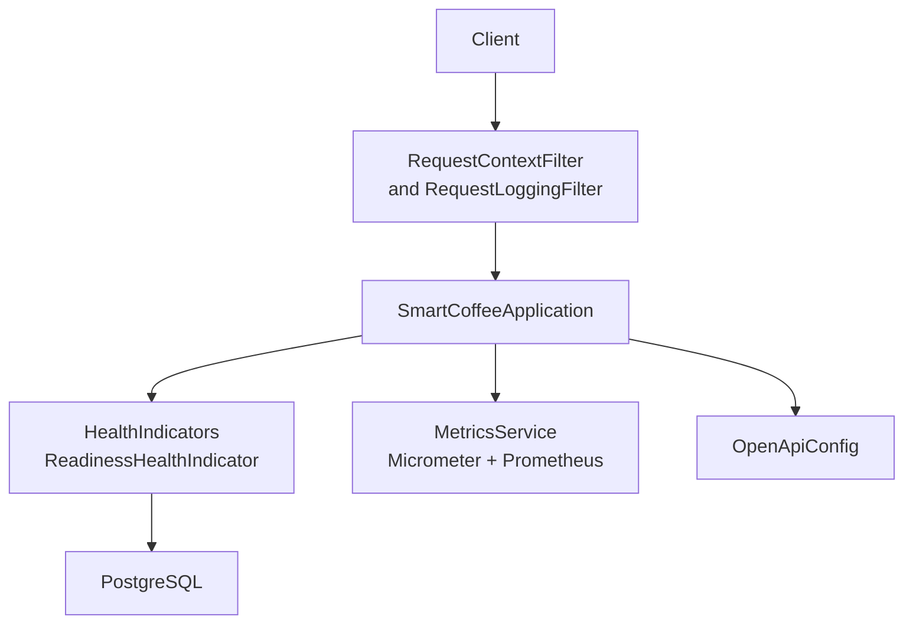
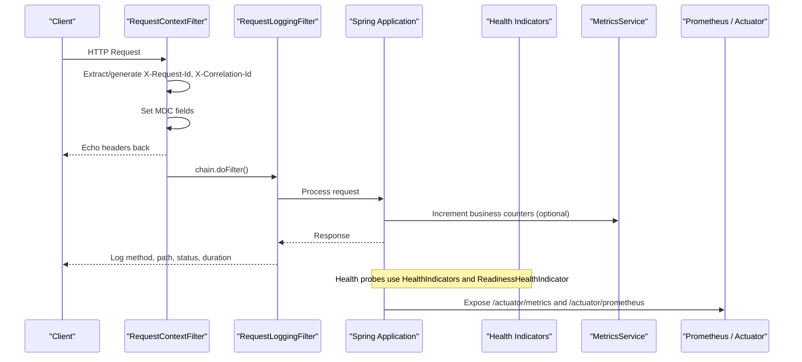
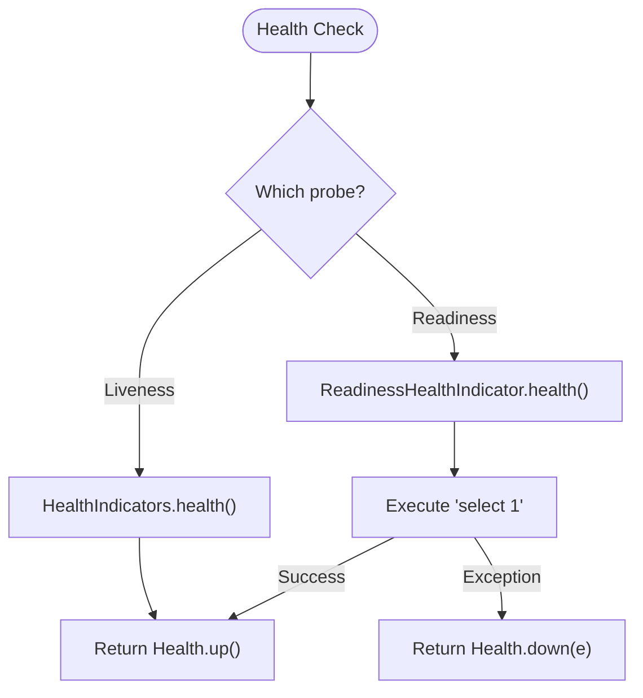
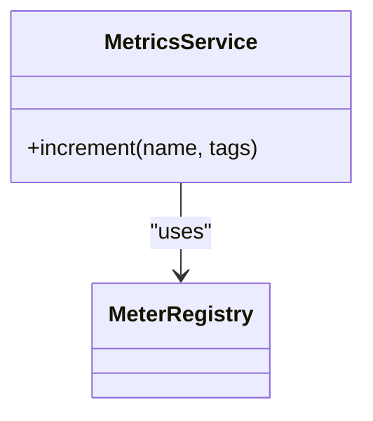
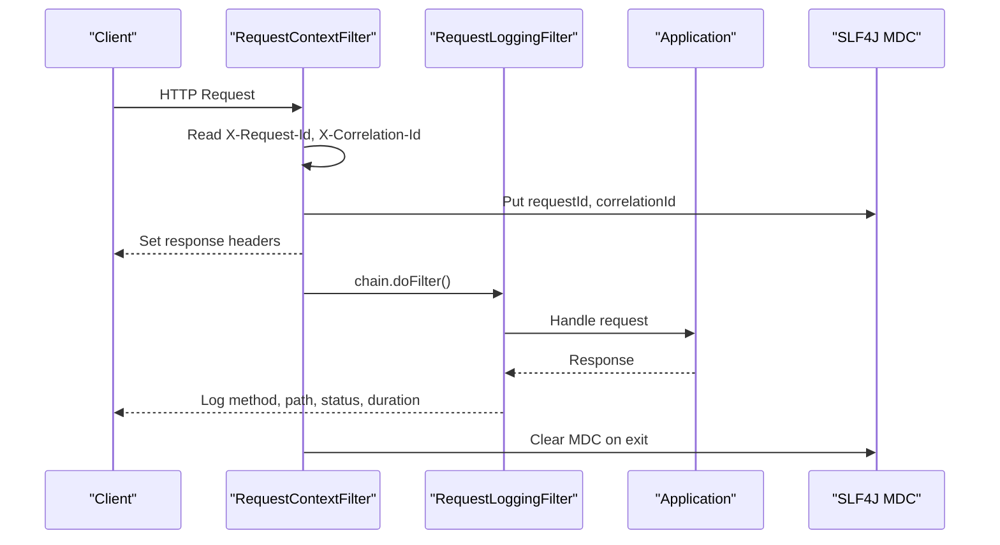
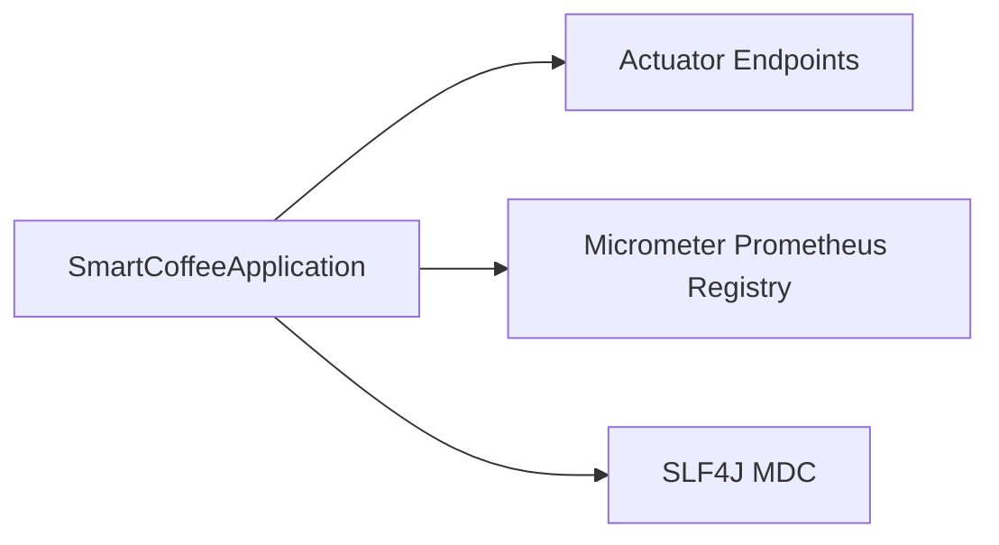

# Monitoring & Observability

<cite>
**Referenced Files in This Document**
- [HealthIndicators.java](file://src/main/java/com/smartcoffee/infrastructure/observability/HealthIndicators.java)
- [ReadinessHealthIndicator.java](file://src/main/java/com/smartcoffee/infrastructure/observability/ReadinessHealthIndicator.java)
- [MetricsService.java](file://src/main/java/com/smartcoffee/infrastructure/observability/MetricsService.java)
- [RequestLoggingFilter.java](file://src/main/java/com/smartcoffee/infrastructure/observability/RequestLoggingFilter.java)
- [OpenApiConfig.java](file://src/main/java/com/smartcoffee/config/OpenApiConfig.java)
- [CorrelationContext.java](file://src/main/java/com/smartcoffee/common/context/CorrelationContext.java)
- [RequestContext.java](file://src/main/java/com/smartcoffee/common/context/RequestContext.java)
- [RequestContextFilter.java](file://src/main/java/com/smartcoffee/common/context/RequestContextFilter.java)
- [application.yml](file://src/main/resources/application.yml)
- [SmartCoffeeApplication.java](file://src/main/java/com/smartcoffee/SmartCoffeeApplication.java)
- [pom.xml](file://pom.xml)
</cite>

## Table of Contents
1. [Introduction](#introduction)
2. [Project Structure](#project-structure)
3. [Core Components](#core-components)
4. [Architecture Overview](#architecture-overview)
5. [Detailed Component Analysis](#detailed-component-analysis)
6. [Dependency Analysis](#dependency-analysis)
7. [Performance Considerations](#performance-considerations)
8. [Troubleshooting Guide](#troubleshooting-guide)
9. [Conclusion](#conclusion)
10. [Appendices](#appendices)

## Introduction
This document explains how Smart Coffee Backend implements observability through health checks, metrics collection, request logging, OpenAPI documentation, and distributed tracing with correlation IDs. It covers the built-in Spring Boot Actuator endpoints, Micrometer-based metrics with Prometheus exposure, custom health indicators for liveness and readiness, structured request logs enriched with correlation identifiers, and guidance for extending the system with additional health checks, business metrics, Grafana dashboards, and alerting rules.

## Project Structure
Observability is implemented across a small set of focused components:
- Health checks: Liveness and readiness via Spring Boot Actuator and custom indicators.
- Metrics: Micrometer counters exposed to Prometheus via Actuator.
- Request tracing: A filter that logs HTTP requests with timing and enriches logs with correlation IDs.
- API documentation: OpenAPI configuration for Swagger UI.
- Correlation context: Thread-local context and MDC fields to propagate request identifiers across layers.

**Diagram sources**
- [RequestContextFilter.java:11-36](file://src/main/java/com/smartcoffee/common/context/RequestContextFilter.java#L11-L36)
- [RequestLoggingFilter.java:10-23](file://src/main/java/com/smartcoffee/infrastructure/observability/RequestLoggingFilter.java#L10-L23)
- [HealthIndicators.java:7-15](file://src/main/java/com/smartcoffee/infrastructure/observability/HealthIndicators.java#L7-L15)
- [ReadinessHealthIndicator.java:9-26](file://src/main/java/com/smartcoffee/infrastructure/observability/ReadinessHealthIndicator.java#L9-L26)
- [MetricsService.java:1-4](file://src/main/java/com/smartcoffee/infrastructure/observability/MetricsService.java#L1-L4)
- [OpenApiConfig.java:1-4](file://src/main/java/com/smartcoffee/config/OpenApiConfig.java#L1-L4)
- [SmartCoffeeApplication.java:5-8](file://src/main/java/com/smartcoffee/SmartCoffeeApplication.java#L5-L8)

**Section sources**
- [SmartCoffeeApplication.java:5-8](file://src/main/java/com/smartcoffee/SmartCoffeeApplication.java#L5-L8)
- [application.yml:81-93](file://src/main/resources/application.yml#L81-L93)

## Core Components
- HealthIndicators: Provides a simple liveness indicator reporting service identity.
- ReadinessHealthIndicator: Validates database connectivity by executing a minimal query; reports down on failure.
- MetricsService: Thin wrapper around Micrometer MeterRegistry to increment counters with optional tags.
- RequestLoggingFilter: Logs each HTTP request with method, path, status code, and duration.
- RequestContextFilter: Extracts or generates X-Request-Id and X-Correlation-Id, sets them in response headers, and populates MDC for structured logs.
- OpenApiConfig: Configures OpenAPI metadata for API documentation.

**Section sources**
- [HealthIndicators.java:7-15](file://src/main/java/com/smartcoffee/infrastructure/observability/HealthIndicators.java#L7-L15)
- [ReadinessHealthIndicator.java:9-26](file://src/main/java/com/smartcoffee/infrastructure/observability/ReadinessHealthIndicator.java#L9-L26)
- [MetricsService.java:1-4](file://src/main/java/com/smartcoffee/infrastructure/observability/MetricsService.java#L1-L4)
- [RequestLoggingFilter.java:10-23](file://src/main/java/com/smartcoffee/infrastructure/observability/RequestLoggingFilter.java#L10-L23)
- [RequestContextFilter.java:11-36](file://src/main/java/com/smartcoffee/common/context/RequestContextFilter.java#L11-L36)
- [OpenApiConfig.java:1-4](file://src/main/java/com/smartcoffee/config/OpenApiConfig.java#L1-L4)

## Architecture Overview
The runtime flow integrates request processing, correlation propagation, logging, metrics, and health checks.

**Diagram sources**
- [RequestContextFilter.java:11-36](file://src/main/java/com/smartcoffee/common/context/RequestContextFilter.java#L11-L36)
- [RequestLoggingFilter.java:10-23](file://src/main/java/com/smartcoffee/infrastructure/observability/RequestLoggingFilter.java#L10-L23)
- [MetricsService.java:1-4](file://src/main/java/com/smartcoffee/infrastructure/observability/MetricsService.java#L1-L4)
- [application.yml:81-93](file://src/main/resources/application.yml#L81-L93)

## Detailed Component Analysis

### Health Checks
- Liveness: HealthIndicators returns an up status with service detail. Suitable for container liveness probes.
- Readiness: ReadinessHealthIndicator queries the database using JdbcTemplate. Returns up when the query succeeds, otherwise down. Suitable for readiness probes before accepting traffic.

**Diagram sources**
- [HealthIndicators.java:7-15](file://src/main/java/com/smartcoffee/infrastructure/observability/HealthIndicators.java#L7-L15)
- [ReadinessHealthIndicator.java:9-26](file://src/main/java/com/smartcoffee/infrastructure/observability/ReadinessHealthIndicator.java#L9-L26)

**Section sources**
- [HealthIndicators.java:7-15](file://src/main/java/com/smartcoffee/infrastructure/observability/HealthIndicators.java#L7-L15)
- [ReadinessHealthIndicator.java:9-26](file://src/main/java/com/smartcoffee/infrastructure/observability/ReadinessHealthIndicator.java#L9-L26)
- [application.yml:81-93](file://src/main/resources/application.yml#L81-L93)

### Metrics Collection
- Micrometer integration is enabled via the Prometheus registry dependency.
- Actuator exposes metrics and Prometheus endpoints under management endpoints.
- MetricsService provides a simple counter increment API with optional tags for categorization.

**Diagram sources**
- [MetricsService.java:1-4](file://src/main/java/com/smartcoffee/infrastructure/observability/MetricsService.java#L1-L4)
- [pom.xml:172-177](file://pom.xml#L172-L177)
- [application.yml:81-93](file://src/main/resources/application.yml#L81-L93)

**Section sources**
- [MetricsService.java:1-4](file://src/main/java/com/smartcoffee/infrastructure/observability/MetricsService.java#L1-L4)
- [pom.xml:172-177](file://pom.xml#L172-L177)
- [application.yml:81-93](file://src/main/resources/application.yml#L81-L93)

### Request Logging and Tracing
- RequestLoggingFilter logs HTTP method, path, status, and duration for every request.
- RequestContextFilter extracts or generates X-Request-Id and X-Correlation-Id from request headers, echoes them back in responses, and populates MDC with requestId and correlationId for structured logging.
- CorrelationContext stores RequestContext per thread for programmatic access within the request scope.

**Diagram sources**
- [RequestContextFilter.java:11-36](file://src/main/java/com/smartcoffee/common/context/RequestContextFilter.java#L11-L36)
- [RequestLoggingFilter.java:10-23](file://src/main/java/com/smartcoffee/infrastructure/observability/RequestLoggingFilter.java#L10-L23)
- [CorrelationContext.java:3-25](file://src/main/java/com/smartcoffee/common/context/CorrelationContext.java#L3-L25)
- [RequestContext.java:1-8](file://src/main/java/com/smartcoffee/common/context/RequestContext.java#L1-L8)

**Section sources**
- [RequestLoggingFilter.java:10-23](file://src/main/java/com/smartcoffee/infrastructure/observability/RequestLoggingFilter.java#L10-L23)
- [RequestContextFilter.java:11-36](file://src/main/java/com/smartcoffee/common/context/RequestContextFilter.java#L11-L36)
- [CorrelationContext.java:3-25](file://src/main/java/com/smartcoffee/common/context/CorrelationContext.java#L3-L25)
- [RequestContext.java:1-8](file://src/main/java/com/smartcoffee/common/context/RequestContext.java#L1-L8)

### OpenAPI/Swagger Configuration
- OpenApiConfig defines OpenAPI metadata including title and version.
- Combined with Spring Boot Actuator and Swagger dependencies, this enables API documentation endpoints typically available at standard Swagger paths.

**Section sources**
- [OpenApiConfig.java:1-4](file://src/main/java/com/smartcoffee/config/OpenApiConfig.java#L1-L4)

## Dependency Analysis
Key runtime dependencies for observability:
- Spring Boot Actuator endpoints for health, info, metrics, and Prometheus are enabled in application configuration.
- Micrometer Prometheus registry is included as a dependency to expose metrics in Prometheus format.
- SLF4J MDC is used for correlation ID propagation in logs.

**Diagram sources**
- [application.yml:81-93](file://src/main/resources/application.yml#L81-L93)
- [pom.xml:172-177](file://pom.xml#L172-L177)
- [RequestContextFilter.java:11-36](file://src/main/java/com/smartcoffee/common/context/RequestContextFilter.java#L11-L36)

**Section sources**
- [application.yml:81-93](file://src/main/resources/application.yml#L81-L93)
- [pom.xml:172-177](file://pom.xml#L172-L177)

## Performance Considerations
- Health checks should be lightweight. The database readiness check executes a minimal query; ensure it remains fast and does not trigger heavy operations.
- RequestLoggingFilter logs after each request; consider log levels and sampling in high-throughput environments to avoid overhead.
- Metrics counters are cheap but can add overhead if incremented excessively; prefer batching or aggregating where appropriate.
- Avoid logging sensitive data in request/response bodies; rely on correlation IDs and structured fields for traceability.

[No sources needed since this section provides general guidance]

## Troubleshooting Guide
- Health endpoint issues:
  - Verify Actuator endpoints are exposed and probes are enabled in configuration.
  - If readiness is down, inspect database connectivity and credentials.
- Missing correlation IDs in logs:
  - Ensure RequestContextFilter is active and headers are present or generated.
  - Confirm MDC fields are populated and cleared properly.
- Metrics not visible:
  - Confirm Prometheus registry dependency is present and Actuator exposes metrics and prometheus endpoints.
  - Validate that Micrometer is initialized and counters are being incremented via MetricsService.
- OpenAPI docs not accessible:
  - Confirm OpenApiConfig is loaded and Swagger dependencies are available.

**Section sources**
- [application.yml:81-93](file://src/main/resources/application.yml#L81-L93)
- [ReadinessHealthIndicator.java:9-26](file://src/main/java/com/smartcoffee/infrastructure/observability/ReadinessHealthIndicator.java#L9-L26)
- [RequestContextFilter.java:11-36](file://src/main/java/com/smartcoffee/common/context/RequestContextFilter.java#L11-L36)
- [MetricsService.java:1-4](file://src/main/java/com/smartcoffee/infrastructure/observability/MetricsService.java#L1-L4)
- [OpenApiConfig.java:1-4](file://src/main/java/com/smartcoffee/config/OpenApiConfig.java#L1-L4)

## Conclusion
Smart Coffee Backend provides a solid observability foundation:
- Health checks for liveness and readiness with clear status reporting.
- Structured request logging with correlation IDs for end-to-end tracing.
- Micrometer-based metrics with Prometheus exposure for monitoring and alerting.
- OpenAPI configuration for API documentation.
To extend further, add custom health checks, instrument business flows with MetricsService, build Grafana dashboards from Prometheus metrics, and define alerting rules based on key indicators such as error rates, latency, and readiness failures.

[No sources needed since this section summarizes without analyzing specific files]

## Appendices

### Setup for Prometheus, Grafana, and Alerting
- Prometheus:
  - Scrape the /actuator/prometheus endpoint exposed by Actuator.
  - Configure job targets to include the backend service instances.
- Grafana:
  - Add Prometheus as a data source.
  - Create dashboards visualizing:
    - HTTP request rate and latency from request logs (via log aggregation) or metrics.
    - Business counters incremented via MetricsService.
    - Health statuses from Actuator health endpoint.
- Alerting Rules:
  - Define alerts for:
    - ReadinessHealthIndicator down (database connectivity issues).
    - High error rates or latency spikes.
    - Sudden drops in business metric counters indicating degraded functionality.

[No sources needed since this section provides general guidance]

### Examples: Adding Custom Health Checks and Collecting Business Metrics
- Custom health check:
  - Implement a new HealthIndicator component that checks a subsystem (e.g., cache or external API) and returns up/down with details.
  - Register it as a Spring component so Actuator includes it automatically.
- Collecting business metrics:
  - Inject MetricsService into domain or application services.
  - Call increment with a meaningful name and tags (e.g., category, outcome) to track events like order creation, payment attempts, or inventory updates.
- Debugging requests:
  - Use X-Request-Id and X-Correlation-Id headers to correlate logs across services.
  - Search logs by these IDs to reconstruct request flows and identify bottlenecks or errors.

**Section sources**
- [HealthIndicators.java:7-15](file://src/main/java/com/smartcoffee/infrastructure/observability/HealthIndicators.java#L7-L15)
- [ReadinessHealthIndicator.java:9-26](file://src/main/java/com/smartcoffee/infrastructure/observability/ReadinessHealthIndicator.java#L9-L26)
- [MetricsService.java:1-4](file://src/main/java/com/smartcoffee/infrastructure/observability/MetricsService.java#L1-L4)
- [RequestContextFilter.java:11-36](file://src/main/java/com/smartcoffee/common/context/RequestContextFilter.java#L11-L36)
- [RequestLoggingFilter.java:10-23](file://src/main/java/com/smartcoffee/infrastructure/observability/RequestLoggingFilter.java#L10-L23)