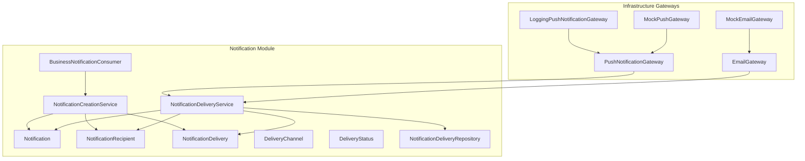
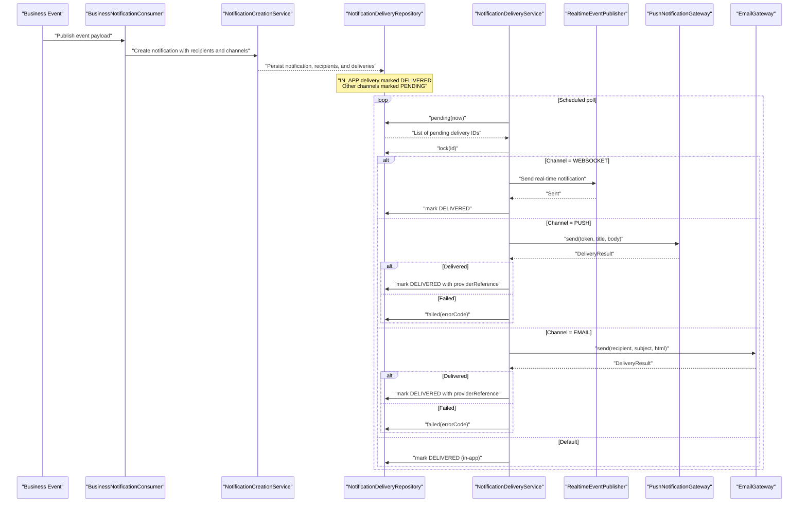
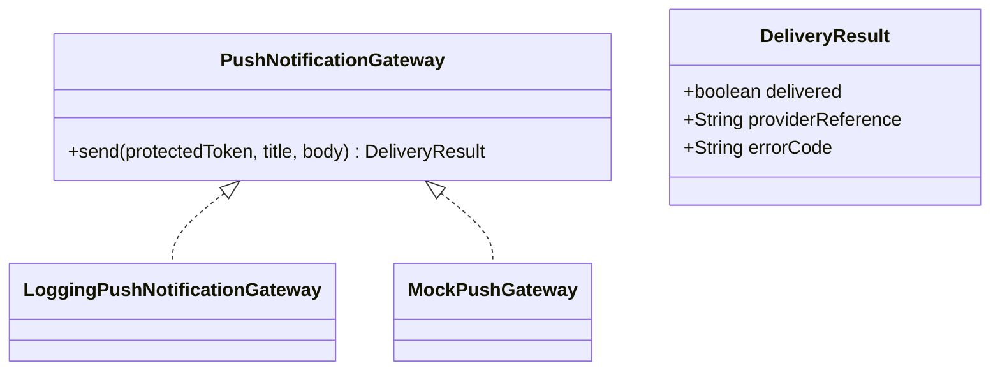
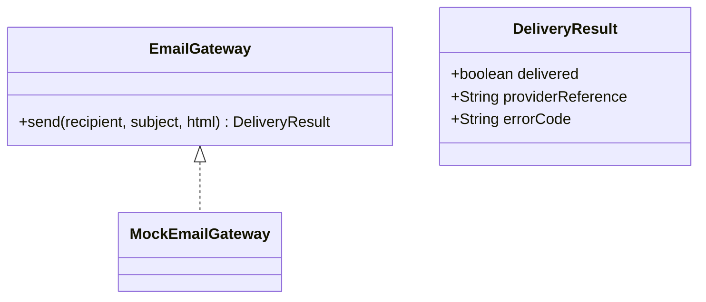
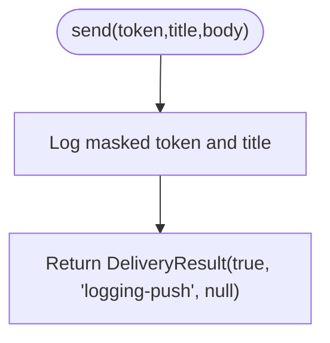
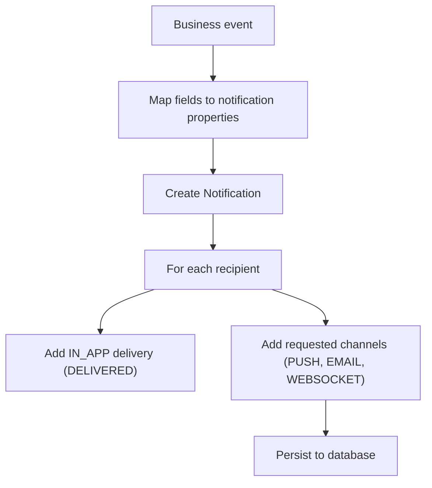
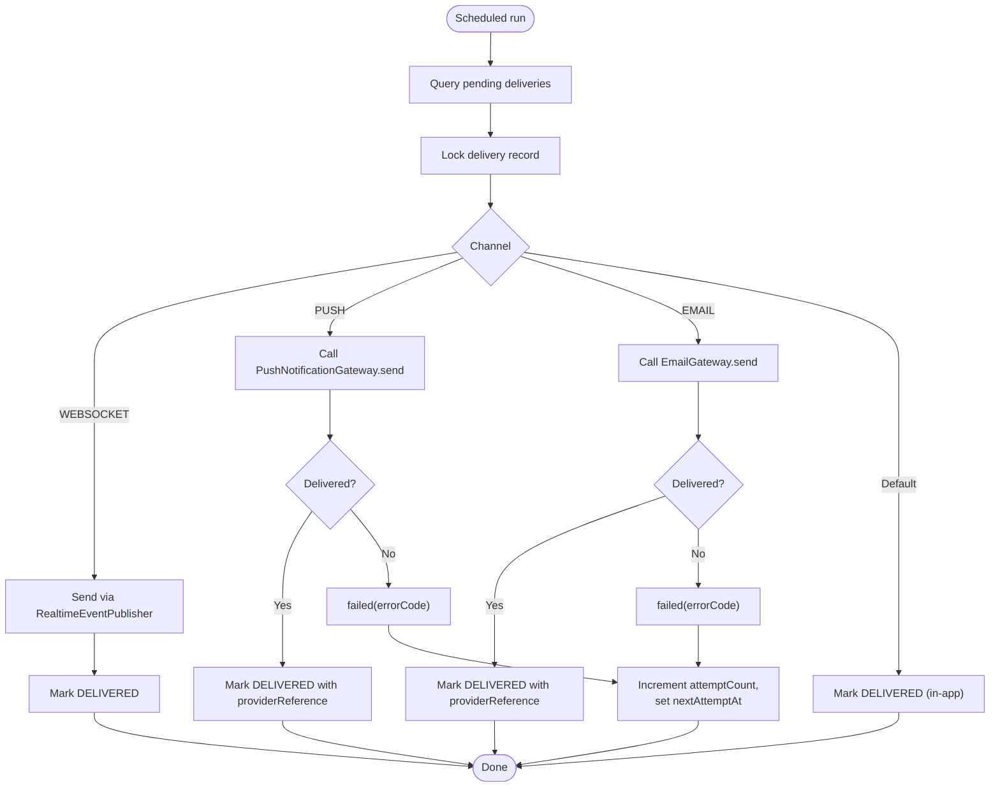
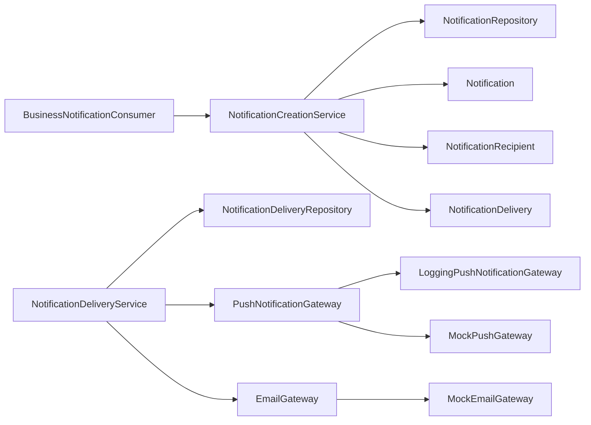

# Notification Delivery Services

<cite>
**Referenced Files in This Document**
- [PushNotificationGateway.java](file://src/main/java/com/smartcoffee/infrastructure/notification/PushNotificationGateway.java)
- [EmailGateway.java](file://src/main/java/com/smartcoffee/infrastructure/notification/EmailGateway.java)
- [LoggingPushNotificationGateway.java](file://src/main/java/com/smartcoffee/infrastructure/notification/LoggingPushNotificationGateway.java)
- [MockPushGateway.java](file://src/main/java/com/smartcoffee/infrastructure/notification/MockPushGateway.java)
- [MockEmailGateway.java](file://src/main/java/com/smartcoffee/infrastructure/notification/MockEmailGateway.java)
- [NotificationDeliveryService.java](file://src/main/java/com/smartcoffee/modules/notification/application/NotificationDeliveryService.java)
- [NotificationCreationService.java](file://src/main/java/com/smartcoffee/modules/notification/application/NotificationCreationService.java)
- [BusinessNotificationConsumer.java](file://src/main/java/com/smartcoffee/modules/notification/consumer/BusinessNotificationConsumer.java)
- [Notification.java](file://src/main/java/com/smartcoffee/modules/notification/domain/Notification.java)
- [NotificationRecipient.java](file://src/main/java/com/smartcoffee/modules/notification/domain/NotificationRecipient.java)
- [NotificationDelivery.java](file://src/main/java/com/smartcoffee/modules/notification/domain/NotificationDelivery.java)
- [DeliveryChannel.java](file://src/main/java/com/smartcoffee/modules/notification/domain/DeliveryChannel.java)
- [DeliveryStatus.java](file://src/main/java/com/smartcoffee/modules/notification/domain/DeliveryStatus.java)
- [NotificationDeliveryRepository.java](file://src/main/java/com/smartcoffee/modules/notification/persistence/NotificationDeliveryRepository.java)
- [application.yml](file://src/main/resources/application.yml)
</cite>

## Table of Contents
1. [Introduction](#introduction)
2. [Project Structure](#project-structure)
3. [Core Components](#core-components)
4. [Architecture Overview](#architecture-overview)
5. [Detailed Component Analysis](#detailed-component-analysis)
6. [Dependency Analysis](#dependency-analysis)
7. [Performance Considerations](#performance-considerations)
8. [Troubleshooting Guide](#troubleshooting-guide)
9. [Conclusion](#conclusion)

## Introduction
This document explains the notification delivery services for multi-channel notifications. It focuses on:
- The PushNotificationGateway interface and its implementations
- EmailGateway for email notifications
- LoggingPushNotificationGateway for development
- Mock implementations for local and test environments
- Notification formatting via message keys and template arguments
- Delivery tracking, retry mechanisms, and status monitoring
- Configuration for providers and scheduling
- Examples for sending push notifications, emails, and implementing custom channels

The system supports multiple delivery channels including WebSocket, push, email, and in-app notifications. Notifications are created from business events, persisted with recipients and per-channel deliveries, and delivered by a scheduled worker that tracks success or failure and schedules retries.

## Project Structure
The notification subsystem is split into infrastructure gateways and module-level domain, application, and persistence layers:
- Infrastructure gateways define provider-agnostic contracts for push and email delivery
- Domain models represent notifications, recipients, and per-channel delivery records
- Application services create notifications and deliver them across channels
- Persistence repositories provide locking and polling for pending deliveries
- Configuration controls polling intervals and environment-specific behavior

**Diagram sources**
- [PushNotificationGateway.java:1-4](file://src/main/java/com/smartcoffee/infrastructure/notification/PushNotificationGateway.java#L1-L4)
- [EmailGateway.java:1-9](file://src/main/java/com/smartcoffee/infrastructure/notification/EmailGateway.java#L1-L9)
- [LoggingPushNotificationGateway.java:1-50](file://src/main/java/com/smartcoffee/infrastructure/notification/LoggingPushNotificationGateway.java#L1-L50)
- [MockPushGateway.java:1-5](file://src/main/java/com/smartcoffee/infrastructure/notification/MockPushGateway.java#L1-L5)
- [MockEmailGateway.java:1-5](file://src/main/java/com/smartcoffee/infrastructure/notification/MockEmailGateway.java#L1-L5)
- [NotificationDeliveryService.java:1-68](file://src/main/java/com/smartcoffee/modules/notification/application/NotificationDeliveryService.java#L1-L68)
- [NotificationCreationService.java:1-38](file://src/main/java/com/smartcoffee/modules/notification/application/NotificationCreationService.java#L1-L38)
- [BusinessNotificationConsumer.java:87-130](file://src/main/java/com/smartcoffee/modules/notification/consumer/BusinessNotificationConsumer.java#L87-L130)
- [Notification.java:1-99](file://src/main/java/com/smartcoffee/modules/notification/domain/Notification.java#L1-L99)
- [NotificationRecipient.java:1-85](file://src/main/java/com/smartcoffee/modules/notification/domain/NotificationRecipient.java#L1-L85)
- [NotificationDelivery.java:1-98](file://src/main/java/com/smartcoffee/modules/notification/domain/NotificationDelivery.java#L1-L98)
- [DeliveryChannel.java:1-7](file://src/main/java/com/smartcoffee/modules/notification/domain/DeliveryChannel.java#L1-L7)
- [DeliveryStatus.java:1-7](file://src/main/java/com/smartcoffee/modules/notification/domain/DeliveryStatus.java#L1-L7)
- [NotificationDeliveryRepository.java:1-21](file://src/main/java/com/smartcoffee/modules/notification/persistence/NotificationDeliveryRepository.java#L1-L21)

**Section sources**
- [application.yml:67-70](file://src/main/resources/application.yml#L67-L70)

## Core Components
This section documents the gateway interfaces and their role in multi-channel delivery.

- PushNotificationGateway
  - Defines send(token, title, body) returning DeliveryResult
  - DeliveryResult includes whether delivery succeeded, provider reference, and error code
  - Used to abstract push provider details (e.g., FCM, APNs)

- EmailGateway
  - Defines send(recipient, subject, html) returning DeliveryResult
  - Allows swapping email providers without changing business logic

- LoggingPushNotificationGateway
  - Development implementation that logs masked tokens and returns success
  - Activated outside local/test profiles

- MockPushGateway and MockEmailGateway
  - Local/test implementations that return success with mock provider references
  - Activated under local/test profiles

These components enable pluggable providers while keeping the delivery pipeline consistent.

**Section sources**
- [PushNotificationGateway.java:1-4](file://src/main/java/com/smartcoffee/infrastructure/notification/PushNotificationGateway.java#L1-L4)
- [EmailGateway.java:1-9](file://src/main/java/com/smartcoffee/infrastructure/notification/EmailGateway.java#L1-L9)
- [LoggingPushNotificationGateway.java:1-50](file://src/main/java/com/smartcoffee/infrastructure/notification/LoggingPushNotificationGateway.java#L1-L50)
- [MockPushGateway.java:1-5](file://src/main/java/com/smartcoffee/infrastructure/notification/MockPushGateway.java#L1-L5)
- [MockEmailGateway.java:1-5](file://src/main/java/com/smartcoffee/infrastructure/notification/MockEmailGateway.java#L1-L5)

## Architecture Overview
The notification architecture separates creation, delivery, and tracking:
- Business events trigger notification creation with recipients and channels
- A scheduled worker polls pending deliveries, locks each record, and dispatches to the appropriate channel
- Delivery outcomes update status, provider metadata, and schedule retries on failure

**Diagram sources**
- [BusinessNotificationConsumer.java:87-130](file://src/main/java/com/smartcoffee/modules/notification/consumer/BusinessNotificationConsumer.java#L87-L130)
- [NotificationCreationService.java:21-36](file://src/main/java/com/smartcoffee/modules/notification/application/NotificationCreationService.java#L21-L36)
- [NotificationDeliveryService.java:28-65](file://src/main/java/com/smartcoffee/modules/notification/application/NotificationDeliveryService.java#L28-L65)
- [NotificationDeliveryRepository.java:11-18](file://src/main/java/com/smartcoffee/modules/notification/persistence/NotificationDeliveryRepository.java#L11-L18)

## Detailed Component Analysis

### PushNotificationGateway Interface
- Purpose: Abstracts push notification providers behind a simple contract
- Method: send(protectedToken, title, body)
- Return: DeliveryResult(delivered, providerReference, errorCode)
- Usage: Called by NotificationDeliveryService when delivering PUSH channel messages

**Diagram sources**
- [PushNotificationGateway.java:1-4](file://src/main/java/com/smartcoffee/infrastructure/notification/PushNotificationGateway.java#L1-L4)
- [LoggingPushNotificationGateway.java:8-35](file://src/main/java/com/smartcoffee/infrastructure/notification/LoggingPushNotificationGateway.java#L8-L35)
- [MockPushGateway.java:1-5](file://src/main/java/com/smartcoffee/infrastructure/notification/MockPushGateway.java#L1-L5)

**Section sources**
- [PushNotificationGateway.java:1-4](file://src/main/java/com/smartcoffee/infrastructure/notification/PushNotificationGateway.java#L1-L4)

### EmailGateway Interface
- Purpose: Abstracts email providers behind a simple contract
- Method: send(recipient, subject, html)
- Return: DeliveryResult(delivered, providerReference, errorCode)
- Usage: Called by NotificationDeliveryService when delivering EMAIL channel messages

**Diagram sources**
- [EmailGateway.java:1-9](file://src/main/java/com/smartcoffee/infrastructure/notification/EmailGateway.java#L1-L9)
- [MockEmailGateway.java:1-5](file://src/main/java/com/smartcoffee/infrastructure/notification/MockEmailGateway.java#L1-L5)

**Section sources**
- [EmailGateway.java:1-9](file://src/main/java/com/smartcoffee/infrastructure/notification/EmailGateway.java#L1-L9)

### LoggingPushNotificationGateway
- Behavior: Logs masked token and title; always returns delivered with provider reference "logging-push"
- Profile: Active outside local/test profiles
- Security: Masks sensitive tokens in logs

**Diagram sources**
- [LoggingPushNotificationGateway.java:18-35](file://src/main/java/com/smartcoffee/infrastructure/notification/LoggingPushNotificationGateway.java#L18-L35)

**Section sources**
- [LoggingPushNotificationGateway.java:1-50](file://src/main/java/com/smartcoffee/infrastructure/notification/LoggingPushNotificationGateway.java#L1-L50)

### Mock Implementations
- MockPushGateway: Returns delivered with provider reference "mock-push"
- MockEmailGateway: Returns delivered with provider reference "mock-email"
- Profiles: Both active under local and test profiles

Use these mocks to validate delivery flows without external dependencies.

**Section sources**
- [MockPushGateway.java:1-5](file://src/main/java/com/smartcoffee/infrastructure/notification/MockPushGateway.java#L1-L5)
- [MockEmailGateway.java:1-5](file://src/main/java/com/smartcoffee/infrastructure/notification/MockEmailGateway.java#L1-L5)

### Notification Creation and Formatting
- NotificationCreationService creates a Notification with:
  - type, category, messageKey, templateArguments, actionUrl, related entity info, priority, expiry
- For each recipient:
  - Creates IN_APP delivery immediately marked DELIVERED
  - Adds additional deliveries for requested channels (WEBSOCKET, PUSH, EMAIL)
- BusinessNotificationConsumer maps incoming events to notification types and sets channels accordingly

Formatting approach:
- messageKey identifies the template or message content key
- templateArguments holds JSON data used by templates to render localized content
- actionUrl provides navigation context for clients

**Diagram sources**
- [NotificationCreationService.java:21-36](file://src/main/java/com/smartcoffee/modules/notification/application/NotificationCreationService.java#L21-L36)
- [BusinessNotificationConsumer.java:87-130](file://src/main/java/com/smartcoffee/modules/notification/consumer/BusinessNotificationConsumer.java#L87-L130)

**Section sources**
- [Notification.java:1-99](file://src/main/java/com/smartcoffee/modules/notification/domain/Notification.java#L1-L99)
- [NotificationRecipient.java:1-85](file://src/main/java/com/smartcoffee/modules/notification/domain/NotificationRecipient.java#L1-L85)
- [NotificationCreationService.java:1-38](file://src/main/java/com/smartcoffee/modules/notification/application/NotificationCreationService.java#L1-L38)
- [BusinessNotificationConsumer.java:87-130](file://src/main/java/com/smartcoffee/modules/notification/consumer/BusinessNotificationConsumer.java#L87-L130)

### Delivery Tracking and Retry Mechanisms
- NotificationDelivery tracks per-channel delivery state:
  - status: PENDING, PROCESSING, DELIVERED, FAILED, SKIPPED, CANCELLED
  - attemptCount increments on failures
  - nextAttemptAt uses exponential backoff capped at one hour
  - lastErrorCode stores failure reason
  - providerName/providerReference capture successful delivery metadata
- NotificationDeliveryService:
  - Polls pending deliveries every configured interval
  - Locks each delivery record before processing
  - Updates status based on gateway results
  - Wraps exceptions to mark failed with generic error code

**Diagram sources**
- [NotificationDeliveryService.java:28-65](file://src/main/java/com/smartcoffee/modules/notification/application/NotificationDeliveryService.java#L28-L65)
- [NotificationDelivery.java:45-71](file://src/main/java/com/smartcoffee/modules/notification/domain/NotificationDelivery.java#L45-L71)
- [NotificationDeliveryRepository.java:11-18](file://src/main/java/com/smartcoffee/modules/notification/persistence/NotificationDeliveryRepository.java#L11-L18)

**Section sources**
- [NotificationDelivery.java:1-98](file://src/main/java/com/smartcoffee/modules/notification/domain/NotificationDelivery.java#L1-L98)
- [DeliveryStatus.java:1-7](file://src/main/java/com/smartcoffee/modules/notification/domain/DeliveryStatus.java#L1-L7)
- [NotificationDeliveryService.java:1-68](file://src/main/java/com/smartcoffee/modules/notification/application/NotificationDeliveryService.java#L1-L68)

### Configuration
- Scheduling interval: app.notification.poll-ms defaults to 2000 ms
- RabbitMQ queue name: app.notification.queue
- Other relevant settings include Redis, datasource, and logging levels

Adjust these values to tune throughput and resource usage.

**Section sources**
- [application.yml:67-70](file://src/main/resources/application.yml#L67-L70)

## Dependency Analysis
The following diagram shows how components depend on each other during notification creation and delivery.

**Diagram sources**
- [BusinessNotificationConsumer.java:87-130](file://src/main/java/com/smartcoffee/modules/notification/consumer/BusinessNotificationConsumer.java#L87-L130)
- [NotificationCreationService.java:1-38](file://src/main/java/com/smartcoffee/modules/notification/application/NotificationCreationService.java#L1-L38)
- [NotificationDeliveryService.java:1-68](file://src/main/java/com/smartcoffee/modules/notification/application/NotificationDeliveryService.java#L1-L68)
- [PushNotificationGateway.java:1-4](file://src/main/java/com/smartcoffee/infrastructure/notification/PushNotificationGateway.java#L1-L4)
- [EmailGateway.java:1-9](file://src/main/java/com/smartcoffee/infrastructure/notification/EmailGateway.java#L1-L9)
- [LoggingPushNotificationGateway.java:1-50](file://src/main/java/com/smartcoffee/infrastructure/notification/LoggingPushNotificationGateway.java#L1-L50)
- [MockPushGateway.java:1-5](file://src/main/java/com/smartcoffee/infrastructure/notification/MockPushGateway.java#L1-L5)
- [MockEmailGateway.java:1-5](file://src/main/java/com/smartcoffee/infrastructure/notification/MockEmailGateway.java#L1-L5)

**Section sources**
- [NotificationDeliveryRepository.java:1-21](file://src/main/java/com/smartcoffee/modules/notification/persistence/NotificationDeliveryRepository.java#L1-L21)

## Performance Considerations
- Polling interval: Tune app.notification.poll-ms to balance latency and load
- Batch size: The delivery service processes up to 100 pending deliveries per poll
- Database locking: Uses pessimistic write lock to avoid concurrent processing of the same delivery
- Exponential backoff: Retries use increasing delays capped at one hour to reduce pressure on failing providers
- Provider calls: Keep provider integrations fast and idempotent where possible

[No sources needed since this section provides general guidance]

## Troubleshooting Guide
Common issues and resolutions:
- Deliveries remain PENDING
  - Check if the scheduled worker is running and polling interval is configured
  - Verify database connectivity and that pending queries return expected rows
- Push or email delivery fails repeatedly
  - Inspect lastErrorCode and attemptCount on NotificationDelivery
  - Validate provider credentials and endpoint availability
  - Confirm that gateway implementations return correct DeliveryResult
- Tokens not reaching devices
  - Ensure device tokens are resolved correctly before calling push gateway
  - Review LoggingPushNotificationGateway logs for masked token patterns
- Emails not sent
  - Validate recipient addresses and HTML content
  - Use MockEmailGateway in tests to isolate provider issues

**Section sources**
- [NotificationDeliveryService.java:34-65](file://src/main/java/com/smartcoffee/modules/notification/application/NotificationDeliveryService.java#L34-L65)
- [NotificationDelivery.java:58-71](file://src/main/java/com/smartcoffee/modules/notification/domain/NotificationDelivery.java#L58-L71)
- [LoggingPushNotificationGateway.java:18-49](file://src/main/java/com/smartcoffee/infrastructure/notification/LoggingPushNotificationGateway.java#L18-L49)

## Conclusion
The notification delivery system provides a robust, extensible foundation for multi-channel notifications. By separating concerns through gateway interfaces, domain-driven models, and a scheduled delivery worker, it supports reliable delivery, clear tracking, and easy testing. Providers can be swapped via configuration and profiles, while formatting remains consistent through message keys and template arguments.

[No sources needed since this section summarizes without analyzing specific files]