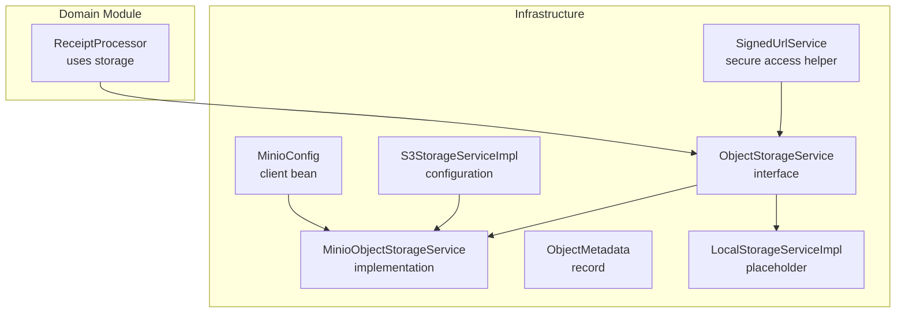
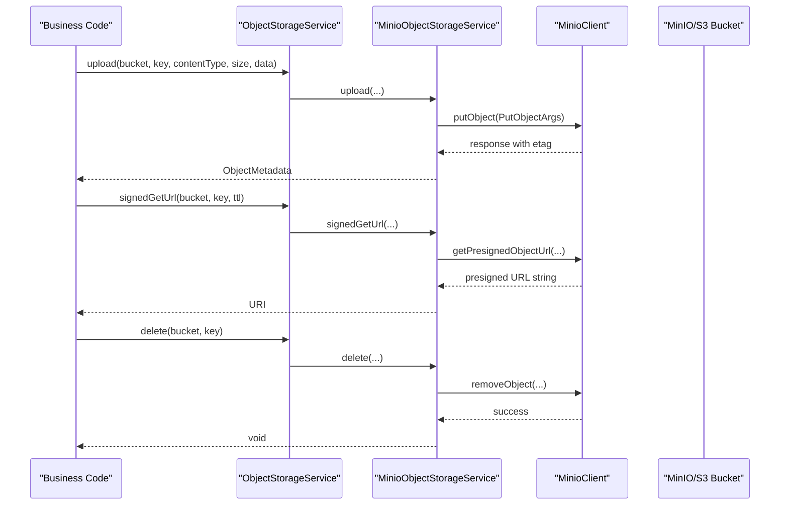
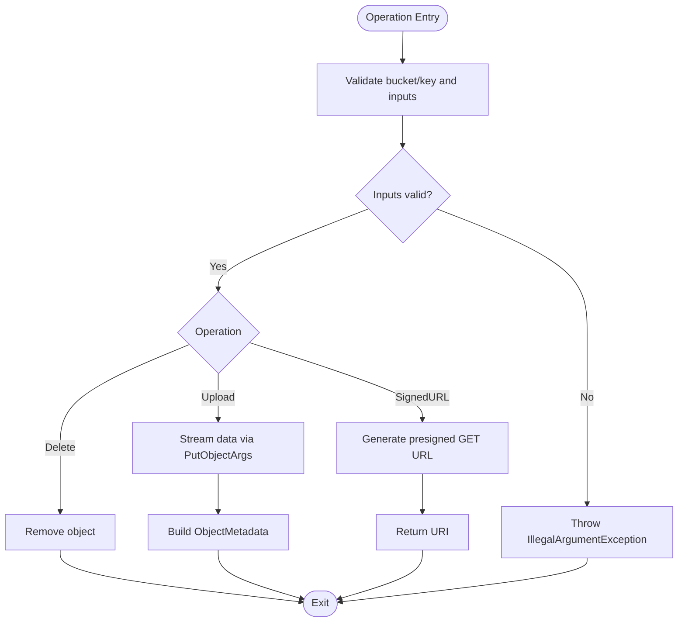
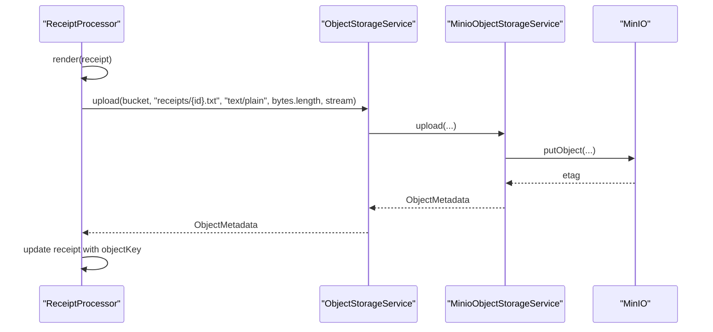
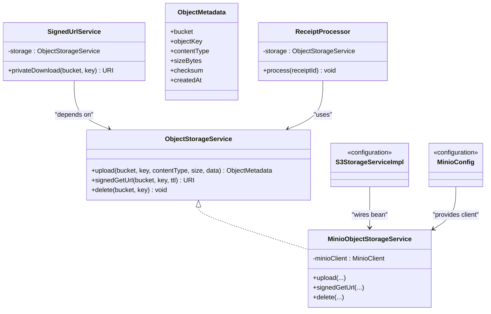

# Object Storage Integration

<cite>
**Referenced Files in This Document**
- [ObjectStorageService.java](file://src/main/java/com/smartcoffee/infrastructure/storage/ObjectStorageService.java)
- [MinioObjectStorageService.java](file://src/main/java/com/smartcoffee/infrastructure/storage/MinioObjectStorageService.java)
- [S3StorageServiceImpl.java](file://src/main/java/com/smartcoffee/infrastructure/storage/S3StorageServiceImpl.java)
- [SignedUrlService.java](file://src/main/java/com/smartcoffee/infrastructure/storage/SignedUrlService.java)
- [ObjectMetadata.java](file://src/main/java/com/smartcoffee/infrastructure/storage/ObjectMetadata.java)
- [LocalStorageServiceImpl.java](file://src/main/java/com/smartcoffee/infrastructure/storage/LocalStorageServiceImpl.java)
- [MinioConfig.java](file://src/main/java/com/smartcoffee/config/MinioConfig.java)
- [ReceiptProcessor.java](file://src/main/java/com/smartcoffee/modules/payment/application/ReceiptProcessor.java)
</cite>

## Table of Contents
1. [Introduction](#introduction)
2. [Project Structure](#project-structure)
3. [Core Components](#core-components)
4. [Architecture Overview](#architecture-overview)
5. [Detailed Component Analysis](#detailed-component-analysis)
6. [Dependency Analysis](#dependency-analysis)
7. [Performance Considerations](#performance-considerations)
8. [Troubleshooting Guide](#troubleshooting-guide)
9. [Conclusion](#conclusion)
10. [Appendices](#appendices)

## Introduction
This document explains the pluggable object storage abstraction used to support local filesystem, MinIO, and S3-compatible services. It covers:
- The StorageService interface (ObjectStorageService)
- Implementations for MinIO and a placeholder for local storage
- Signed URL generation for secure, temporary access
- Object metadata handling
- Upload/download operations and integration with receipt generation

The design isolates storage details behind a clean interface so business logic can remain backend-agnostic.

## Project Structure
The object storage feature is implemented under infrastructure and integrated by domain modules such as payments.

**Diagram sources**
- [ObjectStorageService.java:7-27](file://src/main/java/com/smartcoffee/infrastructure/storage/ObjectStorageService.java#L7-L27)
- [MinioObjectStorageService.java:15-181](file://src/main/java/com/smartcoffee/infrastructure/storage/MinioObjectStorageService.java#L15-L181)
- [SignedUrlService.java:8-29](file://src/main/java/com/smartcoffee/infrastructure/storage/SignedUrlService.java#L8-L29)
- [ObjectMetadata.java:5-15](file://src/main/java/com/smartcoffee/infrastructure/storage/ObjectMetadata.java#L5-L15)
- [LocalStorageServiceImpl.java:1-7](file://src/main/java/com/smartcoffee/infrastructure/storage/LocalStorageServiceImpl.java#L1-L7)
- [S3StorageServiceImpl.java:8-23](file://src/main/java/com/smartcoffee/infrastructure/storage/S3StorageServiceImpl.java#L8-L23)
- [MinioConfig.java:1-5](file://src/main/java/com/smartcoffee/config/MinioConfig.java#L1-L5)
- [ReceiptProcessor.java:12-60](file://src/main/java/com/smartcoffee/modules/payment/application/ReceiptProcessor.java#L12-L60)

**Section sources**
- [ObjectStorageService.java:7-27](file://src/main/java/com/smartcoffee/infrastructure/storage/ObjectStorageService.java#L7-L27)
- [MinioObjectStorageService.java:15-181](file://src/main/java/com/smartcoffee/infrastructure/storage/MinioObjectStorageService.java#L15-L181)
- [SignedUrlService.java:8-29](file://src/main/java/com/smartcoffee/infrastructure/storage/SignedUrlService.java#L8-L29)
- [ObjectMetadata.java:5-15](file://src/main/java/com/smartcoffee/infrastructure/storage/ObjectMetadata.java#L5-L15)
- [LocalStorageServiceImpl.java:1-7](file://src/main/java/com/smartcoffee/infrastructure/storage/LocalStorageServiceImpl.java#L1-L7)
- [S3StorageServiceImpl.java:8-23](file://src/main/java/com/smartcoffee/infrastructure/storage/S3StorageServiceImpl.java#L8-L23)
- [MinioConfig.java:1-5](file://src/main/java/com/smartcoffee/config/MinioConfig.java#L1-L5)
- [ReceiptProcessor.java:12-60](file://src/main/java/com/smartcoffee/modules/payment/application/ReceiptProcessor.java#L12-L60)

## Core Components
- ObjectStorageService: Defines upload, signedGetUrl, and delete operations over a bucket/key namespace.
- MinioObjectStorageService: Concrete implementation using MinIO client; validates inputs, uploads via streaming, generates presigned URLs, and deletes objects.
- SignedUrlService: Convenience service that returns a short-lived private download URL with a fixed TTL.
- ObjectMetadata: Immutable record describing uploaded object attributes including checksum and creation time.
- LocalStorageServiceImpl: Placeholder class for future local filesystem implementation.
- S3StorageServiceImpl: Configuration holder wiring MinioObjectStorageService as the default ObjectStorageService bean.
- MinioConfig: Spring configuration providing MinioClient bean from application properties.

Key responsibilities:
- Upload: Validate parameters, stream data to storage, return metadata.
- Signed URL: Generate a GET presigned URL with bounded TTL.
- Delete: Remove an object by bucket and key.
- Security: Enforce input validation and bounded TTLs.

**Section sources**
- [ObjectStorageService.java:7-27](file://src/main/java/com/smartcoffee/infrastructure/storage/ObjectStorageService.java#L7-L27)
- [MinioObjectStorageService.java:15-181](file://src/main/java/com/smartcoffee/infrastructure/storage/MinioObjectStorageService.java#L15-L181)
- [SignedUrlService.java:8-29](file://src/main/java/com/smartcoffee/infrastructure/storage/SignedUrlService.java#L8-L29)
- [ObjectMetadata.java:5-15](file://src/main/java/com/smartcoffee/infrastructure/storage/ObjectMetadata.java#L5-L15)
- [LocalStorageServiceImpl.java:1-7](file://src/main/java/com/smartcoffee/infrastructure/storage/LocalStorageServiceImpl.java#L1-L7)
- [S3StorageServiceImpl.java:8-23](file://src/main/java/com/smartcoffee/infrastructure/storage/S3StorageServiceImpl.java#L8-L23)
- [MinioConfig.java:1-5](file://src/main/java/com/smartcoffee/config/MinioConfig.java#L1-L5)

## Architecture Overview
The system uses dependency injection to provide a single ObjectStorageService implementation at runtime. Business code calls this interface without knowing whether the underlying store is MinIO or another S3-compatible service.

**Diagram sources**
- [ObjectStorageService.java:7-27](file://src/main/java/com/smartcoffee/infrastructure/storage/ObjectStorageService.java#L7-L27)
- [MinioObjectStorageService.java:27-146](file://src/main/java/com/smartcoffee/infrastructure/storage/MinioObjectStorageService.java#L27-L146)

## Detailed Component Analysis

### ObjectStorageService Interface
Defines the contract for object storage operations:
- upload(bucket, key, contentType, size, data): Streams content into storage and returns metadata.
- signedGetUrl(bucket, key, ttl): Generates a time-bounded GET URL.
- delete(bucket, key): Removes an object.

Design notes:
- Uses InputStream for zero-copy streaming.
- Returns a URI for signed URLs.
- Exposes a simple bucket/key addressing model.

**Section sources**
- [ObjectStorageService.java:7-27](file://src/main/java/com/smartcoffee/infrastructure/storage/ObjectStorageService.java#L7-L27)

### MinioObjectStorageService Implementation
Responsibilities:
- Validates bucket/key and operation parameters.
- Streams data to MinIO using PutObjectArgs.
- Builds ObjectMetadata from server-provided etag and current timestamp.
- Generates presigned GET URLs with bounded TTL.
- Deletes objects via RemoveObjectArgs.

Validation and error handling:
- Rejects null/blank bucket or key.
- Requires non-blank content type.
- Ensures size is non-negative.
- Requires non-null input stream.
- Enforces signed URL TTL between 1 second and 604,800 seconds.
- Wraps storage exceptions in IllegalStateException with context.

Complexity:
- Upload: O(n) in bytes streamed.
- Signed URL: O(1) network call to generate token.
- Delete: O(1) network call.

**Diagram sources**
- [MinioObjectStorageService.java:27-146](file://src/main/java/com/smartcoffee/infrastructure/storage/MinioObjectStorageService.java#L27-L146)

**Section sources**
- [MinioObjectStorageService.java:15-181](file://src/main/java/com/smartcoffee/infrastructure/storage/MinioObjectStorageService.java#L15-L181)

### SignedUrlService
Provides a convenient method to obtain a private download URL with a fixed TTL. Internally delegates to ObjectStorageService.signedGetUrl.

Usage pattern:
- Call privateDownload(bucket, key) to receive a URI valid for a short period.
- Suitable for temporary access flows where clients should not hold long-lived credentials.

Security considerations:
- TTL is fixed to a short duration to limit exposure.
- Clients must use HTTPS when consuming signed URLs.

**Section sources**
- [SignedUrlService.java:8-29](file://src/main/java/com/smartcoffee/infrastructure/storage/SignedUrlService.java#L8-L29)

### ObjectMetadata
Immutable record capturing:
- bucket
- objectKey
- contentType
- sizeBytes
- checksum
- createdAt

Used to describe uploaded objects and can be persisted alongside business entities.

**Section sources**
- [ObjectMetadata.java:5-15](file://src/main/java/com/smartcoffee/infrastructure/storage/ObjectMetadata.java#L5-L15)

### LocalStorageServiceImpl
Placeholder for a local filesystem-based implementation. Currently empty; extend it to implement ObjectStorageService when running without MinIO.

**Section sources**
- [LocalStorageServiceImpl.java:1-7](file://src/main/java/com/smartcoffee/infrastructure/storage/LocalStorageServiceImpl.java#L1-L7)

### S3StorageServiceImpl Configuration
Wires MinioObjectStorageService as the default ObjectStorageService bean. This allows other components to depend on the interface while the concrete implementation is provided by Spring.

Note: To switch to a different backend, replace the bean definition here or provide an alternative configuration class.

**Section sources**
- [S3StorageServiceImpl.java:8-23](file://src/main/java/com/smartcoffee/infrastructure/storage/S3StorageServiceImpl.java#L8-L23)

### MinioConfig
Creates MinioClient from application properties:
- app.minio.endpoint
- app.minio.access-key
- app.minio.secret-key

Ensure these values are configured securely in your environment.

**Section sources**
- [MinioConfig.java:1-5](file://src/main/java/com/smartcoffee/config/MinioConfig.java#L1-L5)

### ReceiptProcessor Integration Example
Demonstrates how a domain service uses ObjectStorageService to persist generated receipts:
- Renders receipt content to bytes.
- Constructs a deterministic object key path.
- Streams bytes to storage with appropriate content type.
- Updates the receipt entity with the stored object key.

**Diagram sources**
- [ReceiptProcessor.java:33-59](file://src/main/java/com/smartcoffee/modules/payment/application/ReceiptProcessor.java#L33-L59)
- [MinioObjectStorageService.java:27-79](file://src/main/java/com/smartcoffee/infrastructure/storage/MinioObjectStorageService.java#L27-L79)

**Section sources**
- [ReceiptProcessor.java:12-60](file://src/main/java/com/smartcoffee/modules/payment/application/ReceiptProcessor.java#L12-L60)

## Dependency Analysis
The following diagram shows how components depend on each other:

**Diagram sources**
- [ObjectStorageService.java:7-27](file://src/main/java/com/smartcoffee/infrastructure/storage/ObjectStorageService.java#L7-L27)
- [MinioObjectStorageService.java:15-181](file://src/main/java/com/smartcoffee/infrastructure/storage/MinioObjectStorageService.java#L15-L181)
- [SignedUrlService.java:8-29](file://src/main/java/com/smartcoffee/infrastructure/storage/SignedUrlService.java#L8-L29)
- [ObjectMetadata.java:5-15](file://src/main/java/com/smartcoffee/infrastructure/storage/ObjectMetadata.java#L5-L15)
- [S3StorageServiceImpl.java:8-23](file://src/main/java/com/smartcoffee/infrastructure/storage/S3StorageServiceImpl.java#L8-L23)
- [MinioConfig.java:1-5](file://src/main/java/com/smartcoffee/config/MinioConfig.java#L1-L5)
- [ReceiptProcessor.java:12-60](file://src/main/java/com/smartcoffee/modules/payment/application/ReceiptProcessor.java#L12-L60)

**Section sources**
- [ObjectStorageService.java:7-27](file://src/main/java/com/smartcoffee/infrastructure/storage/ObjectStorageService.java#L7-L27)
- [MinioObjectStorageService.java:15-181](file://src/main/java/com/smartcoffee/infrastructure/storage/MinioObjectStorageService.java#L15-L181)
- [SignedUrlService.java:8-29](file://src/main/java/com/smartcoffee/infrastructure/storage/SignedUrlService.java#L8-L29)
- [ObjectMetadata.java:5-15](file://src/main/java/com/smartcoffee/infrastructure/storage/ObjectMetadata.java#L5-L15)
- [S3StorageServiceImpl.java:8-23](file://src/main/java/com/smartcoffee/infrastructure/storage/S3StorageServiceImpl.java#L8-L23)
- [MinioConfig.java:1-5](file://src/main/java/com/smartcoffee/config/MinioConfig.java#L1-L5)
- [ReceiptProcessor.java:12-60](file://src/main/java/com/smartcoffee/modules/payment/application/ReceiptProcessor.java#L12-L60)

## Performance Considerations
- Streaming uploads: Use InputStream to avoid loading entire files into memory.
- Content-Type accuracy: Ensure correct content types for efficient caching and rendering.
- TTL bounds: Keep signed URL TTLs short to reduce risk and minimize resource usage.
- Connection reuse: Rely on MinioClient connection pooling managed by the SDK.
- Idempotency: For large uploads, consider generating stable keys and handling retries safely.
- Error propagation: Wrap low-level failures with contextual messages to aid diagnostics.

[No sources needed since this section provides general guidance]

## Troubleshooting Guide
Common issues and resolutions:
- Missing or blank bucket/key:
  - Cause: Validation failure before storage calls.
  - Fix: Ensure bucket and key are non-empty and properly sanitized.
- Invalid content type:
  - Cause: Null or blank content type passed to upload.
  - Fix: Provide a valid MIME type for the payload.
- Negative size:
  - Cause: Incorrect size parameter.
  - Fix: Pass the actual byte length of the stream.
- Null input stream:
  - Cause: Empty or uninitialized stream.
  - Fix: Verify stream initialization before calling upload.
- Signed URL TTL out of range:
  - Cause: TTL outside allowed bounds.
  - Fix: Set TTL between 1 second and 604,800 seconds.
- Storage errors:
  - Cause: Network or permission issues with MinIO/S3.
  - Fix: Check credentials, endpoint, bucket policies, and network connectivity. Inspect wrapped exception details.

Operational tips:
- Validate all inputs early to fail fast.
- Log contextual information (bucket/key) around storage calls.
- Use separate buckets or prefixes for sensitive data (e.g., receipts).
- Rotate credentials and restrict bucket policies to least privilege.

**Section sources**
- [MinioObjectStorageService.java:35-103](file://src/main/java/com/smartcoffee/infrastructure/storage/MinioObjectStorageService.java#L35-L103)
- [MinioObjectStorageService.java:148-163](file://src/main/java/com/smartcoffee/infrastructure/storage/MinioObjectStorageService.java#L148-L163)

## Conclusion
The object storage layer provides a clean, testable abstraction for storing and retrieving objects across backends. MinIO is currently wired as the default implementation, with a placeholder for local storage and a configuration class for easy switching. Signed URLs enable secure, temporary access without exposing credentials. Integrating with domain services like ReceiptProcessor demonstrates practical usage patterns for uploads and metadata handling.

[No sources needed since this section summarizes without analyzing specific files]

## Appendices

### Configuration Reference
- MinIO client configuration:
  - app.minio.endpoint
  - app.minio.access-key
  - app.minio.secret-key
- Receipt bucket name:
  - app.receipt.bucket (default: receipts)

**Section sources**
- [MinioConfig.java:1-5](file://src/main/java/com/smartcoffee/config/MinioConfig.java#L1-L5)
- [ReceiptProcessor.java:20-31](file://src/main/java/com/smartcoffee/modules/payment/application/ReceiptProcessor.java#L20-L31)

### API Usage Examples

- Upload a file:
  - Construct a non-empty bucket and key.
  - Determine the correct content type.
  - Provide the exact size and an InputStream.
  - Handle ObjectMetadata returned for persistence.

- Download via signed URL:
  - Use SignedUrlService.privateDownload(bucket, key) to obtain a short-lived URI.
  - Serve the URI to the client over HTTPS.

- Delete a file:
  - Call delete(bucket, key) after confirming ownership and policy.

These examples align with the interfaces and implementations described above.

**Section sources**
- [ObjectStorageService.java:7-27](file://src/main/java/com/smartcoffee/infrastructure/storage/ObjectStorageService.java#L7-L27)
- [SignedUrlService.java:8-29](file://src/main/java/com/smartcoffee/infrastructure/storage/SignedUrlService.java#L8-L29)
- [MinioObjectStorageService.java:27-146](file://src/main/java/com/smartcoffee/infrastructure/storage/MinioObjectStorageService.java#L27-L146)