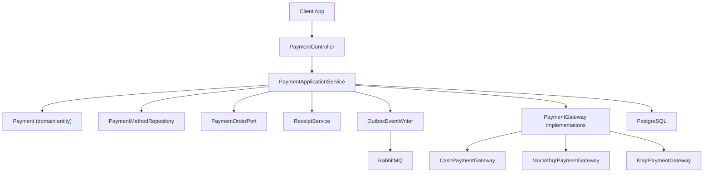
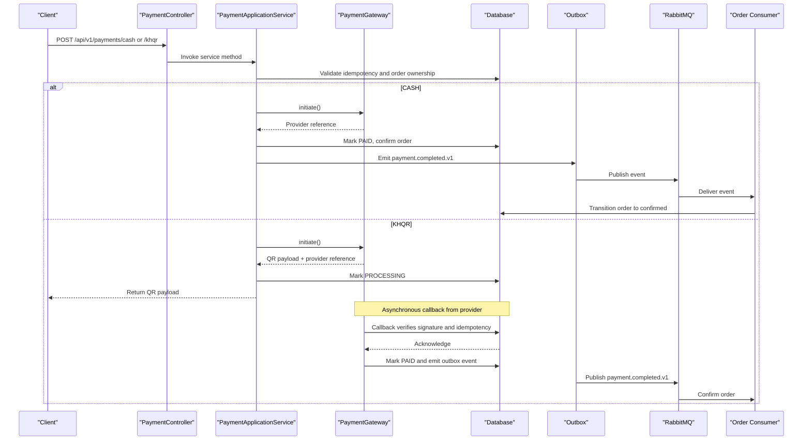
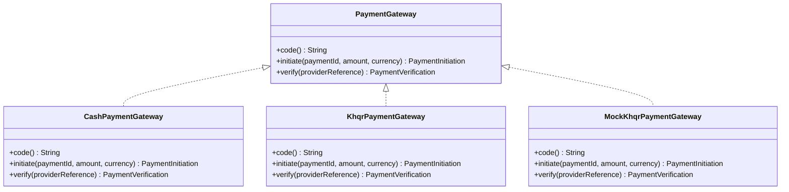
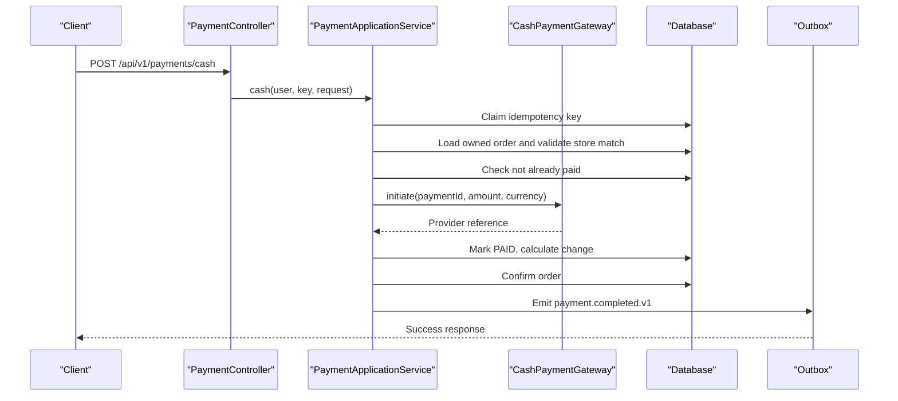
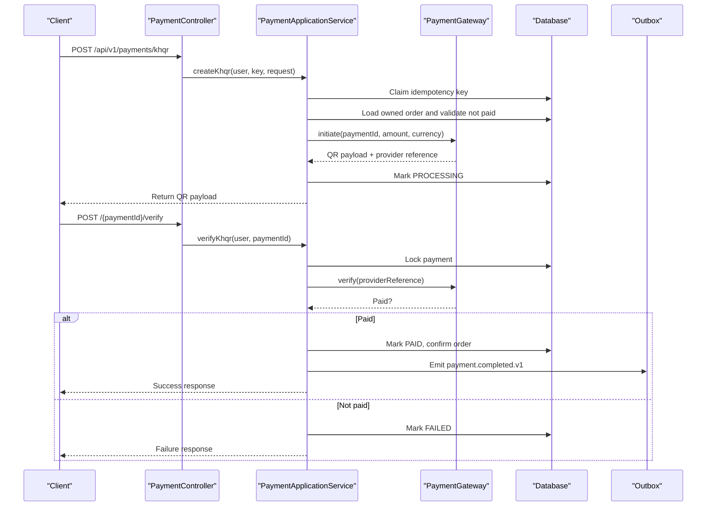
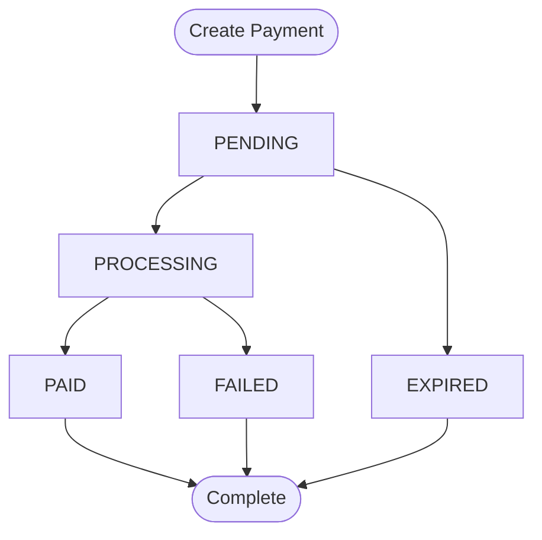
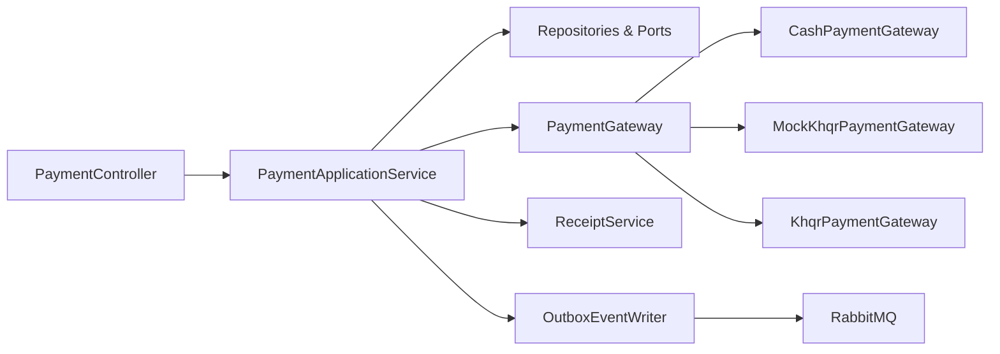

# Payment Gateway Integrations

<cite>
**Referenced Files in This Document**
- [PaymentGateway.java](file://src/main/java/com/smartcoffee/infrastructure/payment/PaymentGateway.java)
- [CashPaymentGateway.java](file://src/main/java/com/smartcoffee/infrastructure/payment/CashPaymentGateway.java)
- [KhqrPaymentGateway.java](file://src/main/java/com/smartcoffee/infrastructure/payment/KhqrPaymentGateway.java)
- [MockKhqrPaymentGateway.java](file://src/main/java/com/smartcoffee/infrastructure/payment/MockKhqrPaymentGateway.java)
- [PaymentController.java](file://src/main/java/com/smartcoffee/modules/payment/api/PaymentController.java)
- [PaymentApplicationService.java](file://src/main/java/com/smartcoffee/modules/payment/application/PaymentApplicationService.java)
- [Payment.java](file://src/main/java/com/smartcoffee/modules/payment/domain/Payment.java)
- [PaymentStatus.java](file://src/main/java/com/smartcoffee/modules/payment/domain/PaymentStatus.java)
- [PaymentMethodType.java](file://src/main/java/com/smartcoffee/modules/payment/domain/PaymentMethodType.java)
- [CashPaymentRequest.java](file://src/main/java/com/smartcoffee/modules/payment/api/CashPaymentRequest.java)
- [KhqrPaymentRequest.java](file://src/main/java/com/smartcoffee/modules/payment/api/KhqrPaymentRequest.java)
- [ReceiptService.java](file://src/main/java/com/smartcoffee/modules/payment/application/ReceiptService.java)
- [ReceiptProcessor.java](file://src/main/java/com/smartcoffee/modules/payment/application/ReceiptProcessor.java)
- [application.yml](file://src/main/resources/application.yml)
- [PAYMENT_FLOW.mermaid](file://architecture/PAYMENT_FLOW.mermaid)
- [smart-coffee-logical.dbml](file://database/smart-coffee-logical.dbml)
</cite>

## Table of Contents
1. Introduction
2. Project Structure
3. Core Components
4. Architecture Overview
5. Detailed Component Analysis
6. Dependency Analysis
7. Performance Considerations
8. Troubleshooting Guide
9. Conclusion
10. Appendices

## Introduction
This document explains the payment gateway integration design for external payment providers, focusing on:
- The PaymentGateway interface and its implementations for cash and digital payments
- Payment flow orchestration across controllers, application services, domain entities, and provider gateways
- Signature verification guidance for KHQR callbacks
- Error handling strategies, idempotency, outbox-based eventing, and reconciliation
- Configuration for different environments and providers
- Examples for initiating payments, handling callbacks, and processing refunds

## Project Structure
The payment feature is implemented as a modular component with clear separation between API, application logic, domain models, infrastructure adapters (payment gateways), and persistence.

**Diagram sources**
- [PaymentController.java:11-37](file://src/main/java/com/smartcoffee/modules/payment/api/PaymentController.java#L11-L37)
- [PaymentApplicationService.java:21-46](file://src/main/java/com/smartcoffee/modules/payment/application/PaymentApplicationService.java#L21-L46)
- [PaymentGateway.java:1-5](file://src/main/java/com/smartcoffee/infrastructure/payment/PaymentGateway.java#L1-L5)
- [CashPaymentGateway.java:1-5](file://src/main/java/com/smartcoffee/infrastructure/payment/CashPaymentGateway.java#L1-L5)
- [MockKhqrPaymentGateway.java:1-5](file://src/main/java/com/smartcoffee/infrastructure/payment/MockKhqrPaymentGateway.java#L1-L5)
- [KhqrPaymentGateway.java:1-9](file://src/main/java/com/smartcoffee/infrastructure/payment/KhqrPaymentGateway.java#L1-L9)

**Section sources**
- [PaymentController.java:11-37](file://src/main/java/com/smartcoffee/modules/payment/api/PaymentController.java#L11-L37)
- [PaymentApplicationService.java:21-46](file://src/main/java/com/smartcoffee/modules/payment/application/PaymentApplicationService.java#L21-L46)
- [application.yml:64-73](file://src/main/resources/application.yml#L64-L73)

## Core Components
- PaymentGateway: Defines the contract for initiating and verifying payments with external providers. It exposes a code identifier and two operations: initiation and verification.
- CashPaymentGateway: Implements local cash payments, returning immediate success and generating a provider reference.
- KhqrPaymentGateway: Placeholder for production KHQR integration; currently throws an exception to indicate configuration is required.
- MockKhqrPaymentGateway: Provides a mock KHQR implementation for local and test profiles, simulating QR payload generation and verification.

Key responsibilities:
- Orchestrate payment lifecycle from creation through confirmation or failure
- Enforce idempotency for client retries
- Persist domain state transitions
- Publish events via outbox for downstream consumers
- Generate receipts upon successful payment

**Section sources**
- [PaymentGateway.java:1-5](file://src/main/java/com/smartcoffee/infrastructure/payment/PaymentGateway.java#L1-L5)
- [CashPaymentGateway.java:1-5](file://src/main/java/com/smartcoffee/infrastructure/payment/CashPaymentGateway.java#L1-L5)
- [KhqrPaymentGateway.java:1-9](file://src/main/java/com/smartcoffee/infrastructure/payment/KhqrPaymentGateway.java#L1-L9)
- [MockKhqrPaymentGateway.java:1-5](file://src/main/java/com/smartcoffee/infrastructure/payment/MockKhqrPaymentGateway.java#L1-L5)
- [PaymentApplicationService.java:48-108](file://src/main/java/com/smartcoffee/modules/payment/application/PaymentApplicationService.java#L48-L108)

## Architecture Overview
The system supports both synchronous cash payments and asynchronous digital payments via KHQR. For KHQR, the architecture follows a callback-driven model with signature verification, idempotent event processing, and outbox-based delivery to ensure reliable order confirmation.

**Diagram sources**
- [PaymentController.java:22-37](file://src/main/java/com/smartcoffee/modules/payment/api/PaymentController.java#L22-L37)
- [PaymentApplicationService.java:48-108](file://src/main/java/com/smartcoffee/modules/payment/application/PaymentApplicationService.java#L48-L108)
- [PAYMENT_FLOW.mermaid:1-73](file://architecture/PAYMENT_FLOW.mermaid#L1-L73)

## Detailed Component Analysis

### PaymentGateway Interface
The interface defines:
- code(): Returns a stable provider code used for selection and logging
- initiate(paymentId, amount, currency): Creates a payment session with the provider and returns provider-specific references and optional QR payload
- verify(providerReference): Checks provider status for a given reference

Complexity:
- O(1) per operation; selection by code is linear over registered gateways but typically small constant set

Error handling:
- Implementations may throw exceptions to signal misconfiguration or unsupported operations

**Section sources**
- [PaymentGateway.java:1-5](file://src/main/java/com/smartcoffee/infrastructure/payment/PaymentGateway.java#L1-L5)

#### Class Diagram: Payment Gateway Implementations

**Diagram sources**
- [PaymentGateway.java:1-5](file://src/main/java/com/smartcoffee/infrastructure/payment/PaymentGateway.java#L1-L5)
- [CashPaymentGateway.java:1-5](file://src/main/java/com/smartcoffee/infrastructure/payment/CashPaymentGateway.java#L1-L5)
- [KhqrPaymentGateway.java:1-9](file://src/main/java/com/smartcoffee/infrastructure/payment/KhqrPaymentGateway.java#L1-L9)
- [MockKhqrPaymentGateway.java:1-5](file://src/main/java/com/smartcoffee/infrastructure/payment/MockKhqrPaymentGateway.java#L1-L5)

### CashPaymentGateway
Behavior:
- Returns a deterministic provider reference based on the payment ID
- Verification always succeeds immediately

Use cases:
- In-store cashier workflows where cash tendered is validated at point of sale

**Section sources**
- [CashPaymentGateway.java:1-5](file://src/main/java/com/smartcoffee/infrastructure/payment/CashPaymentGateway.java#L1-L5)

### KhqrPaymentGateway (Production)
Behavior:
- Currently throws an exception indicating that real provider adapter configuration is required

Configuration:
- Activated under the prod profile
- Replace placeholder methods with actual provider SDK calls, including signature verification and webhook handling

**Section sources**
- [KhqrPaymentGateway.java:1-9](file://src/main/java/com/smartcoffee/infrastructure/payment/KhqrPaymentGateway.java#L1-L9)

### MockKhqrPaymentGateway (Local/Test)
Behavior:
- Generates a mock provider reference and QR payload
- Expiration time is set to a short window for testing
- Verification always returns paid

Profiles:
- Active under local and test profiles

**Section sources**
- [MockKhqrPaymentGateway.java:1-5](file://src/main/java/com/smartcoffee/infrastructure/payment/MockKhqrPaymentGateway.java#L1-L5)

### Payment Application Service
Responsibilities:
- Enforces idempotency using IdempotencyService and CanonicalRequestHasher
- Validates order ownership and prevents duplicate payments
- Converts tender amounts for cash payments using exchange rates
- Orchestrates gateway interactions and domain state transitions
- Emits outbox events for completed payments and failures
- Requests receipt generation after successful payment

Key flows:
- Cash payment: validates inputs, converts currency, marks payment paid, confirms order, emits events
- KHQR creation: creates pending payment, initiates provider session, stores provider reference, returns QR payload
- KHQR verification: locks payment, checks provider status, marks paid if verified, confirms order, emits events

Error handling:
- Throws specific business exceptions for conflicts and validation errors
- Uses InfrastructureException for gateway and idempotency response issues

**Section sources**
- [PaymentApplicationService.java:48-108](file://src/main/java/com/smartcoffee/modules/payment/application/PaymentApplicationService.java#L48-L108)
- [PaymentApplicationService.java:110-126](file://src/main/java/com/smartcoffee/modules/payment/application/PaymentApplicationService.java#L110-L126)
- [PaymentApplicationService.java:128-160](file://src/main/java/com/smartcoffee/modules/payment/application/PaymentApplicationService.java#L128-L160)

#### Sequence Diagram: Cash Payment Flow

**Diagram sources**
- [PaymentController.java:22-26](file://src/main/java/com/smartcoffee/modules/payment/api/PaymentController.java#L22-L26)
- [PaymentApplicationService.java:48-70](file://src/main/java/com/smartcoffee/modules/payment/application/PaymentApplicationService.java#L48-L70)
- [CashPaymentGateway.java:1-5](file://src/main/java/com/smartcoffee/infrastructure/payment/CashPaymentGateway.java#L1-L5)

#### Sequence Diagram: KHQR Payment Creation and Verification

**Diagram sources**
- [PaymentController.java:28-37](file://src/main/java/com/smartcoffee/modules/payment/api/PaymentController.java#L28-L37)
- [PaymentApplicationService.java:72-108](file://src/main/java/com/smartcoffee/modules/payment/application/PaymentApplicationService.java#L72-L108)

### Payment Domain Model
The Payment entity encapsulates:
- Lifecycle states: PENDING, PROCESSING, PAID, FAILED, EXPIRED, CANCELLED
- Provider linkage: providerName and providerReference
- Financial fields: amount, amountReceived, changeAmount, currency
- Timestamps: expiresAt, paidAt, failedAt, createdAt, updatedAt
- Versioning for optimistic concurrency control

State transitions:
- processing(provider, providerRef)
- paid(received, change)
- failed(code)
- expired()

**Section sources**
- [Payment.java:11-105](file://src/main/java/com/smartcoffee/modules/payment/domain/Payment.java#L11-L105)
- [PaymentStatus.java:1-7](file://src/main/java/com/smartcoffee/modules/payment/domain/PaymentStatus.java#L1-L7)

#### Flowchart: Payment State Transitions

**Diagram sources**
- [Payment.java:56-105](file://src/main/java/com/smartcoffee/modules/payment/domain/Payment.java#L56-L105)
- [PaymentStatus.java:1-7](file://src/main/java/com/smartcoffee/modules/payment/domain/PaymentStatus.java#L1-L7)

### API Endpoints
- POST /api/v1/payments/cash: Initiates cash payment with idempotency key and tender details
- POST /api/v1/payments/khqr: Initiates KHQR digital payment and returns QR payload
- POST /api/v1/payments/{paymentId}/verify: Verifies KHQR payment status against provider

Request objects:
- CashPaymentRequest: orderId, storeId, amountReceived, tenderCurrency, exchangeRate
- KhqrPaymentRequest: orderId

Response object:
- PaymentResponse: includes payment details, provider code, and optional QR payload

**Section sources**
- [PaymentController.java:11-37](file://src/main/java/com/smartcoffee/modules/payment/api/PaymentController.java#L11-L37)
- [CashPaymentRequest.java:1-12](file://src/main/java/com/smartcoffee/modules/payment/api/CashPaymentRequest.java#L1-L12)
- [KhqrPaymentRequest.java:1-9](file://src/main/java/com/smartcoffee/modules/payment/api/KhqrPaymentRequest.java#L1-L9)

### Webhook Handling and Signature Verification
Conceptual guidance for KHQR webhooks:
- Verify signature using provider’s public key or shared secret
- Validate timestamp and source IP to prevent replay attacks
- Use a unique provider event ID to ensure idempotent processing
- On valid success events: lock the payment, transition to PAID, persist evidence, and emit outbox event
- On invalid or duplicate events: return appropriate status codes without side effects

Note: The current codebase does not include a dedicated webhook endpoint; this section provides recommended practices for implementing a secure callback handler.

[No sources needed since this section provides conceptual guidance]

### Reconciliation Processes
Reconciliation tables are defined to track provider state and outcomes:
- payment_reconciliations: records provider status, result, provider payload, and check timestamp
- refund_items and refunds: support partial/full refunds linked to payments

Operational recommendations:
- Periodically poll provider APIs to reconcile PENDING or UNKNOWN attempts
- Store provider payloads for auditability and dispute resolution
- Ensure idempotent updates when reconciling duplicates

**Section sources**
- [smart-coffee-logical.dbml:522-554](file://database/smart-coffee-logical.dbml#L522-L554)

### Receipt Generation
After successful payment:
- ReceiptService requests a receipt snapshot tied to the payment and order
- ReceiptProcessor renders the receipt document and persists it to object storage

Configuration:
- Bucket name configured via app.receipt.bucket

**Section sources**
- [ReceiptService.java:11-34](file://src/main/java/com/smartcoffee/modules/payment/application/ReceiptService.java#L11-L34)
- [ReceiptProcessor.java:12-41](file://src/main/java/com/smartcoffee/modules/payment/application/ReceiptProcessor.java#L12-L41)
- [application.yml:78-80](file://src/main/resources/application.yml#L78-L80)

## Dependency Analysis
Component relationships:
- PaymentController depends on PaymentApplicationService and CurrentActorProvider
- PaymentApplicationService depends on repositories, ports, gateways, idempotency, outbox, and receipt services
- Gateways are selected by code string and activated via Spring profiles

External dependencies:
- PostgreSQL for persistence
- RabbitMQ for event publishing via outbox
- Object storage for receipts

**Diagram sources**
- [PaymentController.java:11-37](file://src/main/java/com/smartcoffee/modules/payment/api/PaymentController.java#L11-L37)
- [PaymentApplicationService.java:21-46](file://src/main/java/com/smartcoffee/modules/payment/application/PaymentApplicationService.java#L21-L46)
- [application.yml:39-42](file://src/main/resources/application.yml#L39-L42)

**Section sources**
- [PaymentController.java:11-37](file://src/main/java/com/smartcoffee/modules/payment/api/PaymentController.java#L11-L37)
- [PaymentApplicationService.java:21-46](file://src/main/java/com/smartcoffee/modules/payment/application/PaymentApplicationService.java#L21-L46)
- [application.yml:39-42](file://src/main/resources/application.yml#L39-L42)

## Performance Considerations
- Idempotency reduces redundant processing and protects against client retries
- Optimistic locking via version field prevents concurrent state mutations
- Outbox batching improves event throughput and reliability
- Short-lived QR payloads reduce exposure window and encourage timely verification
- Exchange rate conversion uses precise decimal arithmetic to avoid rounding errors

[No sources needed since this section provides general guidance]

## Troubleshooting Guide
Common issues and resolutions:
- ORDER_ALREADY_PAID: Indicates duplicate payment attempt; verify order state and idempotency keys
- STORE_MISMATCH: Ensure storeId matches the order’s store
- INSUFFICIENT_CASH_RECEIVED: Validate tender amount against order total after conversion
- PAYMENT_GATEWAY_UNAVAILABLE: Check active Spring profile and gateway registration
- PROVIDER_REJECTED: KHQR verification returned unpaid; review provider logs and retry policy
- IDEMPOTENCY_RESPONSE_ERROR: Issues storing or replaying idempotency responses; inspect idempotency storage

Operational checks:
- Confirm correct profile activation for KHQR gateway implementation
- Validate exchange rate presence and positivity for cash payments
- Monitor outbox publishing and consumer inbox deduplication

**Section sources**
- [PaymentApplicationService.java:48-108](file://src/main/java/com/smartcoffee/modules/payment/application/PaymentApplicationService.java#L48-L108)
- [PaymentApplicationService.java:118-126](file://src/main/java/com/smartcoffee/modules/payment/application/PaymentApplicationService.java#L118-L126)
- [PaymentApplicationService.java:145-160](file://src/main/java/com/smartcoffee/modules/payment/application/PaymentApplicationService.java#L145-L160)

## Conclusion
The payment integration layer provides a robust foundation for both cash and digital payments. The PaymentGateway abstraction enables pluggable providers, while the application service enforces idempotency, domain integrity, and reliable event emission. For KHQR, implement a secure webhook handler with signature verification and idempotent processing, and use reconciliation tables to maintain consistency with provider state.

[No sources needed since this section summarizes without analyzing specific files]

## Appendices

### Configuration Reference
- Profiles:
  - local/test: MockKhqrPaymentGateway active
  - prod: KhqrPaymentGateway active (requires real provider configuration)
- Application settings:
  - app.payment.expiration-poll-ms: Polling interval for payment expiration checks
  - app.outbox.batch-size: Batch size for outbox event publishing
  - app.notification.queue: Notification queue name
  - app.receipt.bucket: Object storage bucket for receipts

**Section sources**
- [application.yml:9-10](file://src/main/resources/application.yml#L9-L10)
- [application.yml:64-80](file://src/main/resources/application.yml#L64-L80)

### Example Workflows

- Initiate cash payment:
  - Call POST /api/v1/payments/cash with Idempotency-Key header and CashPaymentRequest body
  - System validates order ownership, store match, and sufficient funds
  - Payment marked PAID, order confirmed, receipt requested, and events emitted

- Initiate KHQR payment:
  - Call POST /api/v1/payments/khqr with Idempotency-Key header and KhqrPaymentRequest body
  - System creates pending payment, calls gateway.initiate(), stores provider reference, and returns QR payload

- Handle KHQR callback:
  - Implement webhook endpoint to receive signed callback
  - Verify signature, timestamp, source, and replay key
  - Process idempotently using provider event ID
  - Update payment to PAID and emit outbox event

- Process refunds:
  - Create refund record linked to payment
  - Integrate with provider SDK to issue refund
  - Track refund status and items in refund tables
  - Emit events for refund completion or failure

[No sources needed since this section provides conceptual examples]