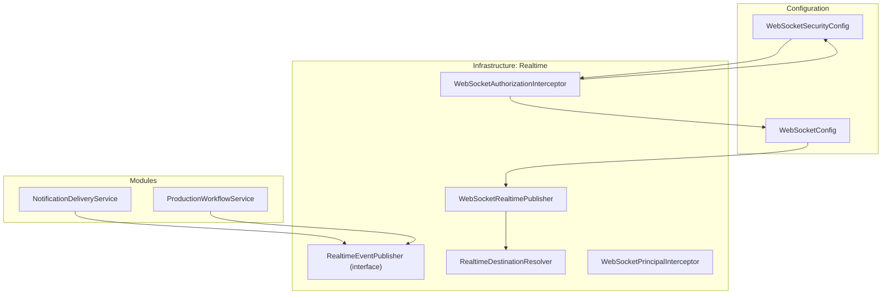
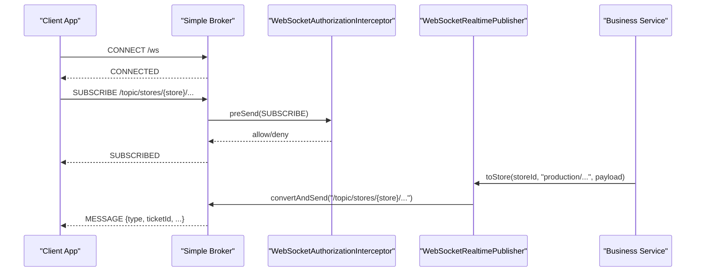
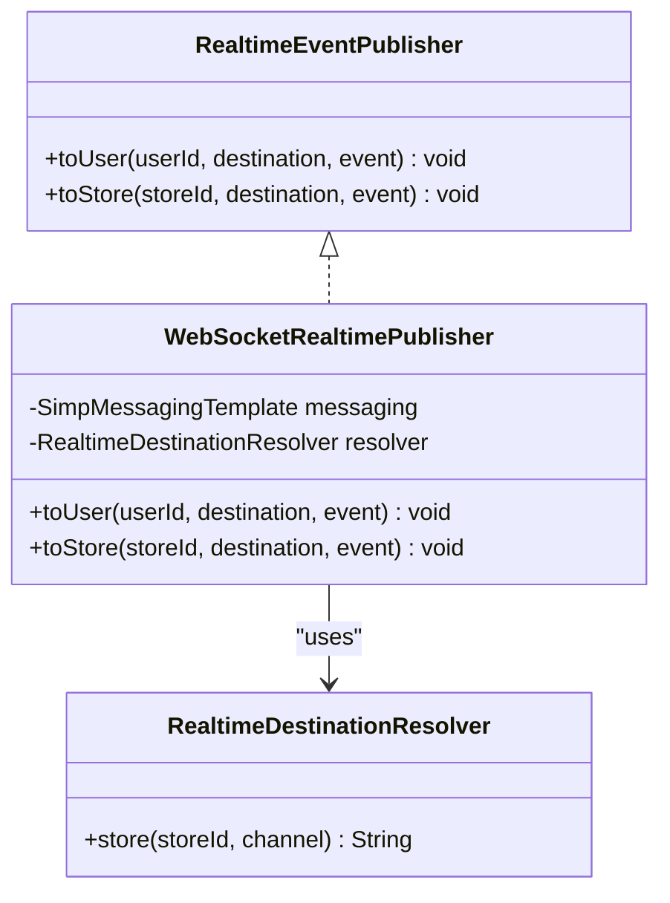
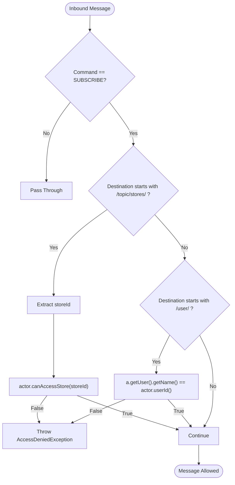
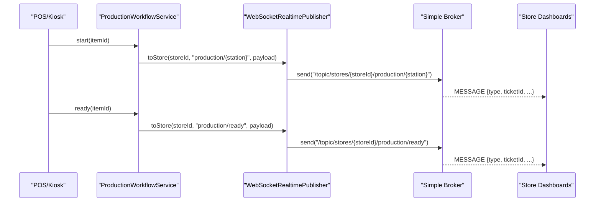
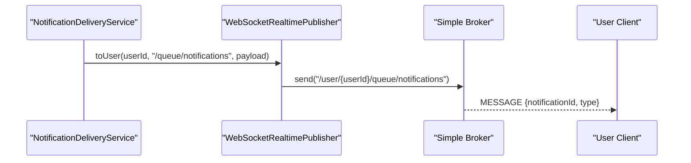
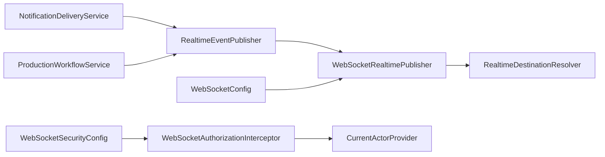

# Real-time Communication

<cite>
**Referenced Files in This Document**
- [RealtimeEventPublisher.java](file://src/main/java/com/smartcoffee/infrastructure/realtime/RealtimeEventPublisher.java)
- [WebSocketRealtimePublisher.java](file://src/main/java/com/smartcoffee/infrastructure/realtime/WebSocketRealtimePublisher.java)
- [RealtimeDestinationResolver.java](file://src/main/java/com/smartcoffee/infrastructure/realtime/RealtimeDestinationResolver.java)
- [WebSocketAuthorizationInterceptor.java](file://src/main/java/com/smartcoffee/infrastructure/realtime/WebSocketAuthorizationInterceptor.java)
- [WebSocketPrincipalInterceptor.java](file://src/main/java/com/smartcoffee/infrastructure/realtime/WebSocketPrincipalInterceptor.java)
- [WebSocketConfig.java](file://src/main/java/com/smartcoffee/config/WebSocketConfig.java)
- [WebSocketSecurityConfig.java](file://src/main/java/com/smartcoffee/config/WebSocketSecurityConfig.java)
- [CurrentActorProvider.java](file://src/main/java/com/smartcoffee/common/security/CurrentActorProvider.java)
- [StoreAuthorizationService.java](file://src/main/java/com/smartcoffee/common/security/StoreAuthorizationService.java)
- [NotificationDeliveryService.java](file://src/main/java/com/smartcoffee/modules/notification/application/NotificationDeliveryService.java)
- [ProductionWorkflowService.java](file://src/main/java/com/smartcoffee/modules/production/application/ProductionWorkflowService.java)
</cite>

## Table of Contents
1. Introduction
2. Project Structure
3. Core Components
4. Architecture Overview
5. Detailed Component Analysis
6. Dependency Analysis
7. Performance Considerations
8. Troubleshooting Guide
9. Conclusion
10. Appendices

## Introduction
This document explains the real-time communication layer built on Spring WebSocket and STOMP for live updates. It covers event broadcasting, WebSocket-specific publishing, destination resolution, authentication and authorization interceptors, connection management, message routing, and client disconnection handling. It also provides security considerations, scaling strategies, monitoring approaches, and practical examples such as real-time order updates, production status changes, and notification delivery via WebSockets.

## Project Structure
The real-time features are implemented under infrastructure/realtime with configuration in config and usage across modules (notification, production). The system uses a simple in-process message broker (/topic, /queue) with user-scoped destinations (/user) and application destinations (/app).

**Diagram sources**
- [WebSocketConfig.java:1-21](file://src/main/java/com/smartcoffee/config/WebSocketConfig.java#L1-L21)
- [WebSocketSecurityConfig.java:1-37](file://src/main/java/com/smartcoffee/config/WebSocketSecurityConfig.java#L1-L37)
- [RealtimeEventPublisher.java:1-4](file://src/main/java/com/smartcoffee/infrastructure/realtime/RealtimeEventPublisher.java#L1-L4)
- [WebSocketRealtimePublisher.java:1-5](file://src/main/java/com/smartcoffee/infrastructure/realtime/WebSocketRealtimePublisher.java#L1-L5)
- [RealtimeDestinationResolver.java:1-5](file://src/main/java/com/smartcoffee/infrastructure/realtime/RealtimeDestinationResolver.java#L1-L5)
- [WebSocketAuthorizationInterceptor.java:1-39](file://src/main/java/com/smartcoffee/infrastructure/realtime/WebSocketAuthorizationInterceptor.java#L1-L39)
- [WebSocketPrincipalInterceptor.java:1-14](file://src/main/java/com/smartcoffee/infrastructure/realtime/WebSocketPrincipalInterceptor.java#L1-L14)
- [NotificationDeliveryService.java:1-68](file://src/main/java/com/smartcoffee/modules/notification/application/NotificationDeliveryService.java#L1-L68)
- [ProductionWorkflowService.java:1-134](file://src/main/java/com/smartcoffee/modules/production/application/ProductionWorkflowService.java#L1-L134)

**Section sources**
- [WebSocketConfig.java:1-21](file://src/main/java/com/smartcoffee/config/WebSocketConfig.java#L1-L21)
- [WebSocketSecurityConfig.java:1-37](file://src/main/java/com/smartcoffee/config/WebSocketSecurityConfig.java#L1-L37)

## Core Components
- RealtimeEventPublisher: Interface defining toUser(userId, destination, event) and toStore(storeId, destination, event).
- WebSocketRealtimePublisher: Implementation using SimpMessagingTemplate to send to user queues or store topics.
- RealtimeDestinationResolver: Builds store-scoped topic paths like /topic/stores/{storeId}/{channel}.
- WebSocketAuthorizationInterceptor: Validates subscriptions to /topic/stores/* and /user/* based on current actor permissions.
- WebSocketPrincipalInterceptor: Placeholder interceptor for principal-related logic.
- Configuration:
  - WebSocketConfig: Enables simple broker (/topic, /queue), sets /app prefix, and registers /ws endpoint.
  - WebSocketSecurityConfig: Adds authorization interceptor to inbound channel, configures allowed origins from properties.

Key responsibilities:
- Broadcasting events to users and stores.
- Resolving destinations for store-scoped channels.
- Enforcing per-store and per-user subscription access.

**Section sources**
- [RealtimeEventPublisher.java:1-4](file://src/main/java/com/smartcoffee/infrastructure/realtime/RealtimeEventPublisher.java#L1-L4)
- [WebSocketRealtimePublisher.java:1-5](file://src/main/java/com/smartcoffee/infrastructure/realtime/WebSocketRealtimePublisher.java#L1-L5)
- [RealtimeDestinationResolver.java:1-5](file://src/main/java/com/smartcoffee/infrastructure/realtime/RealtimeDestinationResolver.java#L1-L5)
- [WebSocketAuthorizationInterceptor.java:1-39](file://src/main/java/com/smartcoffee/infrastructure/realtime/WebSocketAuthorizationInterceptor.java#L1-L39)
- [WebSocketPrincipalInterceptor.java:1-14](file://src/main/java/com/smartcoffee/infrastructure/realtime/WebSocketPrincipalInterceptor.java#L1-L14)
- [WebSocketConfig.java:1-21](file://src/main/java/com/smartcoffee/config/WebSocketConfig.java#L1-L21)
- [WebSocketSecurityConfig.java:1-37](file://src/main/java/com/smartcoffee/config/WebSocketSecurityConfig.java#L1-L37)

## Architecture Overview
The runtime flow connects business services to the real-time layer through the publisher interface. Subscriptions are protected by an authorization interceptor that checks the current actor’s store access and user identity.

**Diagram sources**
- [WebSocketSecurityConfig.java:22-34](file://src/main/java/com/smartcoffee/config/WebSocketSecurityConfig.java#L22-L34)
- [WebSocketAuthorizationInterceptor.java:18-36](file://src/main/java/com/smartcoffee/infrastructure/realtime/WebSocketAuthorizationInterceptor.java#L18-L36)
- [WebSocketRealtimePublisher.java:1-5](file://src/main/java/com/smartcoffee/infrastructure/realtime/WebSocketRealtimePublisher.java#L1-L5)
- [ProductionWorkflowService.java:69-90](file://src/main/java/com/smartcoffee/modules/production/application/ProductionWorkflowService.java#L69-L90)

## Detailed Component Analysis

### RealtimeEventPublisher and WebSocketRealtimePublisher
- Purpose: Abstracts real-time publishing so modules depend only on the interface.
- Behavior:
  - toUser: Sends to /user/{userId}/{destination} via SimpMessagingTemplate.
  - toStore: Resolves store topic path and sends to /topic/stores/{storeId}/{destination}.
- Data flow: Business service calls publisher; publisher delegates to messaging template; broker routes to subscribers.

**Diagram sources**
- [RealtimeEventPublisher.java:1-4](file://src/main/java/com/smartcoffee/infrastructure/realtime/RealtimeEventPublisher.java#L1-L4)
- [WebSocketRealtimePublisher.java:1-5](file://src/main/java/com/smartcoffee/infrastructure/realtime/WebSocketRealtimePublisher.java#L1-L5)
- [RealtimeDestinationResolver.java:1-5](file://src/main/java/com/smartcoffee/infrastructure/realtime/RealtimeDestinationResolver.java#L1-L5)

**Section sources**
- [WebSocketRealtimePublisher.java:1-5](file://src/main/java/com/smartcoffee/infrastructure/realtime/WebSocketRealtimePublisher.java#L1-L5)
- [RealtimeDestinationResolver.java:1-5](file://src/main/java/com/smartcoffee/infrastructure/realtime/RealtimeDestinationResolver.java#L1-L5)

### RealtimeDestinationResolver
- Purpose: Normalizes store-scoped destinations to /topic/stores/{storeId}/{channel}.
- Usage: Called by WebSocketRealtimePublisher to build target topic paths.

**Section sources**
- [RealtimeDestinationResolver.java:1-5](file://src/main/java/com/smartcoffee/infrastructure/realtime/RealtimeDestinationResolver.java#L1-L5)

### WebSocket Interceptors: Authentication and Authorization
- WebSocketAuthorizationInterceptor:
  - Runs on inbound messages.
  - For SUBSCRIBE to /topic/stores/*, extracts storeId and verifies current actor canAccessStore.
  - For SUBSCRIBE to /user/*, ensures the subscriber is acting on their own user destination.
  - Throws AccessDeniedException when unauthorized.
- WebSocketPrincipalInterceptor:
  - Currently a no-op placeholder for future principal enrichment.

**Diagram sources**
- [WebSocketAuthorizationInterceptor.java:18-36](file://src/main/java/com/smartcoffee/infrastructure/realtime/WebSocketAuthorizationInterceptor.java#L18-L36)
- [CurrentActorProvider.java:20-40](file://src/main/java/com/smartcoffee/common/security/CurrentActorProvider.java#L20-L40)

**Section sources**
- [WebSocketAuthorizationInterceptor.java:1-39](file://src/main/java/com/smartcoffee/infrastructure/realtime/WebSocketAuthorizationInterceptor.java#L1-L39)
- [WebSocketPrincipalInterceptor.java:1-14](file://src/main/java/com/smartcoffee/infrastructure/realtime/WebSocketPrincipalInterceptor.java#L1-L14)
- [CurrentActorProvider.java:1-44](file://src/main/java/com/smartcoffee/common/security/CurrentActorProvider.java#L1-L44)
- [StoreAuthorizationService.java:1-15](file://src/main/java/com/smartcoffee/common/security/StoreAuthorizationService.java#L1-L15)

### Connection Management and Security Configuration
- WebSocketConfig:
  - Enables simple broker with /topic and /queue.
  - Sets /app application destination prefix.
  - Registers /ws endpoint with localhost origin patterns.
- WebSocketSecurityConfig:
  - Adds WebSocketAuthorizationInterceptor to inbound channel.
  - Configures allowed origins from app.websocket.allowed-origins property.
  - Repeats broker configuration for clarity.

Connection lifecycle notes:
- Clients connect to /ws.
- Subscriptions are validated before allowing access to store/user topics.
- User destinations are scoped to authenticated userId.

**Section sources**
- [WebSocketConfig.java:1-21](file://src/main/java/com/smartcoffee/config/WebSocketConfig.java#L1-L21)
- [WebSocketSecurityConfig.java:1-37](file://src/main/java/com/smartcoffee/config/WebSocketSecurityConfig.java#L1-L37)

### Message Routing Examples

#### Real-time Order Updates
- Use case: Notify clients about order status transitions (e.g., preparing, ready).
- Approach: Publish to store-scoped topic using toStore with a channel like "order/status".
- Consumers: Clients subscribe to /topic/stores/{storeId}/order/status.

Implementation reference:
- Production workflow publishes store-scoped messages for production milestones and readiness.

**Section sources**
- [ProductionWorkflowService.java:69-90](file://src/main/java/com/smartcoffee/modules/production/application/ProductionWorkflowService.java#L69-L90)

#### Production Status Changes
- Use case: Broadcast item start and ready events to relevant stations.
- Flow:
  - Start item -> publish to "production/{stationType}" on store topic.
  - Ready item -> if all items ready, publish "production/ready" on store topic.
- Payload includes type, ticketId, orderId, storeId, and status.

**Diagram sources**
- [ProductionWorkflowService.java:69-90](file://src/main/java/com/smartcoffee/modules/production/application/ProductionWorkflowService.java#L69-L90)
- [WebSocketRealtimePublisher.java:1-5](file://src/main/java/com/smartcoffee/infrastructure/realtime/WebSocketRealtimePublisher.java#L1-L5)

**Section sources**
- [ProductionWorkflowService.java:1-134](file://src/main/java/com/smartcoffee/modules/production/application/ProductionWorkflowService.java#L1-L134)

#### Notification Delivery via WebSockets
- Use case: Deliver notifications to specific users in real time.
- Flow:
  - Scheduled job polls pending deliveries.
  - For WEBSOCKET channel, publishes to /queue/notifications for the user.
  - Marks delivery as delivered upon success.

**Diagram sources**
- [NotificationDeliveryService.java:28-65](file://src/main/java/com/smartcoffee/modules/notification/application/NotificationDeliveryService.java#L28-L65)
- [WebSocketRealtimePublisher.java:1-5](file://src/main/java/com/smartcoffee/infrastructure/realtime/WebSocketRealtimePublisher.java#L1-L5)

**Section sources**
- [NotificationDeliveryService.java:1-68](file://src/main/java/com/smartcoffee/modules/notification/application/NotificationDeliveryService.java#L1-L68)

## Dependency Analysis
- Modules depend on RealtimeEventPublisher interface, not implementation details.
- WebSocketRealtimePublisher depends on SimpMessagingTemplate and RealtimeDestinationResolver.
- Authorization relies on CurrentActorProvider and store-based permissions.
- Configuration wires interceptors and endpoints.

**Diagram sources**
- [NotificationDeliveryService.java:1-68](file://src/main/java/com/smartcoffee/modules/notification/application/NotificationDeliveryService.java#L1-L68)
- [ProductionWorkflowService.java:1-134](file://src/main/java/com/smartcoffee/modules/production/application/ProductionWorkflowService.java#L1-L134)
- [WebSocketRealtimePublisher.java:1-5](file://src/main/java/com/smartcoffee/infrastructure/realtime/WebSocketRealtimePublisher.java#L1-L5)
- [RealtimeDestinationResolver.java:1-5](file://src/main/java/com/smartcoffee/infrastructure/realtime/RealtimeDestinationResolver.java#L1-L5)
- [WebSocketConfig.java:1-21](file://src/main/java/com/smartcoffee/config/WebSocketConfig.java#L1-L21)
- [WebSocketSecurityConfig.java:1-37](file://src/main/java/com/smartcoffee/config/WebSocketSecurityConfig.java#L1-L37)
- [CurrentActorProvider.java:1-44](file://src/main/java/com/smartcoffee/common/security/CurrentActorProvider.java#L1-L44)

**Section sources**
- [WebSocketRealtimePublisher.java:1-5](file://src/main/java/com/smartcoffee/infrastructure/realtime/WebSocketRealtimePublisher.java#L1-L5)
- [WebSocketAuthorizationInterceptor.java:1-39](file://src/main/java/com/smartcoffee/infrastructure/realtime/WebSocketAuthorizationInterceptor.java#L1-L39)
- [CurrentActorProvider.java:1-44](file://src/main/java/com/smartcoffee/common/security/CurrentActorProvider.java#L1-L44)

## Performance Considerations
- Simple broker suitability: In-memory broker is suitable for single-instance deployments. For multi-instance scaling, consider a shared message broker (e.g., RabbitMQ) to fan out messages across nodes.
- Topic design: Keep store-scoped topics narrow and purposeful to reduce fan-out overhead.
- Payload size: Minimize payload sizes; use concise JSON structures.
- Backpressure: Avoid sending high-frequency bursts without throttling; consider batching where appropriate.
- Connection limits: Monitor concurrent connections and tune server resources accordingly.

[No sources needed since this section provides general guidance]

## Troubleshooting Guide
Common issues and resolutions:
- Subscription denied:
  - Cause: Subscriber lacks permission to the requested store or is attempting to subscribe to another user’s /user destination.
  - Resolution: Ensure the current actor has access to the store or is acting on their own user identity.
- Endpoint not reachable:
  - Cause: Origin not allowed or endpoint misconfiguration.
  - Resolution: Configure app.websocket.allowed-origins to include your frontend origin.
- No messages received:
  - Cause: Publisher not invoked or wrong destination/channel.
  - Resolution: Verify module code calls toStore/toUser with correct parameters and that clients subscribe to matching paths.

Operational tips:
- Log authorization decisions and exceptions in interceptors for faster debugging.
- Add metrics around publish/send operations and subscription counts.

**Section sources**
- [WebSocketAuthorizationInterceptor.java:18-36](file://src/main/java/com/smartcoffee/infrastructure/realtime/WebSocketAuthorizationInterceptor.java#L18-L36)
- [WebSocketSecurityConfig.java:22-34](file://src/main/java/com/smartcoffee/config/WebSocketSecurityConfig.java#L22-L34)

## Conclusion
The real-time layer provides a clean abstraction for broadcasting events to users and stores with strong authorization controls. Modules integrate via the RealtimeEventPublisher interface, enabling consistent patterns for order updates, production status changes, and notifications. With proper configuration, security, and scaling strategies, this foundation supports robust live experiences in production environments.

[No sources needed since this section summarizes without analyzing specific files]

## Appendices

### Security Considerations for WebSocket Connections
- Always validate subscriptions against current actor permissions.
- Restrict /user destinations to the authenticated user.
- Configure strict allowed origins and consider TLS in production.
- Apply rate limiting and connection quotas at the gateway level.

**Section sources**
- [WebSocketAuthorizationInterceptor.java:18-36](file://src/main/java/com/smartcoffee/infrastructure/realtime/WebSocketAuthorizationInterceptor.java#L18-L36)
- [WebSocketSecurityConfig.java:22-34](file://src/main/java/com/smartcoffee/config/WebSocketSecurityConfig.java#L22-L34)
- [CurrentActorProvider.java:20-40](file://src/main/java/com/smartcoffee/common/security/CurrentActorProvider.java#L20-L40)

### Scaling Strategies for Real-time Features
- Multi-instance deployment:
  - Replace simple broker with a distributed broker to ensure cross-node message delivery.
  - Use sticky sessions or centralized session storage if needed.
- Horizontal scaling:
  - Scale producers and consumers independently.
  - Partition topics by store or tenant to limit scope.
- Resilience:
  - Implement retries and dead-letter handling for failed deliveries.
  - Gracefully handle client disconnects and reconnections.

[No sources needed since this section provides general guidance]

### Monitoring Approaches
- Metrics:
  - Track publish rates, subscription counts, and error rates.
  - Measure latency from event creation to client delivery.
- Logging:
  - Correlate events with request IDs and user/store identifiers.
  - Log authorization failures and retry attempts.
- Health checks:
  - Expose readiness indicators for WebSocket connectivity.

[No sources needed since this section provides general guidance]