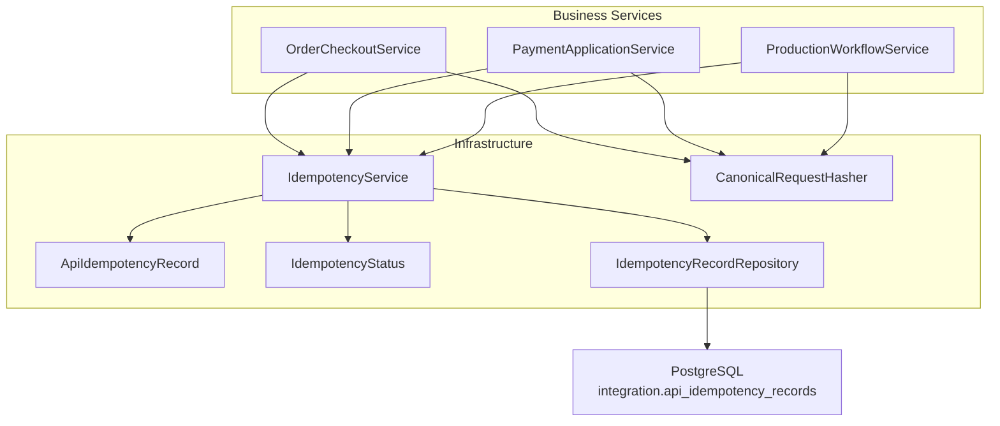
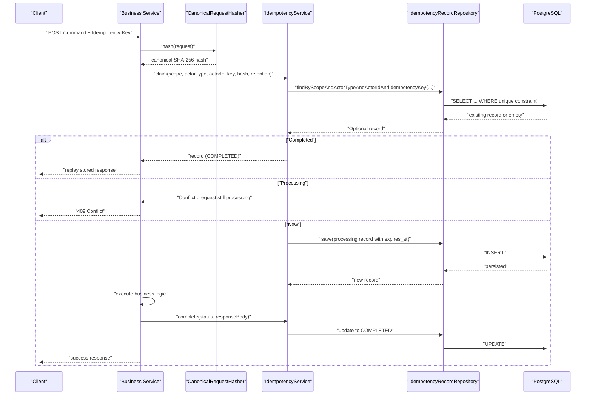
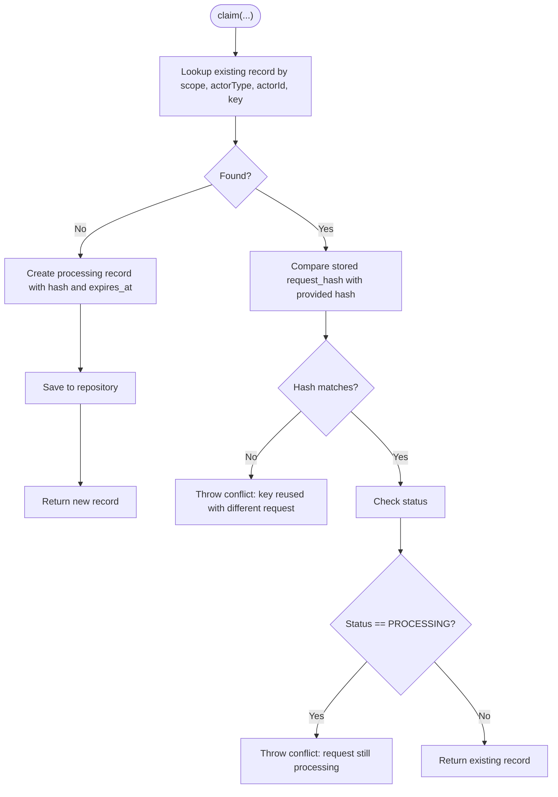
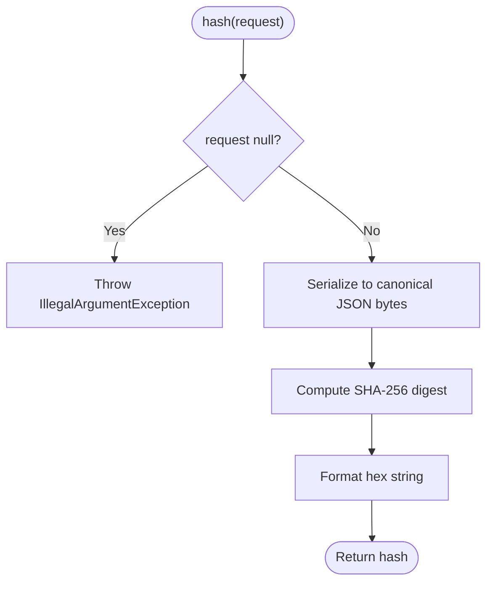
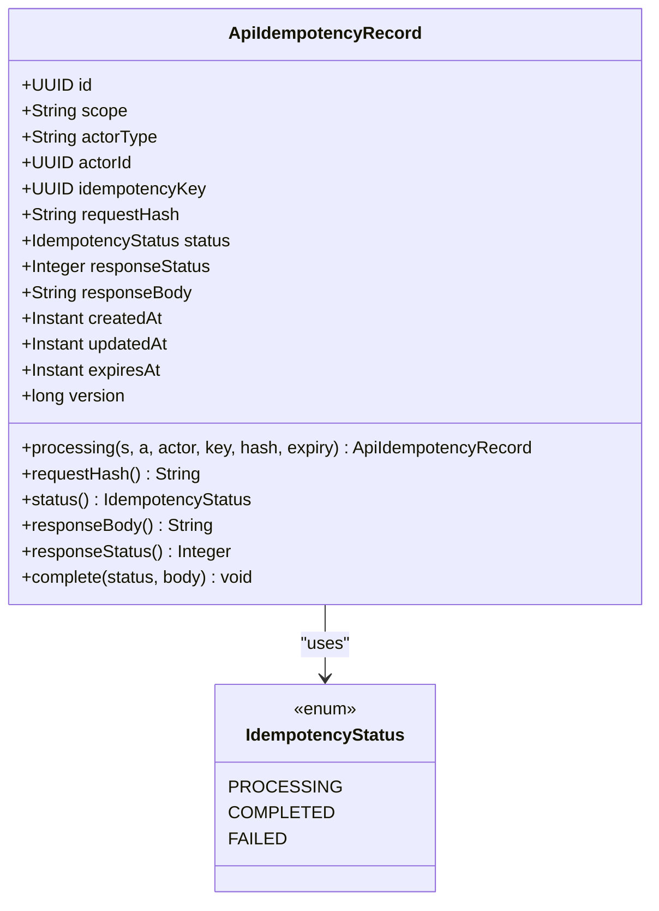
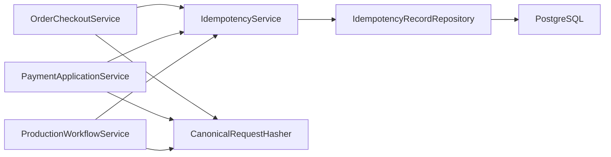

# Request Idempotency

<cite>
**Referenced Files in This Document**
- [IdempotencyService.java](file://src/main/java/com/smartcoffee/infrastructure/idempotency/IdempotencyService.java)
- [CanonicalRequestHasher.java](file://src/main/java/com/smartcoffee/infrastructure/idempotency/CanonicalRequestHasher.java)
- [ApiIdempotencyRecord.java](file://src/main/java/com/smartcoffee/infrastructure/idempotency/ApiIdempotencyRecord.java)
- [IdempotencyStatus.java](file://src/main/java/com/smartcoffee/infrastructure/idempotency/IdempotencyStatus.java)
- [IdempotencyRecordRepository.java](file://src/main/java/com/smartcoffee/infrastructure/idempotency/IdempotencyRecordRepository.java)
- [OrderCheckoutService.java](file://src/main/java/com/smartcoffee/modules/ordering/application/OrderCheckoutService.java)
- [PaymentApplicationService.java](file://src/main/java/com/smartcoffee/modules/payment/application/PaymentApplicationService.java)
- [ProductionWorkflowService.java](file://src/main/java/com/smartcoffee/modules/production/application/ProductionWorkflowService.java)
- [application.yml](file://src/main/resources/application.yml)
- [smart-coffee-logical.dbml](file://database/smart-coffee-logical.dbml)
- [SYSTEM_ARCHITECTURE.md](file://architecture/SYSTEM_ARCHITECTURE.md)
- [ORDER_FLOW.mermaid](file://architecture/ORDER_FLOW.mermaid)
</cite>

## Table of Contents
1. [Introduction](#introduction)
2. [Project Structure](#project-structure)
3. [Core Components](#core-components)
4. [Architecture Overview](#architecture-overview)
5. [Detailed Component Analysis](#detailed-component-analysis)
6. [Dependency Analysis](#dependency-analysis)
7. [Performance Considerations](#performance-considerations)
8. [Troubleshooting Guide](#troubleshooting-guide)
9. [Conclusion](#conclusion)

## Introduction
This document explains how request idempotency is implemented to ensure safety against duplicate requests and network retries. It focuses on:
- IdempotencyService for claiming and managing idempotency keys
- CanonicalRequestHasher for deterministic request normalization and hashing
- ApiIdempotencyRecord for persistent tracking of processed requests
- IdempotencyStatus for state management
It also covers idempotency key generation, storage strategy, cleanup considerations, configuration options, conflict resolution, and practical examples from order, payment, and production workflows.

## Project Structure
The idempotency feature lives under the infrastructure layer and is consumed by domain application services:
- Infrastructure idempotency components are defined in `com.smartcoffee.infrastructure.idempotency`
- Business services such as ordering, payment, and production use these components to make their commands idempotent
- The database schema for idempotency records is defined in the integration schema

**Diagram sources**
- [IdempotencyService.java:3-5](file://src/main/java/com/smartcoffee/infrastructure/idempotency/IdempotencyService.java#L3-L5)
- [CanonicalRequestHasher.java:11-18](file://src/main/java/com/smartcoffee/infrastructure/idempotency/CanonicalRequestHasher.java#L11-L18)
- [ApiIdempotencyRecord.java:3-7](file://src/main/java/com/smartcoffee/infrastructure/idempotency/ApiIdempotencyRecord.java#L3-L7)
- [IdempotencyStatus.java:1-1](file://src/main/java/com/smartcoffee/infrastructure/idempotency/IdempotencyStatus.java#L1-L1)
- [IdempotencyRecordRepository.java:2-3](file://src/main/java/com/smartcoffee/infrastructure/idempotency/IdempotencyRecordRepository.java#L2-L3)
- [OrderCheckoutService.java:39-46](file://src/main/java/com/smartcoffee/modules/ordering/application/OrderCheckoutService.java#L39-L46)
- [PaymentApplicationService.java:28-35](file://src/main/java/com/smartcoffee/modules/payment/application/PaymentApplicationService.java#L28-L35)
- [ProductionWorkflowService.java:27-38](file://src/main/java/com/smartcoffee/modules/production/application/ProductionWorkflowService.java#L27-L38)

**Section sources**
- [IdempotencyService.java:1-6](file://src/main/java/com/smartcoffee/infrastructure/idempotency/IdempotencyService.java#L1-L6)
- [CanonicalRequestHasher.java:1-67](file://src/main/java/com/smartcoffee/infrastructure/idempotency/CanonicalRequestHasher.java#L1-L67)
- [ApiIdempotencyRecord.java:1-9](file://src/main/java/com/smartcoffee/infrastructure/idempotency/ApiIdempotencyRecord.java#L1-L9)
- [IdempotencyStatus.java:1-3](file://src/main/java/com/smartcoffee/infrastructure/idempotency/IdempotencyStatus.java#L1-L3)
- [IdempotencyRecordRepository.java:1-5](file://src/main/java/com/smartcoffee/infrastructure/idempotency/IdempotencyRecordRepository.java#L1-L5)
- [OrderCheckoutService.java:1-136](file://src/main/java/com/smartcoffee/modules/ordering/application/OrderCheckoutService.java#L1-L136)
- [PaymentApplicationService.java:1-163](file://src/main/java/com/smartcoffee/modules/payment/application/PaymentApplicationService.java#L1-L163)
- [ProductionWorkflowService.java:98-133](file://src/main/java/com/smartcoffee/modules/production/application/ProductionWorkflowService.java#L98-L133)

## Core Components
- IdempotencyService: Claims an idempotency record within a transaction, validates reuse, detects in-progress requests, and creates new processing records with expiration.
- CanonicalRequestHasher: Produces deterministic SHA-256 hashes from canonical JSON representations of request objects or raw JSON strings.
- ApiIdempotencyRecord: JPA entity representing an idempotency record with scope, actor identity, idempotency key, request hash, status, response snapshot, and expiry.
- IdempotencyStatus: Enumerates PROCESSING, COMPLETED, and FAILED states.
- IdempotencyRecordRepository: Spring Data repository providing lookup by scope, actor type, actor id, and idempotency key.

Key responsibilities:
- Deterministic hashing ensures that identical requests produce the same hash.
- Claim semantics prevent duplicate execution while allowing replay of completed results.
- Expiration supports cleanup and prevents indefinite retention.

**Section sources**
- [IdempotencyService.java:3-5](file://src/main/java/com/smartcoffee/infrastructure/idempotency/IdempotencyService.java#L3-L5)
- [CanonicalRequestHasher.java:20-39](file://src/main/java/com/smartcoffee/infrastructure/idempotency/CanonicalRequestHasher.java#L20-L39)
- [ApiIdempotencyRecord.java:3-7](file://src/main/java/com/smartcoffee/infrastructure/idempotency/ApiIdempotencyRecord.java#L3-L7)
- [IdempotencyStatus.java:1-1](file://src/main/java/com/smartcoffee/infrastructure/idempotency/IdempotencyStatus.java#L1-L1)
- [IdempotencyRecordRepository.java:2-3](file://src/main/java/com/smartcoffee/infrastructure/idempotency/IdempotencyRecordRepository.java#L2-L3)

## Architecture Overview
Idempotency is enforced at the boundary between API controllers and business services. A typical flow:
1. Client sends a command with an Idempotency-Key header.
2. Service computes a canonical hash of the request body.
3. Service claims the idempotency record; if already completed, it replays the stored response.
4. If new, the service executes the operation inside a transaction and stores the result.
5. On duplicates, the original response is returned without re-executing side effects.

**Diagram sources**
- [OrderCheckoutService.java:62-73](file://src/main/java/com/smartcoffee/modules/ordering/application/OrderCheckoutService.java#L62-L73)
- [IdempotencyService.java:4-5](file://src/main/java/com/smartcoffee/infrastructure/idempotency/IdempotencyService.java#L4-L5)
- [IdempotencyRecordRepository.java:3](file://src/main/java/com/smartcoffee/infrastructure/idempotency/IdempotencyRecordRepository.java#L3)
- [ApiIdempotencyRecord.java:6-7](file://src/main/java/com/smartcoffee/infrastructure/idempotency/ApiIdempotencyRecord.java#L6-L7)

**Section sources**
- [SYSTEM_ARCHITECTURE.md:232-250](file://architecture/SYSTEM_ARCHITECTURE.md#L232-L250)
- [ORDER_FLOW.mermaid:16-43](file://architecture/ORDER_FLOW.mermaid#L16-L43)

## Detailed Component Analysis

### IdempotencyService
Responsibilities:
- Transactional claim of idempotency records
- Conflict detection when a key is reused with a different request hash
- Detection of in-progress requests
- Creation of new processing records with calculated expiration

Behavior highlights:
- Uses a unique composite key across scope, actor type, actor id, and idempotency key
- Throws conflict exceptions for key reuse and in-progress requests
- Persists new records with status PROCESSING and an expires_at timestamp

**Diagram sources**
- [IdempotencyService.java:4-5](file://src/main/java/com/smartcoffee/infrastructure/idempotency/IdempotencyService.java#L4-L5)

**Section sources**
- [IdempotencyService.java:3-5](file://src/main/java/com/smartcoffee/infrastructure/idempotency/IdempotencyService.java#L3-L5)

### CanonicalRequestHasher
Responsibilities:
- Normalize request objects into canonical JSON using ObjectMapper
- Compute SHA-256 digest over canonical bytes
- Provide both object-based and raw JSON-based hashing

Design notes:
- Null inputs are rejected with IllegalArgumentException
- Missing algorithm support throws IllegalStateException
- Deterministic output requires stable serialization configuration

**Diagram sources**
- [CanonicalRequestHasher.java:20-39](file://src/main/java/com/smartcoffee/infrastructure/idempotency/CanonicalRequestHasher.java#L20-L39)

**Section sources**
- [CanonicalRequestHasher.java:11-65](file://src/main/java/com/smartcoffee/infrastructure/idempotency/CanonicalRequestHasher.java#L11-L65)

### ApiIdempotencyRecord
Responsibilities:
- Persist idempotency metadata including scope, actor identity, idempotency key, request hash, status, response snapshot, timestamps, and version
- Provide factory method to create processing records with computed expiry
- Support completion by updating status to COMPLETED and storing response metadata

Schema mapping:
- Stored in integration schema table api_idempotency_records
- Unique constraint enforces uniqueness across scope, actor_type, actor_id, idempotency_key

**Diagram sources**
- [ApiIdempotencyRecord.java:3-7](file://src/main/java/com/smartcoffee/infrastructure/idempotency/ApiIdempotencyRecord.java#L3-L7)
- [IdempotencyStatus.java:1-1](file://src/main/java/com/smartcoffee/infrastructure/idempotency/IdempotencyStatus.java#L1-L1)

**Section sources**
- [ApiIdempotencyRecord.java:1-9](file://src/main/java/com/smartcoffee/infrastructure/idempotency/ApiIdempotencyRecord.java#L1-L9)
- [smart-coffee-logical.dbml:789-803](file://database/smart-coffee-logical.dbml#L789-L803)

### IdempotencyStatus
Responsibilities:
- Represent lifecycle states for idempotency records: PROCESSING, COMPLETED, FAILED

Usage:
- PROCESSING indicates an ongoing operation
- COMPLETED indicates successful completion with stored response
- FAILED indicates unsuccessful completion where applicable

**Section sources**
- [IdempotencyStatus.java:1-1](file://src/main/java/com/smartcoffee/infrastructure/idempotency/IdempotencyStatus.java#L1-L1)

### Repository Layer
Responsibilities:
- Provide query by composite key for idempotency deduplication
- Extend JpaRepository for standard persistence operations

**Section sources**
- [IdempotencyRecordRepository.java:2-3](file://src/main/java/com/smartcoffee/infrastructure/idempotency/IdempotencyRecordRepository.java#L2-L3)

## Dependency Analysis
Idempotency components are used by multiple business services:
- OrderCheckoutService uses IdempotencyService and CanonicalRequestHasher to make order creation idempotent
- PaymentApplicationService uses them for cash payments and KHQR payment initiation
- ProductionWorkflowService uses them for production ticket actions

**Diagram sources**
- [OrderCheckoutService.java:39-46](file://src/main/java/com/smartcoffee/modules/ordering/application/OrderCheckoutService.java#L39-L46)
- [PaymentApplicationService.java:28-35](file://src/main/java/com/smartcoffee/modules/payment/application/PaymentApplicationService.java#L28-L35)
- [ProductionWorkflowService.java:27-38](file://src/main/java/com/smartcoffee/modules/production/application/ProductionWorkflowService.java#L27-L38)
- [IdempotencyRecordRepository.java:2-3](file://src/main/java/com/smartcoffee/infrastructure/idempotency/IdempotencyRecordRepository.java#L2-L3)

**Section sources**
- [OrderCheckoutService.java:62-73](file://src/main/java/com/smartcoffee/modules/ordering/application/OrderCheckoutService.java#L62-L73)
- [PaymentApplicationService.java:48-87](file://src/main/java/com/smartcoffee/modules/payment/application/PaymentApplicationService.java#L48-L87)
- [ProductionWorkflowService.java:116-131](file://src/main/java/com/smartcoffee/modules/production/application/ProductionWorkflowService.java#L116-L131)

## Performance Considerations
- Database-backed idempotency provides strong consistency but adds write overhead per command
- Unique constraints on composite keys prevent race conditions but require indexed lookups
- Response replay avoids recomputation and reduces downstream load
- Expiration enables eventual cleanup; consider periodic jobs to remove expired records
- Canonical JSON serialization cost should be acceptable compared to business logic costs

[No sources needed since this section provides general guidance]

## Troubleshooting Guide
Common issues and resolutions:
- Key reused with different request:
  - Cause: Same Idempotency-Key sent with different payload
  - Resolution: Ensure clients generate unique keys per distinct request
  - Error code: IDEMPOTENCY_KEY_REUSED
- Request still processing:
  - Cause: Duplicate request received while first attempt is ongoing
  - Resolution: Retry after backoff or return conflict to client
  - Error code: IDEMPOTENCY_REQUEST_IN_PROGRESS
- Cannot store or replay response:
  - Cause: Serialization failure when persisting or reading response body
  - Resolution: Validate response model and JSON compatibility
  - Error code: IDEMPOTENCY_RESPONSE_ERROR

Operational checks:
- Verify unique constraint integrity on integration.api_idempotency_records
- Monitor expires_at values and implement cleanup if necessary
- Review transaction boundaries to ensure idempotency claim and result storage occur within the same transaction

**Section sources**
- [IdempotencyService.java:4-5](file://src/main/java/com/smartcoffee/infrastructure/idempotency/IdempotencyService.java#L4-L5)
- [OrderCheckoutService.java:127-131](file://src/main/java/com/smartcoffee/modules/ordering/application/OrderCheckoutService.java#L127-L131)
- [PaymentApplicationService.java:145-160](file://src/main/java/com/smartcoffee/modules/payment/application/PaymentApplicationService.java#L145-L160)
- [ProductionWorkflowService.java:116-131](file://src/main/java/com/smartcoffee/modules/production/application/ProductionWorkflowService.java#L116-L131)

## Conclusion
The idempotency implementation provides robust duplicate prevention through:
- Deterministic request hashing
- Transactional claim and completion semantics
- Persistent records with unique constraints and expiration
- Clear conflict handling and response replay

For distributed environments:
- Use unique Idempotency-Key per distinct request
- Align TTLs with business lifecycles
- Implement cleanup jobs for expired records
- Monitor conflicts and failures for operational visibility

[No sources needed since this section summarizes without analyzing specific files]