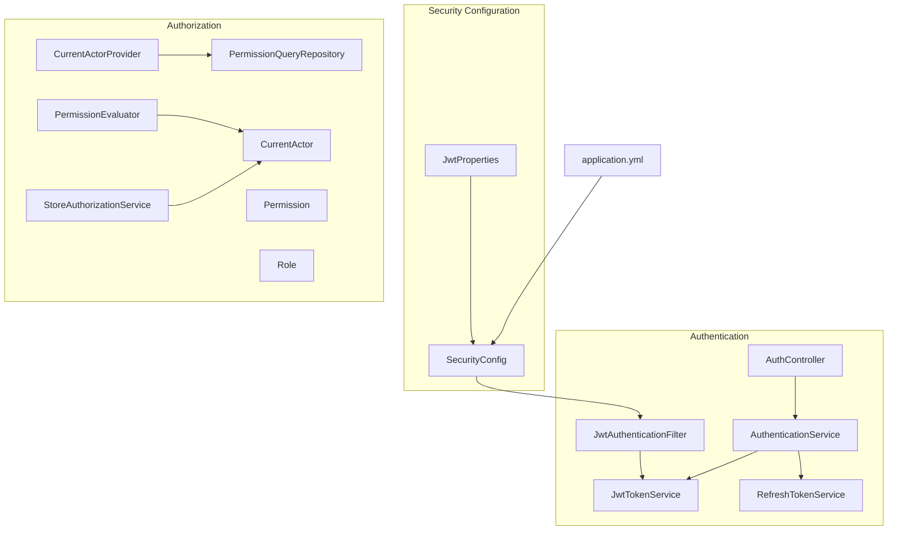
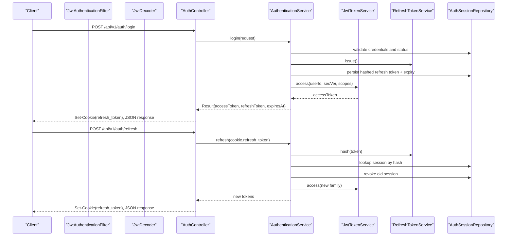
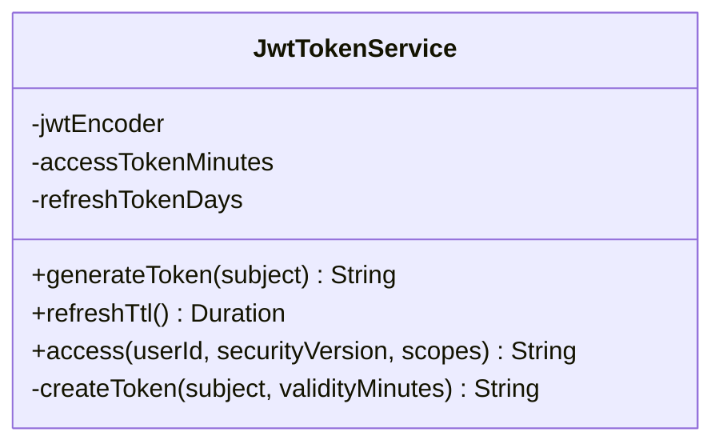
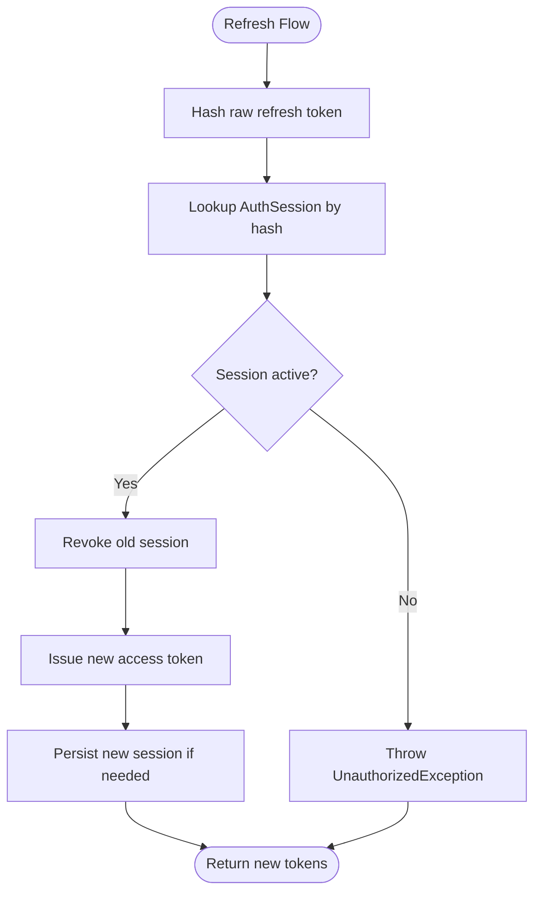
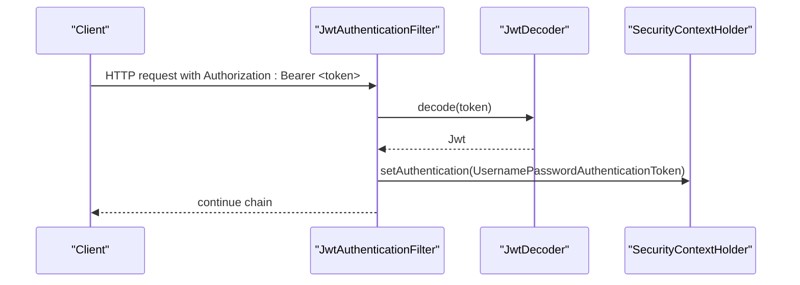
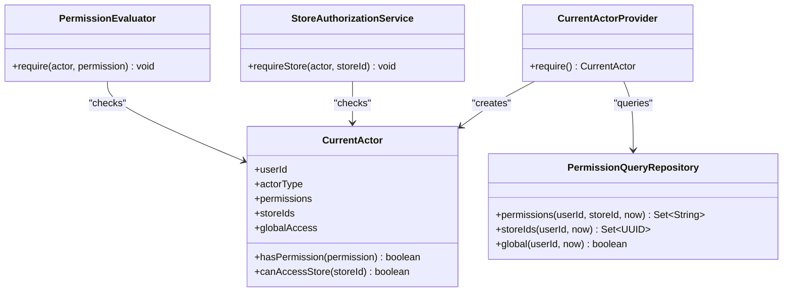
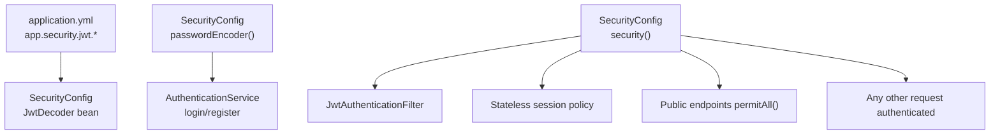
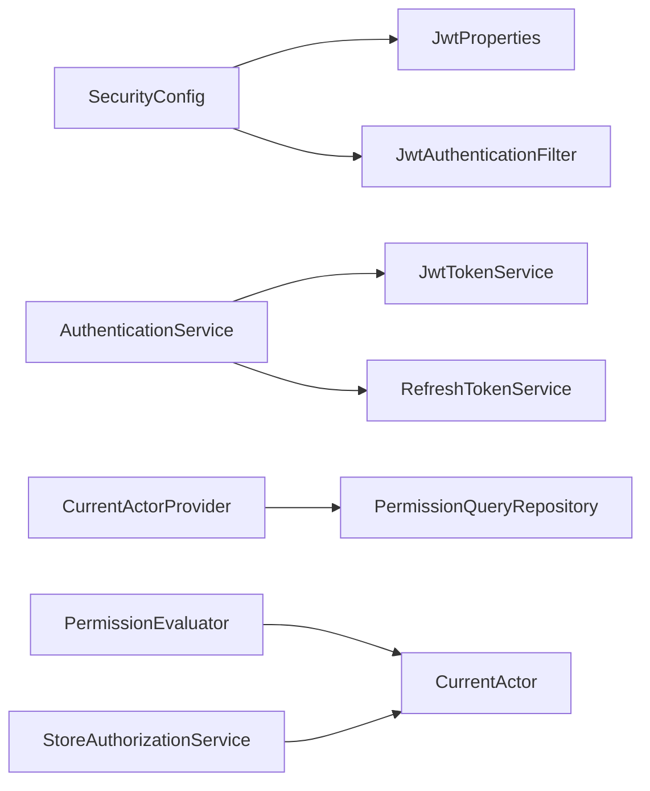

# Security & Authentication Infrastructure

<cite>
**Referenced Files in This Document**
- [JwtTokenService.java](file://src/main/java/com/smartcoffee/modules/auth/security/JwtTokenService.java)
- [RefreshTokenService.java](file://src/main/java/com/smartcoffee/modules/auth/security/RefreshTokenService.java)
- [JwtAuthenticationFilter.java](file://src/main/java/com/smartcoffee/modules/auth/security/JwtAuthenticationFilter.java)
- [PermissionEvaluator.java](file://src/main/java/com/smartcoffee/common/security/PermissionEvaluator.java)
- [StoreAuthorizationService.java](file://src/main/java/com/smartcoffee/common/security/StoreAuthorizationService.java)
- [CurrentActor.java](file://src/main/java/com/smartcoffee/common/security/CurrentActor.java)
- [CurrentActorProvider.java](file://src/main/java/com/smartcoffee/common/security/CurrentActorProvider.java)
- [PermissionCodes.java](file://src/main/java/com/smartcoffee/common/security/PermissionCodes.java)
- [SecurityConfig.java](file://src/main/java/com/smartcoffee/config/SecurityConfig.java)
- [JwtProperties.java](file://src/main/java/com/smartcoffee/modules/auth/security/JwtProperties.java)
- [AuthController.java](file://src/main/java/com/smartcoffee/modules/auth/api/AuthController.java)
- [AuthenticationService.java](file://src/main/java/com/smartcoffee/modules/auth/application/AuthenticationService.java)
- [PermissionQueryRepository.java](file://src/main/java/com/smartcoffee/modules/rbac/persistence/PermissionQueryRepository.java)
- [Permission.java](file://src/main/java/com/smartcoffee/modules/rbac/domain/Permission.java)
- [Role.java](file://src/main/java/com/smartcoffee/modules/rbac/domain/Role.java)
- [application.yml](file://src/main/resources/application.yml)
</cite>

## Table of Contents
1. Introduction
2. Project Structure
3. Core Components
4. Architecture Overview
5. Detailed Component Analysis
6. Dependency Analysis
7. Performance Considerations
8. Troubleshooting Guide
9. Conclusion

## Introduction
This document explains the security and authentication infrastructure for the application, focusing on:
- JWT token lifecycle and validation
- Refresh token handling and session revocation
- Request filtering and principal extraction
- Role-based access control (RBAC) and store-scoped authorization
- Current user context propagation
- Security configuration, password hashing, session policy, and CORS considerations
- Practical examples for protected endpoints, custom permissions, and best practices

## Project Structure
The security features are implemented across a small set of focused components:
- Configuration and HTTP security wiring
- JWT encoding/decoding and filter
- Refresh token generation and hashing
- RBAC domain and query layer
- Authorization helpers and current actor resolution

**Diagram sources**
- [SecurityConfig.java:22-80](file://src/main/java/com/smartcoffee/config/SecurityConfig.java#L22-L80)
- [JwtProperties.java:1-5](file://src/main/java/com/smartcoffee/modules/auth/security/JwtProperties.java#L1-L5)
- [AuthController.java:13-71](file://src/main/java/com/smartcoffee/modules/auth/api/AuthController.java#L13-L71)
- [AuthenticationService.java:16-100](file://src/main/java/com/smartcoffee/modules/auth/application/AuthenticationService.java#L16-L100)
- [JwtTokenService.java:23-104](file://src/main/java/com/smartcoffee/modules/auth/security/JwtTokenService.java#L23-L104)
- [RefreshTokenService.java:1-5](file://src/main/java/com/smartcoffee/modules/auth/security/RefreshTokenService.java#L1-L5)
- [JwtAuthenticationFilter.java:1-5](file://src/main/java/com/smartcoffee/modules/auth/security/JwtAuthenticationFilter.java#L1-L5)
- [CurrentActorProvider.java:12-40](file://src/main/java/com/smartcoffee/common/security/CurrentActorProvider.java#L12-L40)
- [PermissionQueryRepository.java:10-18](file://src/main/java/com/smartcoffee/modules/rbac/persistence/PermissionQueryRepository.java#L10-L18)
- [Permission.java:6-21](file://src/main/java/com/smartcoffee/modules/rbac/domain/Permission.java#L6-L21)
- [Role.java:6-27](file://src/main/java/com/smartcoffee/modules/rbac/domain/Role.java#L6-L27)

**Section sources**
- [SecurityConfig.java:22-80](file://src/main/java/com/smartcoffee/config/SecurityConfig.java#L22-L80)
- [application.yml:49-53](file://src/main/resources/application.yml#L49-L53)

## Core Components
- JwtTokenService: Encodes HS256 JWTs with configurable TTLs and claims including issuer, subject, scopes, and security version.
- RefreshTokenService: Generates cryptographically random refresh tokens and hashes them using SHA-256 before persistence.
- JwtAuthenticationFilter: Decodes Bearer tokens, extracts permissions from the JWT, and sets Spring Security’s authentication context.
- PermissionEvaluator: Enforces permission checks against CurrentActor; throws ForbiddenException when missing.
- StoreAuthorizationService: Enforces store-scoped access based on CurrentActor’s allowed stores or global flag.
- CurrentActor: Immutable record representing authenticated user identity, permissions, store scope, and global access.
- CurrentActorProvider: Resolves CurrentActor by querying RBAC data for the authenticated user at request time.
- PermissionQueryRepository: Provides SQL-backed queries for permissions, store IDs, and global admin status.
- Permission and Role: Domain entities backing RBAC tables.

**Section sources**
- [JwtTokenService.java:23-104](file://src/main/java/com/smartcoffee/modules/auth/security/JwtTokenService.java#L23-L104)
- [RefreshTokenService.java:1-5](file://src/main/java/com/smartcoffee/modules/auth/security/RefreshTokenService.java#L1-L5)
- [JwtAuthenticationFilter.java:1-5](file://src/main/java/com/smartcoffee/modules/auth/security/JwtAuthenticationFilter.java#L1-L5)
- [PermissionEvaluator.java:6-12](file://src/main/java/com/smartcoffee/common/security/PermissionEvaluator.java#L6-L12)
- [StoreAuthorizationService.java:7-13](file://src/main/java/com/smartcoffee/common/security/StoreAuthorizationService.java#L7-L13)
- [CurrentActor.java:6-15](file://src/main/java/com/smartcoffee/common/security/CurrentActor.java#L6-L15)
- [CurrentActorProvider.java:12-40](file://src/main/java/com/smartcoffee/common/security/CurrentActorProvider.java#L12-L40)
- [PermissionQueryRepository.java:10-18](file://src/main/java/com/smartcoffee/modules/rbac/persistence/PermissionQueryRepository.java#L10-L18)
- [Permission.java:6-21](file://src/main/java/com/smartcoffee/modules/rbac/domain/Permission.java#L6-L21)
- [Role.java:6-27](file://src/main/java/com/smartcoffee/modules/rbac/domain/Role.java#L6-L27)

## Architecture Overview
The system uses stateless JWT-based authentication with a cookie-stored refresh token for re-authentication flows. Requests are filtered by JwtAuthenticationFilter, which decodes the token and populates SecurityContext. Business services resolve CurrentActor to enforce fine-grained permissions and store scoping.

**Diagram sources**
- [AuthController.java:33-45](file://src/main/java/com/smartcoffee/modules/auth/api/AuthController.java#L33-L45)
- [AuthenticationService.java:48-99](file://src/main/java/com/smartcoffee/modules/auth/application/AuthenticationService.java#L48-L99)
- [JwtTokenService.java:66-84](file://src/main/java/com/smartcoffee/modules/auth/security/JwtTokenService.java#L66-L84)
- [RefreshTokenService.java:1-5](file://src/main/java/com/smartcoffee/modules/auth/security/RefreshTokenService.java#L1-L5)

## Detailed Component Analysis

### JWT Token Management (JwtTokenService)
- Uses HS256 with a Base64-decoded secret; validates minimum key length.
- Produces short-lived access tokens with configurable TTL and includes issuer, subject, security version, and scopes.
- Exposes refresh TTL for session management.

**Diagram sources**
- [JwtTokenService.java:23-104](file://src/main/java/com/smartcoffee/modules/auth/security/JwtTokenService.java#L23-L104)

**Section sources**
- [JwtTokenService.java:23-104](file://src/main/java/com/smartcoffee/modules/auth/security/JwtTokenService.java#L23-L104)

### Refresh Token Handling (RefreshTokenService and AuthenticationService)
- RefreshTokenService generates secure random tokens and hashes them with SHA-256.
- AuthenticationService persists hashed refresh tokens with expiration, revokes sessions on refresh/logout, and issues new access tokens.

**Diagram sources**
- [AuthenticationService.java:64-99](file://src/main/java/com/smartcoffee/modules/auth/application/AuthenticationService.java#L64-L99)
- [RefreshTokenService.java:1-5](file://src/main/java/com/smartcoffee/modules/auth/security/RefreshTokenService.java#L1-L5)

**Section sources**
- [AuthenticationService.java:64-99](file://src/main/java/com/smartcoffee/modules/auth/application/AuthenticationService.java#L64-L99)
- [RefreshTokenService.java:1-5](file://src/main/java/com/smartcoffee/modules/auth/security/RefreshTokenService.java#L1-L5)

### JWT Filtering and Principal Extraction (JwtAuthenticationFilter)
- Extracts Bearer token from Authorization header.
- Decodes token via JwtDecoder and maps JWT “permissions” claim to authorities.
- Sets UsernamePasswordAuthenticationToken into SecurityContextHolder.

**Diagram sources**
- [JwtAuthenticationFilter.java:1-5](file://src/main/java/com/smartcoffee/modules/auth/security/JwtAuthenticationFilter.java#L1-L5)

**Section sources**
- [JwtAuthenticationFilter.java:1-5](file://src/main/java/com/smartcoffee/modules/auth/security/JwtAuthenticationFilter.java#L1-L5)

### Role-Based Access Control and Store Scoping
- PermissionEvaluator enforces explicit permission checks against CurrentActor.
- StoreAuthorizationService enforces store-scoped access unless the user has global access.
- CurrentActorProvider resolves CurrentActor by querying PermissionQueryRepository for permissions, store IDs, and global admin status.

**Diagram sources**
- [CurrentActor.java:6-15](file://src/main/java/com/smartcoffee/common/security/CurrentActor.java#L6-L15)
- [PermissionEvaluator.java:6-12](file://src/main/java/com/smartcoffee/common/security/PermissionEvaluator.java#L6-L12)
- [StoreAuthorizationService.java:7-13](file://src/main/java/com/smartcoffee/common/security/StoreAuthorizationService.java#L7-L13)
- [CurrentActorProvider.java:12-40](file://src/main/java/com/smartcoffee/common/security/CurrentActorProvider.java#L12-L40)
- [PermissionQueryRepository.java:10-18](file://src/main/java/com/smartcoffee/modules/rbac/persistence/PermissionQueryRepository.java#L10-L18)

**Section sources**
- [PermissionEvaluator.java:6-12](file://src/main/java/com/smartcoffee/common/security/PermissionEvaluator.java#L6-L12)
- [StoreAuthorizationService.java:7-13](file://src/main/java/com/smartcoffee/common/security/StoreAuthorizationService.java#L7-L13)
- [CurrentActorProvider.java:12-40](file://src/main/java/com/smartcoffee/common/security/CurrentActorProvider.java#L12-L40)
- [PermissionQueryRepository.java:10-18](file://src/main/java/com/smartcoffee/modules/rbac/persistence/PermissionQueryRepository.java#L10-L18)

### Security Configuration, Password Hashing, Session Policy, and CORS
- SecurityConfig wires:
  - Argon2PasswordEncoder for secure password hashing.
  - NimbusJwtDecoder configured with the same HS256 secret used by JwtTokenService.
  - Stateless session management.
  - Public endpoint allowlist and default authentication requirement.
  - JwtAuthenticationFilter added before UsernamePasswordAuthenticationFilter.
- application.yml defines JWT secret and TTLs under app.security.jwt.
- CORS is not explicitly configured in SecurityConfig; consider adding a dedicated CORS configuration if cross-origin requests are required.

**Diagram sources**
- [SecurityConfig.java:22-80](file://src/main/java/com/smartcoffee/config/SecurityConfig.java#L22-L80)
- [application.yml:49-53](file://src/main/resources/application.yml#L49-L53)

**Section sources**
- [SecurityConfig.java:22-80](file://src/main/java/com/smartcoffee/config/SecurityConfig.java#L22-L80)
- [application.yml:49-53](file://src/main/resources/application.yml#L49-L53)

## Dependency Analysis
Key relationships:
- SecurityConfig depends on JwtProperties and JwtAuthenticationFilter.
- AuthenticationService depends on JwtTokenService and RefreshTokenService.
- CurrentActorProvider depends on PermissionQueryRepository to build CurrentActor.
- PermissionEvaluator and StoreAuthorizationService depend on CurrentActor.

**Diagram sources**
- [SecurityConfig.java:22-80](file://src/main/java/com/smartcoffee/config/SecurityConfig.java#L22-L80)
- [AuthenticationService.java:16-36](file://src/main/java/com/smartcoffee/modules/auth/application/AuthenticationService.java#L16-L36)
- [CurrentActorProvider.java:12-40](file://src/main/java/com/smartcoffee/common/security/CurrentActorProvider.java#L12-L40)
- [PermissionEvaluator.java:6-12](file://src/main/java/com/smartcoffee/common/security/PermissionEvaluator.java#L6-L12)
- [StoreAuthorizationService.java:7-13](file://src/main/java/com/smartcoffee/common/security/StoreAuthorizationService.java#L7-L13)

**Section sources**
- [SecurityConfig.java:22-80](file://src/main/java/com/smartcoffee/config/SecurityConfig.java#L22-L80)
- [AuthenticationService.java:16-36](file://src/main/java/com/smartcoffee/modules/auth/application/AuthenticationService.java#L16-L36)
- [CurrentActorProvider.java:12-40](file://src/main/java/com/smartcoffee/common/security/CurrentActorProvider.java#L12-L40)

## Performance Considerations
- Use short-lived access tokens to limit exposure window; rely on refresh tokens for renewal.
- Cache CurrentActor-derived permissions where appropriate to reduce repeated RBAC queries.
- Ensure database indexes exist on user_role_assignments columns referenced by PermissionQueryRepository queries.
- Avoid storing sensitive data in JWT claims beyond what is necessary.

[No sources needed since this section provides general guidance]

## Troubleshooting Guide
Common issues and resolutions:
- Invalid or expired refresh token:
  - Verify that the refresh token cookie matches the persisted hashed value and is not revoked.
  - Check session expiry and ensure refresh flow revokes the previous session.
- Missing permissions:
  - Confirm that the user has active role assignments and that the permission code exists.
  - Validate that CurrentActorProvider successfully loaded permissions and store IDs.
- CSRF and session errors:
  - CSRF is disabled intentionally for stateless APIs; ensure clients send Authorization headers correctly.
  - Session creation policy is STATELESS; do not rely on server-side sessions.
- CORS failures:
  - If cross-origin calls fail, configure a dedicated CORS policy to allow required origins and methods.

**Section sources**
- [AuthenticationService.java:64-87](file://src/main/java/com/smartcoffee/modules/auth/application/AuthenticationService.java#L64-L87)
- [CurrentActorProvider.java:20-40](file://src/main/java/com/smartcoffee/common/security/CurrentActorProvider.java#L20-L40)
- [SecurityConfig.java:46-80](file://src/main/java/com/smartcoffee/config/SecurityConfig.java#L46-L80)

## Conclusion
This security infrastructure combines stateless JWT authentication, secure refresh token handling, and fine-grained RBAC with store scoping. The design emphasizes minimal trust in tokens, strong password hashing, and clear separation between authentication (filter and token service) and authorization (permission and store checks). For production, ensure secrets are managed securely, consider enabling HTTPS-only cookies, and add explicit CORS configuration aligned with your frontend domains.

[No sources needed since this section summarizes without analyzing specific files]