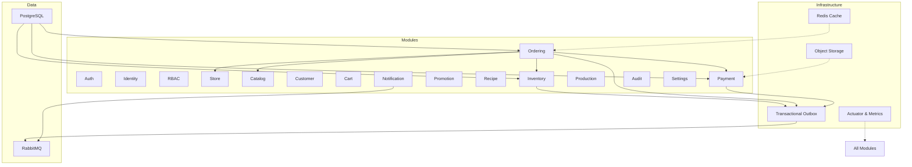
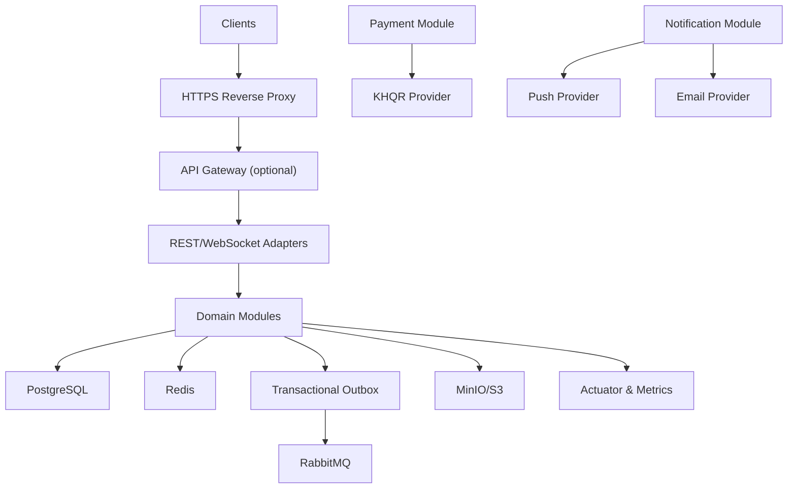
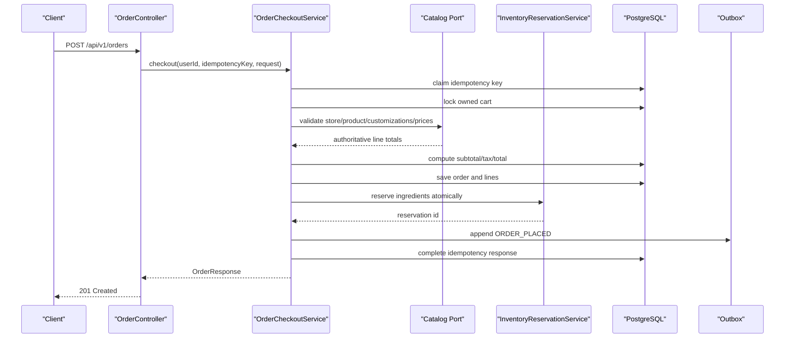
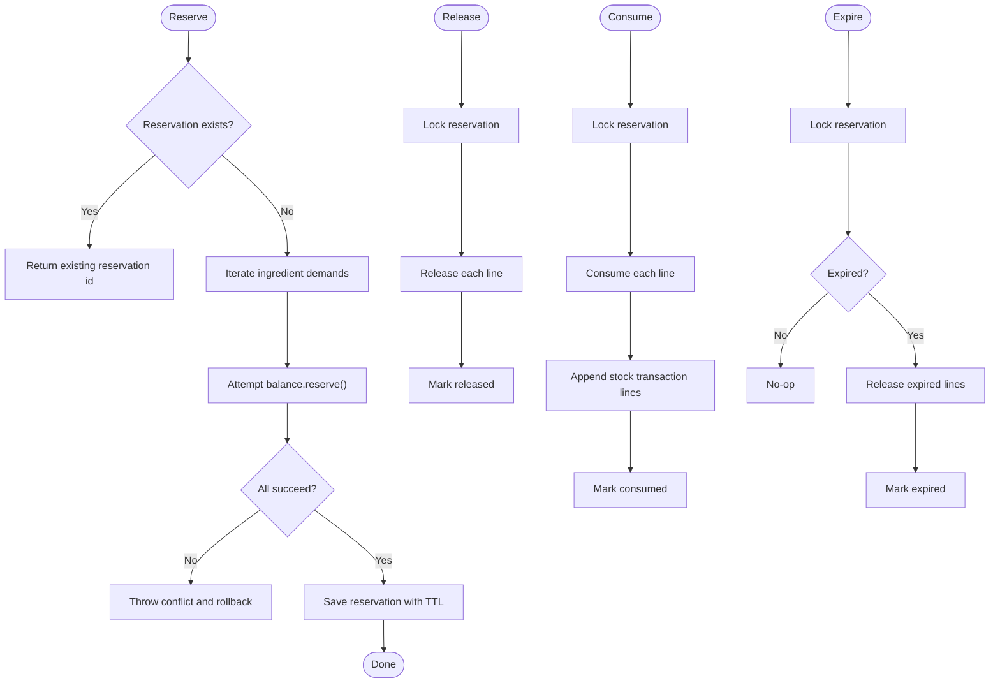
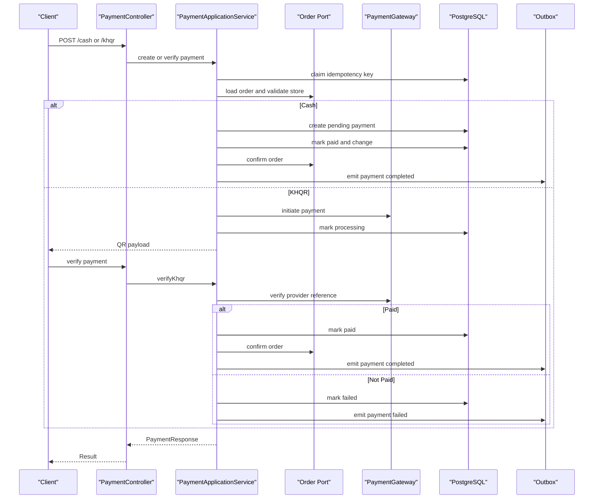
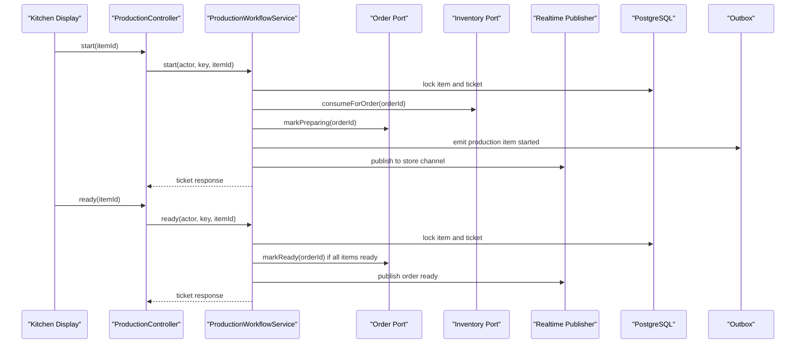
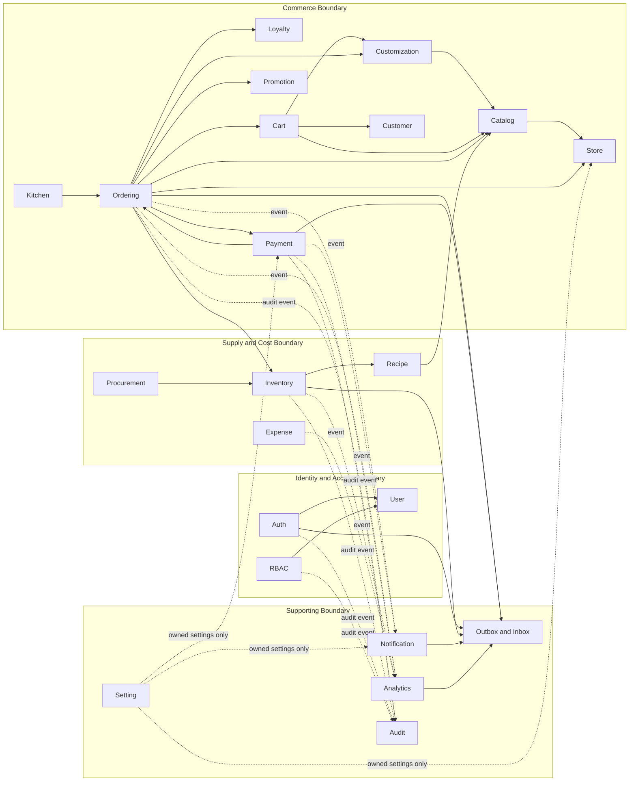

# Project Overview

<cite>
**Referenced Files in This Document**
- [ADR-001-modular-monolith.md](file://adr/ADR-001-modular-monolith.md)
- [SYSTEM_ARCHITECTURE.md](file://architecture/SYSTEM_ARCHITECTURE.md)
- [ArchitectureDiagram.mermaid](file://architecture/ArchitectureDiagram.mermaid)
- [MODULE_DEPENDENCIES.mermaid](file://architecture/MODULE_DEPENDENCIES.mermaid)
- [DB_OWNERSHIP_MATRIX.md](file://database/DB_OWNERSHIP_MATRIX.md)
- [pom.xml](file://pom.xml)
- [README_STEP10.md](file://README_STEP10.md)
- [README_STEP11.md](file://README_STEP11.md)
- [README_STEP12.md](file://README_STEP12.md)
- [OrderCheckoutService.java](file://src/main/java/com/smartcoffee/modules/ordering/application/OrderCheckoutService.java)
- [InventoryReservationService.java](file://src/main/java/com/smartcoffee/modules/inventory/application/InventoryReservationService.java)
- [PaymentApplicationService.java](file://src/main/java/com/smartcoffee/modules/payment/application/PaymentApplicationService.java)
- [ProductionWorkflowService.java](file://src/main/java/com/smartcoffee/modules/production/application/ProductionWorkflowService.java)
</cite>

## Table of Contents
1. Introduction
2. Project Structure
3. Core Components
4. Architecture Overview
5. Detailed Component Analysis
6. Dependency Analysis
7. Performance Considerations
8. Troubleshooting Guide
9. Conclusion

## Introduction
Smart Coffee Backend is a modular monolith that implements the operational capabilities for a coffee shop management platform. It coordinates store operations, catalog and customization, customer carts, ordering, payments, promotions, loyalty, recipe-driven inventory reservations, kitchen production workflows, notifications, audit trails, and reporting projections. The system is designed to be microservice-ready while keeping critical business transactions strongly consistent within a single Spring Boot application backed by PostgreSQL.

Target users:
- Customers: browse catalogs, build carts, place orders, pay, and receive receipts and notifications.
- Staff: manage stores, products, orders, payments, and production tickets via POS or admin tools.
- Administrators: configure settings, observe health and metrics, and review audit logs.

Key value propositions:
- Strong consistency for checkout, payment, and inventory using local database transactions.
- Clear module boundaries with explicit ownership of data and behavior.
- Asynchronous reliability through transactional outbox and durable messaging.
- Extensible integrations for payments, storage, and notifications without compromising core correctness.

**Section sources**
- [SYSTEM_ARCHITECTURE.md:15-85](file://architecture/SYSTEM_ARCHITECTURE.md#L15-L85)
- [ADR-001-modular-monolith.md:8-49](file://adr/ADR-001-modular-monolith.md#L8-L49)

## Project Structure
The repository is organized as a Spring Boot 4 modular monolith with domain modules under src/main/java/com/smartcoffee/modules and shared infrastructure under common and infrastructure packages. Configuration, migrations, and architecture artifacts are kept alongside source code for clarity.

High-level structure:
- Modules: auth, identity, rbac, organization/store, catalog, customer, cart, ordering, payment, promotion, recipe, inventory, production, notification, analytics, audit, settings.
- Infrastructure: idempotency, messaging (outbox/inbox), cache (Redis), storage (MinIO/S3), observability, security, WebSocket, payment gateways.
- Database: Flyway migrations under resources/db/migration; logical schema and ownership documented in DBML and matrices.
- Architecture docs and diagrams: ADRs and Mermaid diagrams describing boundaries, flows, and dependencies.

**Diagram sources**
- [ArchitectureDiagram.mermaid:22-86](file://architecture/ArchitectureDiagram.mermaid#L22-L86)
- [MODULE_DEPENDENCIES.mermaid:10-77](file://architecture/MODULE_DEPENDENCIES.mermaid#L10-L77)

**Section sources**
- [pom.xml:14-19](file://pom.xml#L14-L19)
- [pom.xml:62-159](file://pom.xml#L62-L159)
- [DB_OWNERSHIP_MATRIX.md:16-65](file://database/DB_OWNERSHIP_MATRIX.md#L16-L65)

## Core Components
This section summarizes the primary business capabilities implemented across modules.

- Authentication and authorization: JWT-based authentication, session handling, role-based access control, and store-scoped permissions.
- Catalog and customization: categories, products, store availability, effective pricing, and product customization groups/options.
- Customer and loyalty: customer profiles and an append-only points ledger with reservation and redemption transitions.
- Cart: active per-customer, per-store carts with estimated totals; authoritative recalculation at checkout.
- Ordering: server-authoritative price calculation, immutable order snapshots, status history, and idempotent creation.
- Payment: cash acceptance and KHQR initiation/verification, provider callbacks, receipts, and reconciliation.
- Promotion: rule validation and atomic capacity claiming with redemption lifecycle.
- Recipe and inventory: versioned recipes, ingredient requirements, balances, reservations, and immutable stock ledger.
- Production: kitchen tickets, station flow, consumption on start, readiness signaling, and real-time updates.
- Notifications: persistent requests, delivery attempts, retry, and deduplication via inbox.
- Audit: append-only records for security and business actions.
- Analytics: event-driven projections for reporting.

**Section sources**
- [SYSTEM_ARCHITECTURE.md:136-195](file://architecture/SYSTEM_ARCHITECTURE.md#L136-L195)
- [DB_OWNERSHIP_MATRIX.md:16-65](file://database/DB_OWNERSHIP_MATRIX.md#L16-L65)

## Architecture Overview
The platform follows a Modular Monolith First approach with clear module boundaries, strong consistency for critical paths, and eventual consistency for side effects like notifications and analytics.

Technology stack:
- Backend: Java 25-compatible, Spring Boot 4, Spring Web MVC
- Database: PostgreSQL 16+ as the system of record
- Cache: Redis for bounded caching, rate limiting, and ephemeral coordination
- Messaging: RabbitMQ for durable asynchronous work
- Storage: MinIO locally, S3-compatible in production
- Security: Spring Security with OAuth2 resource server/JWT
- Observability: Actuator, Prometheus metrics, OpenAPI documentation

System boundaries:
- Clients: mobile apps, web apps, POS, admin dashboard, kitchen display
- Edge: optional API gateway and HTTPS reverse proxy
- Backend: REST and WebSocket adapters plus domain modules
- Data: PostgreSQL, Redis, RabbitMQ, object storage
- External providers: KHQR/Bakong, push/email providers

**Diagram sources**
- [ArchitectureDiagram.mermaid:2-98](file://architecture/ArchitectureDiagram.mermaid#L2-L98)
- [SYSTEM_ARCHITECTURE.md:53-133](file://architecture/SYSTEM_ARCHITECTURE.md#L53-L133)

**Section sources**
- [SYSTEM_ARCHITECTURE.md:1-12](file://architecture/SYSTEM_ARCHITECTURE.md#L1-L12)
- [SYSTEM_ARCHITECTURE.md:88-133](file://architecture/SYSTEM_ARCHITECTURE.md#L88-L133)
- [pom.xml:62-159](file://pom.xml#L62-L159)

## Detailed Component Analysis

### Ordering and Checkout
Purpose:
- Create orders idempotently, validate store and authorization, calculate server-authoritative prices, reserve inventory atomically, persist immutable order snapshots, emit events, and return results.

Key behaviors:
- Idempotency key claim prevents duplicate order creation.
- Catalog validation ensures currency and price integrity at checkout time.
- Recipe demand computed from cart items drives inventory reservation.
- Order placed event emitted via outbox for downstream consumers.

**Diagram sources**
- [OrderCheckoutService.java:62-133](file://src/main/java/com/smartcoffee/modules/ordering/application/OrderCheckoutService.java#L62-L133)

**Section sources**
- [OrderCheckoutService.java:62-133](file://src/main/java/com/smartcoffee/modules/ordering/application/OrderCheckoutService.java#L62-L133)

### Inventory Reservation and Consumption
Purpose:
- Reserve ingredients for an order within a TTL, release on failure/expiration, and consume into immutable stock ledger upon production start.

Key behaviors:
- Atomic reservation across all required ingredients; partial failures roll back.
- Reservation lifecycle supports release, consume, and expire states.
- Stock movements recorded as append-only transactions.

**Diagram sources**
- [InventoryReservationService.java:43-97](file://src/main/java/com/smartcoffee/modules/inventory/application/InventoryReservationService.java#L43-L97)

**Section sources**
- [InventoryReservationService.java:43-97](file://src/main/java/com/smartcoffee/modules/inventory/application/InventoryReservationService.java#L43-L97)

### Payments
Purpose:
- Accept cash and initiate KHQR payments, verify provider evidence, confirm orders, generate receipts, and emit payment events.

Key behaviors:
- Idempotent payment endpoints prevent duplicate settlements.
- Cash payments require sufficient received amount and convert currencies safely.
- KHQR verification checks provider state and avoids double payment.
- Receipt generation requested after successful payment.

**Diagram sources**
- [PaymentApplicationService.java:48-143](file://src/main/java/com/smartcoffee/modules/payment/application/PaymentApplicationService.java#L48-L143)

**Section sources**
- [PaymentApplicationService.java:48-143](file://src/main/java/com/smartcoffee/modules/payment/application/PaymentApplicationService.java#L48-L143)

### Production Workflow
Purpose:
- Manage kitchen ticket lifecycle, consume inventory when preparation starts, signal readiness, and publish real-time updates.

Key behaviors:
- Idempotent start/ready actions protect against duplicate kitchen operations.
- First item start triggers inventory consumption and order transition to preparing.
- When all items ready, order marked ready and realtime event published.

**Diagram sources**
- [ProductionWorkflowService.java:53-91](file://src/main/java/com/smartcoffee/modules/production/application/ProductionWorkflowService.java#L53-L91)

**Section sources**
- [ProductionWorkflowService.java:53-91](file://src/main/java/com/smartcoffee/modules/production/application/ProductionWorkflowService.java#L53-L91)

### Promotions and Loyalty
Purpose:
- Validate promotions against store, product, amount, currency, time window, and usage limits; manage loyalty accounts with append-only ledgers and point reservations/redemptions.

Implementation status:
- APIs exposed for promotion validation and customer loyalty queries.
- Redemptions move between reserved/redeemed/released states with atomic capacity claims.
- Loyalty uses unique source-event deduplication for earn operations.

**Section sources**
- [README_STEP10.md:1-12](file://README_STEP10.md#L1-L12)

### Notifications and Audit
Purpose:
- Persist notification requests before external delivery, enforce recipient ownership, retry with bounded attempts, and suppress duplicates via consumer inbox.
- Maintain append-only audit logs with redacted snapshots for security and compliance.

Implementation status:
- APIs for listing notifications, unread counts, marking read, and reading audit logs.
- Requires applying patches and migrations to enable durable messaging and audit features.

**Section sources**
- [README_STEP11.md:1-8](file://README_STEP11.md#L1-L8)

### Infrastructure Hardening and Test Environment
Purpose:
- Harden messaging with durable topology, publisher confirms, and race-safe inbox insertion.
- Add readiness health indicators, Docker Compose services, Testcontainers base, and receipt processing foundation.

Implementation status:
- Patches replace earlier outbox implementations and remove duplicates.
- Receipt renderer currently text-based; replace with PDF renderer before production.

**Section sources**
- [README_STEP12.md:1-8](file://README_STEP12.md#L1-L8)

## Dependency Analysis
Module relationships follow strict boundaries:
- Commerce boundary includes store, catalog, customization, customer, loyalty, cart, ordering, payment, and kitchen.
- Supply boundary includes recipe, inventory, procurement, and expense.
- Supporting boundary includes notification, analytics, audit, settings, and integration (outbox/inbox).
- Synchronous dependencies use application interfaces; asynchronous dependencies use events.

**Diagram sources**
- [MODULE_DEPENDENCIES.mermaid:1-93](file://architecture/MODULE_DEPENDENCIES.mermaid#L1-L93)

**Section sources**
- [MODULE_DEPENDENCIES.mermaid:1-93](file://architecture/MODULE_DEPENDENCIES.mermaid#L1-L93)

## Performance Considerations
- Use PostgreSQL transactions for strong consistency in checkout, payment, and inventory reservation.
- Leverage Redis for bounded catalog and store caches, rate limiting, and short-lived coordination.
- Emit durable events via transactional outbox to RabbitMQ for reliable async processing.
- Avoid client-authoritative pricing and payment success; always validate server-side.
- Ensure consumers are idempotent to handle at-least-once delivery semantics.
- Monitor health and metrics via Actuator and Prometheus for observability.

[No sources needed since this section provides general guidance]

## Troubleshooting Guide
Common issues and mitigations:
- Duplicate order creation: ensure idempotency keys are used and responses are replayed correctly.
- Insufficient stock: verify reservation logic and TTL expiration; check stock ledger entries.
- Payment conflicts: guard against already-paid orders and provider callback replays; validate signatures and freshness.
- Notification delivery failures: inspect delivery attempts and retry policies; ensure inbox deduplication prevents duplicates.
- Audit log integrity: confirm append-only constraints and redaction rules are enforced.

Operational tips:
- Verify Flyway migration history before applying step overlays.
- Replace placeholder device-token and email resolution before production.
- Do not use local default credentials in production.
- Replace text receipt renderer with a proper PDF renderer before production.

**Section sources**
- [README_STEP10.md:1-12](file://README_STEP10.md#L1-L12)
- [README_STEP11.md:1-8](file://README_STEP11.md#L1-L8)
- [README_STEP12.md:1-8](file://README_STEP12.md#L1-L8)

## Conclusion
Smart Coffee Backend delivers a robust, modular monolith for coffee shop operations with clear boundaries, strong consistency for critical flows, and reliable asynchronous processing. It supports customers, staff, and administrators through well-defined APIs and workflows covering ordering, payments, inventory, production, promotions, loyalty, notifications, and audit. The architecture is prepared for future extraction into microservices while maintaining safety and simplicity during development and early deployment.

[No sources needed since this section summarizes without analyzing specific files]