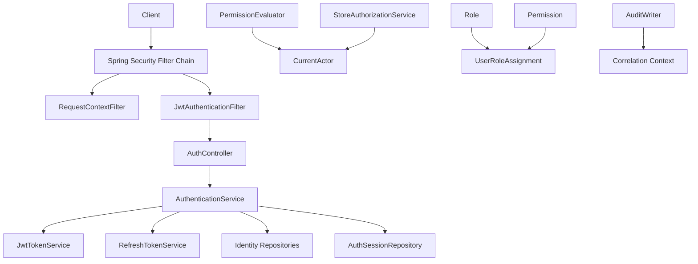
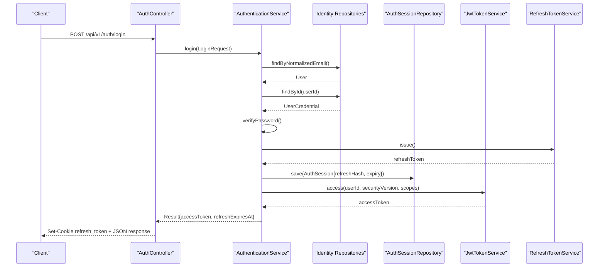
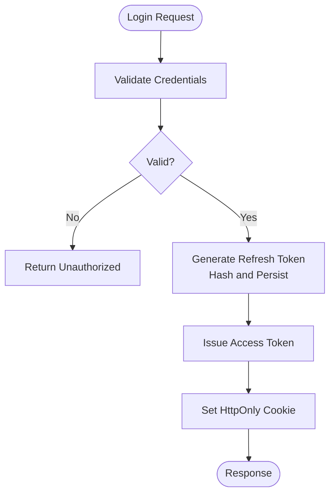
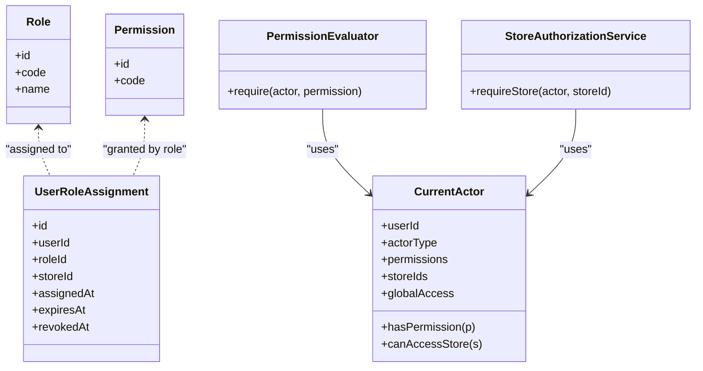
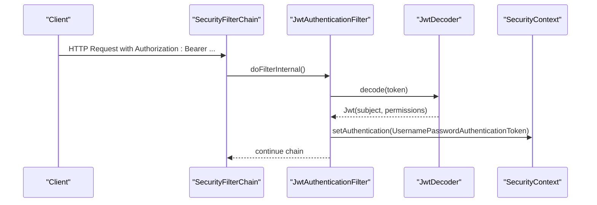
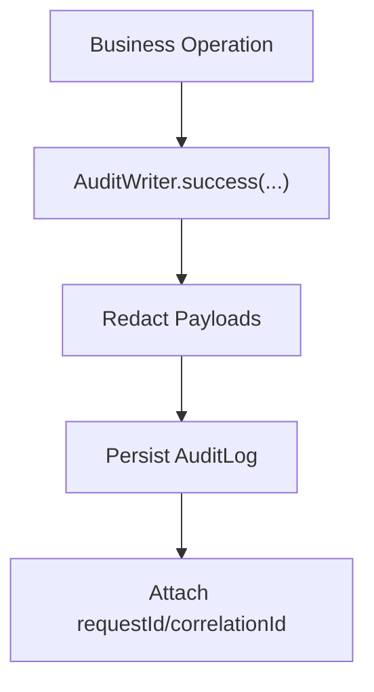
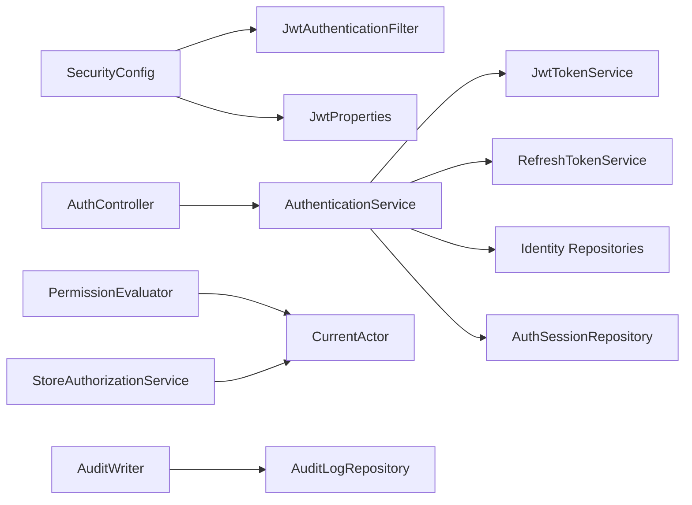

# Security Architecture

<cite>
**Referenced Files in This Document**
- [SecurityConfig.java](file://src/main/java/com/smartcoffee/config/SecurityConfig.java)
- [JwtAuthenticationFilter.java](file://src/main/java/com/smartcoffee/modules/auth/security/JwtAuthenticationFilter.java)
- [JwtTokenService.java](file://src/main/java/com/smartcoffee/modules/auth/security/JwtTokenService.java)
- [RefreshTokenService.java](file://src/main/java/com/smartcoffee/modules/auth/security/RefreshTokenService.java)
- [JwtProperties.java](file://src/main/java/com/smartcoffee/modules/auth/security/JwtProperties.java)
- [AuthController.java](file://src/main/java/com/smartcoffee/modules/auth/api/AuthController.java)
- [AuthenticationService.java](file://src/main/java/com/smartcoffee/modules/auth/application/AuthenticationService.java)
- [PermissionEvaluator.java](file://src/main/java/com/smartcoffee/common/security/PermissionEvaluator.java)
- [StoreAuthorizationService.java](file://src/main/java/com/smartcoffee/common/security/StoreAuthorizationService.java)
- [CurrentActor.java](file://src/main/java/com/smartcoffee/common/security/CurrentActor.java)
- [PermissionCodes.java](file://src/main/java/com/smartcoffee/common/security/PermissionCodes.java)
- [Role.java](file://src/main/java/com/smartcoffee/modules/rbac/domain/Role.java)
- [Permission.java](file://src/main/java/com/smartcoffee/modules/rbac/domain/Permission.java)
- [UserRoleAssignment.java](file://src/main/java/com/smartcoffee/modules/rbac/domain/UserRoleAssignment.java)
- [AuditWriter.java](file://src/main/java/com/smartcoffee/modules/audit/application/AuditWriter.java)
- [RequestContextFilter.java](file://src/main/java/com/smartcoffee/common/context/RequestContextFilter.java)
- [application.yml](file://src/main/resources/application.yml)
- [ADR-006-authentication-model.md](file://adr/ADR-006-authentication-model.md)
</cite>

## Table of Contents
1. [Introduction](#introduction)
2. [Project Structure](#project-structure)
3. [Core Components](#core-components)
4. [Architecture Overview](#architecture-overview)
5. [Detailed Component Analysis](#detailed-component-analysis)
6. [Dependency Analysis](#dependency-analysis)
7. [Performance Considerations](#performance-considerations)
8. [Troubleshooting Guide](#troubleshooting-guide)
9. [Conclusion](#conclusion)
10. [Appendices](#appendices)

## Introduction
This document describes the security architecture of the Smart Coffee Backend, focusing on authentication with JWT and refresh tokens, authorization using role-based access control (RBAC), store-scoped authorization, token lifecycle management, session handling, password security, input validation, API security posture, data protection, and audit logging for compliance. It also provides guidance for implementing custom security filters, permission evaluators, and secure operational practices.

## Project Structure
The security surface is implemented across configuration, authentication services, RBAC domain models, common security utilities, and audit capabilities:
- Configuration and HTTP security are defined in a central security filter chain.
- Authentication endpoints and service orchestrate login, registration, refresh, and logout flows.
- JWT encoding/decoding and refresh token generation/hashing are encapsulated in dedicated services.
- RBAC entities model roles, permissions, and user-role assignments.
- Common security utilities provide actor context, permission checks, and store-scoped authorization.
- Audit writer records business actions with correlation identifiers and redacted payloads.

**Diagram sources**
- [SecurityConfig.java:46-79](file://src/main/java/com/smartcoffee/config/SecurityConfig.java#L46-L79)
- [RequestContextFilter.java:11-30](file://src/main/java/com/smartcoffee/common/context/RequestContextFilter.java#L11-L30)
- [JwtAuthenticationFilter.java:1-4](file://src/main/java/com/smartcoffee/modules/auth/security/JwtAuthenticationFilter.java#L1-L4)
- [AuthController.java:13-70](file://src/main/java/com/smartcoffee/modules/auth/api/AuthController.java#L13-L70)
- [AuthenticationService.java:16-100](file://src/main/java/com/smartcoffee/modules/auth/application/AuthenticationService.java#L16-L100)
- [JwtTokenService.java:23-104](file://src/main/java/com/smartcoffee/modules/auth/security/JwtTokenService.java#L23-L104)
- [RefreshTokenService.java:1-5](file://src/main/java/com/smartcoffee/modules/auth/security/RefreshTokenService.java#L1-L5)
- [PermissionEvaluator.java:6-12](file://src/main/java/com/smartcoffee/common/security/PermissionEvaluator.java#L6-L12)
- [StoreAuthorizationService.java:7-13](file://src/main/java/com/smartcoffee/common/security/StoreAuthorizationService.java#L7-L13)
- [Role.java:6-27](file://src/main/java/com/smartcoffee/modules/rbac/domain/Role.java#L6-L27)
- [Permission.java:6-21](file://src/main/java/com/smartcoffee/modules/rbac/domain/Permission.java#L6-L21)
- [UserRoleAssignment.java:7-28](file://src/main/java/com/smartcoffee/modules/rbac/domain/UserRoleAssignment.java#L7-L28)
- [AuditWriter.java:11-28](file://src/main/java/com/smartcoffee/modules/audit/application/AuditWriter.java#L11-L28)

**Section sources**
- [SecurityConfig.java:22-79](file://src/main/java/com/smartcoffee/config/SecurityConfig.java#L22-L79)
- [application.yml:43-53](file://src/main/resources/application.yml#L43-L53)

## Core Components
- Security filter chain configures stateless sessions, permits public endpoints, and injects the JWT filter before Spring’s default authentication filter.
- Password hashing uses Argon2 via Spring Security defaults.
- JWT decoding uses HS256 with a Base64-encoded HMAC secret configured through properties.
- JWT encoding produces short-lived access tokens and supports refresh token issuance and rotation.
- Refresh tokens are stored as hashes to prevent replay if the database is compromised.
- RBAC domain entities define roles, permissions, and user-role assignments including optional store scoping.
- Authorization utilities enforce permission and store-scoped access.
- Audit writer persists tamper-evident logs with correlation IDs and redacted payloads.

**Section sources**
- [SecurityConfig.java:26-44](file://src/main/java/com/smartcoffee/config/SecurityConfig.java#L26-L44)
- [SecurityConfig.java:46-79](file://src/main/java/com/smartcoffee/config/SecurityConfig.java#L46-L79)
- [JwtTokenService.java:30-48](file://src/main/java/com/smartcoffee/modules/auth/security/JwtTokenService.java#L30-L48)
- [RefreshTokenService.java:1-5](file://src/main/java/com/smartcoffee/modules/auth/security/RefreshTokenService.java#L1-L5)
- [Role.java:6-27](file://src/main/java/com/smartcoffee/modules/rbac/domain/Role.java#L6-L27)
- [Permission.java:6-21](file://src/main/java/com/smartcoffee/modules/rbac/domain/Permission.java#L6-L21)
- [UserRoleAssignment.java:7-28](file://src/main/java/com/smartcoffee/modules/rbac/domain/UserRoleAssignment.java#L7-L28)
- [PermissionEvaluator.java:6-12](file://src/main/java/com/smartcoffee/common/security/PermissionEvaluator.java#L6-L12)
- [StoreAuthorizationService.java:7-13](file://src/main/java/com/smartcoffee/common/security/StoreAuthorizationService.java#L7-L13)
- [AuditWriter.java:11-28](file://src/main/java/com/smartcoffee/modules/audit/application/AuditWriter.java#L11-L28)

## Architecture Overview
The system follows a stateless, token-driven security model:
- Clients authenticate via REST endpoints that return an access token and set a refresh token cookie.
- Subsequent requests carry an Authorization header with a Bearer JWT.
- The JWT filter decodes the token, extracts subject and permissions, and sets the Spring Security context.
- Application code uses CurrentActor and permission/store authorization services to enforce fine-grained access.
- Audit events capture actor, store, action, category, aggregate identity, and correlation IDs.

**Diagram sources**
- [AuthController.java:33-38](file://src/main/java/com/smartcoffee/modules/auth/api/AuthController.java#L33-L38)
- [AuthenticationService.java:48-62](file://src/main/java/com/smartcoffee/modules/auth/application/AuthenticationService.java#L48-L62)
- [RefreshTokenService.java:1-5](file://src/main/java/com/smartcoffee/modules/auth/security/RefreshTokenService.java#L1-L5)
- [JwtTokenService.java:66-84](file://src/main/java/com/smartcoffee/modules/auth/security/JwtTokenService.java#L66-L84)

## Detailed Component Analysis

### Authentication Flow and Token Management
- Registration and login create a new session, generate a refresh token, persist its hash, and issue an access token.
- Refresh endpoint validates the hashed refresh token against persisted sessions, revokes the old session, and issues a new access token while maintaining family linkage.
- Logout revokes a single session; logout-all revokes all sessions for the current user.
- Access tokens include issuer, subject, security version, and scopes; they are signed with HS256.
- Refresh tokens are random bytes encoded as URL-safe Base64 without padding and stored as SHA-256 hashes.

**Diagram sources**
- [AuthenticationService.java:48-62](file://src/main/java/com/smartcoffee/modules/auth/application/AuthenticationService.java#L48-L62)
- [AuthenticationService.java:89-100](file://src/main/java/com/smartcoffee/modules/auth/application/AuthenticationService.java#L89-L100)
- [AuthController.java:61-65](file://src/main/java/com/smartcoffee/modules/auth/api/AuthController.java#L61-L65)

**Section sources**
- [AuthenticationService.java:38-62](file://src/main/java/com/smartcoffee/modules/auth/application/AuthenticationService.java#L38-L62)
- [AuthenticationService.java:64-87](file://src/main/java/com/smartcoffee/modules/auth/application/AuthenticationService.java#L64-L87)
- [AuthenticationService.java:89-100](file://src/main/java/com/smartcoffee/modules/auth/application/AuthenticationService.java#L89-L100)
- [JwtTokenService.java:66-84](file://src/main/java/com/smartcoffee/modules/auth/security/JwtTokenService.java#L66-L84)
- [RefreshTokenService.java:1-5](file://src/main/java/com/smartcoffee/modules/auth/security/RefreshTokenService.java#L1-L5)
- [AuthController.java:25-59](file://src/main/java/com/smartcoffee/modules/auth/api/AuthController.java#L25-L59)

### Authorization Model (RBAC) and Store Scoping
- Roles and permissions are modeled as persistent entities; user-role assignments can be scoped to a store and time-bounded.
- Permission codes are centralized constants used by application logic.
- PermissionEvaluator enforces explicit permission requirements and throws a forbidden exception when missing.
- StoreAuthorizationService enforces store-scoped access based on CurrentActor’s allowed stores or global access flag.

**Diagram sources**
- [Role.java:6-27](file://src/main/java/com/smartcoffee/modules/rbac/domain/Role.java#L6-L27)
- [Permission.java:6-21](file://src/main/java/com/smartcoffee/modules/rbac/domain/Permission.java#L6-L21)
- [UserRoleAssignment.java:7-28](file://src/main/java/com/smartcoffee/modules/rbac/domain/UserRoleAssignment.java#L7-L28)
- [PermissionEvaluator.java:6-12](file://src/main/java/com/smartcoffee/common/security/PermissionEvaluator.java#L6-L12)
- [StoreAuthorizationService.java:7-13](file://src/main/java/com/smartcoffee/common/security/StoreAuthorizationService.java#L7-L13)
- [CurrentActor.java:6-15](file://src/main/java/com/smartcoffee/common/security/CurrentActor.java#L6-L15)

**Section sources**
- [PermissionCodes.java:3-9](file://src/main/java/com/smartcoffee/common/security/PermissionCodes.java#L3-L9)
- [PermissionEvaluator.java:6-12](file://src/main/java/com/smartcoffee/common/security/PermissionEvaluator.java#L6-L12)
- [StoreAuthorizationService.java:7-13](file://src/main/java/com/smartcoffee/common/security/StoreAuthorizationService.java#L7-L13)
- [CurrentActor.java:6-15](file://src/main/java/com/smartcoffee/common/security/CurrentActor.java#L6-L15)
- [Role.java:6-27](file://src/main/java/com/smartcoffee/modules/rbac/domain/Role.java#L6-L27)
- [Permission.java:6-21](file://src/main/java/com/smartcoffee/modules/rbac/domain/Permission.java#L6-L21)
- [UserRoleAssignment.java:7-28](file://src/main/java/com/smartcoffee/modules/rbac/domain/UserRoleAssignment.java#L7-L28)

### JWT Processing and Security Filter Chain
- The security filter chain disables CSRF, sets stateless session policy, permits public endpoints, and requires authentication for all other requests.
- The JWT filter reads the Authorization header, decodes the token, maps claims to authorities, and populates SecurityContextHolder.
- Decoding uses HS256 with a secret loaded from configuration.

**Diagram sources**
- [SecurityConfig.java:46-79](file://src/main/java/com/smartcoffee/config/SecurityConfig.java#L46-L79)
- [JwtAuthenticationFilter.java:1-4](file://src/main/java/com/smartcoffee/modules/auth/security/JwtAuthenticationFilter.java#L1-L4)

**Section sources**
- [SecurityConfig.java:46-79](file://src/main/java/com/smartcoffee/config/SecurityConfig.java#L46-L79)
- [JwtAuthenticationFilter.java:1-4](file://src/main/java/com/smartcoffee/modules/auth/security/JwtAuthenticationFilter.java#L1-L4)

### Input Validation and Error Handling
- Controller inputs use Jakarta Bean Validation annotations to enforce request constraints.
- Business exceptions are thrown for invalid credentials, duplicate registrations, and unauthorized operations.
- A global exception handler converts exceptions into standardized API error responses.

**Section sources**
- [AuthController.java:25-59](file://src/main/java/com/smartcoffee/modules/auth/api/AuthController.java#L25-L59)
- [AuthenticationService.java:38-62](file://src/main/java/com/smartcoffee/modules/auth/application/AuthenticationService.java#L38-L62)

### Data Protection and Secure Communication
- Passwords are hashed with Argon2 via Spring Security defaults.
- JWT signing uses HS256 with a secret provided through environment variables.
- Refresh tokens are generated cryptographically and stored as SHA-256 hashes.
- WebSocket origins are configurable; CORS and CSRF policies should be aligned with deployment needs.

**Section sources**
- [SecurityConfig.java:26-44](file://src/main/java/com/smartcoffee/config/SecurityConfig.java#L26-L44)
- [application.yml:49-53](file://src/main/resources/application.yml#L49-L53)
- [application.yml:75-76](file://src/main/resources/application.yml#L75-L76)
- [RefreshTokenService.java:1-5](file://src/main/java/com/smartcoffee/modules/auth/security/RefreshTokenService.java#L1-L5)

### Audit Logging and Compliance
- AuditWriter persists structured audit events with actor, store, action, category, aggregate identity, status, reason, redacted snapshots, and correlation identifiers.
- Redaction ensures sensitive data is not written to logs.
- Correlation and request IDs are propagated from the request context filter to support traceability.

**Diagram sources**
- [AuditWriter.java:11-28](file://src/main/java/com/smartcoffee/modules/audit/application/AuditWriter.java#L11-L28)
- [RequestContextFilter.java:11-30](file://src/main/java/com/smartcoffee/common/context/RequestContextFilter.java#L11-L30)

**Section sources**
- [AuditWriter.java:11-28](file://src/main/java/com/smartcoffee/modules/audit/application/AuditWriter.java#L11-L28)
- [RequestContextFilter.java:11-30](file://src/main/java/com/smartcoffee/common/context/RequestContextFilter.java#L11-L30)

## Dependency Analysis
Key dependencies and relationships:
- SecurityConfig depends on JwtAuthenticationFilter and JwtProperties.
- AuthController depends on AuthenticationService and CurrentActorProvider.
- AuthenticationService depends on identity repositories, session repository, password encoder, JwtTokenService, and RefreshTokenService.
- JwtTokenService depends on NimbusJwtEncoder and HS256 algorithm.
- RBAC entities are independent but consumed by authorization logic and assignment workflows.
- AuditWriter depends on AuditLogRepository and AuditRedactionService.

**Diagram sources**
- [SecurityConfig.java:22-44](file://src/main/java/com/smartcoffee/config/SecurityConfig.java#L22-L44)
- [AuthController.java:13-23](file://src/main/java/com/smartcoffee/modules/auth/api/AuthController.java#L13-L23)
- [AuthenticationService.java:16-36](file://src/main/java/com/smartcoffee/modules/auth/application/AuthenticationService.java#L16-L36)
- [JwtTokenService.java:23-48](file://src/main/java/com/smartcoffee/modules/auth/security/JwtTokenService.java#L23-L48)
- [RefreshTokenService.java:1-5](file://src/main/java/com/smartcoffee/modules/auth/security/RefreshTokenService.java#L1-L5)
- [PermissionEvaluator.java:6-12](file://src/main/java/com/smartcoffee/common/security/PermissionEvaluator.java#L6-L12)
- [StoreAuthorizationService.java:7-13](file://src/main/java/com/smartcoffee/common/security/StoreAuthorizationService.java#L7-L13)
- [AuditWriter.java:11-18](file://src/main/java/com/smartcoffee/modules/audit/application/AuditWriter.java#L11-L18)

**Section sources**
- [SecurityConfig.java:22-44](file://src/main/java/com/smartcoffee/config/SecurityConfig.java#L22-L44)
- [AuthenticationService.java:16-36](file://src/main/java/com/smartcoffee/modules/auth/application/AuthenticationService.java#L16-L36)

## Performance Considerations
- Use short-lived access tokens to limit exposure windows.
- Cache frequently accessed permissions and store authorizations where appropriate to reduce database load.
- Avoid heavy cryptographic operations per request; precompute and cache non-secret derived values when safe.
- Ensure Redis and database connections are tuned for expected throughput.
- Batch audit writes where possible without compromising transactional integrity.

[No sources needed since this section provides general guidance]

## Troubleshooting Guide
Common issues and resolutions:
- Invalid or expired JWT: Verify HS256 secret alignment between encoder and decoder and ensure token expiration settings match client expectations.
- Missing permissions in JWT: Confirm that permissions are included in token claims and mapped to authorities by the JWT filter.
- Refresh token failures: Ensure the hashed refresh token matches the persisted value and that the session is active.
- CSRF disabled: If switching to cookie-based auth, consider enabling CSRF and aligning it with token storage strategy.
- CORS misconfiguration: Restrict allowed origins explicitly and validate WebSocket origins.
- Audit gaps: Ensure correlation/request IDs are propagated and audit writer is invoked within mandatory transactions.

**Section sources**
- [JwtAuthenticationFilter.java:1-4](file://src/main/java/com/smartcoffee/modules/auth/security/JwtAuthenticationFilter.java#L1-L4)
- [AuthenticationService.java:64-87](file://src/main/java/com/smartcoffee/modules/auth/application/AuthenticationService.java#L64-L87)
- [SecurityConfig.java:46-79](file://src/main/java/com/smartcoffee/config/SecurityConfig.java#L46-L79)
- [application.yml:75-76](file://src/main/resources/application.yml#L75-L76)
- [AuditWriter.java:21-28](file://src/main/java/com/smartcoffee/modules/audit/application/AuditWriter.java#L21-L28)

## Conclusion
Smart Coffee Backend implements a robust, stateless security model centered on JWT access tokens and hashed refresh tokens. RBAC and store-scoped authorization provide granular control, while audit logging and correlation tracking support compliance and observability. To harden further, adopt production-grade secret management, enable CSRF where appropriate, restrict CORS strictly, add rate limiting, and integrate MFA for high-risk roles as recommended by the authentication design record.

[No sources needed since this section summarizes without analyzing specific files]

## Appendices

### Security Headers, CORS, and CSRF Guidance
- Add standard security headers (e.g., Strict-Transport-Security, X-Content-Type-Options, X-Frame-Options, Content-Security-Policy) at the gateway or server level.
- Configure CORS with explicit trusted origins and methods; avoid wildcard origins in production.
- CSRF policy should align with token storage: disable for pure bearer-token APIs; enable for cookie-based browser flows.

**Section sources**
- [ADR-006-authentication-model.md:168-180](file://adr/ADR-006-authentication-model.md#L168-L180)
- [application.yml:75-76](file://src/main/resources/application.yml#L75-L76)
- [SecurityConfig.java:52-56](file://src/main/java/com/smartcoffee/config/SecurityConfig.java#L52-L56)

### Implementing Custom Security Filters and Permission Evaluators
- Extend OncePerRequestFilter to implement custom request/response transformations or additional validations.
- Use PermissionEvaluator.require to enforce explicit permissions in service layers.
- Use StoreAuthorizationService.requireStore to enforce tenant/store boundaries consistently.

**Section sources**
- [PermissionEvaluator.java:6-12](file://src/main/java/com/smartcoffee/common/security/PermissionEvaluator.java#L6-L12)
- [StoreAuthorizationService.java:7-13](file://src/main/java/com/smartcoffee/common/security/StoreAuthorizationService.java#L7-L13)