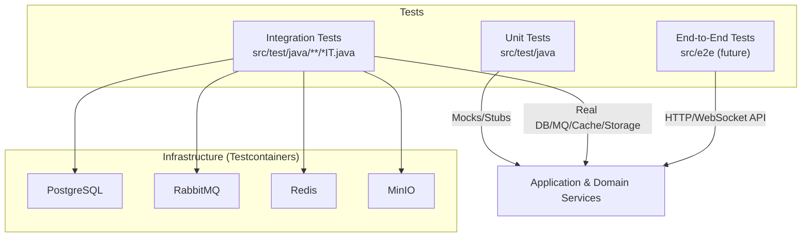
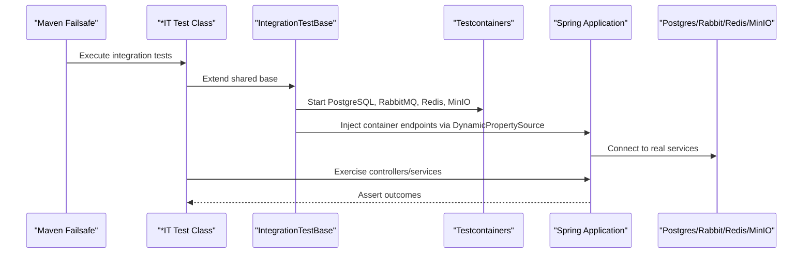
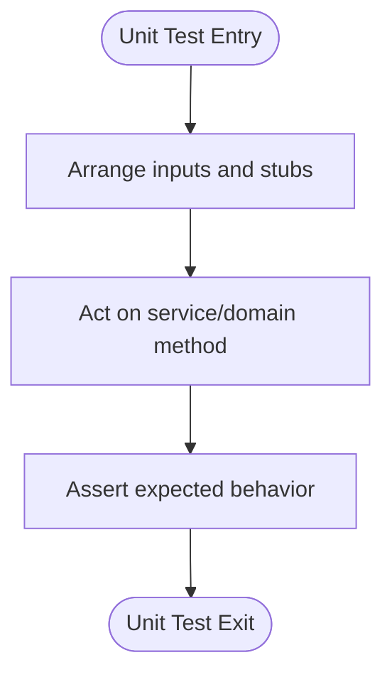
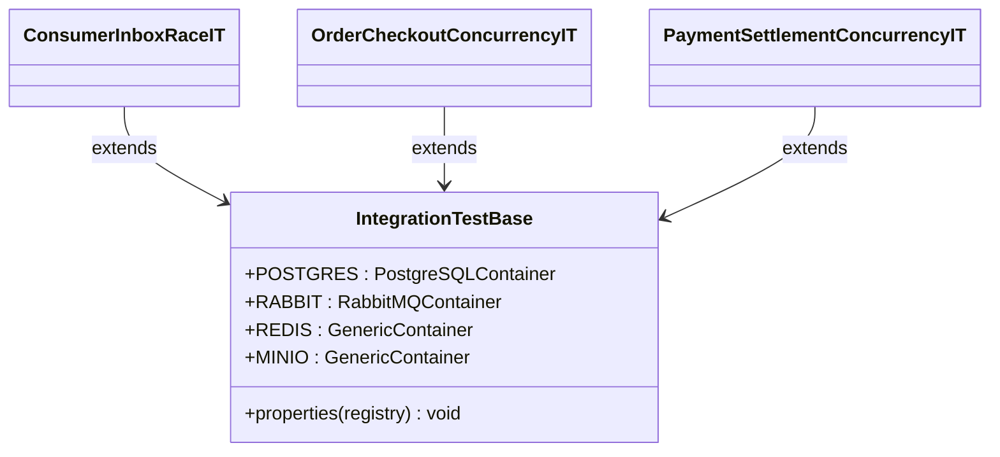
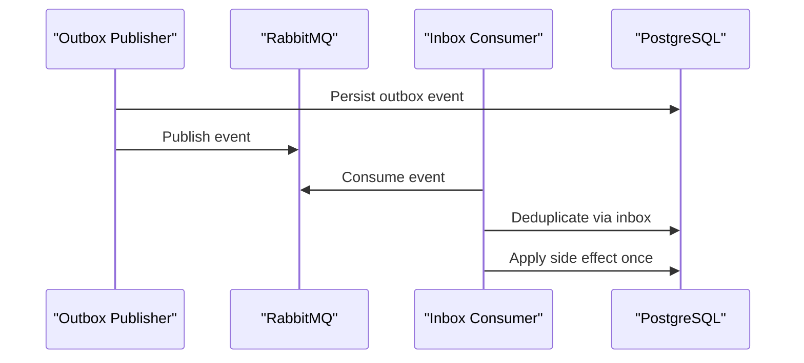
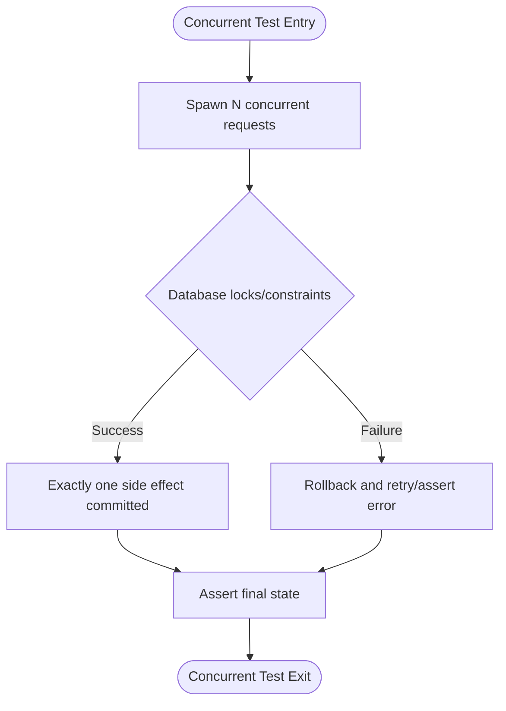
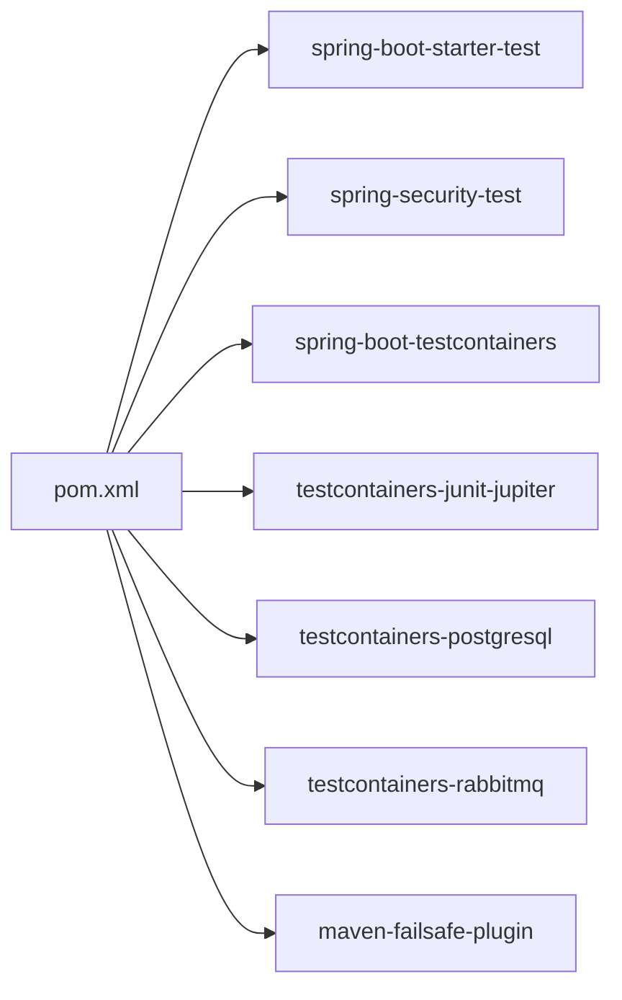

# Testing Strategy

<cite>
**Referenced Files in This Document**
- [pom.xml](file://pom.xml)
- [compose.yaml](file://compose.yaml)
- [application-test.yml](file://src/test/resources/application-test.yml)
- [IntegrationTestBase.java](file://src/test/java/com/smartcoffee/testsupport/IntegrationTestBase.java)
- [TestcontainersConfiguration.java](file://src/test/java/com/smartcoffee/identity/TestcontainersConfiguration.java)
- [AuditRedactionServiceTest.java](file://src/test/java/com/smartcoffee/modules/audit/AuditRedactionServiceTest.java)
- [CartCustomizationValidatorTest.java](file://src/test/java/com/smartcoffee/modules/cart/application/CartCustomizationValidatorTest.java)
- [ConsumerInboxRaceIT.java](file://src/test/java/com/smartcoffee/infrastructure/messaging/ConsumerInboxRaceIT.java)
- [OrderCheckoutConcurrencyIT.java](file://src/test/java/com/smartcoffee/modules/ordering/OrderCheckoutConcurrencyIT.java)
- [PaymentSettlementConcurrencyIT.java](file://src/test/java/com/smartcoffee/modules/payment/PaymentSettlementConcurrencyIT.java)
</cite>

## Table of Contents
1. Introduction
2. Project Structure
3. Core Components
4. Architecture Overview
5. Detailed Component Analysis
6. Dependency Analysis
7. Performance Considerations
8. Troubleshooting Guide
9. Conclusion

## Introduction
This document defines the testing strategy for the Smart Coffee Backend. It covers unit testing with JUnit, integration testing using Testcontainers for PostgreSQL, RabbitMQ, Redis, and MinIO, and end-to-end testing approaches. It also documents test data management, fixtures, factory patterns, asynchronous and event-driven testing, concurrency scenarios, performance and load testing guidance, coverage expectations, and debugging techniques for failing tests.

## Project Structure
The project uses a layered structure with clear separation between production code and tests:
- Unit tests under src/test/java validate business logic and application services without external dependencies.
- Integration tests under src/test/java use Testcontainers to spin up real infrastructure (PostgreSQL, RabbitMQ, Redis, MinIO).
- A shared base class centralizes container lifecycle and dynamic property wiring.
- A dedicated test profile configures minimal settings for integration runs.
- A compose file provides local development environments for all external services.

**Diagram sources**
- [IntegrationTestBase.java:17-105](file://src/test/java/com/smartcoffee/testsupport/IntegrationTestBase.java#L17-L105)
- [application-test.yml:1-19](file://src/test/resources/application-test.yml#L1-L19)
- [compose.yaml:1-71](file://compose.yaml#L1-L71)

**Section sources**
- [pom.xml:260-304](file://pom.xml#L260-L304)
- [pom.xml:373-396](file://pom.xml#L373-L396)
- [compose.yaml:1-71](file://compose.yaml#L1-L71)
- [application-test.yml:1-19](file://src/test/resources/application-test.yml#L1-L19)

## Core Components
- Test execution and lifecycle
  - JUnit 5 is used across unit and integration tests.
  - Spring Boot Test provides @SpringBootTest and test utilities.
  - Failsafe plugin executes integration tests matching **/*IT.java during verify phase.
- Infrastructure containers
  - PostgreSQL, RabbitMQ, Redis, and MinIO are provisioned via Testcontainers in integration tests.
  - Dynamic properties wire container endpoints into the application at runtime.
- Test configuration
  - application-test.yml disables scheduling and sets a deterministic JWT secret for tests.
  - TestcontainersConfiguration provides service connections for Postgres and Redis where applicable.

Key responsibilities:
- IntegrationTestBase: manages containers and injects connection properties.
- TestcontainersConfiguration: optional service connections for specific modules.
- application-test.yml: test-specific application properties.

**Section sources**
- [pom.xml:264-304](file://pom.xml#L264-L304)
- [pom.xml:373-396](file://pom.xml#L373-L396)
- [IntegrationTestBase.java:17-105](file://src/test/java/com/smartcoffee/testsupport/IntegrationTestBase.java#L17-L105)
- [TestcontainersConfiguration.java:10-29](file://src/test/java/com/smartcoffee/identity/TestcontainersConfiguration.java#L10-L29)
- [application-test.yml:1-19](file://src/test/resources/application-test.yml#L1-L19)

## Architecture Overview
The testing architecture aligns with the production architecture:
- Unit tests isolate domain and application logic using mocks/stubs.
- Integration tests exercise full stacks with real databases, message brokers, caches, and storage.
- End-to-end tests will drive HTTP/WebSocket APIs against running services.

**Diagram sources**
- [pom.xml:373-396](file://pom.xml#L373-L396)
- [IntegrationTestBase.java:17-105](file://src/test/java/com/smartcoffee/testsupport/IntegrationTestBase.java#L17-L105)

## Detailed Component Analysis

### Unit Testing Approach
- Frameworks: JUnit 5, AssertJ, Spring Boot Test.
- Scope: Pure domain and application logic without external dependencies.
- Patterns:
  - Direct instantiation of stateless services or use of lightweight stubs.
  - Validation rules and redaction logic verified with simple inputs and assertions.

Examples:
- Audit redaction verifies sensitive fields are masked.
- Cart customization validation enforces group rules and option constraints.

**Diagram sources**
- [AuditRedactionServiceTest.java:9-34](file://src/test/java/com/smartcoffee/modules/audit/AuditRedactionServiceTest.java#L9-L34)
- [CartCustomizationValidatorTest.java:10-35](file://src/test/java/com/smartcoffee/modules/cart/application/CartCustomizationValidatorTest.java#L10-L35)

**Section sources**
- [AuditRedactionServiceTest.java:9-34](file://src/test/java/com/smartcoffee/modules/audit/AuditRedactionServiceTest.java#L9-L34)
- [CartCustomizationValidatorTest.java:10-35](file://src/test/java/com/smartcoffee/modules/cart/application/CartCustomizationValidatorTest.java#L10-L35)

### Integration Testing with Testcontainers
- Containers:
  - PostgreSQL for persistence.
  - RabbitMQ for messaging.
  - Redis for caching/session.
  - MinIO for object storage.
- Property wiring:
  - DynamicPropertySource injects JDBC URL, credentials, Rabbit host/port, Redis host/port, and MinIO endpoint/credentials.
- Profiles:
  - @ActiveProfiles("test") ensures test-specific configuration is applied.

**Diagram sources**
- [IntegrationTestBase.java:17-105](file://src/test/java/com/smartcoffee/testsupport/IntegrationTestBase.java#L17-L105)
- [ConsumerInboxRaceIT.java:6-10](file://src/test/java/com/smartcoffee/infrastructure/messaging/ConsumerInboxRaceIT.java#L6-L10)
- [OrderCheckoutConcurrencyIT.java:5-13](file://src/test/java/com/smartcoffee/modules/ordering/OrderCheckoutConcurrencyIT.java#L5-L13)
- [PaymentSettlementConcurrencyIT.java:5-10](file://src/test/java/com/smartcoffee/modules/payment/PaymentSettlementConcurrencyIT.java#L5-L10)

**Section sources**
- [IntegrationTestBase.java:17-105](file://src/test/java/com/smartcoffee/testsupport/IntegrationTestBase.java#L17-L105)
- [application-test.yml:1-19](file://src/test/resources/application-test.yml#L1-L19)

### End-to-End Testing Strategy
- Objective: Validate complete user journeys over HTTP and WebSocket endpoints.
- Environment: Run the application with compose.yaml services and execute tests against live endpoints.
- Recommendations:
  - Use Spring’s TestRestTemplate or WebClient for HTTP flows.
  - For WebSocket flows, use Spring’s WebSocket Test support.
  - Seed initial data via Flyway migrations and/or test setup scripts.
  - Isolate test tenants/organizations to avoid cross-test interference.

[No sources needed since this section provides general guidance]

### Test Data Management, Fixtures, and Factories
- Migrations:
  - Flyway migrations define schema and seed data; tests run with validate mode to ensure consistency.
- Fixtures:
  - Prefer small, focused fixture builders within tests rather than large global datasets.
- Factories:
  - Introduce factory classes for complex aggregates (e.g., orders, payments) to keep tests readable and maintainable.
- Cleanup:
  - Use transactional boundaries where possible; otherwise, clean up created entities after each test.

[No sources needed since this section provides general guidance]

### Testing Asynchronous Operations and Event-Driven Workflows
- Outbox and Inbox:
  - Verify idempotency and exactly-once semantics by simulating duplicate deliveries and concurrent claims.
- Consumers:
  - Use Testcontainers RabbitMQ and assert side effects (e.g., inbox records, outbox confirmations).
- Scheduling:
  - Disable scheduled tasks in tests via application-test.yml to avoid background noise.

**Diagram sources**
- [ConsumerInboxRaceIT.java:6-10](file://src/test/java/com/smartcoffee/infrastructure/messaging/ConsumerInboxRaceIT.java#L6-L10)
- [application-test.yml:8-10](file://src/test/resources/application-test.yml#L8-L10)

**Section sources**
- [ConsumerInboxRaceIT.java:6-10](file://src/test/java/com/smartcoffee/infrastructure/messaging/ConsumerInboxRaceIT.java#L6-L10)
- [application-test.yml:8-10](file://src/test/resources/application-test.yml#L8-L10)

### Testing Concurrent Scenarios
- Goals:
  - Ensure one-time effects (e.g., order creation, payment settlement) under concurrent requests.
- Techniques:
  - Use multiple threads or parallel test invocations to simulate contention.
  - Assert final database state (e.g., exactly one order, one reservation, one receipt).
  - Leverage database-level constraints and transactions to enforce correctness.

**Diagram sources**
- [OrderCheckoutConcurrencyIT.java:5-13](file://src/test/java/com/smartcoffee/modules/ordering/OrderCheckoutConcurrencyIT.java#L5-L13)
- [PaymentSettlementConcurrencyIT.java:5-10](file://src/test/java/com/smartcoffee/modules/payment/PaymentSettlementConcurrencyIT.java#L5-L10)

**Section sources**
- [OrderCheckoutConcurrencyIT.java:5-13](file://src/test/java/com/smartcoffee/modules/ordering/OrderCheckoutConcurrencyIT.java#L5-L13)
- [PaymentSettlementConcurrencyIT.java:5-10](file://src/test/java/com/smartcoffee/modules/payment/PaymentSettlementConcurrencyIT.java#L5-L10)

### Examples of Well-Structured Tests
- Controller tests:
  - Use @WebMvcTest or @SpringBootTest with MockMvc to validate request/response contracts and security.
- Service tests:
  - Instantiate services directly or use @MockBean for external dependencies; assert domain invariants.
- Domain logic tests:
  - Focus on pure functions and invariants; no I/O.

[No sources needed since this section provides general guidance]

## Dependency Analysis
Testing-related dependencies and plugins:
- spring-boot-starter-test: JUnit, Mockito, AssertJ, Spring Test.
- spring-security-test: Security test utilities.
- spring-boot-testcontainers and testcontainers-*: Containerized infrastructure.
- maven-failsafe-plugin: Executes integration tests.

**Diagram sources**
- [pom.xml:264-304](file://pom.xml#L264-L304)
- [pom.xml:373-396](file://pom.xml#L373-L396)

**Section sources**
- [pom.xml:264-304](file://pom.xml#L264-L304)
- [pom.xml:373-396](file://pom.xml#L373-L396)

## Performance Considerations
- Unit tests should be fast and isolated; avoid I/O and network calls.
- Integration tests should minimize container startup overhead:
  - Reuse containers where safe.
  - Keep test data minimal.
- Load testing:
  - Use tools like k6, Gatling, or Apache JMeter to simulate realistic traffic.
  - Target key workflows: checkout, payment settlement, inventory reservations.
  - Monitor metrics via Prometheus and actuator endpoints.
- Coverage requirements:
  - Aim for high branch and line coverage on critical paths (ordering, payment, inventory).
  - Enforce minimum thresholds in CI pipelines.

[No sources needed since this section provides general guidance]

## Troubleshooting Guide
Common issues and resolutions:
- Docker not available:
  - Testcontainers respects disabledWithoutDocker; ensure Docker is running or skip integration tests.
- Port conflicts:
  - Containers expose dynamic ports; rely on DynamicPropertySource instead of hardcoding ports.
- Database migration failures:
  - Ensure Flyway is enabled and migrations match schema; check validate mode in application-test.yml.
- RabbitMQ connectivity:
  - Verify host/port wiring from RABBIT container; ensure queues/exchanges exist if required.
- Redis connectivity:
  - Confirm port mapping and host injection; consider redis-stack for advanced features.
- MinIO connectivity:
  - Check endpoint, access-key, secret-key; ensure bucket exists before uploads.

Debugging tips:
- Enable verbose logging for messaging and JPA during tests.
- Inspect container logs via Testcontainers or Docker CLI.
- Use @Disabled selectively while fixing flaky tests; re-enable when resolved.

**Section sources**
- [IntegrationTestBase.java:17-105](file://src/test/java/com/smartcoffee/testsupport/IntegrationTestBase.java#L17-L105)
- [application-test.yml:1-19](file://src/test/resources/application-test.yml#L1-L19)

## Conclusion
This testing strategy combines fast, isolated unit tests with robust integration tests backed by Testcontainers for real infrastructure. It emphasizes idempotency, concurrency safety, and clear separation of concerns. By following these guidelines, the Smart Coffee Backend can maintain reliability, performance, and developer productivity across its evolving feature set.