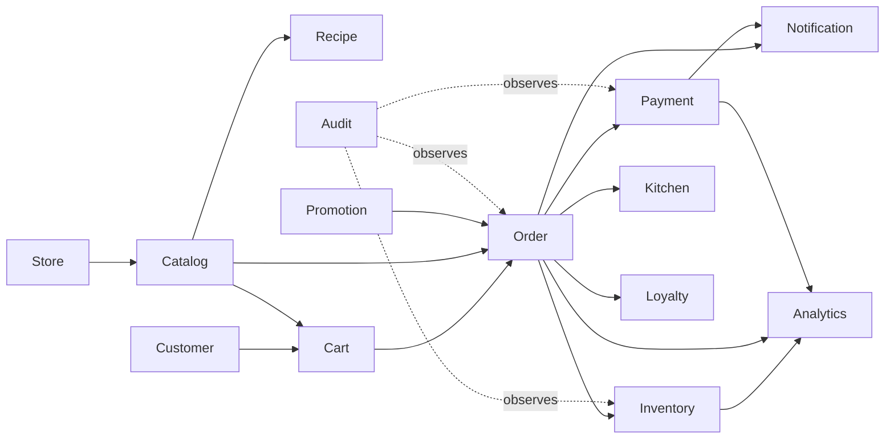

# SMART Coffee & Bakery Management Platform

# PHASE 0: Architecture Audit

**Status:** Proposed for architecture approval  
**Scope:** Architecture, module boundaries, database ownership, schema risks, API validation, security risks, and required migrations only  
**Implementation code:** Not included  
**Target:** Spring Boot 4 modular monolith, microservice-ready  

---

## 1. Executive Decision

### 1.1 Recommended starting architecture

Start with a **modular monolith** for the operational business capabilities, not a large set of independently deployed microservices.

Recommended initial deployables:

1. `smart-coffee-backend`, containing operational domain modules
2. Optional `api-gateway`, only when more than one backend deployable exists
3. PostgreSQL 16+
4. Redis for bounded caching, rate limiting, and ephemeral coordination
5. RabbitMQ for asynchronous integration and background processing after transactional outbox support exists
6. MinIO locally and S3-compatible storage in production

The current project name `identity-service` is inconsistent with its actual contents. It contains Store, Product, Order, Payment, Inventory, Promotion, Notification, Analytics, Audit, Setting, jobs, and WebSocket capabilities. It is therefore a full backend modular monolith, not an Identity microservice.

**Decision:** Rename it to `smart-coffee-backend` or `operation-service`. If the name `identity-service` must remain temporarily, document that it is a transitional repository name and do not treat it as an independently bounded Identity service.

### 1.2 Recommended target architecture

Future extraction candidates, in likely priority order:

1. Identity and Access Service
2. Payment Service
3. Notification Service
4. Reporting and Analytics Service
5. Inventory and Procurement Service
6. Ordering Service
7. Catalog Service

Extraction must be driven by measurable needs such as security isolation, independent scaling, team ownership, failure isolation, or release cadence. It must not be driven only by table count.

### 1.3 Architecture approval verdict

**Current design is not approved for implementation without schema corrections.**

Blocking reasons:

- Payment intent, payment attempt, settlement, tender, and refund concepts are mixed or missing.
- No durable API idempotency table exists.
- Inventory has balances and transaction lines but no reservation aggregate.
- Loyalty uses a mutable balance without an immutable points ledger.
- Promotion usage limits cannot be enforced correctly because redemption records are missing.
- Most business timestamps use `timestamp` instead of `timestamptz`.
- The folder name and service boundary conflict.
- Cross-domain classes are placed in `common`, creating coupling.
- Async events have no transactional outbox or consumer inbox model.
- Offline POS policy and synchronization identifiers are absent.

---

## 2. Source Audit

### 2.1 Folder structure findings

The existing package root is:

```text
src/main/java/com/smartcoffee/identity/
```

It contains:

```text
config/
common/
infrastructure/
modules/
jobs/
websocket/
```

This top-level shape can be retained, but responsibilities must be corrected.

### 2.2 Database findings

The supplied database contains the major business areas:

- Store
- Identity and RBAC
- Customer and staff profiles
- Catalog and customization
- Promotions
- Cart and ordering
- Payment and receipts
- Recipe and inventory
- Expenses
- Settings
- Favorites
- Audit
- Notification delivery

The relational starting point is useful, but it is incomplete for production-grade payment, stock reservation, loyalty, promotion usage, offline synchronization, and reliable event processing.

### 2.3 SQL text warning

The supplied SQL representation shows escaped identifiers such as `user\_status` and `store\_id`. If the backslashes are literal characters in the uploaded `.sql` file, the migration is invalid or creates unintended quoted identifiers. Before Flyway adoption, verify the raw file and normalize identifiers to `user_status`, `store_id`, and similar names.

---

## 3. Corrected Modular Boundaries

### 3.1 Proposed modules

```text
modules/
├── auth/
├── user/
├── rbac/
├── store/
├── catalog/
│   ├── category/
│   ├── product/
│   └── customization/
├── customer/
├── loyalty/
├── cart/
├── order/
├── payment/
├── promotion/
├── inventory/
├── recipe/
├── procurement/
├── expense/
├── kitchen/
├── notification/
├── analytics/
├── audit/
└── setting/
```

### 3.2 Dependency rules

Allowed conceptual direction:

```text
controller -> application service -> domain logic -> repository port -> persistence
```

Required rules:

1. Controllers contain transport concerns only.
2. Transactions begin in application services.
3. Domain state transitions are enforced by aggregates/domain services.
4. Repositories do not perform business decisions.
5. REST APIs never return JPA entities.
6. One module must not inject another module's JPA repository.
7. Cross-module actions use explicit application interfaces or domain events.
8. Spring events are used only for in-process, non-critical decoupling unless their failure semantics are explicitly controlled.
9. RabbitMQ events that must survive process failure are written through a transactional outbox.

### 3.3 Dependency map



This diagram represents business dependencies, not permission to access another module's tables directly.

---

## 4. Module Ownership Matrix

| Module | Owned tables | Aggregate roots | Must not be modified directly by |
|---|---|---|---|
| Store | `stores`, `store_opening_hours` | Store | Catalog, Order, Identity |
| User | `users`, `staff_profiles` identity portion | User | Order, Payment, Notification |
| Auth | `user_credentials`, `auth_sessions` | Credential, AuthSession | All non-auth modules |
| RBAC | `roles`, `permissions`, `role_permissions`, `user_roles` | Role, UserRoleAssignment | Business modules |
| Customer | `customer_profiles`, `customer_favorites` | CustomerProfile | Order, Catalog |
| Loyalty | new `loyalty_accounts`, new `loyalty_ledger` | LoyaltyAccount | Order and Payment |
| Catalog | `product_categories`, `products`, `store_products`, customization tables | Product, Category, CustomizationGroup | Cart and Order |
| Cart | `carts`, `cart_items`, `cart_item_customizations` | Cart | Catalog and Order |
| Order | `orders`, `order_items`, `order_item_customizations`, `order_status_history`, new idempotency records | Order | Payment, Inventory, Kitchen |
| Payment | `payment_methods`, revised `payments`, new attempts/callbacks/refunds, `receipts` | Payment, Refund | Order |
| Promotion | `promotions`, `promotion_products`, `promotion_categories`, new redemptions | Promotion | Cart and Order |
| Recipe | `units_of_measure`, `ingredients`, revised `product_recipes` | Ingredient, RecipeVersion | Order |
| Inventory | `inventory_balances`, stock transaction tables, new reservations and lots | InventoryReservation, StockTransaction | Order and Recipe |
| Procurement | new suppliers, purchase orders, goods receipts, transfers | PurchaseOrder, GoodsReceipt | Inventory consumers |
| Expense | `expense_categories`, `expenses` | Expense | Reporting |
| Notification | `notifications`, `user_notifications`, `device_tokens`, new delivery attempts | Notification | Order and Payment |
| Audit | `audit_logs` | AuditRecord | Every ordinary business module |
| Setting | split `system_settings` by owner | Setting | Modules that do not own the key |
| Analytics | new read models | ReportProjection | Operational modules |
| Integration | new outbox, inbox | OutboxEvent, InboxReceipt | External consumers |

### Ownership rule

A table has exactly one write owner. Other modules may use IDs, read-only projections, or explicit application interfaces. After extraction into microservices, cross-service IDs become logical references and must not use cross-database foreign keys.

---

## 5. Folder Structure Corrections

### 5.1 Packages that should remain

```text
config/
common/
infrastructure/
modules/
jobs/
websocket/
```

### 5.2 Required corrections

#### `common/enums`

Move domain enums into their owning modules:

```text
modules/user/domain/UserStatus.java
modules/order/domain/OrderStatus.java
modules/payment/domain/PaymentStatus.java
modules/inventory/domain/StockTransactionType.java
```

`common` must not become a global business model.

#### `common/exception`

Keep only transport-neutral base errors in common. Move domain errors to the owning modules:

```text
modules/inventory/exception/InsufficientStockException.java
modules/payment/exception/PaymentException.java
modules/order/exception/InvalidOrderTransitionException.java
```

#### `RefreshTokenFilter`

Remove the global refresh-token filter. Refresh tokens should be accepted only by a dedicated refresh endpoint. This reduces accidental token exposure and keeps token rotation logic transactional.

#### `ResponseInterceptor`

A global wrapper may be retained if it is a strict project requirement, but it must skip:

- RFC 9457 or project error responses
- file downloads
- streaming responses
- Actuator endpoints
- OpenAPI resources
- WebSocket handshakes

It must not double-wrap already structured responses.

#### `TransactionService`

Do not use a universal transaction service for ordinary use cases. Prefer `@Transactional` on application service methods. Use `TransactionTemplate` only for explicit, documented transaction boundaries.

#### Health and metrics controllers

Remove custom `HealthController` and `MetricsController` unless they expose business-specific health. Use Spring Boot Actuator for infrastructure health and metrics.

#### Jobs

Move each job next to its domain owner:

```text
modules/cart/scheduling/CartExpirationScheduler.java
modules/promotion/scheduling/PromotionStatusScheduler.java
modules/inventory/scheduling/InventoryReconciliationScheduler.java
modules/notification/messaging/NotificationProcessor.java
modules/payment/scheduling/ReceiptProcessor.java
```

#### WebSocket

Move order status publishing under Order/Kitchen adapters and notification messaging under Notification. `websocket/` may contain shared broker configuration, but it must not own business rules.

---

## 6. Database Critical Findings

## 6.1 Critical severity

### A-001: Missing order idempotency persistence

**Affected:** Order creation  
**Failure:** A mobile retry creates two orders.  
**Correction:** Add `api_idempotency_records` with a unique scope/key or actor/scope/key, request hash, processing status, resource ID, stored status code, stored response, and expiration.  
**Migration:** New additive migration.  
**Compatibility:** Backward compatible after deployment coordination.

### A-002: Payment model combines multiple lifecycles

**Affected:** `payments`  
**Failure:** A KHQR retry overwrites provider state, duplicates a charge, or loses callback history.  
**Correction:** Separate:

- `payments`, representing obligation/aggregate
- `payment_attempts`
- `payment_provider_callbacks`
- `refunds`
- `refund_items`
- optional `payment_reconciliation_runs`

`payment_at` must not default to current time for a pending attempt. Use `created_at`, `authorized_at`, `captured_at`, `failed_at`, and `refunded_at` where appropriate.

### A-003: No inventory reservation aggregate

**Affected:** `inventory_balances`, order checkout  
**Failure:** Two concurrent orders reserve the same last unit.  
**Correction:** Add `inventory_reservations` and `inventory_reservation_lines`. Use an atomic conditional update or row lock while creating a reservation. `inventory_balances` is a current-state projection, while stock transaction lines remain the immutable movement record.

### A-004: Promotion limits are not enforceable

**Affected:** `promotions`  
**Failure:** Concurrent orders exceed global or per-customer usage limits.  
**Correction:** Add `promotion_redemptions` with order, customer, promotion, status, monetary snapshot, timestamps, and uniqueness rules.

### A-005: Mutable loyalty balance is the only record

**Affected:** `customer_profiles.points_balance`  
**Failure:** Lost concurrent updates and no fraud/accounting trace.  
**Correction:** Add immutable `loyalty_ledger`. Retain `points_balance` only as a cached projection with reconciliation.

### A-006: No reliable message publication model

**Affected:** events, RabbitMQ, analytics, notifications  
**Failure:** Database commit succeeds but event publication fails, or event is consumed twice.  
**Correction:** Add `outbox_events` per producer boundary and `consumer_inbox` per consumer boundary.

## 6.2 High severity

### A-007: Incorrect timestamp semantics

Most business timestamps use `timestamp`. Replace business timestamps with `timestamptz`. Store opening `open_time` and `close_time` may remain local `time`, interpreted using the store timezone.

### A-008: Weak status columns

The following are unvalidated strings:

- `carts.status`
- `expenses.status`
- `notifications.notification_type`
- `user_notifications.delivery_channel`
- `user_notifications.delivery_status`
- `device_tokens.platform`
- `order_status_history.from_status`
- `order_status_history.to_status`

Use check constraints, PostgreSQL enums where evolution is controlled, or lookup/reference values where administrators may configure options.

### A-009: Product customization composite integrity gap

`product_customization_options` proves that a product is linked to a group and separately references an option, but it does not guarantee that the option belongs to that same group.

Required correction:

1. Add unique `(customization_group_id, customization_option_id)` on `customization_options`.
2. Add a composite foreign key from the product option table to that pair.

### A-010: Missing price and recipe history

Orders correctly preserve product and customization snapshots, but store price and recipe changes are overwritten. Add effective-dated store price records and recipe versions. Inventory consumption must use the recipe snapshot/version selected for the order.

### A-011: Missing stock lots and expiry

Bakery and dairy ingredients are perishable. Add ingredient lots, received quantity, remaining quantity, manufactured/received date, expiry date, supplier, and unit cost. Define FEFO allocation.

### A-012: Store-sensitive IDs are not consistently protected

Database foreign keys do not guarantee that the current user is authorized for the store in a request. Every store-sensitive application service needs user, store, and permission validation.

## 6.3 Medium severity

- Add unique `(store_id, day_of_week)` to opening hours.
- Add `day_of_week BETWEEN 1 AND 7` or adopt a documented 0-to-6 convention.
- Add valid open/close semantics when `is_closed = false`.
- Add unique `(customization_group_id, option_code)`.
- Add selection checks: minimum non-negative and maximum not lower than minimum.
- Add positive quantity checks to cart items and order items.
- Add non-negative checks to prices, taxes, discounts, and stock reserves.
- Add latitude/longitude range checks.
- Add `reserved_stock >= 0` and normally `current_stock >= 0`.
- Add `@Version`-backed columns to mutable high-contention aggregates.
- Add uniqueness for settings scope and key. PostgreSQL requires separate handling for null/global scope.
- Normalize email for case-insensitive uniqueness.
- Decide whether phone is unique and store it in normalized E.164-style representation where possible.
- Replace `json` with `jsonb` where fields are queried, indexed, or updated.

---

## 7. Foreign-Key Review

### 7.1 Valid within the initial modular monolith

Most supplied foreign keys are valid while all modules share one operational PostgreSQL database.

Examples:

- Store opening hours to Store
- Products to Category
- Cart items to Cart
- Order items to Order
- Payment to Order
- Inventory balance to Store and Ingredient

### 7.2 Foreign keys that become logical references after extraction

The following must be removed when their modules become independently deployed services:

- Identity `user_roles.store_id` to Store
- Customer profile identity link to User
- Staff home store to Store
- Promotion creator to User
- Order cashier and creator to User
- Payment receiver to User
- Stock recorder to User
- Expense recorder/voider to User
- Notification creator and recipient to User
- Device token to User
- Audit actor to User

The owning service stores the referenced UUID as an external identifier and validates it through token claims, an API, or replicated reference data. It must not use a cross-service database foreign key.

### 7.3 Historical references

For historical order data, product and customization foreign keys should be nullable because catalog records may later be retired. Snapshot fields remain mandatory. Do not cascade-delete business history.

---

## 8. Missing Business Capabilities and Tables

Required before production:

### Payment

- `payment_attempts`
- `payment_provider_callbacks`
- `refunds`
- `refund_items`
- provider idempotency and external reference uniqueness
- reconciliation records or results

### Inventory and procurement

- `inventory_reservations`
- `inventory_reservation_lines`
- `ingredient_lots`
- `suppliers`
- `purchase_orders`
- `purchase_order_lines`
- `goods_receipts`
- `goods_receipt_lines`
- `stock_transfers`
- `stock_transfer_lines`

### Loyalty and promotion

- `loyalty_accounts`
- `loyalty_ledger`
- `promotion_redemptions`

### POS operations

Required if cash reconciliation is in scope:

- `pos_registers`
- `cashier_shifts`
- `cash_drawer_movements`
- shift opening and closing counts

### Kitchen

Required if Kitchen Display is in scope:

- `kitchen_tickets`
- `kitchen_ticket_items`
- station assignment/status history where necessary

### Reliability

- `api_idempotency_records`
- `outbox_events`
- `consumer_inbox`
- `notification_delivery_attempts`
- `offline_pos_operations` or equivalent synchronization receipt

### Privacy

- customer consent history
- deletion/anonymization request tracking
- retention policy metadata where required

---

## 9. State and Transaction Boundaries

### 9.1 Order state correction

The supplied states are insufficient to model asynchronous payments safely. Recommended initial order states:

```text
RECEIVED
AWAITING_PAYMENT
CONFIRMED
PREPARING
READY
COMPLETED
CANCELLED
```

Financial status should not be overloaded into order status. A completed order may later be partially or fully refunded without becoming cancelled.

Allowed primary transitions:

```text
RECEIVED -> AWAITING_PAYMENT
RECEIVED -> CONFIRMED          cash accepted
AWAITING_PAYMENT -> CONFIRMED  trusted payment confirmation
AWAITING_PAYMENT -> CANCELLED
CONFIRMED -> PREPARING
CONFIRMED -> CANCELLED         only before preparation under policy
PREPARING -> READY
READY -> COMPLETED
```

### 9.2 Inventory reservation lifecycle

```text
PENDING -> RESERVED -> CONSUMED
PENDING -> FAILED
RESERVED -> RELEASED
RESERVED -> EXPIRED
```

Do not automatically return consumed ingredients after preparation. A cancellation after preparation may create wastage or an explicit stock adjustment.

### 9.3 Payment lifecycle

Do not rely on a single broad `payment_status` for every provider operation. Payment attempt lifecycle should distinguish:

```text
CREATED -> PENDING -> SUCCEEDED
CREATED -> FAILED
PENDING -> FAILED
PENDING -> EXPIRED
PENDING -> CANCELLED
```

Refund has its own lifecycle:

```text
REQUESTED -> PROCESSING -> COMPLETED
REQUESTED -> CANCELLED
PROCESSING -> FAILED
```

### 9.4 Order transaction in the modular monolith

During initial implementation, order creation and inventory reservation may use one local PostgreSQL transaction because Order and Inventory remain modules in one deployable/database.

Transaction steps:

1. Claim the idempotency key.
2. Read authoritative store/catalog/customization data.
3. Validate and calculate price.
4. Create promotion redemption or reservation if applicable.
5. Reserve ingredient quantities atomically.
6. Persist order and snapshots.
7. Write outbox event.
8. Save the idempotent result.
9. Commit.

External KHQR calls must not occur while a database transaction remains open.

---

## 10. Concurrency Strategy

### 10.1 Inventory

Recommended initial choice: atomic conditional SQL update for each balance row, with deterministic ingredient ordering to reduce deadlocks.

Concept:

```sql
UPDATE inventory_balances
SET reserved_stock = reserved_stock + :quantity,
    version = version + 1,
    updated_at = now()
WHERE store_id = :storeId
  AND ingredient_id = :ingredientId
  AND current_stock - reserved_stock >= :quantity;
```

The command succeeds only when exactly one row is updated. If a multi-ingredient reservation partially succeeds, all changes must roll back in the same transaction.

### 10.2 Promotion usage

Lock the promotion or use a conditional counter/update together with a unique redemption record. Application-only count queries are unsafe under concurrency.

### 10.3 Payment callbacks

Use a unique `(provider_code, provider_event_id)` and a unique provider transaction reference. Process the callback and payment-state update transactionally. Duplicate callbacks return success without applying effects twice.

### 10.4 Optimistic locking

Use version columns for:

- Order
- Inventory balance where JPA mutation is used
- Promotion counters/redemptions where applicable
- Cart, if concurrent device editing is supported
- Payment aggregate

---

## 11. API Audit

### 11.1 Correct starting endpoints

Authentication endpoints are reasonable, subject to refresh-token rotation and logout idempotency.

Catalog reads should be store-aware:

```text
GET /api/v1/stores/{storeId}/catalog
GET /api/v1/stores/{storeId}/products/{productId}
```

This is clearer than a global product endpoint when price and availability vary by store.

### 11.2 Endpoints requiring correction

#### Cart

`GET /api/v1/carts` is ambiguous for customers. Prefer:

```text
GET  /api/v1/customers/me/carts/active?storeId={storeId}
POST /api/v1/carts
GET  /api/v1/carts/{cartId}
```

#### Order status

Avoid unrestricted generic updates. Use commands:

```text
POST /api/v1/orders/{orderId}/confirm
POST /api/v1/orders/{orderId}/start-preparation
POST /api/v1/orders/{orderId}/ready
POST /api/v1/orders/{orderId}/complete
POST /api/v1/orders/{orderId}/cancel
```

Each command requires transition validation and permission checks.

#### Payment refund

Prefer a refund resource:

```text
POST /api/v1/refunds
GET  /api/v1/refunds/{refundId}
```

`POST /payments/{id}/refund` may be retained as a convenience command, but a refund must still have its own identifier and lifecycle.

#### KHQR callback

Add a provider-specific server endpoint not accessible as an ordinary user action:

```text
POST /api/v1/payment-providers/khqr/callback
```

It requires signature, timestamp/freshness, replay, and event-ID validation. It must never trust a customer JWT as proof of payment.

#### Inventory

Store must be explicit:

```text
GET  /api/v1/stores/{storeId}/inventory
GET  /api/v1/stores/{storeId}/inventory/ingredients/{ingredientId}
POST /api/v1/stores/{storeId}/inventory/adjustments
```

#### Notification read state

Prefer idempotent update semantics:

```text
PUT /api/v1/notifications/{notificationId}/read
```

### 11.3 API response decision

The requested success wrapper can be implemented consistently, but errors should preferably align with `application/problem+json`. If the project mandates the custom error envelope, document it in OpenAPI and do not expose stack traces or database details.

Pagination should not repeat a nested global wrapper unless the API contract requires it. Define one canonical paginated response format.

---

## 12. Security Risk Review

### Critical and high risks

1. A `@Public` annotation can expose endpoints accidentally. Public routes must also be explicit in Security configuration.
2. A general refresh-token filter expands the area where refresh tokens are accepted.
3. Store access must be enforced in application services, not only servlet filters or argument resolvers.
4. JWT roles can become stale. Keep access tokens short-lived and define revocation/critical-role-change behavior.
5. Raw refresh tokens must never be stored; use hash, token family, rotation count, expiry, revocation, and reuse detection.
6. KHQR secrets must be held in environment/secret management, not ordinary user-editable settings.
7. `system_settings.is_secret` does not make a value encrypted. Secrets need actual encrypted storage and restricted retrieval.
8. File uploads need MIME, size, extension, malware/validation, and object-key authorization controls.
9. WebSocket subscriptions must authorize access to the requested order/store destination.
10. Audit data must be append-only and ordinary application accounts must not update/delete it.

### Recommended token/session model

- Access token: 5 to 15 minutes
- Refresh session: 7 to 30 days based on client type
- Refresh rotation on every use
- Reuse detection revokes the token family
- Logout revokes one session
- Logout-all revokes all active sessions and increments a user security version if needed
- Admin and finance roles require MFA before production

---

## 13. Redis Audit

Approved uses:

- Short-lived store/catalog cache
- Rate-limit counters
- Session revocation cache backed by PostgreSQL
- Temporary locks only when database uniqueness still protects correctness
- Promotion read cache with safe invalidation

Rejected uses:

- Sole order idempotency guarantee
- Payment truth
- Inventory truth
- Promotion redemption truth
- Loyalty balance truth

All financially or operationally critical state remains in PostgreSQL.

---

## 14. Messaging Audit

### Initial decision

Prefer RabbitMQ when asynchronous processing begins. Kafka is not required for the first implementation.

RabbitMQ is appropriate for:

- Notification requests
- Receipt generation
- Reporting updates
- Retryable external integrations
- Background work

Spring application events are appropriate for simple in-process reactions that do not require durable delivery.

### Mandatory reliability rules

- Business record and outbox event committed in one transaction
- Publisher retries unpublished outbox records
- Consumer inbox deduplicates event IDs
- Messages include event ID, version, aggregate ID, correlation ID, causation ID, and occurred time
- Retry only transient failures
- Dead-letter queues require alerts and replay procedures
- Consumers must tolerate duplicate and out-of-order events where ordering is not guaranteed

### Naming correction

Use past-tense events with explicit versioning:

```text
OrderPlaced.v1
OrderConfirmed.v1
PaymentSucceeded.v1
InventoryReserved.v1
InventoryConsumed.v1
PromotionRedeemed.v1
```

Avoid mixing `PaymentCompletedEvent` and `PAYMENT_SUCCESS` as if they were the same contract. WebSocket notification names may differ from durable integration-event names, but mappings must be documented.

---

## 15. WebSocket Audit

Recommended destinations:

```text
/topic/orders/{orderId}
/topic/stores/{storeId}/orders
/user/queue/notifications
```

Required security behavior:

- Authenticate the STOMP/WebSocket connection.
- Authorize each subscription.
- A customer may subscribe only to an order they own.
- Staff may subscribe only to stores in their granted scope.
- Never accept authoritative order status from a WebSocket client.
- WebSocket is a presentation channel, not a persistence or event source.
- Reconnection must recover current state from REST because messages can be missed.

---

## 16. Required Migration Plan

Do not implement the provided schema as one final `V1` without correcting blocking defects. During pre-release development it may be reorganized. After release, never modify an applied migration.

Recommended initial migration plan:

```text
V1__create_extensions_and_schemas.sql
V2__create_identity_and_rbac.sql
V3__create_store_and_customer.sql
V4__create_catalog_and_customization.sql
V5__create_cart.sql
V6__create_ordering.sql
V7__create_inventory_and_recipe.sql
V8__create_payment.sql
V9__create_promotion_and_loyalty.sql
V10__create_notification.sql
V11__create_expense_setting_and_audit.sql
V12__create_reliability_tables.sql
V13__create_indexes_and_constraints.sql
V14__seed_system_roles_permissions_and_reference_data.sql
```

Required changes before producing Flyway SQL:

1. Convert business timestamps to `timestamptz`.
2. Add missing check and unique constraints.
3. Add order idempotency.
4. Split payment concepts and add refunds/callbacks.
5. Add inventory reservations.
6. Add promotion redemptions.
7. Add loyalty ledger.
8. Add outbox/inbox.
9. Add recipe/version and store-price history.
10. Decide whether procurement, POS shifts, and kitchen tickets are in first release.

---

## 17. Important Index Plan

Indexes must support actual query patterns, not simply every foreign key.

Recommended initial indexes:

```text
users: normalized email, normalized phone if uniqueness is required
auth_sessions: user_id + revoked_at + expires_at
user_roles: user_id + store_id + active expiry condition
products: category_id + availability_status
store_products: store_id + is_available + sold_out_until
carts: customer_id + store_id + active status
orders: store_id + status + order_at descending
orders: customer_id + order_at descending
orders: cashier_user_id + order_at descending
order_status_history: order_id + changed_at
payments: order_id + payment_status
payment_attempts: provider_code + provider_reference unique
inventory_balances: composite primary key already supports store/ingredient lookup
inventory_reservations: store_id + status + expires_at
stock_transactions: store_id + transaction_at descending
audit_logs: occurred_at, actor_user_id + occurred_at, store_id + occurred_at
notifications: scheduled_at for pending delivery
outbox_events: partial index for unpublished rows
```

Use keyset pagination for high-volume chronological lists such as orders, stock ledger, payments, notifications, and audit logs.

---

## 18. Testing Risks to Resolve in Future Phases

Mandatory architecture-level scenarios:

1. Duplicate order request creates one order.
2. Same idempotency key with different payload returns conflict.
3. Two concurrent orders cannot reserve more stock than available.
4. Multi-ingredient reservation rolls back completely on one insufficient ingredient.
5. Duplicate KHQR callback changes payment once.
6. Provider timeout is reconciled before another charge attempt.
7. Refund total cannot exceed captured amount.
8. Store A staff cannot read or mutate Store B resources.
9. Customer cannot subscribe to another customer's order topic.
10. Promotion global and per-customer limits hold under concurrency.
11. Loyalty balance equals immutable ledger sum.
12. Outbox publisher retry does not duplicate read-model totals.
13. Notification failure does not roll back order creation.
14. Cart expiration cannot expire an already checked-out cart.
15. Invalid order transitions return conflict and create no side effects.

---

## 19. Phase 1 File Impact Preview

No files are implemented in this audit. If the architecture is approved, Phase 1 will create or modify approximately:

```text
pom.xml
compose.yaml
Dockerfile
src/main/resources/application.yml
src/main/resources/application-local.yml
src/main/resources/application-prod.yml
src/main/resources/db/migration/*.sql
src/main/java/com/smartcoffee/identity/config/*
src/main/java/com/smartcoffee/identity/common/exception/*
src/main/java/com/smartcoffee/identity/common/filter/RequestIdFilter.java
src/main/java/com/smartcoffee/identity/infrastructure/observability/*
src/test/java/com/smartcoffee/identity/integration/*
```

Before Phase 1, the package/repository naming decision must be approved.

---

## 20. Architecture Approval Checklist

### Service and module boundaries

- [ ] Repository/app renamed to match a modular monolith, or transitional naming is documented
- [ ] Every database table has one write owner
- [ ] Modules do not access another module's repository directly
- [ ] Future service boundaries have no planned cross-database foreign keys

### Database

- [ ] Literal escaped underscores in SQL are resolved
- [ ] Business timestamps changed to `timestamptz`
- [ ] Payment attempts, callbacks, and refunds approved
- [ ] Inventory reservation model approved
- [ ] Promotion redemption model approved
- [ ] Loyalty ledger approved
- [ ] Outbox, inbox, and idempotency models approved
- [ ] Price and recipe version policy approved
- [ ] POS shift, procurement, and kitchen scope decided

### Security

- [ ] Store-level authorization is enforced in application services
- [ ] Refresh-token rotation and reuse detection approved
- [ ] Callback authentication strategy approved
- [ ] WebSocket subscription authorization approved
- [ ] Secrets removed from ordinary settings and source control

### Operational reliability

- [ ] RabbitMQ adoption point approved
- [ ] Retry and DLQ policy approved
- [ ] Reporting consistency expectation approved
- [ ] Backup, RPO, and RTO targets defined
- [ ] Audit retention policy defined

---

## 21. Final Audit Verdict

### Approved direction

- Modular monolith first
- Clear feature modules
- PostgreSQL as persistent source of truth
- RabbitMQ only when durable asynchronous processing is required
- Redis only as cache/ephemeral infrastructure
- Server-authoritative pricing
- Idempotent order and payment commands
- Transaction-controlled stock reservation
- Future extraction by bounded context

### Rejected direction

- Treating the current repository as a true Identity microservice while it owns every business domain
- Creating many deployable microservices before stable contracts exist
- Using Redis as financial or inventory truth
- Marking payment successful from the frontend
- Publishing critical events without outbox/inbox
- Reducing stock without a reservation/ledger transaction
- Allowing a central scheduler to update every domain table
- Returning JPA entities directly from APIs

### Decision required before Phase 1

The architecture can proceed after approving these defaults:

1. Rename project/package from Identity to backend/operation, while preserving structure.
2. Keep operational modules in one deployable for initial releases.
3. Expand the schema before generating JPA entities.
4. Use RabbitMQ, not Kafka, for initial durable messaging.
5. Use PostgreSQL outbox/inbox for reliability.
6. Implement custom API success envelope only if required, while keeping standardized safe errors.
7. Keep KHQR behind a provider interface and use sandbox/mock behavior until an official contract and credentials exist.

**Architecture confidence after required corrections:** 86/100  
**Current schema readiness before corrections:** 55/100  
**Implementation status:** STOPPED at Phase 0 as required.
